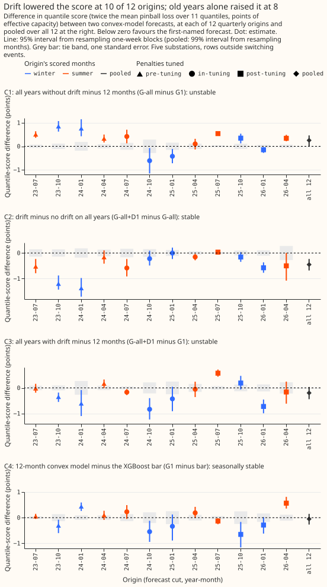
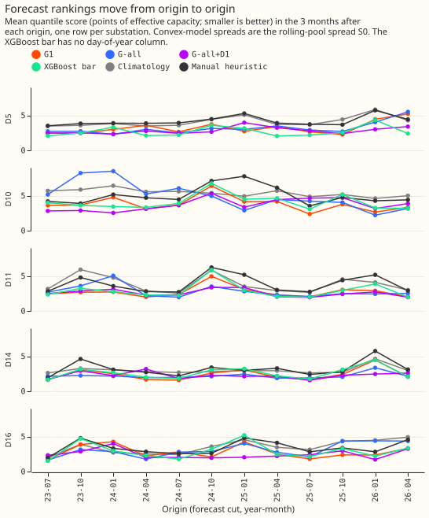
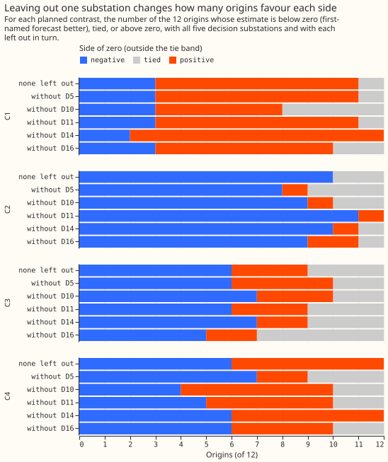
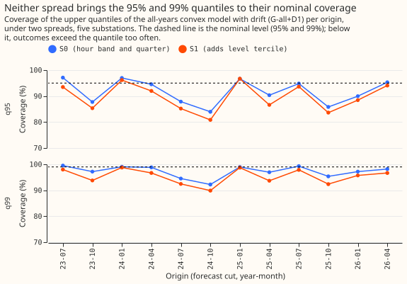
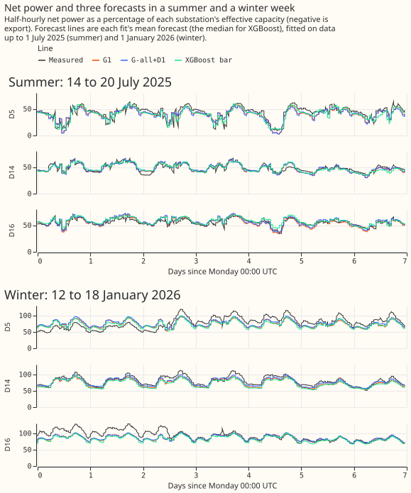
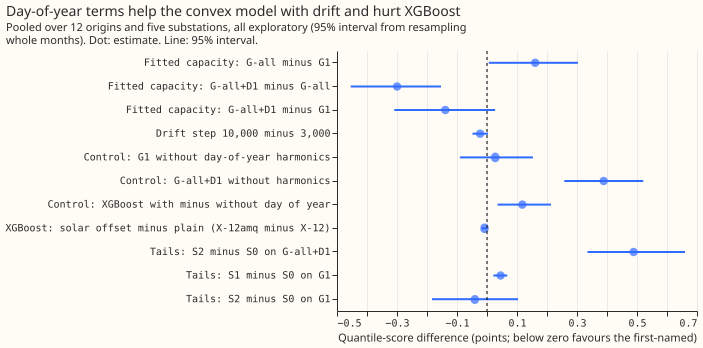
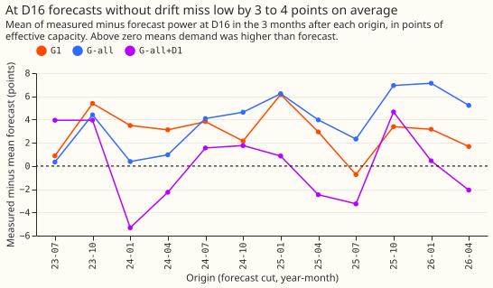
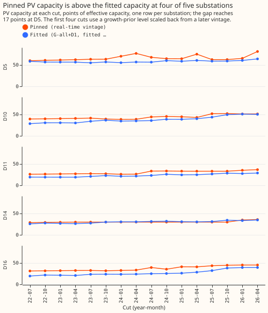

**Giving the convex model a drift term lowered the score at 10 of 12 quarterly refits, but the size
of the gain depends on one substation in one period.** The drift term lowered the quantile score by
0.45 points when trained on all years. In a post hoc split, about three-fifths of that size is one
substation (D10) at the 2023-24 origins, and the 2025-26 origins give 0.30, as experiment 104 found.
All years without drift raised the score at 8 of 12 origins and, in a post hoc split, the rise comes
from D10 at the 2023-24 origins and from D16 at the 2025-26 origins. All years with drift against
the last 12 months has no stable answer, because winter-quarter origins favour more years and
summer-quarter origins are level. The spread that splits the forecast into three level bands (S1)
did not fix the tails: the 95% and 99% quantiles still cover 91.8% and 97.3% of outcomes under the
baseline spread (S0) and less under S1. The verdict is `partly supported`.

We asked whether the two history contrasts of [experiment
104](../00104-differentiable-physics-2-simple-structural-model/result.md), which had reversed sign
between its tuning year and its scored year, keep one sign. We tested this by refitting a convex
model of demand minus solar output every quarter. The model was refitted at 12 quarterly cut dates,
called origins, from 1 July 2023 to 1 April 2026, and each fit was scored on the 3 months after its
origin, at five Primary substations (D5, D10, D11, D14, and D16). The two history contrasts are C1
(all years of history minus the last 12 months, with no drift term) and C2 (a drift term minus no
drift term, both on all years); C3 and C4 are defined in the table below. "D1" is the name of the
drift term, not a substation. We also asked whether a spread that depends on the forecast level
brings the upper quantiles to their nominal coverage. In the figures, "score" means the quantile
score: twice the mean pinball loss over 11 quantiles, in percentage points of each substation's
effective capacity, where lower is better.

**Figure 1 shows C2 below zero at 10 of 12 origins and C1 above zero at 8 of 12.** Each panel is one
planned contrast at the 12 origins, with a 95% interval from week blocks, the tie band (the grey
bar: a difference smaller than one week-block standard error counts as a tie), and the pooled
estimate at the right. C3 and C4 move with the season of the scored months.

**Figure 2 shows that no arm leads at every substation, and that climatology and the manual heuristic
trail the rest.** Arm scores run from 2.75 to 3.23; climatology scores 3.95 and the manual heuristic
3.92.

**Figure 3 shows that leaving one substation out changes the sign counts of C1, C2, and C4.** Without
D10, C1 has 3 negative, 5 positive, and 4 tied origins.

**Figure 4 shows that neither spread reaches the nominal 95% and 99% coverage at most origins.** The
spread by level band (S1) is below the baseline spread (S0) at most origins.

**Figure 5 shows the forecasts of the three arms plotted in one summer week and one winter week.**
They differ from one another by less than their gap to the measured power at D16 in the winter week.

**Figure 6 shows that day-of-year terms help the convex model with drift and hurt XGBoost.**

**Figure 7 shows that the forecasts without drift mostly miss low at D16.** The measured power is
above the forecast at 11 of 12 origins for G1 and 12 of 12 for G-all (`report.txt`).

**Figure 8 shows pinned photovoltaic (PV) capacity above the fitted capacity at every cut at D5, D10,
D11, and D16.** At D14 the two are close, and at the 2026-04-01 cut the pinned capacity is 17.2 points
above the fitted capacity at D5 (`checks_report.txt`).

## Terms used on this page

- **Origin:** a cut date at which a model is refitted on data up to that date; each fit is then
  frozen and scored on the 3 months after it. The four burn-in origins (2022-07 to 2023-04) only
  supply the first spread pools and are never scored.
- **Arms:** G1 (12 months of training data), G-all (all years), and G-all+D1 (all years plus the
  drift term D1), each with PV capacity pinned to a real-time estimate of
  [experiment 45](../00045-pvdis-4-weekly-capacity-asymmetric-l1/result.md); `-fc` means fitted
  capacity instead, and `-noharm` means without the two day-of-year harmonics. X-12 is lagless
  XGBoost on 12 months, X-12-nodoy is the same without the day-of-year column, and X-12amq adds a
  quantile start and the solar offset of
  [experiment 64](../00064-pvdis-5-net-demand-as-demand-minus-forecast-solar/result.md).
- **The bar:** the XGBoost benchmark the convex model has to beat, X-12-nodoy, chosen on the four
  burn-in windows before any scored window was read.
- **Spreads:** S0 is the centred residual spread of experiment 104, fitted on a rolling pool of the
  arm's own out-of-sample residuals over the 12 months before each origin. S1 splits the pool into
  three bands of the predicted level. S2 adds a split-conformal shift
  (conformal prediction: [Vovk et al. (2005)](https://doi.org/10.1007/b106715)) to S0.
- **Tie:** a difference smaller than one standard error from resampling the week blocks of one
  scored window. A contrast's label counts origins on each side outside the tie band.
- **Post-tuning and out-of-tuning:** experiment 104 tuned the penalties on 2024-07 to 2025-06, so
  the 4 origins of 2025-26 are post-tuning and strictly causal. The 8 out-of-tuning origins are the
  4 pre-tuning (2023-24) and 4 post-tuning ones; the 2024-25 origins are in-tuning.
- **Controls and other labels:** K1 is G1 without harmonics, K2 is G-all+D1 without harmonics, K3 is
  X-12 minus X-12-nodoy, and E7 (exploratory) is G1 minus X-12. The seed floor is the score change
  from changing only the random seed of an XGBoost fit. MAE is the mean absolute error of the mean
  forecast. ERA5 is the ECMWF reanalysis of past weather, and CAMS is the Copernicus Atmosphere
  Monitoring Service, whose irradiance estimates drive the solar term.

## Results

**Arms and rows.**

- **Convex arms** (nine, all at Part 2's tuned penalties: ridge 0.1, drift step 3,000): G1, G-all,
  and G-all+D1 with pinned capacity; the same three with fitted capacity; G-all+D1 with drift step
  10,000; and G1 and G-all+D1 without harmonics.
- **XGBoost arms:** X-12, X-12-nodoy (the bar), and X-12amq from the 2023-10-01 origin on. The bar
  scored 3.82 against 4.58 for X-12 over the four burn-in windows.
- **Why S2 is not interpreted:** the older windows hold no rows of the newest window's calendar
  quarter, so that quarter falls back to a band-level table about 3 points wider. The conformal
  shift calibrated on that wider table narrows every quarter's spread. The numbers stay in
  `report.txt` and are not read here.
- **Rows:** experiment 103's `dp_mw_v1` rows outside the hand-filtered switching events, 254,756
  half-hours at the five decision substations ([experiment
  103](../00103-differentiable-physics-1-data-look/result.md)). Fits are frozen from their origin to
  the next origin and run on the CPU. The predictions are stored as one set per arm and spread.
- **Past weather:** ERA5 temperature and CAMS irradiance, which exist only after the event, so every
  score is a ceiling for a forecast made on a weather forecast.
- **Not run:** D18 (its data start on 2025-03-01, so a 12-month pool of out-of-sample residuals cannot
  exist), and the bank-holiday, Christmas-run, and days-below-0°C rows, which were dropped to save
  time because no contrast or label depends on them.

**Absolute scores** (pooled over 12 origins and five substations; mean forecast error is measured
minus forecast, in points):

| Arm | Score | Mean forecast error |
|---|---|---|
| G-all+D1, drift step 10,000 | 2.753 | +0.137 |
| G-all+D1, fitted capacity | 2.768 | +0.014 |
| G-all+D1 | 2.776 | -0.018 |
| G1, fitted capacity | 2.907 | +1.046 |
| G1 | 2.972 | +1.495 |
| X-12-nodoy (the bar) | 3.024 | +0.911 |
| G-all, fitted capacity | 3.067 | +0.094 |
| X-12 | 3.142 | +0.994 |
| G-all | 3.227 | -0.118 |
| Manual heuristic | 3.917 | +0.919 |
| Climatology | 3.954 | -1.075 |

**Planned contrasts** (treatment minus reference; negative favours the treatment; 99% intervals
resample whole months; the subset columns are 95% intervals; "tied" means the difference is within
one week-block standard error; labels follow the pre-registered rule):

| Contrast | All 12 origins | 4 post-tuning (2025-26) | 8 out-of-tuning | Origins below / above / tied | Label |
|---|---|---|---|---|---|
| C1: G-all minus G1 | +0.255 [-0.003, +0.463] | +0.279 [+0.096, +0.432] | +0.447 [+0.299, +0.597] | 3 / 8 / 1 | unstable |
| C2: G-all+D1 minus G-all | -0.451 [-0.681, -0.232] | -0.295 [-0.520, -0.085] | -0.556 [-0.792, -0.326] | 10 / 0 / 2 | stable |
| C3: G-all+D1 minus G1 | -0.196 [-0.440, +0.037] | -0.016 [-0.345, +0.278] | -0.110 [-0.339, +0.102] | 6 / 3 / 3 | unstable: no stable answer |
| C4: G1 minus bar | -0.052 [-0.267, +0.148] | -0.115 [-0.430, +0.175] | -0.022 [-0.204, +0.155] | 6 / 6 / 0 | seasonally stable |
| C4b: G-all+D1 minus bar | -0.249 [-0.579, +0.048] | -0.131 [-0.569, +0.226] | -0.131 [-0.386, +0.111] | 5 / 4 / 3 | unstable |
| C5 (score): S1 minus S0 on G-all+D1 | +0.050 [+0.031, +0.069] | +0.042 [+0.022, +0.060] | +0.046 [+0.033, +0.061] | 0 / 11 / 1 | worse |

The origin-year split of all 12 origins is in the post hoc table below.

- **C1's driver changes with the origin year (post hoc).** G-all minus G1 is +0.611 over the 2023-24
  origins, -0.124 over 2024-25, and +0.279 over 2025-26. At the 2023-24 origins it is D10 (+2.978;
  +0.002 without D10). At the 2025-26 origins it is D16 (+1.292; +0.029 without D16), which
  reproduces experiment 104 (+0.25, and +0.03 without D16). Over all 12 origins, per substation, it
  is +1.139 at D10, +0.275 at D16, +0.087 at D11, -0.048 at D5, and -0.187 at D14. The pooled 99%
  interval's lower end sits at zero (-0.003).
- **C2 holds in every origin year, and its stable label survives on the 8 out-of-tuning origins
  (7 of 8 below zero).** Pre-tuning (2023-24) -0.813, in-tuning (2024-25) -0.243, and post-tuning
  (2025-26) -0.295 (each 95%, all excluding zero). Winter rows (November to March) -0.560 and other
  rows -0.377. **About three-fifths of the size comes from D10 at the 2023-24 origins (post hoc):**
  -3.931 there, and -0.011 for 2023-24 without D10. Leaving out D5, D10, or D16 drops the label from
  stable to unstable; leaving out D11 or D14 keeps it stable.
- **C3 has no stable answer.** Winter-quarter origins -0.461 [-0.736, -0.184], summer-quarter
  origins +0.058 [-0.129, +0.239]; rows from November to March -0.528 and from April to October
  +0.031. The pooled interval spans zero.
- **C4's lead over the bar is smaller than experiment 104's -0.25, and its interval spans zero.** G1
  minus X-12-nodoy is -0.052; against X-12 with the day-of-year column it is -0.170 [-0.334, -0.011]
  (E7, exploratory). Winter-quarter origins favour G1 (-0.279) and summer-quarter origins the bar
  (+0.166). G-all+D1 minus the bar is -0.249, with an interval that spans zero.
- **Seasonal labels:** C1 and C3 are not seasonally stable under the rule (C3 has 5 of 6
  winter-quarter origins below zero, but its summer-quarter origins are mixed); C4 is, with G1 ahead
  in winter and the bar ahead in summer.
- **The 2025-26 origins reproduce Part 2:** C1 +0.279 [+0.096, +0.432] (Part 2 +0.25), C2 -0.295
  [-0.520, -0.085] (-0.29), C3 -0.016 [-0.345, +0.278] (-0.04).
- **D10 with its two jump windows masked** (training and scoring; the X-12amq arm keeps D10
  unmasked): C2 -0.512 [-0.728, -0.306] with 11 of 12 origins below zero, C1 +0.274 [+0.059,
  +0.474], C3 -0.238 [-0.480, +0.000], and C4 -0.034. No label changes.

**Post hoc, by origin year** (mean difference in points; the error of the mean forecast is in
`report.txt`):

| Contrast | 2023-24 | 2024-25 | 2025-26 | 2023-24 without D10 | 2025-26 without D16 |
|---|---|---|---|---|---|
| C1 | +0.611 | -0.124 | +0.279 | +0.002 | +0.029 |
| C2 | -0.813 | -0.243 | -0.295 | -0.011 | -0.088 |
| C3 | -0.202 | -0.367 | -0.016 | -0.009 | -0.058 |

**Tail model (C5) fails.** S1's coverage is 89.7% at q95 and 95.4% at q99, further from nominal than
S0's 91.8% and 97.3%, and its score is worse at 11 of 12 origins. All four of the pass rule's
conditions fail: pooled coverage within 1 point of nominal, 4 of 5 substations within their
tolerance band, lower tails no worse, and the upper end of the score contrast's interval at most
+0.03. From 2024-07-01 on, S1's coverage gaps (coverage minus nominal) are -6.3 points at q95 and
-4.3 at q99. The baseline spread meets the pre-registered prediction of 89 to 93% at q95 and 95 to
98% at q99.

| Arm and spread | q01 | q05 | q95 | q99 | Pinball at q01, q05, q95, q99 |
|---|---|---|---|---|---|
| G-all+D1, S0 | 3.9 | 10.0 | 91.8 | 97.3 | 0.232, 0.729, 0.732, 0.220 |
| G-all+D1, S1 | 5.4 | 11.6 | 89.7 | 95.4 | 0.258, 0.756, 0.786, 0.280 |
| G1, S0 | 2.2 | 6.1 | 85.8 | 94.2 | 0.189, 0.668, 0.920, 0.327 |
| G-all, S0 | 6.7 | 12.9 | 87.4 | 94.7 | 0.345, 0.917, 0.873, 0.288 |
| X-12-nodoy | 1.3 | 11.1 | 82.5 | 97.8 | 0.243, 0.732, 1.013, 0.339 |
| Climatology | 2.0 | 6.3 | 94.6 | 98.0 | 0.226, 0.864, 0.977, 0.265 |
| Manual heuristic | 9.0 | 11.0 | 80.8 | 83.6 | 0.417, 0.893, 1.223, 0.754 |

Cells are the percentage of outcomes at or below the quantile (nominal 1, 5, 95, and 99). The
per-site pinball losses and per-origin-year coverage are in `report.txt`. The curtailment-cost
saving is not computed: these are demand substations, and the metric scores generators.

**Controls and replication** (the same contrasts with fitted capacity):

- **The calendar controls move the score.** K2 is +0.389 [+0.258, +0.521] (tied at 1 of 12 origins)
  and K3 is +0.118 [+0.035, +0.213] (tied at 4); both 95% intervals exclude zero. K1 is +0.027
  [-0.090, +0.153] and fails the pre-registered rule that a control changes nothing only on its tie
  count (tied at 2 of 12).
- **Replication:** with fitted capacity, G-all minus G1 shares C1's sign at 12 of 12 origins, the
  drift contrast shares C2's at 8 of 12, and G-all+D1 minus G1 shares C3's at 10 of 12. Pinning
  capacity did not lower G1's or G-all's score (2.972 against 2.907, and 3.227 against 3.067 with
  fitted capacity), and left G-all+D1's almost unchanged (2.776 against 2.768).
- **Drift step 10,000 against 3,000** is -0.023 [-0.048, +0.003]. XGBoost's seed floor, the score
  change from changing only the random seed, is 0.006.
- **X-12amq minus X-12** is -0.008 [-0.019, +0.001]: the solar offset adds nothing measurable. Its
  fitted weight per site and origin is in `report.txt`.

## Checks

- **Median forecast minus mean forecast, per site:** exactly 0.000 for every arm with S0 or S1,
  because the centred spread has a zero median, and for XGBoost, whose mean forecast is its median.
  The check therefore cannot expose a shifted forecast here. The mean forecast error in the
  absolute-score table does: G1 misses low by +1.495 points and the bar by +0.911, while G-all+D1
  is unbiased (-0.018).
- **Error of the mean forecast beside each score contrast** (the mean absolute error, pooled, at the
  same interval level as the score): C1 +0.351 [+0.007, +0.644]; C2 -0.644 [-0.959, -0.334]; C3
  -0.293 [-0.675, +0.088]; **C4 +0.093 [-0.209, +0.385], which has the opposite sign to C4's score
  (-0.052)**; C4b -0.201 [-0.687, +0.242]; C5 0. At no origin do the score contrast and the
  error-of-the-mean contrast fall on opposite sides of zero.
- **Leaving one site out:** changes C1's counts (without D14: 2 below, 10 above; without D10: 3, 5,
  4 tied) and drops C2's label from stable to unstable without D5, D10, or D16; see Figure 3 and
  `report.txt`.
- **Blocking checks, all passed** (`checks_report.txt`): the fitted-capacity arms reproduce
  experiment 104 (0.0 difference over 22,080 rows each), no lookahead (every row in its window, no
  D1 knot after its cut, no pool row after its origin), the pool rule (60 of 60 fitted tables
  unchanged when data after the origin change, and S0 moves when the pool changes), and the pinned
  capacity source per cut and substation (87 rows: the five decision substations at their 16 cuts,
  plus D9 at its 7 cuts; 22 growth-prior, 6 early-vintage, 59 vintage). Two of the checks are
  partly tautological: the knot-layout check rebuilds the layout instead of reading the fitted one,
  and the pool check perturbs S0 only.
- **Audit triggers.** The plan lists seven conditions that need an explanation: 1 controls fail, 2
  contradictions, 3 score and mean-error contrasts differ in sign, 4 leaving one site out flips a
  label, 5 a nested arm wins (an arm that contains the training data of another does worse), 6 an
  interval is much wider than experiment 104's, and 7 a later experiment depends on the result.
  **Triggers 1 to 6 fired.**
    1. **Controls fail.** K2 and K3 move the score, K1 fails the tie-count rule, and C2's replication
       shares sign at 8 of 12 origins.
    2. **Contradictions, three of them.**
        - **C1's driver** depends on the origin year (see above); the 2025-26 origins reproduce
          experiment 104's D16 finding.
        - **C2's size:** the pooled -0.451 is larger than predicted (-0.05 to -0.20) and than Part
          2's -0.29. Post hoc, the excess comes from the 2023-24 origins, mostly D10 (-3.931 there;
          -0.011 without D10), and the 2025-26 origins give -0.295.
        - **The tuning-year replicate:** experiment 104 found drift +0.06 on the error of the mean
          forecast from one frozen year, and here the 2024-25 origins give -0.434 on the same
          metric. G-all minus G1 does reproduce on that metric (-0.146 here against -0.25). The
          explanation that quarterly refits keep the drift level current is a hypothesis, not
          tested.
    3. **Score and mean-error contrasts differ in sign (C4)**, and both 99% intervals span zero. The
       pre-registered prediction expected the lead to be in the spread, with the mean-error contrast
       within 0.10 (+0.093 held).
    4. **Leaving one site out** drops C2's label from stable to unstable without D5, D10, or D16,
       and changes C1's counts. Without D10 the 2023-24 gain disappears (post hoc); D5 and D16 carry
       the largest 2025-26 gains (-0.907 and -1.137).
    5. **A nested arm wins.** G-all contains the training years of G1, yet G1 scores better than
       G-all (C1), with the driver above, and the calendar controls move the score.
    6. **Interval width.** C2's 95% interval on the 2025-26 origins is 0.435 wide against 0.16 for
       experiment 104, a ratio of 2.7; C1's interval is 0.336 wide against 0.32. Four separate
       quarterly fits add variance between quarters that one frozen fit does not have (a post hoc
       explanation, not tested).

## Pre-registered decision rule

- **Verdict:** `supported` needed both C1 and C2 stable; `partly supported` applies when exactly one
  is stable (here C2). Stable means 10 of 12 origins on one side outside the tie band, 3 of 4 in
  each origin year, and a 99% interval excluding zero. A stable label survives on the 8
  out-of-tuning origins if at least 7 of them lie on its side (C2 has 7 of 8). Cochran's Q test
  ([Cochran (1954)](https://doi.org/10.2307/3001666)) marks every contrast "sign varies" because
  the per-origin standard errors count only within-window noise, so it did not decide any label
  here.
- **Tie bands** are one week-block standard error per origin, from a fixed rule. They were computed
  in the same run as the sign tables, and their hash is in `decisions.json`.

## Pre-registered predictions and what happened

- **C1** not stable, 3 or more ties, interval spanning zero, D16 out moves it by 0.10: unstable, and
  the interval's lower end is -0.003 (borderline), but 1 tie, and D16 out moves it 0.005 over all 12
  origins (0.250 over the 2025-26 origins). **Failed in part.**
- **C2** negative at 7 to 11 origins, most in winter, pooled -0.05 to -0.20: 10 origins, winter larger
  (-0.592 against -0.315), pooled -0.451. **Held except the size.**
- **C3** negative at 4 or more of 6 winter-quarter origins, pooled -0.05 to -0.20: 5 of 6 negative,
  pooled -0.196. **Held.**
- **C4** negative at 8 or more of 12, pooled -0.10 to -0.30, mean error within 0.10: 6 of 12, -0.052,
  and the mean-error half held (+0.093). **Failed in part.**
- **C5** S0 coverage 89 to 93% at q95 and 95 to 98% at q99, S1 passes: S0 91.8% and 97.3%; S1 fails.
- **Controls and replication:** the seed floor and the replication of C1 (12 of 12) and C3 (10 of 12)
  held; C2's replication (8 of 12), the three calendar controls, and the step-10,000 tie (1 of 12)
  failed.
- **Run time:** the convex grid took 90 seconds and all fits about 15 minutes.

## Caveats

- **Past weather** (ERA5 and CAMS) at forecast time is a ceiling.
- **Penalties:** Part 2's penalties were tuned on 2024-07 to 2025-06, so the 2023-24 origins have a
  lookahead and the 2024-25 origins are in-sample; only 4 origins are strictly causal.
- **Burn-in and the first vintage:** the first four origins use a hindsight capacity level, and the
  2023-07-01 origin uses a vintage dated 37 days later.
- **Spread pools** describe the site 9 to 12 months before the origin, so a drifting level can bias
  them. The quarter groups are the calendar quarter of each row's local date; 2 of the roughly
  4,400 rows of a scored window fall in the next quarter's group.
- **Hindsight switching masks** apply to training and scoring. Refits are quarterly, not weekly.
- **The harmonic controls** zero the harmonic design columns inside the experiment's script rather
  than through the framework module.
- **Reference rows:** the manual heuristic counts an analogue only if it ended before the origin.
- **The post hoc tables** (by origin year, per site, without D10 or D16) were added after the first
  look at the results and carry no interval.

## What to try next

- **Quote C2 as stable only with its caveats:** the gain is concentrated in D10 at the 2023-24
  origins, and leaving out D5, D10, or D16 drops the label. A later experiment could test the
  hypothesis that quarterly refits restore the drift gain that one frozen year lost.
- **Replace the 12-month G1 against all-years contrast** with a per-season one, since the sign
  follows the winter and summer split.
- **For tails,** try a spread that widens with the age of the fit or with the weather forecast's
  error, because conditioning on the predicted level (S1) lowered coverage. The conformal shift
  needs a rebuilt test with a base table of the same kind on both sides.

The code is in `ml-experiments/00107-differentiable-physics-rolling-origin-history-and-tails/`; the
printed report is `report.txt`, the D10-masked variant is `report_d10_masked.txt`, and the bar
choice and tie-band hash are `decisions.json`. To reproduce: run `e00107_gam.py`, `e00107_xgb.py`
(both with `--variant base`, then `d10_masked`), `e00107_decisions.py`, `e00107_assemble.py`
(`--variant base` then `d10_masked`), `e00107_references.py`, `e00107_checks.py`, `e00107_score.py`
(both variants), and `e00107_charts.py`.
