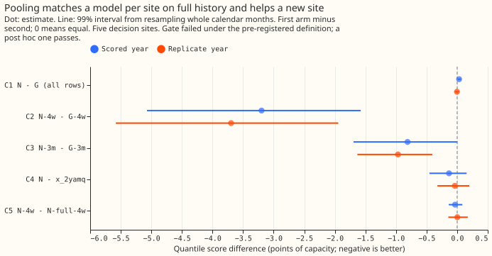
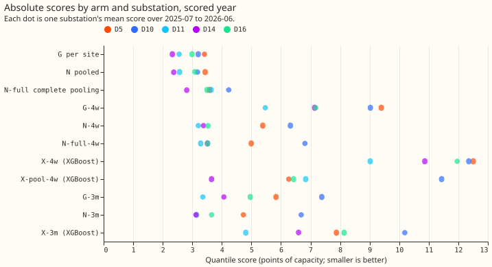
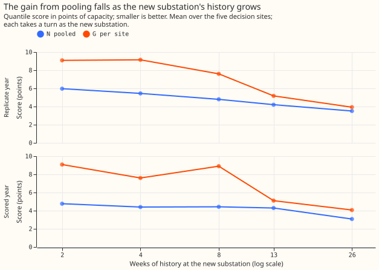
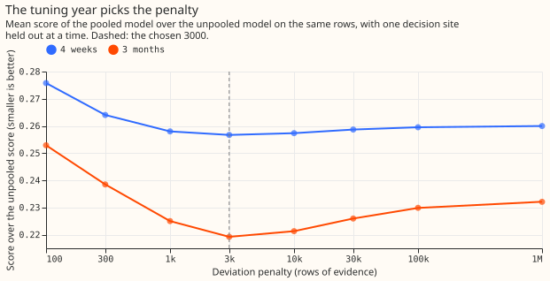
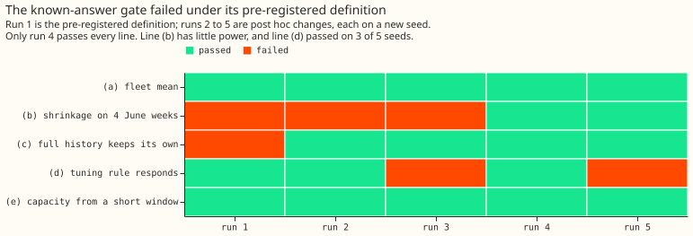
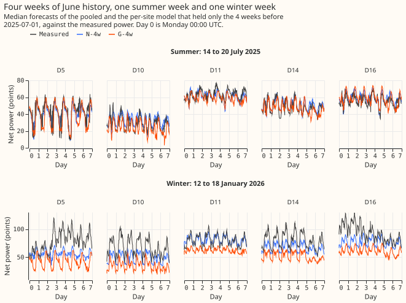
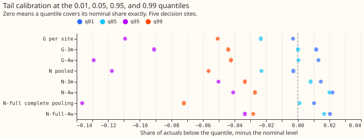
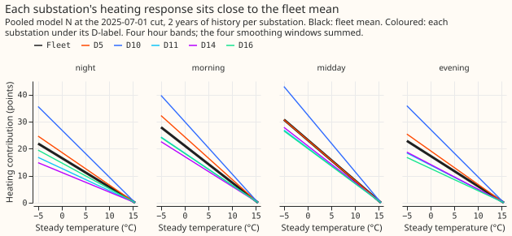
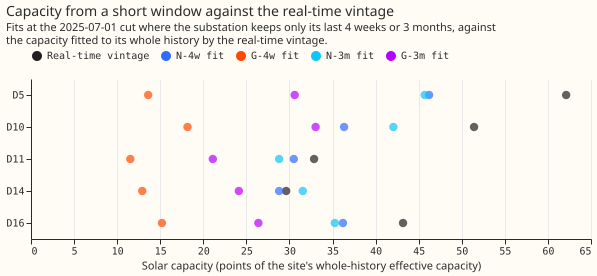

# Differentiable physics, N0: a partially pooled convex model across substations

**A single convex model shared across substations forecast a new substation far better than a model
fitted to that substation alone, and cost almost nothing where history is long.** We asked whether
the convex demand-minus-solar model of part 2 can be fitted to several Primary substations at once,
with each substation keeping its own coefficients but pulled towards a **fleet mean** (the average
of the substations' coefficients). The pull is a ridge penalty on each substation's difference from
the fleet mean, which is called **shrinkage** because a larger penalty shrinks the differences. A
model with these properties is **partially pooled**; a model that gives every substation the same
coefficients is **completely pooled**. We then pretended each of six substations was new in turn,
gave it only its last 4 weeks (June 2025) or its last 3 months of readings, kept 2 years for the
others, and scored the next 12 months. Experiment 105's neural pooled model lost to per-site models
when history was long; this experiment asks whether the loss came from the neural fit.

**The answer is no.** On the five decision substations (D5, D10, D11, D14, and D16), the pooled
model N scored 0.03 points worse than the per-site convex model G with 2 years of history (a lower
score is better; the plan's margin was 0.10). With 4 weeks of history N scored 3.2 points better
than G (4.40 against 7.60), with 3 months 0.8 points better, in both the scored year and the
replicate year, at all five decision substations. N matched lagless XGBoost on full history (0.13 points
better, interval spanning zero). Complete pooling did as well as partial pooling at 4 weeks.
**The verdict is `inconclusive`** because the known-answer gate failed under its pre-registered
definition (see "The known-answer gate"). Applied to the numbers alone, the plan's rule gives
`supported`.

All five contrasts that decide the verdict are in figure 1. The 6 held-out substations, the cut
(2025-07-01), the 4-week and 3-month windows, and the scored rows are those of experiment 105, so
the two experiments compare directly; the rows agree (X-4w scores 11.15 here on six sites against
11.30 there). Every number below is labelled "gate failed (a post hoc redefinition passes)".

## Figures

## Arms, rows, and what was fitted

- **Model.** The convex model of `studies.dp_gam`, fitted jointly by `studies.dp_gam_pooled`: each
  substation's coefficient vector is the fleet mean plus a deviation under a ridge penalty of
  `lambda` rows of evidence. At `lambda = 0` the fit is the per-site model G exactly (a module
  test). The profile, holiday, Christmas, harmonic, heating, and lighting coefficients pool; each
  substation's band means and its solar capacity do not. Complete pooling (N-full) ties the pooled
  coefficients exactly.
- **Arms.** G (per site), N (`lambda* = 3,000`), N-full; for a new substation N-4w, G-4w,
  N-full-4w, N-3m, G-3m, and the onboarding curve at 2, 8, and 26 weeks; N-4w-pin and G-4w-pin
  (the vintage capacity, an oracle leak) and N-4w-cappool; XGBoost X-4w, X-3m, and X-pool-4w (one
  site-agnostic model on the other sites plus the new site's 4 weeks). Every arm is one frozen fit
  per cut with one seed, in the screening tier.
- **Rows.** The D5, D9, D10, D11, D14, D16, and D18 Primaries with usable rows (lockdown and the 66
  hand-filtered transfers out), a 2-year window before each cut, no drift, and the day-ahead
  initialisation (09:00 UTC the day before). Cuts: 2023-07-01 (tuning), 2024-07-01 (replicate),
  2025-07-01 (scored), and 2025-02-01 (winter onboarding).
- **Capacity.** Pinned to the real-time vintage (Part 4's rule), except where the vintage is fitted
  long after the cut: D9 at the replicate cut and D18 at the scored cut, where the capacity is
  fitted from the site's own earlier rows in N and G alike. The new substation fits its capacity
  from its own short window. The 2023-07-01 cut reads the earliest vintage, a 5-week leak that
  touches only the tuning choices.
- **Scale.** A new substation's points of effective capacity are rebuilt from its window (the 99th
  percentile of the absolute power in the window's usable rows, without lockdown or switching
  rows), in N and G alike, and forecasts convert back to whole-history points before scoring. The
  rebuilt capacity was 1.09 to 2.04 times smaller than the whole-history capacity in the June
  windows and 0.91 to 1.01 in the January windows.
- **Spread.** Each full-history site takes the median-centred residual quantiles of its own replica
  fit 12 months earlier. A new substation takes the residuals of each other decision site from the
  replica fits in which that site was the new one with the same weeks of history.
- **Tuning (2023-24 only).** `lambda*` is 3,000 rows: the value that minimises the mean of the
  4-week and 3-month score ratios subject to the all-rows score staying within 0.02 points of G's.
  At `lambda*` the ratios were 0.257 and 0.219 and the all-rows cost +0.015 points. The all-rows
  score alone prefers `lambda = 0`, and the median-error rule picks 3,000 as well. The per-site
  comparator's own short-history ridge is 10 for both histories.

## Results

- **C1, pooling on all rows (N minus G): +0.032 (99% interval +0.010 to +0.060), 1 of 5 sites
  better; replicate -0.003 (-0.038 to +0.030), 3 of 5.** N passes non-inferiority in both years.
  The cost sits in November to March (+0.069) rather than April to October (+0.008). Without D16
  the scored estimate is +0.015.
- **C2, 4 weeks (N-4w minus G-4w): -3.20 (-5.07 to -1.58), 5 of 5; replicate -3.70 (-5.58 to
  -1.94), 5 of 5.** The gain is -5.40 in November to March and -1.77 in April to October.
  N-4w scored 4.40 and G-4w 7.60.
- **C3, 3 months (N-3m minus G-3m): -0.81 (-1.69 to +0.004), 5 of 5; replicate -0.97 (-1.63 to
  -0.41), 5 of 5.** The scored interval's upper end is 0.004 above zero.
- **C4, against lagless XGBoost (N minus X-2yamq, the better of the two on the tuning year by
  0.0003 points): -0.13 (-0.45 to +0.15), 3 of 5; replicate -0.04 (-0.32 to +0.20), 3 of 5.**
  N matches the XGBoost bar on full history.
- **C5, partial against complete pooling for a new site (N-4w minus N-full-4w): -0.03 (-0.14 to
  +0.09), 3 of 5; replicate +0.00 (-0.14 to +0.17), 2 of 5.** The penalty does not matter at 4
  weeks.
- **Complete pooling on full history costs 0.64 points** (N-full minus N, 95% interval 0.38 to
  0.98; replicate +0.42, 0.23 to 0.66), 0 of 5 sites better.
- **Against experiment 105 (95% intervals, scored year, all rows).** N minus P is -0.51 (-0.85 to
  -0.25), 5 of 5 sites; N minus S is -0.12 (-0.26 to +0.02), 3 of 5. On the six held-out sites
  with 4 weeks, N-4w scored 4.22 against 4.18 for P, and G-4w 7.30 against 15.13 for the per-site
  neural model; with 3 months, N-3m 4.06 against 4.38 and G-3m 4.70 against 5.47. The neural
  per-site model was the weak comparator, not the convex one.
- **The onboarding curve (N minus G, scored year).** -4.31 at 2 weeks, -3.20 at 4, -4.48 at 8,
  -0.81 at 3 months (14 weeks), and -0.99 at 26 weeks; replicate -3.12, -3.70, -2.80, -0.97, and
  -0.42. N's gain falls by more than half between 4 and 26 weeks.
- **Winter onboarding (4 weeks ending 2025-01-31, scored to 2026-01-31).** N-win4w minus G-win4w is
  -2.18 (-3.18 to -1.25), 5 of 5, so the gain survives a window that holds heating.
- **Oracle and capacity arms.** With the vintage capacity (an oracle leak), N-4w-pin scored 4.18
  and G-4w-pin 6.85, a gap of -2.67 (-3.94 to -1.49); the pooled model also gains where the
  capacity is known. Shrinking the new site's capacity towards the other sites' median
  (N-4w-cappool) changed N-4w by -0.01 (-0.02 to 0.00).
- **Against XGBoost on a new site.** N-4w minus X-4w is -6.90 (-10.50 to -3.61), N-3m minus X-3m
  -3.21 (-5.25 to -1.42), and N-4w minus the pooled XGBoost X-pool-4w -2.55 (-4.08 to -0.77); in
  the replicate year the last gap is -1.32 (-3.52 to +1.07).
- **References.** N minus climatology -1.15 (-1.39 to -0.89) and N minus the manual heuristic
  -0.57 (-0.85 to -0.25), both 5 of 5 sites. N is 0.54 points worse than lagged XGBoost at 24.5 to
  48 hours (0.31 to 0.84), which has power lags that N lacks; the pairing is on valid time.
- **N-2lambda.** Eight alternative heating and other-family penalties (a tenth to ten times
  `lambda*`) moved the score by -0.03 to +0.11 points; a tenth of `lambda*` for the non-heating
  families was best, at -0.03 (-0.04 to -0.01).

## Predictions against outcome

- **`lambda*` between 1,000 and 30,000 rows: held** (3,000).
- **C1 within -0.10 to +0.05 in both years, D16 moving it under 0.05: held** (+0.032, -0.003;
  +0.015 without D16). The interval half-width is 0.025.
- **C2 between -0.5 and -2.0, interval below zero, 5 of 5 sites both years, over two-thirds in
  November to March: partly held.** The estimate is larger than predicted (-3.2 and -3.7). The
  November-to-March share is 0.69 by rows.
- **C3 between -0.2 and -1.0, interval below zero, 4 of 5 sites: partly held.** The estimate and
  the sites held; the scored interval reaches +0.004.
- **C4 between -0.1 and -0.4: held** (-0.13).
- **C5 between -0.05 and -0.3: did not hold** (-0.03; complete pooling is as good).
- **N beats P by 0.3 to 0.6 and S by 0.0 to 0.3: held** (0.51 and 0.12).
- **N-full minus N between +0.2 and +0.8: held** (+0.64).
- **N's gain over G halves by 26 weeks; N-win4w gains less than C2: held** (-0.99 against -3.20;
  -2.18 against -3.20).
- **Tails: did not hold for full history.** N's q01 and q05 coverage was 0.7% and 2.7%, within 3
  points of nominal, but q95 and q99 were 83.2% and 93.4% (replicate 79.9% and 90.7%). N-4w's
  upper-tail coverage in November to February was nearer nominal than G-4w's (0.794 against
  0.562, held).
- **Run time: held.** Each gate run took 7 to 9 minutes, the tuning about 10 minutes, and the
  convex fits and the XGBoost arms each under an hour on 6 cores.

## The known-answer gate

**Under the pre-registered definition the gate failed, and a post hoc redefinition passes on one
seed.** The gate is synthetic: eight substations on the real calendar and weather of the MW
Primaries, with a known fleet mean and known deviations, and noise taken as whole weeks of residuals
from a different substation. It ran four times on four fresh seeds, and all four runs are in this
folder (`gate_run1.json` to `gate_run4.json`, `gate_runs.csv`).

| Line | Run 1 | Run 2 | Run 3 | Run 4 |
|---|---|---|---|---|
| (a) fleet mean within 10% and 0.5 points | pass | pass | pass | pass |
| (b) shrinkage on 4 June weeks | fail | fail | fail | pass |
| (c) full history keeps its own coefficients | fail | pass | pass | pass |
| (d) the tuning rule responds to the fleet | pass | pass | fail | pass |
| (e) capacity from a short window | pass | pass | pass | pass |

- **Run 1** measured shrinkage on raw heating coefficients against the plan's closed form. The four
  smoothing windows of each heating band are nearly collinear, so coefficients are shrunk far harder
  than predictions (a review of the module found the same on real data): (c) read 0.75 and (b)
  0.05 against 0.26.
- **Run 2** measured the slope on the heating contribution to the prediction, a change made on that
  review's advice before the run. (c) passed (1.01); (b) failed (0.21 against 0.68).
- **Run 3 (post hoc).** After runs 1 and 2 the closed form was replaced by one that accounts for
  the multi-day persistence the plan puts in the noise. It failed again (0.04 against 0.79), and
  (d) failed too: with every between-site spread a tenth, the tuned penalty rose only 3.3 times
  (300 to 1,000) rather than 10.
- **Run 4 (a second post hoc change).** The reference became the joint posterior mean of an oracle
  that estimates every pooled coefficient from the same 4 weeks and knows none of them. (b) passed:
  the slope was 0.17 against the oracle's 0.15, and the heating error 2.40 against 2.97.
- **Weaknesses of the pass.** The oracle's heating error is larger than the pooled fit's, which an
  oracle cannot be if its independent-noise assumption held, so the error half of line (b) is weak.
  Line (d) passed on 3 of 4 seeds. The tuned single penalty shrinks heating harder than a
  heating-only oracle would (a sweep in `gate_run4.json` shows the heating error flat from 300 to
  1,000 rows and the slope falling), which the exploratory N-2lambda arms then tested on real data
  and found to matter by at most 0.03 points.

## Checks

- **Median forecast minus mean forecast, per site.** Zero at every site and arm (report section
  "Median forecast minus mean forecast"). This holds by construction, because every spread is
  centred on its median.
- **Error of the mean forecast beside each contrast (mean absolute error, five sites, scored
  year).** C1 +0.037 (quantile score +0.032), C2 -5.50 (-3.20), C3 -1.73 (-0.81), C4 +0.007
  (-0.13), C5 -0.030 (-0.034). The error of the mean agrees in sign except for C4, where both are
  within 0.13 of zero.
- **Leaving one site out.** C1 to C3 keep their sign in both years whichever site is left out
  (C1 between +0.015 and +0.046 scored, C2 between -3.44 and -3.04, C3 between -0.97 and -0.70).
  C4 changes sign without D10 in the replicate year (+0.059), and C5 changes sign without D10 in
  both years (+0.069 scored, +0.094 replicate); both are near zero with intervals spanning zero.
- **Audit triggers.** Fired: **trigger 1** (the gate's blocking line failed under the
  pre-registered definition); **trigger 3** for C4 only, as above; **trigger 4** for C4 and C5
  (D10, near-zero contrasts that carry no verdict); and **trigger 7** (the next pooled experiments
  start from N). **Trigger 2** is partly met: C2's estimate exceeds its predicted range, which the
  plan review expected because a per-site model fitted to 4 June weeks has almost no heating
  evidence and is a straw man in winter (the November-to-March gain is 5.4 points), and C5 and the
  tails fall short of their predictions. **Trigger 5 did not fire:** on the tuning year N is 0.015
  points worse than G and 0.2 better than the penalty of 1,000,000 rows that approximates
  complete pooling, so it does not lose to both, and the
  `-pin` and capacity controls moved the contrast by less than its interval. **Trigger 6 did not
  fire in the expected direction:** C1's interval is about 10 times narrower than experiment 105's
  (+0.18 to +0.69), as nested convex fits without seed noise should give. A fresh Opus audit runs
  before the prose review.

## Substation cards (provisional)

- **Heating is the family the penalty moves most.** At `lambda*` the pooled fit removes 35% to 72%
  of each decision substation's difference from the fleet mean in the heating coefficients (D10
  35%, D11 49%, D16 51%, D5 62%, D14 72%), 15% to 43% in the profile shape and the harmonics, and
  0% to 75% in the lighting ramps. D10's heating response stays the steepest of the five (figure 8).
- **Capacity from 4 weeks.** The pooled 4-week fit gave 0.70 to 0.97 of the real-time vintage's
  capacity (D5 46 against 62 points, D10 36 against 51, D11 30 against 33, D14 29 against 30, D16 36
  against 43), while the per-site 4-week fit gave 0.22 to 0.40 (figure 9).

## Caveats

- **The gate failed under its pre-registered definition**, so every number carries the label "gate
  failed (a post hoc redefinition passes)" and the verdict is capped at inconclusive.
- **ERA5 and CAMS are estimates of past weather** and flatter the solar term; the main 4-week window
  is June, so C2 tests the transfer of heating and the daily profile more than solar output.
- **The masks and the 66 transfers are hindsight labels**, a mild leak shared by every arm. The
  2023-07-01 cut reads the earliest vintage (5 weeks of hindsight), and D9 at the replicate cut and
  D18 at the scored cut fit their capacity from their own rows because their vintage is later than
  the cut.
- **The joint refit is not a frozen-module onboarding.** The convex joint fit is exact and cheap,
  so each new substation entered a refit of the whole pool; the result does not transfer to
  onboarding a frozen model.
- **The new substation's scale is rebuilt from its window**, which makes its points larger in a
  June window (by 9% to 104%). If the whole-history scale had been used the pooled gain would likely
  be larger, because pooling in points leans on the scale being right.
- **The tails are under-dispersed for full histories.** The spread comes from one replica year, so
  q95 and q99 covered 83% and 93% of the scored year.
- **Not run.** The marginal-likelihood `lambda` arm (N-ml), D18 as a short-history substation, and
  Part 4's X-best arm (the C4 bar is the 2-year XGBoost). The literal "fleet mean shape scaled to
  the new site's 4-week level" baseline was not built; N-full-4w is the closest arm, and it also
  frees each site's band means from its 4 weeks. The `lambda` scale `g_f` is the pre-registered
  mean diagonal per family, so "rows of evidence" is approximate for the holiday and Christmas
  families (the gap to complete pooling at `lambda` 1e6 is 23% and 26% of its size at 1e4, against
  5% to 13% for the others).

## What the next experiment should answer

**Whether a pooled convex model with a better spread keeps these gains where it matters for
curtailment.** The upper tail, where curtailment is decided, is under-covered for full histories,
and a spread that is fitted to a longer or pooled replica should be tested first. A 4-week
substation needs no tuned penalty (complete pooling suffices), which narrows the start of a joint
demand model across substations to a fleet-shared shape plus per-site band means and capacity. The
gate should be rerun with a better-posed oracle before any production port.
