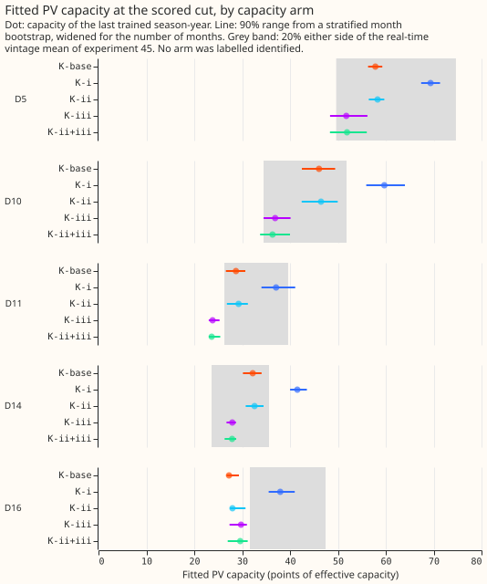
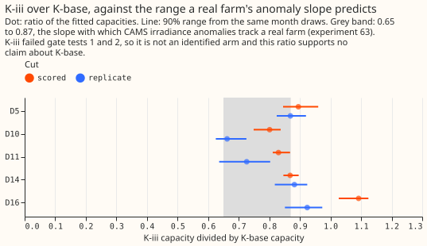
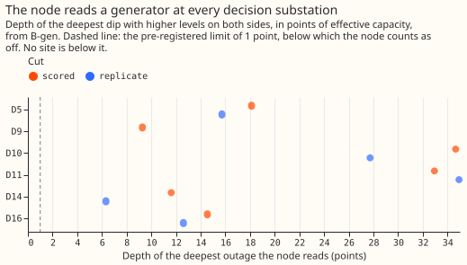
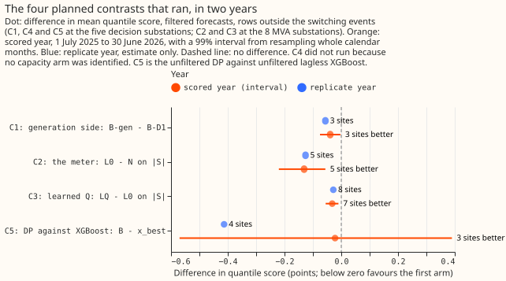
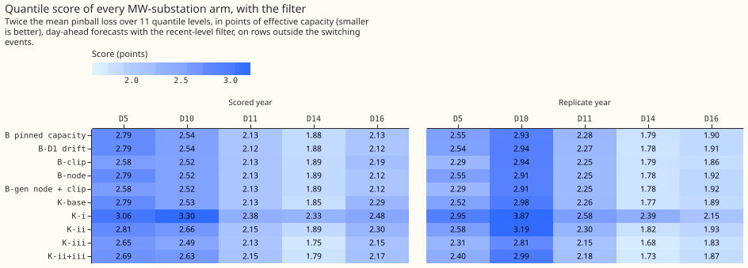
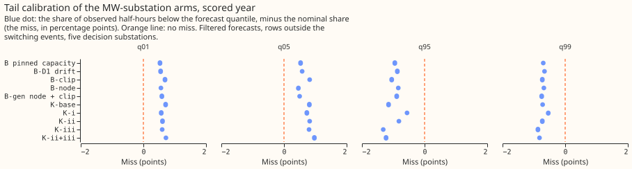
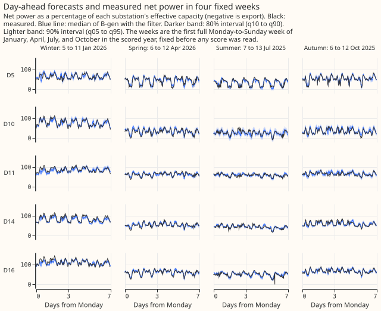

# Differentiable physics, part 5: embedded generation, the MVA meter, and identifying PV capacity

**Take-home message: the convex model could not yet represent the generation side of a Primary
substation, and its fitted solar capacity is not identified.** The MVA meter layer forecast apparent
power slightly better than reading the meter as real power (0.13 points of capacity, 5 of 8
substations better). Capacity fitted from the data was not precise enough, or not close enough to
the capacities known in real time, for any of the three tested arms to be called identified. The
unmetered generator node reported a generator of 6 to 35 points at all five decision substations,
and the export clip's ceiling sat below the grid top at the one substation where clipping is known.
The verdict is `inconclusive`, and the pinned capacity stays in place for Part 6.

**What this means for the forecast.** Adding the node and the clip did not harm the filtered MW
forecast at the five decision substations (C1 passes: −0.04 points, 99% interval −0.08 to −0.003,
both years). The node and the clip do harm the unfiltered forecast (+0.27 points in the scored year
and +1.57 in the replicate year), because an unfiltered forecast cannot correct a wrong level. The
only forecast gain from this part is the clip at the one substation known to clip: −0.21 points (95%
interval −0.32 to −0.10) at that substation.

**Next step.** Keep capacity pinned. Use the MVA layer L0 for MVA substations (it is at least as
good as the real-power reading), keep the learned reactive power out (C3 is −0.03, short of the
−0.10 bar), and leave the node and the clip behind their switches. A follow-up on capacity should
start from the finding that K-iii, the arm that closes the routes by which demand terms imitate
solar, recovered only 0.72 of an injected farm's capacity in the gate, so closing those routes is
not enough on its own.

## Checks

- **The pre-registered verdict rule gives `inconclusive`.** C1 passes, but no component passes: the
  layer fails gate test 3, the node's real-data clause fails (depth of 6 to 35 points, where the
  clause needs under 1 point at 4 of 5 substations), and the clip fails gate test 5 and leaves the
  ceiling below the grid top at D5 and D16.
- **Gate results.** Tests 1 and 2 pass for K-base, K-i, and K-ii and fail for K-iii and K-ii+iii.
  Test 3 (meter) fails. Test 4 (node) failed as pre-registered and passed after a post hoc redesign
  of its readout. Test 5 (clip) fails. The first run is kept in full in
  [`gate_first_run.txt`](gate_first_run.txt) beside the rerun.
- **K-iii is not an identified arm.** It failed tests 1 and 2 (median ratio of recovered to injected
  capacity 0.72, against the bar of 0.75 to 1.25), which was settled before its score was read. Its
  better score (−0.08 points against K-base) therefore supports no claim about capacity.
- **Test 3 limits what the page can say about flow direction at MVA substations.** Balanced accuracy
  of the flow direction was at least 0.65, against a bar of 0.78. The recovered power factor (median
  0.965 against the injected 0.97) and the capacity ratio (1.01 to 1.06) were close.
- **Quantile score and the mean forecast's absolute error disagree in direction for C5** in the
  scored year (QS −0.02, error of the mean +0.21). Trigger 3 fires, and C5 carries no verdict.
- **The median forecast equals the mean forecast** at every site and arm (difference 0.000 points),
  because each forecast is built around its mean with symmetric spread. This check cannot fail and
  is kept for the record.
- **Leaving one decision substation out flips C5's sign** when D10 (+0.024), D11 (+0.112), or D14
  (+0.127) is left out. C1's effect comes from D5 alone (without D5 it is −0.001). Trigger 4 fires
  for both.
- **Triggers that fire** (the seven audit triggers of the `ml-experiment` skill): trigger 1 (failed
  controls: gate tests 3 and 5, the node switched on at every decision substation, and the
  0.63-point dark-row gap between L0 and G-dark); trigger 2 (the unfiltered C1 of +0.27 and +1.57
  against a prediction of within ±0.10; K-iii outside the capacity prediction); trigger 3 (C5);
  trigger 4 (C5 and C1); trigger 5 (B-D1 beats B-gen unfiltered, 2.90 against 3.16 at the five
  decision substations, although B-D1 is nested inside B-gen); trigger 7 (Part 6 and N9 take the
  capacity and the layer choices from this page). Trigger 6 does not fire. The audit is planned.

## Findings

**Capacity (question 1): no arm was identified.** At the scored cut, K-base's 90% bootstrap range
was at most max(3 points, 10%) wide at D5 and D16 only, and its capacity lay within ±20% of the
real-time vintage at D5, D10, D11, and D14 (D16 at 0.69). Both clauses were needed at 4 of 5
substations. The label also needs gate tests 1 and 2, which K-base, K-i, and K-ii passed. K-i's
covariance penalty raised every substation's capacity by 10 to 30% over K-base and cost 0.40 points
of score (95% interval 0.29 to 0.51). K-ii was within 0.05 points of K-base. K-iii's capacity
divided by K-base's had a 90% range that overlapped the band 0.65 to 0.87 at 5 of 5 substations at
the replicate cut and 4 of 5 at the scored cut (D16, at 1.09, is outside), but K-iii is not an
identified arm. Fitting capacity gave no score gain: K-base minus B was +0.02 in the scored year and
−0.005 in the replicate year, so C4 did not run.

**The interval calibration gate says the printed capacity intervals are too narrow.** With 20
synthetic substations per arm, the 80% interval covered 12 to 13 of 20 for K-base, K-i, and K-ii,
and the 90% range covered 14 to 16 of 20 (bars: 70 to 90% and 80 to 100%). At noise made of real
residuals, K-ii's 90% range and K-iii's 80% interval passed; K-i covered 7 of 20. The test is weak
evidence (20 substations), and months are drawn independently, so it cannot see dependence between
months. The cards below carry the line "weakly identified at real noise levels ([experiment
112](../00112-differentiable-physics-vp-variable-projection-fit-of-pooled-model/result.md)); compare
across substations with care".

**The MVA layer (question 2): L0 beats N and LQ beats L0 by less than the bar.** C2 (L0 minus N on
|S|) was −0.13 points at the 8 MVA substations (99% interval −0.22 to −0.06; replicate −0.13), with
5 of 8 substations better and the gain concentrated on sunlit rows (−0.25 on sunlit rows, −0.01 on
dark rows). C3 (LQ minus L0) was −0.03 (99% interval −0.055 to −0.010), 7 of 8 substations better,
which is below the 0.10 points the plan requires for replacing L0. Reverse flow occurred at one
substation (D12, 25% of rows) and at D22 only on 0.7% of rows, so the learned reactive pair was
fitted at those two substations and held at a power factor of 0.97 at the other six. L0 scored 2.50
points better than G-dark (a solar term trained on sunlit MVA rows). On dark rows, where the two
should agree, L0 was still 0.63 points better, so the control did not read zero.

**The node (question 3): it reads a generator everywhere.** B-gen's deepest outage reached 12 to 35
points at the five decision substations at the scored cut (6 to 35 at the replicate cut), and 9
points at D9. The plan's real-data clause needs under 1 point at 4 of 5. The plan named two
false-positive mechanisms before any fit (a short unmodelled rise in demand, and D10's jump in
demand in November 2024), and both are consistent with D10's 35 points. The nodes at D5, D11, and
D16 have no such explanation in the plan, so they are unexplained. On the real generator case G-c
the node read 20.5 points against a dark-row export of 11.6 points (ratio 1.76, tolerance ±25%).

**The clip (question 4): it helps at D5 and does nothing elsewhere, and it fails its gate.** At D5,
B-clip minus B was −0.21 points in the scored year and −0.26 in the replicate year (95% interval
−0.32 to −0.10 in the scored year), a gain wholly on April to October rows. Over all MW substations
it was −0.03 (−0.04 to −0.01; −0.043 to −0.007). The fitted multiplier at D5 was 1.10 (the plan
predicted 0.80 to 0.95) and the ceiling share 0.65, below the grid top, so the clause "P_max stays
at the grid top at every substation [Part 1](../00103-differentiable-physics-1-data-look/result.md)
does not flag" fails at D16 (0.80). D5, which Part 1 does flag, also sits below the grid top. Gate
test 5 passed at 0 of 4 substations for B-D1 and 2 of 4 for B, so the clip's level is not recovered
from known answers.

**Against the baselines (descriptive).** The filtered B scored 2.28 points of capacity (all five
decision substations, scored year); climatology scored 1.79 more and the manual heuristic 1.21 more
(95% intervals −2.10 to −1.48 and −1.52 to −0.91 for the contrast, B minus each). Lagless XGBoost
without the filter was within noise of B's unfiltered score (C5 −0.02, 99% interval −0.57 to 0.39),
and the replicate year gave −0.41. With the filter, B beat XGBoost at 4 of 5 substations (−0.22, 95%
interval −0.35 to −0.07).

**Tails.** B-gen's filtered forecast covered 5.5% below q05 and 94.1% below q95 (nominal 5% and
95%), and 1.6% below q01 and 98.3% below q99 (nominal 1% and 99%), within the plan's 3-point and
1.5-point limits. Unfiltered, B-gen undercovered the upper tail (90.7% below q95, 96.5% below q99).

## Substation cards

**Provisional: fitted to past weather on a screening run.** Capacity, node depth, and clip level
come from the arms at the 1 July 2025 cut, and substations appear by D-label only. Each interval is
**weakly identified at real noise levels (experiment 112); compare across substations with care**. A
card shows no heating slope, because no arm in this part isolates one.

| substation | K-base capacity (points) | 90% range | vintage mean | ratio to vintage | node depth (points) | clip m | clip ceiling share |
|---|---|---|---|---|---|---|---|
| D5 | 58 | 56 to 59 | 62 | 0.93 | 18 | 1.10 | 0.65 |
| D10 | 46 | 42 to 49 | 43 | 1.07 | 35 | 0.95 | 1.00 |
| D11 | 29 | 27 to 31 | 33 | 0.87 | 33 | 0.85 | 1.00 |
| D14 | 32 | 30 to 34 | 30 | 1.09 | 12 | 0.95 | 1.00 |
| D16 | 27 | 27 to 29 | 40 | 0.69 | 15 | 0.75 | 0.80 |

| substation | reactive pair | reverse-flow share | power factor | q0 (points) |
|---|---|---|---|---|
| D12 | learned | 0.254 | 0.953 | 3.87 |
| D22 | learned | 0.007 | 0.967 | 0.38 |
| D2, D3, D4, D8, D19, D21 | held at 0.97 | 0.000 | 0.970 | 0.00 |

**Example forecasts.** The figure below shows B-gen's filtered day-ahead median with 80% and 90%
bands against the measured series, for the first full Monday-to-Sunday week of January, April, July,
and October in the scored year at each decision substation. The weeks were fixed by that rule before
any score was read. No forecast panel is drawn for the capacity profiles, because a capacity has no
time series, and none for the real generator case G-c, which has no forecast arm.

## Known-answer gate results

**The gate ran twice, and the first run is kept in full.**
[`gate_first_run.txt`](gate_first_run.txt) is the run before the node's readout was redesigned, and
[`gate.txt`](gate.txt) is the rerun. Reported as pre-registered: test 4 failed. Reported after the
post hoc redesign (the readout is the lowest block wholly inside the outage, differenced against the
uninjected fit): test 4 passed. Components that depend on a failed test are capped at
`inconclusive`.

| Test | First run | Rerun |
|---|---|---|
| 1, injected PV, mismatched plant | K-base, K-i, K-ii pass; K-iii and K-ii+iii fail | same |
| 2, injected farms (median ratio recovered over injected) | K-base 0.77, K-i 0.88, K-ii 0.80 pass; K-iii 0.72 and K-ii+iii 0.72 fail | same |
| 3, the meter | fails (balanced accuracy at least 0.65, power factor 0.965, capacity ratio 1.01 to 1.06) | same |
| 4, the node | fails | passes after the post hoc redesign |
| 5, the clip | fails (B-D1 0 of 4, B 2 of 4) | same, with the clip level read from training rows (no change) |

## Predictions against results

| Prediction | Result |
|---|---|
| K-base precise at 5 of 5; within ±20% at 3 or 4; identified at one cut or both | precise at 2 of 5, within ±20% at 4 of 5; not identified |
| K-i and K-ii identified; K-ii 0.05 to 0.20 worse unfiltered | not identified; K-ii 0.07 worse unfiltered in the scored year (met) |
| K-iii ratio 0.65 to 0.87 at 4 of 5 | consistent at the scored cut at 4 of 5 (D16 outside); not an identified arm |
| Gate test 3: balanced accuracy 0.78 to 0.85 | failed, minimum 0.65 |
| Real power factors recovered at 2 or fewer of 8 | recovered at 2 of 8 (D12, D22) |
| Node under 1 point at 4 of 5 | 12 to 35 points at all five; fails |
| Clip m at D5 0.80 to 0.95 | 1.10; fails |
| C1 within ±0.05 filtered and ±0.10 unfiltered | −0.04 filtered (met), +0.27 unfiltered scored and +1.57 replicate (failed) |
| C2 within ±0.03; C3 within ±0.05 | C2 −0.13 (failed); C3 −0.03 (met) |
| C5 −0.2 to −0.6 unfiltered | −0.02 scored (failed), −0.41 replicate |
| Tails within 3 and 1.5 points of nominal | met for B-gen filtered |

## Caveats

- **The weather is an estimate of past weather** (ERA5 temperature, CAMS irradiance), which flatters
  the solar term, and CAMS's anomaly attenuation lowers K-iii.
- **The filter's residuals use past weather up to the information cut.**
- **The vintage is itself uncertain by ±20%**, and MVA substations have no capacity truth.
- **The real generator case is a hindsight fit** and enters no forecast score.
- **The trial MVA substations barely bounce**, so reverse flow rests on one substation (D12) and the
  known-answer test.
- **The paired bootstrap months were fixed before the 24-month window was chosen**, test 4's
  alignment tolerance is a judgement, and the interval gate is weak evidence (20 substations, months
  drawn independently). K-iii's paired-ratio coverage was not tested.
- **Every forecast is day-ahead (D+1)**, so these results say nothing about longer leads.
- **Node blocks are 7 days long, a deliberate choice for a quick look.** A 3-day follow-up is the
  next step if the node is wanted.
- **One year's screening interval is about ±0.4 points**, so C3 and the small contrasts are
  descriptive.

## What the next experiment should answer

**Whether any change to the capacity arms can make capacity identified.** The data show a capacity
within ±20% of the vintage at 4 of 5 substations, but a 90% range wider than the floor at 3 of 5,
and arms that close the demand routes (K-iii) fail the known-answer gate. The hypothesis recorded
before any scored fit is that day-of-year harmonics, drift, and the per-band profile absorb the
seasonal cycle of temperature and clear-sky PV, leaving only day-to-day weather anomalies to
identify slope and capacity. A test is a gate in which harmonics, drift, and profile are removed in
turn.

## Privacy

- **Substations appear by D-label only.** No figure, table, or bullet names a Primary.
- **G-c is generator data.** Published text describes G-c as "a Primary with an embedded generator,
  summed with its neighbour", shows no dates, and links it to no D-label. G-c appears in no figure.
- **Injected farms appear as ratios only.**

## What Part 5 asked, and the bar it started from

**Part 5 asks four questions, each answerable on its own:**

1. **Capacity identification.** Does the fitted PV capacity stay put when the routes by which
   demand terms can imitate solar are closed, and does it land near the capacity estimates that
   were available in real time (the "vintages" of [experiment
   45](../00045-pvdis-4-weekly-capacity-asymmetric-l1/result.md))?
2. **The MVA observation layer.** Does reading the 8 MVA Primaries through
   P = D − PV, Q = tanφ·D + q0, |S| = √(P² + Q² + ε) forecast |S| at least as well as reading |S|
   as P, and does a learned Q beat NGED's convention Q = 0?
3. **The unmetered generator node.** Does a flat, non-negative, piecewise-constant generator recover
   an injected generator, and stay off on real demand substations?
4. **The export clip.** Does the smooth clip recover an injected clip, stay open where Part 1 found
   none, and help at D5, the one decision site Part 1 flags (clipping in 4 of 7 summers)?

**The bar is the convex model, not the pooled neural model.** In [Part
3](../00105-differentiable-physics-3-pooled-and-per-site-demand-model/result.md)'s scored year the
pooled neural model lost to the per-site neural model (+0.385 points; verdict capped at
`inconclusive` by a failed known-answer gate), while the convex model with every year of history
scored 2.726 and, with [Part
4](../00106-differentiable-physics-4-all-years-drift-and-recent-level/result.md)'s filter and pinned
capacity, 2.29 (2.90 without the filter). Part 3 also found that the pooled model's fitted capacity
follows its starting value, but that its profile has a minimum near the convex capacity: the data
identify capacity to about 15%. The "near the vintage" band and the precision floor below are read
with that figure in mind. Every decision contrast gets a replicate year, a season split, and a row
without D16.

## Which model and which base arm Part 5 runs on

**The default is the convex per-site model `studies.dp_gam` with pinned capacity and Part 4's
filter.**

- **The base arm B is Part 4's A2** (all years from each site's first usable date, lockdown out, no
  drift, pinned capacity, the Kalman filter), at Part 4's three cuts, reused as stored. If Part 4's
  contrast C4 fails (drift still needed), B is A3 (drift D1 plus filter). If Part 4 hands the
  exponentially weighted mean to Part 6, B uses it.
- **The node's base is B-D1, Part 4's A3** (D1 plus filter), whatever B is. A non-negative step path
  on a base without drift absorbs any fall in demand (D10's fell from 55 to 43 points), so the node
  needs a drift term beside it to be read as a generator.
- **Every arm is scored twice:** after the base's filter (hyperparameters by marginal likelihood on
  that arm's own tuning-year residuals), which is the forecast that would be used, and without it,
  which is the structural reading. Planned contrasts are read filtered, with the unfiltered contrast
  beside each, because the filter absorbs part of what a node or clip explains. The known-answer
  gates run without the filter.
- **The pooled branch is switched off.** Part 3's gate failed, so the pooled questions go to the
  partially pooled convex model (N0) and to a variable-projection fit of the pooled model, planned
  separately. The manager may switch the branch on before the scored fits; if so, it adds the
  layer in `dp_pooled` and capacity arms on three starts, on the GPU.

## Size triggers

- **Stored data:** private files only, and one new row set (`dp_mva_sunlit_v1`).
- **Serving path:** not touched.
- **Degradation rules:** not touched.
- **Several defensible designs:** yes, and this page pre-registers one of each.
- **Callers:** Parts 5 and 6 of the series, and N9. The module pull request goes to `main` first,
  with two Opus reviews (leakage and known-answer truths first), and merges before any real score.

## Module changes (`studies.dp_gam`, `studies.dp_operator`; each test under 5 minutes)

- **(i) Orthogonal demand terms.** A quadratic penalty λ·Σ cov(term, u)², taken separately for the
  harmonics block and the heating block, over daylight rows, within each calendar quarter ×
  half-hour cell, where u is the derated unit PV shape. Covariance is linear in θ, so the fit stays
  convex. Lighting is left out: its ramps are a function of elevation and anti-correlated with u by
  construction, so the penalty would only delete lighting. Its midday movement is reported. λ is in
  units of the Gram matrix's mean diagonal over the penalty matrix's mean diagonal.
- **(ii) Demand terms blind to clear-sky output.** The day-of-year harmonics get one coefficient
  shared by all hour bands (no day-of-year × time-of-day term), and the heating hinge uses only the
  72 and 168 hour smoothed temperatures, whose day-to-day link to sunshine is weak.
- **(iii) Capacity from irradiance anomalies only.** The solar term becomes C·(u − ū) + A[month,
  half-hour], with ū u's month-by-half-hour mean over the training window and A ≥ 0 a free solar
  climatology per site under a ridge (A is aliased with the profile). A cannot grow with capacity,
  so K-iii trains on the last two season-years only. Forecasts use both terms.
- **Fitted capacity** in each K arm follows [Part
  2](../00104-differentiable-physics-2-simple-structural-model/result.md)'s behaviour. K-base is A2
  with fitted capacity. The convex solver `solve_bounded_quadratic` takes no start, so the K arms
  need no start check.
- **The meter fit** (`fit_gam_through_meter`). The loss (|S| − √(P² + Q² + ε))² is not convex: a
  mirror basin exists wherever P can change sign, and tanφ·D(θ) is bilinear. The fit is
  Gauss-Newton: linearise √ at the current P and Q and solve each step with the existing
  `solve_bounded_quadratic`, which keeps the bounds exact. With learned Q, θ steps alternate with
  (tanφ, q0) steps. The fit is multi-start from four states (capacity 0.5, 1, and 2 times N's, and
  G-dark's demand with no solar), keeps the lowest loss, and reports the spread across starts.
  `qmode` is `zero` (tanφ = q0 = 0, NGED's convention) or `learned`. tanφ ≥ 0 (lagging load), which
  removes the (tanφ, q0) → (−tanφ, −q0) mirror. The power-factor prior is centred on 0.97 with 95%
  of its mass on 0.95 to 0.99. q0 is free in sign (cable capacitance makes it negative) with scale 2
  points. MVA capacity is fitted, because MVA sites have no vintage.
- **The unmetered generator node (flat type, behind a typed interface).** Net power is D − PV −
  G(t) with G(t) ≥ 0 built from daily positive and negative step parts under an L1 penalty, so an
  outage is a pair of steps. The level is aliased with the profile: it is identified only as the
  deepest outage under G ≥ 0, so where no full outage occurs it is unrecoverable and only the
  steps are read. A fit with G(t) below zero fails loudly.
- **The smooth clip.** PV = P_max − softplus(β(P_max − m·C·u))/β, with β = 2 per point, one P_max
  per site, and a capacity multiplier m. For given (m, P_max) the clipped PV is a fixed column, so
  both are profiled on a 2-D grid (m from 0.7 to 1.3 in steps of 0.05; P_max from 40 to 100% of
  m·C in 5% steps), with one convex fit each. Profiling m stops the clip absorbing error in the
  pinned capacity (D5's convex-to-vintage ratio is 0.85, close to a 70 to 90% "clip").
- **Tests.**
    1. With λ = 0, route switches off, A = 0, no node, m = 1, and P_max infinite, every option
       reproduces B's fit exactly.
    2. The meter fit with qmode `zero` on P > 0 everywhere matches the plain convex fit to 1e-5.
    3. The apparent operator's gradient is finite at P = Q = 0.
    4. The leakage asserts of Parts 2 and 4 hold, including that ū, A, the clip grid, tanφ, and q0
       use training rows only.
    5. The node on a synthetic series with no generator stays under 0.5 points.
  The module pull request also times one site's multi-start meter fit.

## Years, sites, and rows

**Part 4's three cuts, so that every choice is made on a year that is never scored:**

| Year | Cut | Role |
|---|---|---|
| 2023-07-01 to 2024-06-30 | 2023-07-01 | tuning: λ, the node's penalties, the XGBoost bar, C4's arm |
| 2024-07-01 to 2025-06-30 | 2024-07-01 | replicate, and the first capacity cut |
| 2025-07-01 to 2026-06-30 | 2025-07-01 | scored: the verdict, and the second capacity cut |

- **Sites.** MW: D5, D9, D10, D11, D14, D16, D18 (decision count over D5, D10, D11, D14, D16; D9
  beside it; D18 descriptive). MVA: D2, D3, D4, D8, D12, D19, D21, D22.
- **Rows and windows.** As Part 4's A2 (all years, lockdown out, `default_rows == True`, 24-hour
  switching masks, none before 2022-03). `dp_mva_sunlit_v1` is the MVA rows with CAMS GHI of 1 W/m²
  or more under the same rules. Pinned capacity follows `dp_pinned_capacity` exactly, including
  D14's held value and the disclosed leak at the tuning cut.
- **Leads:** 09:00 UTC daily, 7 days ahead; the headline is D+1.
- **Predictions written:** `time_series_id`, `valid_time`, `power_fcst_init_time`, all 11 levels
  (`q01`, `q05` to `q95`, `q99`), `actual`, `lead_hours`, `arm`, `seed`, and `filtered`. Meter arms
  add `p_mw` and `q_mvar`, and node arms add `generator`.
- **Spread:** Part 4's post-filter replica spread when filtered, and the centred replica spread if
  not.
- **Robustness rows for every contrast:** November to March against April to October; without D16;
  all rows beside the masked headline; and summer midday (April to September, 10:00 to 14:00).

## Arms

**Every arm is screening tier: one frozen fit per cut, on the CPU.**

**Capacity identification (all three cuts; the label reads the 2024-07-01 and 2025-07-01 cuts):**

| Arm | What closes the route | Window |
|---|---|---|
| K-base | nothing (A2 with fitted capacity) | all years |
| K-i | (i) per-term covariance penalty in quarter × half-hour cells | all years |
| K-ii | (ii) no day-of-year × time-of-day term, slow temperature only | all years |
| K-iii | (iii) anomalies only | last two season-years |
| K-ii+iii | (ii) and (iii) together (exploratory) | last two season-years |

Each arm gets 20 month-block bootstrap weightings in the batched Gram matrix, at the cost of one
fit.

**The MVA layer (all three cuts):**

| Arm | MVA rows | Meter | Role |
|---|---|---|---|
| N | dark and sunlit | none: \|S\| read as P ([experiment 79](../00079-pvdis-7-mw-at-mva-only-primaries/result.md)'s naive fit) | C2's comparator |
| L0 | dark and sunlit | Q = 0 | the decision arm: NGED's convention |
| LQ | dark and sunlit | learned Q | tests the Q = 0 assumption |
| G-dark | dark only | demand alone, Parts 2 to 4's rule | the no-solar reference |

L0 and N differ only in reading |P| against P, so L0 minus N isolates the meter. L0 minus G-dark
measures training a solar term on sunlit MVA rows, not the meter.

**The generator node and the clip:**

- **B-node:** B-D1 with the node at every MW site, where the node must stay off.
- **B-clip:** B with the clip at D5 only. **B-clip-all:** the clip at every MW site, where the clip
  must stay open at each site Part 1 did not flag.
- **B-gen:** B-D1 with the node at every MW site and the clip at D5, the full generation-side model.
- **The real generator case (hindsight only).** G-c is a Primary with an embedded generator, summed
  with its neighbour. The node is fitted over the whole usable history of the sum, and the node's
  level is compared with the mean dark-row export of the series that carries the generator, which
  is mostly the generator (no temperature slope). The fit covers the scored months, so it is
  labelled hindsight and enters no forecast score. There is no forecast arm: the history before the
  2025-07-01 cut is too short to identify heating or a season.

**XGBoost bars** (CPU, lagless, [experiment
87](../00087-bg2-best-guess-assembled-with-drop-one-ablations/result.md)'s Primary hyperparameters
without the three power lags, 11 quantiles, Part 2's ERA5 and CAMS inputs, on B's window). Part 4's
X-best, X-bestz, X-bestamq, X-bestam, and its C6 bar (the tuning-year winner of X-best and
X-bestamq) are reused as stored, with X-best+K (the filter on XGBoost's residuals) beside it.
**X-mva** is X-best on |S| at each MVA site (no offset, because there is no vintage), filtered and
unfiltered. Lagged XGBoost at 24.5 to 48 hours is descriptive. BG2 does not enter Part 5, because it
is Part 6's bar. References are climatology and `manual_heuristic`.

**Tuning (on 2023-24, fitted at the 2023-07-01 cut):**

- **λ for K-i:** the smallest value on {0.1, 1, 10, 100} at which every penalised term's |corr| with
  u falls under 0.05 in every daylight cell. If none does, λ = 100 and the residual correlations
  are reported; the arm is still judged.
- **The node's step and level penalties** (3 × 3 grid) on an injection that gate test 4 never uses:
  flat generators of 6 and 15 points with one step and one 14-day outage, injected at D5 (D9 has
  no usable rows at the tuning cut) on other dates. The chosen values are the largest at which that
  injection is recovered.
- **C4's arm:** among the K arms, the one with the best tuning-year score, recorded before any later
  fit.

## Known-answer gate (pre-registered)

**A failed blocking test stops scoring of the component it tests until it is fixed.** If it cannot
be fixed inside the part, that component counts as failed, and the verdict follows "Decision rule".

1. **Injected PV from a mismatched plant.** Subtract synthetic PV at extra capacities of 10, 30, and
   60 points from each MW decision site's net power, built from real CAMS irradiance through a plant
   unlike `dp_features.FLEET`: an east-west mix (azimuth 90° and 270°, tilt 15°), DC:AC 1.3 with
   inverter clipping, no temperature derating; and a second plant facing south-west at tilt 25°,
   otherwise the same. PV with the model's own shape lies in the capacity column's span, and any
   linear fit would recover it exactly, so only a mismatched plant tests anything. A K arm passes if
   the fitted capacity rises by the injected AC capacity within 20% at every site, level, and plant.
2. **Injected farms** ([experiment 39](../00039-pv-disaggregation-cams-injection/result.md)'s
   harness, at D10, D11, D14, and D16, keeping night rows at the injected site). A K arm passes if
   the median ratio of recovered to injected capacity lies in [0.75, 1.25]. For K-iii the ratio is
   also reported divided by its K-base ratio.
3. **The meter recovers sign, capacity, and power factor.** At the MW decision sites, inject a farm
   at experiment 79's level 1.0 (the window's median absolute midday power) so that reverse flow is
   common. Build Q = tanφ·D with power factor 0.97 from the demand component of the pinned B fit
   (not from the reading, which carries rooftop PV), and replace each reading by √(P² + Q²). Fit L0
   and LQ from the multi-start. The test passes if LQ's balanced accuracy of flow direction is at
   least 0.78 (experiment 79's 0.779), each site's capacity is within 15% of LQ fitted to the signed
   series, and the median recovered power factor is within 0.01 of 0.97. A variant at experiment
   79's level 0.5 (little reverse flow, the real sites' regime) is reported, not blocking.
4. **The node recovers a generator.** Into D10, D11, D14, and D16 (one fit each, on B-D1), inject a
   flat generator of 10 points, with one +5-point step on a known date, a 14-day outage, and a
   1-day outage. The test passes if the step is placed within 7 days and sized within 30%, the
   14-day outage is found, and the level, read at that outage, is within 20%. The 1-day outage is
   reported only.
5. **The clip recovers an injected clip.** At D10, D11, D14, and D16, inject a farm and clip the
   total PV (pinned rooftop C·u plus the farm) at 60% of that total's summer peak, so that the truth
   has the model's form. Fit the 2-D profile. The test passes if P_max is within 10% of the injected
   clip at 3 or more of 4 sites.
6. **Module tests 1 to 5** pass.

Injected farms are metered generators, so only ratios appear in any output.

## The capacity rule (pre-registered; labels, not contrasts)

**A K arm (other than K-iii) is `identified` at a cut if, at 4 or more of the 5 decision sites,
both of these hold for the last trained season-year:**

- **Precise:** the 90% bootstrap range (the 2nd to the 19th of the 20 ordered values) is at most
  max(3 points, 10% of the capacity).
- **Near the vintage:** the capacity lies within ±20% of the vintage's season-year mean ([experiment
  40](../00040-pv-capacity-error-bars/result.md)'s capacity uncertainty). D14 is judged against
  `dp_pinned_capacity`'s held value and flagged. Part 3's profile found capacity identified to about
  15%, so a ±20% band is already loose.

**The label needs both capacity cuts and gate tests 1 and 2.** Otherwise the arm is `not
identified`, with the failing clause named per site. The bootstrap measures sampling noise, not
route bias, so precision alone proves nothing, and the closed-route arms carry the bias test.
**`robust`** holds if at least two non-base K arms are `identified` and both agree with K-base
within the precision floor at 4 or more of 5 sites. **K-iii is judged by its ratio to K-base:** it
is
`consistent` if, at 4 or more of 5 sites, the bootstrap range of K-iii / K-base overlaps [0.65,
0.87], the slope with which CAMS tracks a real farm's anomaly ([experiment
63](../00063-sw2-10-linear-joint-fit-v2-in-miniature/result.md)). A ratio in range supports K-base,
and a ratio near 1 or below 0.65 does not.

## Planned contrasts

Five planned contrasts, Bonferroni-corrected (99% intervals from `studies.bootstrap`, resampling
whole calendar months of stored predictions, paired across arms), at day D+1. Each is reported with
site counts, every arm's absolute score, the mean-forecast error, the replicate year's estimate and
count, the unfiltered contrast, and the robustness rows. **The margin is 0.10 points.** One year's
screening interval is about ±0.4 points, so non-inferiority is decided on the point estimate, as in
Part 3's screening ruling. The interval is reported, and an interval wholly above zero means
`refuted`.

- **C1, the generation side does not harm the MW forecast:** B-gen minus B-D1 at the MW decision
  sites. It passes if the point estimate is at most +0.10 in both years. The arms are nested and
  the node and clip are sparse, so a pass is weak evidence on its own, and the components'
  real-data clauses ("Decision rule") carry the rest.
- **C2, the meter:** L0 minus N on |S| at the 8 MVA sites, all rows, with sunlit and dark rows
  reported apart. It passes if the point estimate is at most +0.10 in both years. The expected
  result is near zero, because the trial MVA sites barely bounce.
- **C3, learned Q against Q = 0:** LQ minus L0 on |S| at the MVA sites (two-sided).
- **C4, fitted against pinned capacity:** C4's arm (chosen on the tuning year) minus B at the MW
  decision sites, at most +0.10 in both years. It runs only if that arm is `identified`.
- **C5, the DP against lagless XGBoost:** B minus Part 4's C6 bar, unfiltered against unfiltered,
  with B minus X-best+K beside it. It is labelled and is not part of the verdict.

**C3 and C4 cannot be decided at this noise level** (predicted within ±0.05 against a ±0.4
interval). Each is reported descriptively, with no verdict word, wherever its interval spans both
−0.10 and +0.10, and a choice handed on from either is labelled provisional.

**Exploratory at 95%:** L0 minus G-dark (a solar term trained on sunlit MVA rows), with its dark-row
part as a control that should be zero; each K arm minus B; K-ii+iii; per-site power factor and q0
with bootstrap intervals; B-node minus B-D1 and B-clip minus B per site; and L0 minus X-mva.
**Descriptive only:** D9; D18; coastal D5 and D9; bank holidays, the Christmas run, and days below
0 °C; L0's MW against experiment 79's fit, which includes the scored months.

## Changes made before any scored fit

These follow the module reviews and the script review, and the maintainer's wish for a quick look
at the node. They change this plan's text above; the rest of the plan stands.

- **The node's blocks are 7 days long, a deliberate choice for a quick look.** A node fit takes 2
  to 10 seconds at 7-day blocks and 14 to 34 seconds at 3-day blocks. Outages of 14 days or more
  are resolved, so the tuning outages and the gate's long outage are 14 days, not 3 and 7. If the
  node arm looks promising, a follow-up at 3-day blocks is the next step.
- **The node's costs do not depend on the window length** (the step cost per point, the level cost
  per point per day), and a node needs a drift term beside it. A generator is evidenced only by an
  outage, so the real-data clause "node under 1 point" reads the depth of the deepest outage
  (`generator_evidence`), not the range of the level path.
- **Known false positives of that readout, pre-registered:** a short unmodelled rise in demand
  (7 days, 4 points reads as 2.3 to 2.6 points) and D10's jump in November 2024.
- **The learned reactive power is fitted only where the data hold reverse flow** (at least 0.5% of
  training rows); otherwise it is held at a power factor of 0.97 and the fit says so.
- **The gate certifies the configuration the scored arms use:** every gate fit uses the scored
  arm's window (all years), tests 1 and 3 include D5, a farm half-hour with no reading or a dropout
  leaves training instead of being injected as zero, and test 5's truth is the rooftop output times
  1.25, clipped at 60% of its peak, so that the truth lies in the profile's grid.
- **Intervals.** The capacity bootstrap keeps each calendar quarter's months and is widened by
  sqrt(m / (m - 1)) (experiment 113), and the ratio of K-iii to K-base uses the same month draws.
  A separate calibration gate (`e00110_gate_intervals.py`) tests the capacity intervals of the four
  capacity arms on 20 synthetic substations each, at independent noise of 5.0 points and at noise
  made of the real residuals of random months of the same quarter. It tests both the 80% interval
  (coverage 70 to 90%) and the 90% range that the cards and the `identified` rule print (coverage
  80 to 100%), reports the counts with binomial ranges, and is weak evidence: 20 substations pass
  an interval that truly covers 80% about 84% of the time, and one that covers 60% or 95% about a
  quarter of the time. Months are drawn independently, so it cannot catch dependence between
  months. The point tolerances of the main gate stay as the pre-registered record. The substation
cards
  show heating slopes and capacities with intervals, and the line
  "weakly identified at real noise levels (experiment 112); compare across substations with care".
- **C4's arm** is chosen among K-base, K-i, and K-ii, because K-iii has no `identified` label, and
  C4 runs only if its arm is `identified`. `robust` does not require K-base, and handing fitted
  capacity to Part 6 also requires K-base `identified`. D14 is judged against its held capacity.
- **Hypothesis to test:** day-of-year harmonics, drift, and the per-band profile absorb the seasonal
  cycle of temperature and clear-sky PV, leaving only day-to-day weather anomalies to identify slope
  and capacity.

## Predictions

Written before any fit. Each line can fail, and none overrides the decision rule.

- **K-base:** precise at 5 of 5 sites; within ±20% of the vintage at 3 or 4 (Part 2's convex
  capacity runs 4 to 21% below the vintage); `identified` at one cut or both.
- **K-i and K-ii:** within the floor of K-base at 4 of 5 sites; at least one `identified`, so
  `robust` is reachable but not certain. K-ii's unfiltered score is 0.05 to 0.20 worse than B's.
- **K-iii:** ratio to K-base 0.65 to 0.87 at 4 of 5 sites (`consistent`); bootstrap range wider than
  K-base's at every site.
- **Gate test 1:** K-base recovers 0.85 to 1.05 of the injected AC capacity; the east-west shape is
  the harder case for K-iii.
- **Gate test 3:** LQ's balanced accuracy 0.78 to 0.85; power factor 0.96 to 0.98; at level 0.5 the
  power factor's interval spans most of 0.95 to 0.99.
- **Real power factors:** recovered (bootstrap interval narrower than 0.95 to 0.99) at 2 or fewer of
  8 MVA sites, since on dark rows secφ folds into the demand scale.
- **Node:** with D1 beside it, under 1 point at 4 or more of 5 decision sites; D10 is the likeliest
  false positive (its demand fell from 55 to 43 points, and it has a jump in November 2024). On the
  hindsight sum, the node's level lies within 25% of the dark-row reference.
- **Clip:** the profiled m at D5 is 0.80 to 0.95; P_max sits at the grid top at every site Part 1
  does not flag; B-clip minus B at D5 on summer midday rows is −0.05 to −0.3 unfiltered.
- **C1:** within ±0.05 filtered and ±0.10 unfiltered, in both years. **C2:** within ±0.03. **C3:**
  within ±0.05. **C5:** −0.2 to −0.6 unfiltered; B minus X-best+K −0.1 to −0.4.
- **Tails:** B-gen's q05 and q95 coverage within 3 points of nominal, and q01 and q99 within 1.5.
- **Run time:** the default plan in under 2 hours of wall clock on 8 CPU cores.

## Decision rule

**The verdict answers whether the convex model can represent the generation side without making the
demand forecast worse.** Capacity gets its own labels (`identified`, `robust`, `consistent`), stated
in the take-home message and the bullets, never in the `verdict` field.

**A component passes when its gate and its real-data clause both hold:**

- **Layer:** gate test 3 passes and C2 passes.
- **Node:** gate test 4 passes; on real data the node stays under 1 point at 4 or more of 5 decision
  sites in both years, and the hindsight sum's level is within 25% of the dark-row reference.
- **Clip:** gate test 5 passes, and on real data B-clip-all's P_max stays at the grid top at every
  MW site that Part 1 does not flag.

**The verdict:**

- **`supported`:** all three components pass and C1 passes.
- **`partly supported`:** C1 passes and one or two components pass.
- **`refuted`:** C1's interval lies wholly above zero in the scored year, so the generation side
  makes the MW forecast worse.
- **`inconclusive`:** anything else, including any gate that cannot be fixed inside the part.

**What is handed on, each needing the same sign in both years:**

- **Capacity to Part 6 and N9:** if K-base is `identified` and `robust`, Part 6 may run fitted
  convex capacity as a variant beside pinned capacity. Otherwise capacity stays pinned, and the
  failing clause names what to try next.
- **The layer:** L0 goes to N9 if the layer passes. LQ replaces L0 only if C3 lies below −0.10 in
  both years.
- **The node:** it stays behind its switch, with drift beside it, and is used only where Part 1's
  screen flags a generator, if the node passes.
- **The clip:** it is used at D5 only if the clip passes and B-clip minus B at D5 is below zero in
  both years, filtered.
