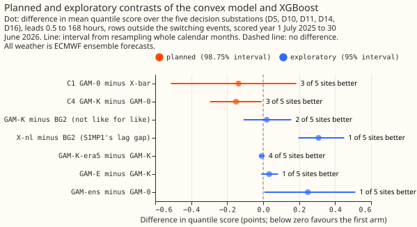
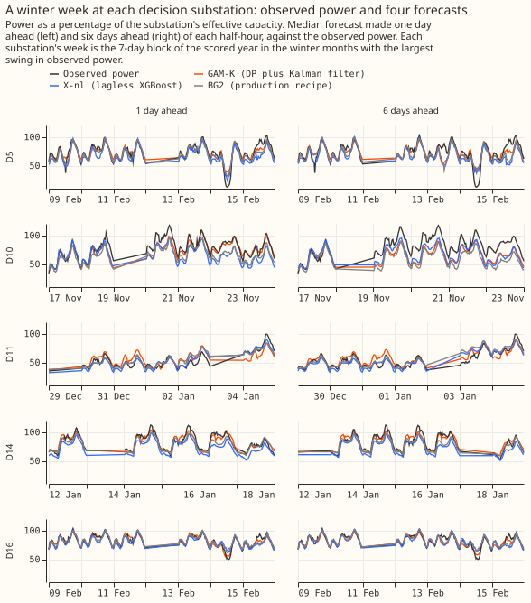
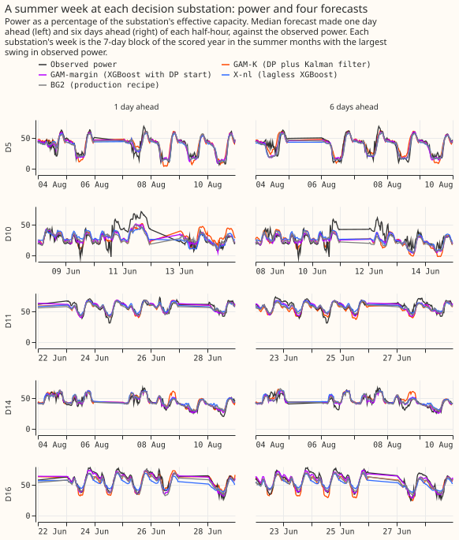
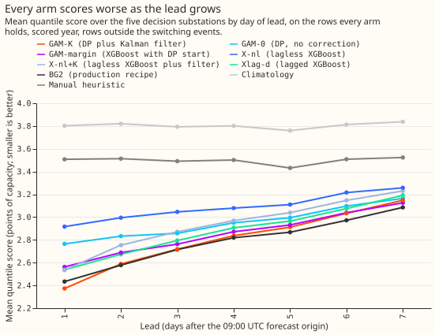
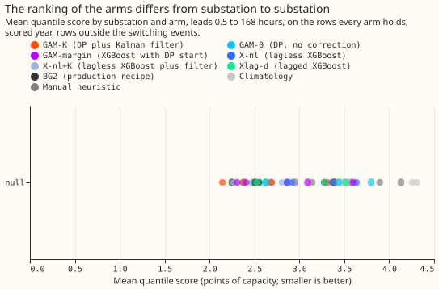
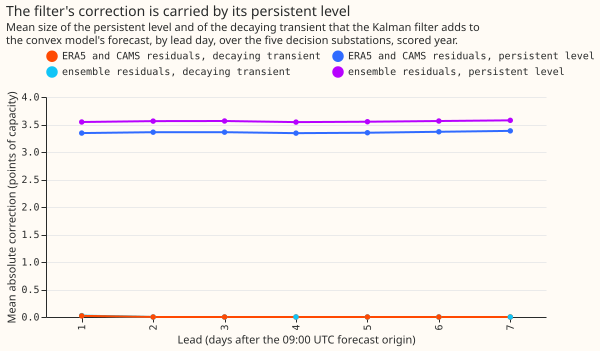
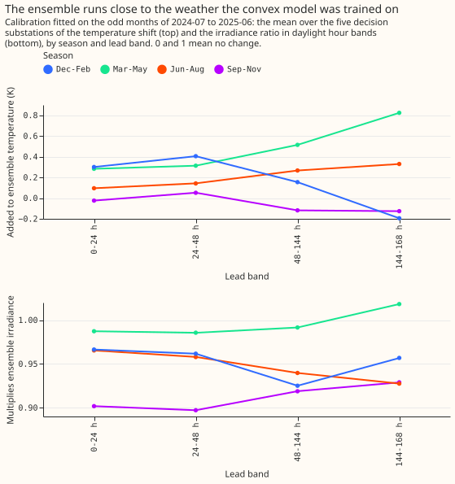
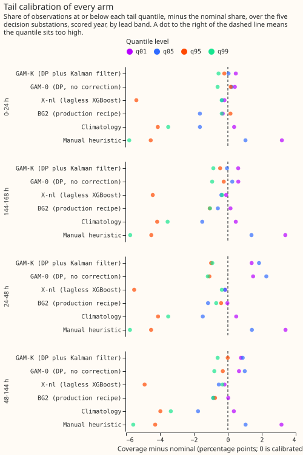
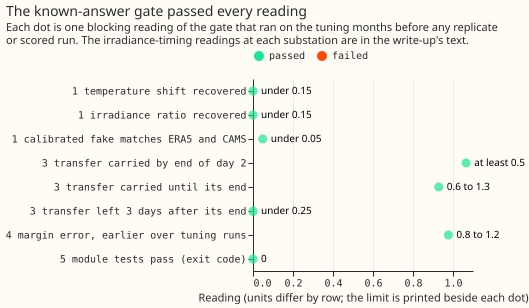
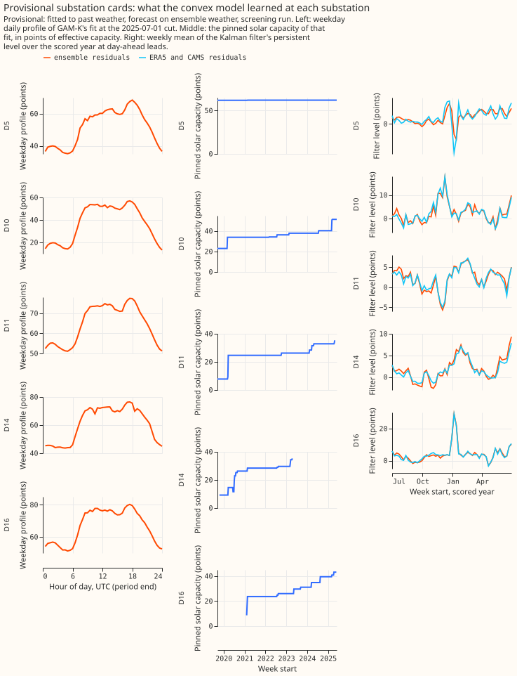

**With ECMWF ensemble weather forecasts as input, the Kalman filter on recent errors lowers the
convex differentiable-physics demand model's score, and that is the part of the hypothesis this year
of data supports; the model's standing against lagless XGBoost and against the production recipe
(BG2) is undecided.** Scores are quantile scores in points of the substation's effective capacity
(lower is better), at the five decision Primary substations D5, D10, D11, D14, and D16, over leads
of 0.5 to 168 hours, on every half-hour outside the hand-filtered switching events. The scored year
is 1 July 2025 to 30 June 2026. The filter lowered the convex model's score by 0.151 points (98.75%
interval -0.295 to -0.008), by 0.392 points at leads under 24 hours and by 0.017 beyond 144 hours.
The convex model with the filter (GAM-K) was 0.134 points better than lagless XGBoost with the same
filter (-0.305 to +0.014, which includes zero) and differed from BG2 by +0.020 points (-0.109 to
+0.157, not like for like, with BG2 better at 3 of 5 substations). GAM-K is the DP's candidate for
the roughly 1,300 substations of version 2. The DP's own forecast, given to lagged XGBoost as a
starting point, changed nothing measurable.

We asked whether the physical model, driven by real weather forecasts as production would be,
forecasts demand better than XGBoost when both see the same weather forecast and the same recent
observations, and whether giving the production recipe the physical model's forecast as a starting
point improves it. Parts 1 to 5 of the series drove the physical model with estimates of past
weather (ERA5 temperature and Copernicus Atmosphere Monitoring Service (CAMS) irradiance), which a
live service would not have. Here the model runs once per member of the 51-member ensemble, with
the ensemble's temperature and irradiance calibrated onto ERA5 and CAMS, and the filter reads the
model's recent errors made with the ensemble's own 9.5-to-33-hour forecasts. XGBoost trains on
ensemble control-member rows. We took the branches of the plan from Parts 3 and 4 (see "Arms, rows,
and settings"). BG2 is compared with GAM-K only as an exploratory contrast, because BG2 differs in
three lags, a five-member blend, and weekly refits. C5, the confirmation run that would compare the
production recipe with and without the DP's margin like for like, was not run: the plan's literal
trigger (C3 below zero) was met by the estimate of -0.023, but the manager ruled that C5 would run
only if C3 showed a gain, and an interval from -0.217 to +0.183 shows none.



















## Arms, rows, and settings

- **Branches taken (Parts 3 and 4).** GAM-K has no drift (Part 4's C4 passed non-inferiority in
  both years) and a 24-month training window (Part 4's C1 was not supported); GAM-0 keeps drift.
  The capacity is pinned to experiment 45's real-time vintage in every arm. The pooled arms of
  Part 3 were not run, because Part 3's onboarding and short-history contrasts were not supported.
  Part 4's drift step of 30 sat at the edge of its grid, so GAM-0's step was tuned afresh on the
  tuning months over 30 to 100,000 and the step of 30,000 won, inside the grid (mean tuning scores
  3.180 at 30, 3.021 at 10,000, 3.018 at 30,000, 3.040 at 100,000).
- **Periods.** Tuning is the odd months of 2024-07 to 2025-06, replicate is the even months, and the
  scored year is the 292 runs of `fold_a_daily_gap_v1`. The solar shrink chosen on the tuning months
  was 1 in every lead band (no shrink); the spread factors were 0.9 to 1.15, with 0.9 at the lower
  edge of the plan's grid for GAM-K in three bands, where the score differs by 0.003 to 0.013
  points from a factor of 1.
- **Calibration.** Fitted on the tuning months per site, season, lead band, and hour band: the
  temperature shift ranged from -1.15 to +2.05 K (mean +0.20) and the daylight irradiance ratio from
  0.80 to 1.11 (mean 0.95) over the decision substations (Figure 6).
- **DP arms.** GAM-0 (drift, no correction), GAM-K (the main arm), GAM-E (14-day weighted mean in
  place of the filter), GAM-K-era5 (the filter on ERA5 and CAMS residuals, which a live service
  would not have), and GAM-ens (trained on ensemble control rows, fitted once at 2025-07-01).
- **XGBoost arms.** X-nl is SIMP1's no-lag monthly recipe (500 rounds, eta 0.05, half-life 0.5
  years), reused for the scored year from SIMP1's stored refits after one refit at D10 reproduced
  within -0.003 points of quantile score, and refitted here for the 12 tuning and replicate months.
  X-nl is SIMP1's raw refit, with no spread factor: SIMP1's stored `p_nl_monthly` widens its
  quantiles by 1.15 and scores 3.110 against 3.088 here.
  X-nl+K adds the same Kalman filter, fitted on X-nl's 24-hour block residuals. Xlag-d is the lagged
  member with three origin lags, GAM-margin is Xlag-d with the DP's forward-chained forecast as the
  base margin, both refitted monthly at 150 rounds and eta 0.15 on leads up to 168 hours. X-nl-z and
  X-nl-o (zero start; median plus experiment 64's solar offset) ran for the scored year only.
- **Predictions** are stored in the experiment store, one set per arm and period (`<arm>_scored` and
  `<arm>_replicate`), in points of effective capacity with the 11 quantiles, the observed power, the
  lead, and a switching-event flag; the filter arms add the filter's level and transient, and
  GAM-margin adds the DP's margin.
- **Rows.** 464,358 half-hours shared by the arms of C1 at the five decision substations in the
  scored year; D9 is scored beside them in the 6-substation rows; D18 is descriptive and enters no
  contrast.

## Decision rule and verdict

- **The verdict is `partly supported`.** C4 (the filter's gain on the convex model) is wholly
  below zero (-0.151, -0.295 to -0.008) and inside the predicted range at both ends of the lead
  range, so that part of the hypothesis is supported. C2 is not `supported` by the series' rule (its
  interval spans zero: -0.134, -0.305 to +0.014, although 4 of 5 substations are better). C3 is
  neither `supported` nor `small gain` (its interval spans zero). C5, the only contrast that can
  say "beats BG2", was not run (see "Departures from the plan"). No contrast is wholly above zero,
  so the verdict is not `refuted`.
- **Production status is `candidate`.** GAM-K with the filter is the DP's candidate for the roughly
  1,300 substations of version 2, because its filter gain survives ensemble weather and it is not
  distinguishably different from BG2 (+0.020, -0.109 to +0.157; BG2 better at 3 of 5 substations;
  not like for like: BG2 has three lags, a five-member blend, and weekly refits). The candidate
  carries four caveats: C2 is undecided, XGBoost's history is short, five substations over one year
  is a small sample, and the margin gave no gain.

## Headline numbers

Scored year, five decision substations, quantile score in points (negative favours the first arm);
the interval of C1 to C4 is 98.75% (Bonferroni across four) and every other interval is 95%, from
resampling whole calendar months of run initialisations, paired across arms. The numbers come from
`e00111_report.py`, saved as `report.md`.

- **C1, GAM-0 minus X-nl (X-bar): -0.137 (-0.513 to +0.185), 3 of 5 substations better.** Absolute
  scores 2.951 and 3.088. The median-forecast error contrast is -0.218. It is -0.670 from November
  to March and +0.215 from April to October. Without D14 it is -0.031.
- **C2, GAM-K minus X-nl+K: -0.134 (-0.305 to +0.014), 4 of 5 better.** Absolute scores 2.800 and
  2.934; median-forecast error -0.159. At leads under 24 hours it is -0.162 (-0.315 to -0.029).
  Without D5 it is -0.210 (-0.337 to -0.098).
- **C3, GAM-margin minus Xlag-d: -0.023 (-0.217 to +0.183), 3 of 5 better.** Absolute scores 2.853
  and 2.877; median-forecast error +0.001. Without D5 it is +0.014.
- **C4, GAM-K minus GAM-0: -0.151 (-0.295 to -0.008), 3 of 5 better.** By lead: -0.392 (-0.498 to
  -0.288) under 24 hours, -0.244 from 24 to 48 hours, -0.100 from 48 to 144 hours, and -0.017
  (-0.165 to +0.159) from 144 to 168 hours. It is -0.026 from November to March and -0.234 from
  April to October.
- **Replicate months.** All even months of 2024-07 to 2025-06, where XGBoost trained on 3 to 14
  months of ensemble rows: C1 -0.679 (-2.193 to +0.257), 4 of 5 better; C2 -0.316 (-0.721 to
  +0.035), 5 of 5; C3 -0.103 (-0.691 to +0.386); C4 -0.215 (-0.396 to -0.057), 5 of 5. In February,
  April, and June 2025 only (10 or more months of XGBoost rows; three months, so the figures below
  are the pooled estimate and the range of the three single-month estimates, not intervals): C1
  +0.221 (months -0.092, +0.287, +0.446), 1 of 5 better; C2 -0.098 (-0.363, -0.191, +0.241), 4 of 5;
  C3 +0.334 (+0.092, +0.402, +0.510), 1 of 5; C4 -0.377 (-0.494 to -0.312 across months), 5 of 5. So
  the sign of C1 and C3 is not stable, and C2's and C4's is not stable either in June.
- **Substations in the scored year.** C4 by substation: D10 -0.489, D11 -0.250, D14 -0.225, D5
  +0.128, D16 +0.130, so the filter worsens GAM-K at D5 and D16. X-nl+K minus X-nl by substation:
  D14 -0.648, D16 -0.058, D10 -0.050, D5 -0.016, D11 +0.015.
- **D9 and D18.** D9 is scored beside the decision substations: with it, C1 is -0.109 (-0.454 to
  +0.190), C2 -0.121 (-0.298 to +0.051), C3 +0.014 (-0.175 to +0.206), and C4 -0.152 (-0.297 to
  -0.007). D18 is one substation whose DP fits start in July 2025 and whose X-nl comes from SIMP1's
  refit with D18's commissioning months cut, so its rows are descriptive: GAM-K minus GAM-0 -0.756
  (-1.924 to +0.413), GAM-K minus BG2 +0.215 (-0.411 to +0.982), X-nl minus BG2 +0.314 (+0.022 to
  +0.572), GAM-0 minus X-nl +0.675 (-0.399 to +2.156).
- **Exploratory, scored year.** GAM-K minus BG2 +0.020 (-0.109 to +0.157, not like for like), better
  at 0 to 24 hours (-0.060) and worse beyond 144 hours (+0.063). X-nl minus BG2 +0.308 (+0.196 to
  +0.450). GAM-K minus Xlag-d -0.077 (-0.218 to +0.067). X-nl+K minus X-nl -0.154 (-0.308 to
  -0.023). GAM-K-era5 minus GAM-K -0.008 (-0.024 to +0.008). GAM-E minus GAM-K +0.034 (-0.011 to
  +0.082), worse at 0 to 24 hours (+0.174). GAM-ens minus GAM-0 +0.248 (+0.007 to +0.513).
  GAM-margin minus Xlag-o -0.020 (-0.192 to +0.150), which agrees with C3. X-nl-o minus X-nl-z
  -0.023 (-0.077 to +0.023) and X-nl-o minus X-nl -0.006 (-0.039 to +0.037).

## Absolute scores

| Arm (scored year, 5 decision substations) | Quantile score |
|---|---|
| BG2 | 2.780 |
| GAM-K-era5 | 2.792 |
| GAM-K | 2.800 |
| GAM-E | 2.834 |
| GAM-margin | 2.853 |
| Xlag-d | 2.877 |
| X-nl+K | 2.934 |
| GAM-0 | 2.951 |
| X-nl | 3.088 |
| GAM-ens | 3.200 |

Each row is on the rows it shares with its contrast partner, so scores quoted from two contrasts
differ in the third decimal. Climatology and the manual heuristic are in Figure 3 and 7.

## What the filter does

- **The filter's gain sits in the first two days for the convex model, and the two model families
  gain in different places.** GAM-K minus GAM-0 is -0.392 under 24 hours and -0.017 beyond 144
  hours, and the first two lead days carry about 60% of the pooled gain. X-nl+K minus X-nl is -0.382
  and -0.028 by lead, but its pooled gain of -0.154 is almost all at D14 (-0.648; -0.027 without
  D14), while the filter worsens GAM-K at D5 (+0.128) and D16 (+0.130). The families also gain in
  opposite seasons: GAM-K from April to October (-0.234) and X-nl+K from November to March (-0.379).
  In the replicate months the two disagree in size (-0.377 against -0.058 in February, April, and
  June 2025; -0.215 against -0.578 over all even months), so "the filter helps both families
  equally" is not supported. Part 4 found -0.61 on past weather at the day-ahead lead; the ensemble
  gain at 0 to 24 hours is about two thirds of that.
- **The persistent level carries the correction (Figure 5).** The transient part is about 0 at every
  lead.
- **ERA5 residuals add nothing.** GAM-K-era5 minus GAM-K is -0.008 (-0.024 to +0.008), so a live
  service gains nothing from waiting for ERA5.
- **The 14-day weighted mean is worse at short range.** GAM-E minus GAM-K is +0.174 at 0 to 24 hours
  and -0.043 beyond 144 hours.

## What did not help

- **The DP's forecast as a base margin.** C3 -0.023 in the scored year and +0.334 in February,
  April, and June 2025. D5 contributes the gain: without D5 C3 is +0.014.
- **Training the convex model on ensemble rows.** GAM-ens minus GAM-0 +0.248 (+0.007 to +0.513),
  +0.591 from November to March, which is the opposite of what the train-each-weather-on-its-own-
  history rule would predict for this model, and agrees with the plan's note that GAM-ens tests the
  departure.
- **Experiment 64's solar offset on lagless XGBoost.** X-nl-o minus X-nl-z -0.023 and minus X-nl
  -0.006 over all rows. On the April-to-September daytime rows the plan names (08:00 to 16:00 UTC),
  X-nl-o minus X-nl is -0.116 (-0.145 to -0.084) and X-nl-o minus X-nl-z -0.034 (-0.093 to +0.028),
  so the first is inside the plan's -0.05 to -0.20 and the second is not.

## Predictions against results

| Prediction | Result | Within? |
|---|---|---|
| C1 -0.05 to -0.40, gain concentrated in 0-48 h | -0.137; the gain is spread across leads (-0.152 at 0-24 h, -0.093 at 144-168 h) | estimate yes, shape no |
| C2 -0.05 to -0.25, same sign in replicate months | -0.134 scored; -0.098 in February, April, and June | yes |
| C3 -0.02 to -0.15 | -0.023 scored; +0.334 in the replicate months | barely, and the replicate disagrees |
| C4 -0.3 to -0.6 at 0-24 h, under -0.1 beyond 144 h | -0.392 and -0.017 | yes |
| C5 -0.01 to -0.08 | not run (see "Departures from the plan") | no result |
| GAM-K 0.0 to 0.4 worse than BG2 | +0.020 | edge |
| X-nl 0.5 to 1.4 worse than BG2 | +0.308 | below the range |
| GAM-K-era5 beats GAM-K by 0.05 to 0.20 at 0-24 h | -0.044 | edge |
| X-nl-o minus X-nl-z -0.05 to -0.20 on April-to-September daylight rows | -0.034 on those rows (-0.023 over all rows); X-nl-o minus X-nl is -0.116 on them | edge |
| Tails: q05 and q95 within 3 points of nominal, q01 and q99 within 1.5 | GAM-K's coverage is within 1.84 points of nominal at every level and band (largest: q05 at 24-48 h, +1.84; q01 at 24-48 h, +1.40); GAM-margin and Xlag-o are 3 to 5 points off (see "Tail calibration") | yes for GAM-K, no for the margin arms |
| Each arm under 10 minutes | seconds for the DP, about 1 minute per XGBoost refit when the GPU is free | yes |

The SIMP1 audit partly explains the X-nl gap. SIMP1's lag penalty is 0.361 points as an average over
the 16 Primaries, including D15, and 0.125 without D15, not 0.9. The five decision substations each
had a lag cost of at most 0.22 there, so our 0.308 is larger than SIMP1 alone predicts. X-nl minus
BG2 also carries BG2's five-member blend and its weekly refits, which X-nl does not have.

## Checks

- **The median forecast minus the mean forecast is under 0.17 points at every site and DP arm** (for
  GAM-K -0.117 at D5, -0.043 at D11, -0.037 at D10, +0.015 at D14, +0.002 at D16), because the
  ensemble mixture is not symmetric. XGBoost arms hold only the median.
- **The median-forecast error agrees in sign with the quantile score for C1, C2, and C4, and
  disagrees for C3** (-0.023 against +0.001, both about 0) and for X-nl-o minus X-nl-z (-0.023
  against +0.032).
- **Six of the seven audit triggers fired.**
    - **Trigger 1, a control fails:** the first run of the gate failed two readings, both from a
      sign error in the gate's own fake irradiance (the fake scaled CAMS up by 1.25 where the plan
      scaled it down by 0.8, and the test expected the wrong ratio); the second run passed 22 of
      22. X-nl's reproduction of SIMP1 held at the one refit checked, at one substation.
    - **Trigger 2, a result contradicts a prediction:** fired for X-nl minus BG2 (+0.308 against
      +0.5 to +1.4), partly explained by the SIMP1 audit (see "Predictions against results"), for
      C1's shape, and for the offset rows.
    - **Trigger 3, the quantile score and the median-forecast error disagree:** fired for C3 and for
      X-nl-o minus X-nl-z, both within noise.
    - **Trigger 4, leaving a site out flips a contrast:** fired for C3, where D16 carries more than
      D5 (without D16 +0.048, without D5 +0.014), and changes C2's label (without D5 -0.210,
      -0.337 to -0.098, wholly below zero).
    - **Trigger 5, a nested arm beats its container, or a null control moves:** fired on the plan's
      pairs. GAM-0 beats GAM-K at D5 (+0.128) and D16 (+0.130), and X-nl beats X-nl+K at D11
      (+0.015). The null control GAM-K-era5 minus GAM-K (-0.008) stayed within its interval.
    - **Trigger 6, an interval far wider or narrower than a sister's:** fired for C3, whose
      half-width of 0.20 is about four times experiment 87's 0.05 for nested steps, and for C1 and
      C2, whose widths (0.70 and 0.32) are under half and under a fifth of Part 4's C6 (1.69).
    - **Trigger 7, a later design depends on an unreplicated result:** did not fire. The candidate
      status rests on C4, which replicated in the even months (-0.215, -0.396 to -0.057, 5 of 5
      substations better).
- **An audit was called for.** Triggers 1 to 6 fired, and a fresh Opus audit of the numbers ran
  before the prose review; its items are applied on this page.

## Known-answer gate

The gate ran on the tuning months before any replicate month or scored run and passed 22 of 22
readings: the calibration recovered a temperature bias of +1.5 to +3 K and an irradiance factor of
0.8 within 15% (and the calibrated fake scored within 0.05 points of ERA5 and CAMS); the calibrated
ensemble's irradiance peaked within one half-hour of CAMS's at every site (a pass at the limit: the
offset was exactly one half-hour at 6 of 7 sites), with a midday ratio of 0.88 to 0.90; the filter
carried a median 1.07 of an injected transfer by the end of day 2, 0.93 from day 2 to the end, and
0.000 three days after the end (16 transfers at D10, D11, D14, and D16); the margin's error on
earlier runs was 0.98 of its error on the tuning months' runs; and the module's tests passed (Figure
8). The recovery readings are exact (0.000) by construction, because the fake's member noise has
zero mean across the 51 members, so they check the indexing and the arithmetic and not the
calibration's response to noise. The calibrated fake's error differed from ERA5's by 0.049 against a
limit of 0.05, and that reading compares mean absolute errors where the plan says quantile score,
with the real ensemble's analysis proxy kept in the noise-free fake. Test 4 is a stability check,
not a leakage check: it compares margin errors by period, cannot catch a leak in the training join,
omits the replicate months, and compares April to June 2024 with the odd months, so the season
differs.

## Departures from the plan

- **Compute.** The plan estimated 1.5 to 2 GPU-hours for the XGBoost arms; one 500-round refit on
  the whole history took 247 s while the GPU was shared, matching SIMP1's log, so the estimate was
  about 20 times too low. The margin family therefore refitted monthly, not weekly, on leads to 168
  hours at 150 rounds and eta 0.15; X-nl for the scored year reused SIMP1's refits; X-nl-z and
  X-nl-o ran for the scored year only; the placebo margin, the zero-start lagged arm, GAM-K-w,
  GAM-K-fc, and the tuning-month choice among start rules were not run, so X-bar is X-nl with its
  default start; and C5, the like-for-like comparison with BG2, was not run. The plan's literal
  trigger (C3 below zero) was met by the estimate of -0.023, but the manager ruled that C5 runs only
  if C3 shows a gain, judged -0.023 (-0.217 to +0.183) not to be one, and the budget was short. The
  production-setting pair was coded and then removed from the scripts. The XGBoost jobs logged 7.88
  job-hours (including about 0.02 job-hours of smoke jobs), plus the early refits, which were not
  logged.
- **Implementation.** No `WeatherInputLayer` was filled (the pooled arms did not run). The PV shape
  is not derated by the member's temperature in the weather layer, because the convex model derates
  it itself. A member with a missing shortwave value is dropped from its run at that site (member 36
  of the 2025-06-04 run at D9 and D11). The last scored run (2026-06-30) is left out of the DP and
  margin arms because the grid ends before the held-out period. The offset arms' training rows
  omit the last two weeks of June 2025, which experiment 87's anomaly table lacks. The filter's
  hyperparameters were fitted in one round, with Part 4's fitted prior, not by the plan's
  empirical-Bayes rounds. The "all rows" robustness row was not run.
- **The XGBoost arms' spread was not tuned,** where the plan tunes a factor per arm on the tuning
  months. The code review found that even the best factor chosen on the scored year would gain at
  most 0.004 points, so C1 and C2 are unaffected.
- **Xlag-bar is Xlag-d,** fixed in advance of the margin results, where the plan chose it among
  Xlag-d, Xlag-o, and Xlag-z on the tuning months. Xlag-o minus Xlag-d is -0.003, and C3 against
  Xlag-o would be -0.020.
- **X-nl+K at D10 in July 2025** uses this experiment's own reproduction refit and not SIMP1's (an
  effect of about 0.003 points).
- **The offset arms use held capacity.** X-nl-o, and the offset start in general, take experiment
  64's held capacity for training and prediction rows alike, and not experiment 87's real-time
  capacity vintages.
- **The tails table** is on each arm's own rows and not on shared rows, and holds no
  threshold-weighted CRPS; curtailment cost was not computed.
- **GAM-0's drift step was retuned** on this experiment's tuning months (30,000, inside a grid of 30
  to 100,000), where Part 4 chose 30 at the edge of its grid.
- **X-nl was reproduced at one refit at one substation (D10)** before SIMP1's stored refits were
  reused for the scored year. X-nl+K got no spread factors.
- **The substation cards omit panels the series asks for** (no heating slope and no fitted
  capacity, and no per-site intervals beyond the note under the cards).
- **The pinned capacity uses hindsight weeks,** as Part 4 discloses for its vintages.
- **C1's shared rows** are 464,358 half-hours, and C4's are 464,363, because 5 half-hours are
  present in the GAM-0 and GAM-K rows and absent from the X-nl rows.
- **D18.** SIMP1's refit with D18's commissioning months cut is the source of D18's X-nl rows;
  D18 enters no contrast.

## Caveats

- **XGBoost had 3 to 27 months of ensemble history, and the convex model years of past weather.**
  The replicate year flatters the DP for that reason (C1 -0.679 in all replicate months, +0.221 in
  the three months with 10 or more months of rows).
- **The tuning months are in-sample for the spread**, and the replicate months are interleaved with
  them.
- **The 73 stride runs of the scored year chose BG2's blend and offset**, and BG2's spread factor
  of 1.15 is experiment 18's.
- **Two mild shared leaks:** the 2024-25 margins use a calibration fitted on the same odd months,
  and the convex model's last training rows use ERA5 that a live refit would not yet have.
- **The analysis proxy is the control member of the latest run**, not an analysis.
- **Hindsight switching masks** apply to every scored row.
- **Five substations, one year.** The intervals resample 12 months.
- **The reversal of C1's sign** in February, April, and June 2025 may be seasonal: the scored
  year's C1 is +0.215 from April to October, and +0.221 in those three months.
- **BG2 is not like for like with GAM-K,** and BG2 is better at 3 of 5 substations; a difference of
  +0.020 is not evidence that the two forecast equally well.

## Tail calibration

GAM-K's q01, q05, q95, and q99 coverage sits within 1.84 points of nominal in every lead band, and
lagless XGBoost's q95 coverage is 4.4 to 5.5 points below nominal at every lead band (Figure 7).
The margin arms are worse: GAM-margin's coverage is 3 to 4.5 points off nominal at every tail level
(for example q05 at 9.0 to 9.5% and q95 at 90.8 to 91.5%), and Xlag-o's is 1 to 4.6 points off
(q95 at 90.4 to 91.3%). Xlag-d's q95 is 1.8 to 2.7 points low.
Curtailment cost against `manual_heuristic` was not computed: at the MW Primaries experiment 87
found no event at the scaled limit that the metric could rank forecasts on.

## Substation cards



**Provisional: fitted to past weather, forecast on ensemble weather, screening run.** The cards
show the weekday daily profile of GAM-K's fit at the 2025-07-01 cut, the pinned solar capacity
(an input from experiment 45's real-time estimates, not a fitted value), and the filter's weekly
mean level over the scored year. No heating slope or fitted capacity is shown. Heating slopes and
capacities are weakly identified at real noise levels (experiment 112); compare across substations
with care, and interpret no threshold per site. Identification improves with more weather
anomalies, which is a reason a longer history could help interpretability.

## Open questions after this experiment

- Does a longer ensemble history (the 2021 to 2024 backfill on Source Cooperative) settle C1 and C2?
  The maintainer decides whether to fetch it.
- Does the filter lower the production XGBoost blend's score as it lowers X-nl's? The result is
  a candidate for the next release review.
- Does the filter, which lowers GAM-K's score at only 3 of 5 substations, gain more at substations
  whose level changes (D15, D18 predicted)? D18's descriptive row (-0.756) points that way, from one
  substation.
- Does the margin help at weekly cadence? The plan's cadence needs about 60 GPU-hours at the speed
  measured here.

## Reproducing the figures

```bash
uv run python ml-experiments/00111-*/e00111_build_frames.py
uv run python ml-experiments/00111-*/e00111_store.py
uv run python ml-experiments/00111-*/e00111_fits.py
uv run python ml-experiments/00111-*/e00111_tune.py
uv run python ml-experiments/00111-*/e00111_drift.py
uv run python ml-experiments/00111-*/e00111_fits.py --arms gam0
uv run python ml-experiments/00111-*/e00111_tune.py --spread-arms gam0
uv run python ml-experiments/00111-*/e00111_gate.py
uv run python ml-experiments/00111-*/e00111_dp_run.py
uv run python ml-experiments/00111-*/e00111_gam_ens.py
uv run python ml-experiments/00111-*/e00111_xgb.py --arm xnl --before 2025-07-01
for arm in xlag_d gam_margin; do
  uv run python ml-experiments/00111-*/e00111_xgb.py --arm $arm
done
for arm in xlag_o xnl_z xnl_o; do
  uv run python ml-experiments/00111-*/e00111_xgb.py --arm $arm --first 2025-07-01
done
uv run python ml-experiments/00111-*/e00111_xnl_k.py
uv run python ml-experiments/00111-*/e00111_report.py
uv run python ml-experiments/00111-*/e00111_report.py --periods replicate
uv run python ml-experiments/00111-*/e00111_report.py --periods replicate \
  --months 2025-02 2025-04 2025-06
uv run python ml-experiments/00111-*/e00111_predictions.py
uv run python ml-experiments/00111-*/e00111_charts.py
```
