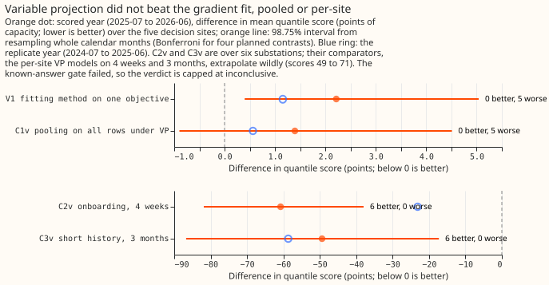
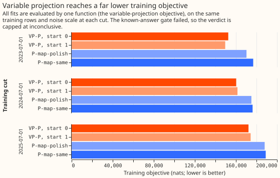
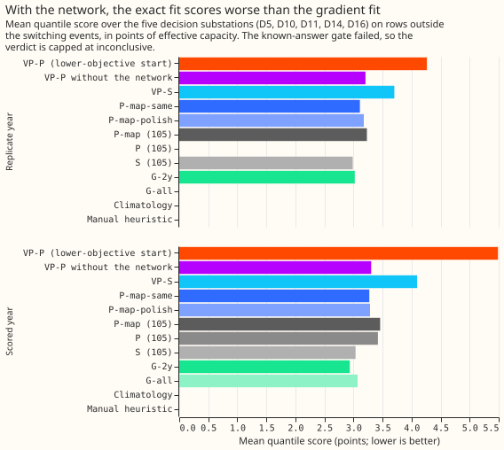
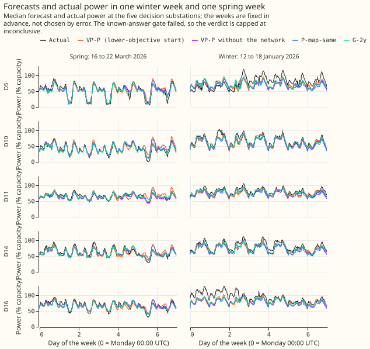
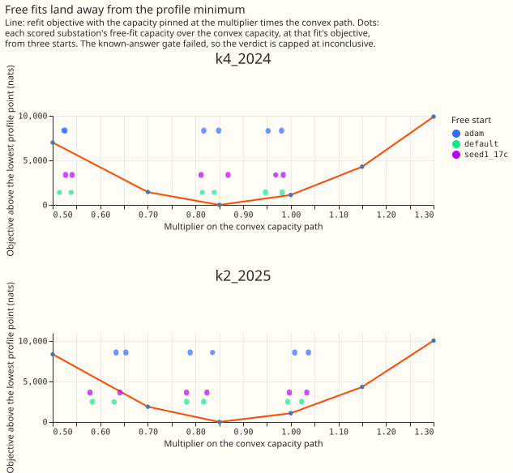
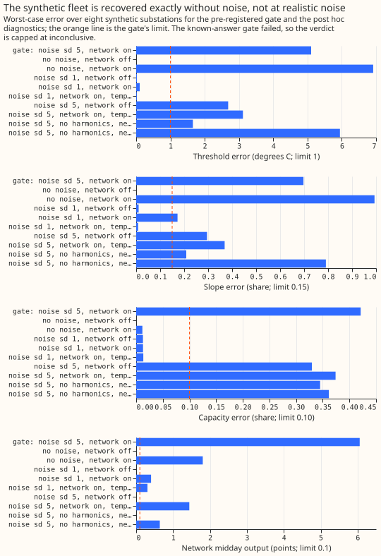

# Differentiable physics, VP: fitting the pooled model's linear coefficients exactly

**Fitting the pooled demand model's linear coefficients exactly did not improve its forecasts, so
the gap to a per-substation model is not caused by the optimiser.** The pooled model is one
differentiable-physics demand model fitted to many Primary substations at once. Variable projection
(VP) is a fitting method that solves the coefficients that enter the forecast linearly exactly at
each step, and moves the rest by gradient steps. VP reached a training objective (the negative
log-likelihood of the training rows, in nats) 16,000 to 27,000 nats lower than the gradient (Adam)
fit of the same objective. With the interaction neural network switched on, VP forecast worse on
the scored year: a quantile score of 5.49 against 3.27 points of effective capacity, averaged over
the five decision substations. Two VP fits from different starting values differed by 1.6 points.
With the network off, VP is stable (the two starts agree to 0.004 points) and matches the gradient
fit (3.30 against 3.27). The known-answer test failed on its pre-registered definition, so the
verdict cannot exceed `inconclusive`.

We asked whether the pooled model lost to a per-substation model in experiment 105 because gradient
descent stopped short of the optimum. We fitted the pooled model, and a model per substation, by VP
at three training cuts, scored 2025-07-01 to 2026-06-30 with 2024-07-01 to 2025-06-30 as a
replicate year, and compared with the gradient fit on one objective. **Exact optimisation helps a
simple model (L1 below) and does nothing for the pooled model,** whose network absorbs structure
the data cannot pin down. The gate failure, the capacity profile, and the network-off arm all point
the same way.

**Figure 1. The VP fits are no better than the gradient fits, and the onboarding contrasts compare
against per-substation VP fits that score 71 and 48 points.** Dot plot of the four planned
contrasts with 98.75% intervals; the first two are positive (worse) at all five substations.

**Figure 2. VP reaches a far lower objective than the gradient fit (P-map-same), and its two starts
differ by up to 3,000 nats.**

**Figure 3. With the network on, the exact fit scores worst; with it off, the fit matches the
gradient fit, and no pooled fit beats the per-substation convex model.**

**Figure 4. In a winter and a spring week, the median forecasts of VP-P differ visibly from the
others at some substations.** The weeks are fixed in advance, not chosen by error.

**Figure 5. The free fits sit 1,400 to 8,600 nats above the lowest capacity-profile point.**

**Figure 6. Recovery of a synthetic fleet is exact without noise, and fails at realistic noise for
every variant.**

## Definitions

| Name | What is fitted |
|---|---|
| VP-P | the pooled model (K = 2 shared daily shapes, interaction network of two hidden layers of 64 units, fitted capacity), maximum a posteriori (MAP), fitted by VP |
| VP-S | the same model, one MW substation at a time, fitted by VP |
| P-map-same | experiment 105's Adam fit (steps and schedule) on VP's objective |
| P-map-polish | P-map-same's non-linear parameters with the linear coefficients solved exactly |
| VP-P-nonet | VP-P without the interaction network (post hoc, exploratory) |
| G-2y, G-all | Part 2's convex per-substation model on the 2-year window, and on all years |
| L1 | the equivalence configuration (see the ladder bullet) fitted by VP |
| V1, C1v, C2v, C3v | planned contrasts 1 to 4 under VP: fitting method, pooling, onboarding, short history |

## Results

- **Arms and references.** The arm VP-P is the lower-objective start of two (start 0: seed 0; start 1:
  seed 1 with every heating threshold at 17 degrees), which is start 0 at the 2024-07-01 and
  2025-07-01 cuts and start 1 at 2023-07-01. References: experiment 105's P, P-map, S, and
  equivalence arm (`s_equiv_all`); climatology; the manual heuristic. Row set, window, pool, and
  masks are as in experiment 105.
- **Fitting schedule.** Every VP fit used 600 Adam warm-start steps, L-BFGS for up to 300
  evaluations, and an Adam fallback of 1,200 steps (VP-P) or 400 (other arms) when L-BFGS missed
  its convergence test. No fit met that test, so none is exactly at its optimum. One frozen fit per
  cut, no refits.
- **Scores (five decision sites, scored year; replicate year in brackets).** VP-P 5.49 (4.26);
  VP-P start 1 3.89 (3.64); VP-P-nonet 3.30 (3.21); VP-S 4.09 (3.70); P-map-same 3.27 (3.11);
  P-map-polish 3.29 (3.18); experiment 105's P 3.42, P-map 3.46, S 3.04; G-2y 2.94 (3.02); G-all
  3.07; climatology 4.07; manual heuristic 3.49.
- **V1 (planned): VP-P minus P-map-same is +2.215 points (98.75% interval +0.398 to +5.041),
  better at 0 of 5 substations;** replicate year +1.154 (+0.527 to +1.849), 0 of 5 better.
- **The exact fit's objective is 16,000 to 27,000 nats lower at every cut.** VP-P minus
  P-map-same is -16,747 nats at the 2025-07-01 cut (172,257 against 189,005), -16,014 at
  2024-07-01, and -27,257 at 2023-07-01. Experiment 105's own P-map is 239,053 on this objective
  (it was fitted on a different objective, so this is a reference only).
- **Solving the linear coefficients exactly after the gradient fit changes the score by only
  +0.013** (-0.001 to +0.025; P-map-polish minus P-map-same), while lowering the objective by 1,005
  nats, so the linear coefficients do not limit skill.
- **C1v (planned): VP-P minus VP-S is +1.394 (-0.896 to +4.508), 0 of 5 better;** replicate year
  +0.561 (-0.095 to +1.289). Non-inferiority (upper end at most +0.10) fails.
- **C2v and C3v (planned, six substations) compare against broken comparators.** VP-onb4w minus
  VP-S-4w is -60.8 (-81.9 to -38.0) and VP-short3m minus VP-S-3m is -49.4 (-86.7 to -17.3), 6 of 6
  better each. The per-site VP fits on 4 weeks and 3 months score 70.6 and 48.4, because the exact
  solve fits the lightly penalised seasonal terms to a short window and extrapolates them. Against
  experiment 105's gradient arms, VP-onb4w minus P-onb4w is +1.460 (+0.439 to +2.522) and
  VP-short3m minus P-short3m is -0.122 (-0.554 to +0.182).
- **Start spread.** The two VP-P starts differ by 1.599 points (limit 0.10); the two VP-P-nonet
  starts differ by 0.004.
- **Ladder (L1, exploratory).** L1 is experiment 105's equivalence configuration (one substation at
  a time, no network, no shared shapes, capacity pinned to the convex path, all years), fitted by
  VP. It scores **2.877**, against 105's `s_equiv_all` 3.326 (-0.449, -0.537 to -0.373, 5 of 5
  better) and G-all's 3.072 (-0.195, -0.298 to -0.075). All five threshold starts (12 to 20
  degrees) reach the same objective to 1 nat at every site and cut. The contrast L1 minus
  `s_equiv_all` combines the effect of the optimiser with the effect of the changed objective
  (natural-scale slope prior, fixed noise scale); the share of the 0.25-point gap that comes from
  the heating form cannot be separated from it. L2, the plan's heating-basis step, was dropped. At
  D9 and D16 the replica fit was numerically singular, so their spread is taken from the other
  substations' replicas.
- **Capacity profile (labelled).** Criterion 1, capacities agree across the three starts within 3
  points at every substation, **passes** at both configurations (largest spread 1.6 points for
  K = 2 and 1.3 for K = 4). Criterion 2, each free objective within 1 nat per 10,000 rows of the
  lowest profile point, **fails:** the free fits are 1,400 to 8,600 nats above it (tolerance 31 to 34
  nats). Criterion 3, each free capacity where the profile is within that tolerance of its minimum,
  **fails:** the minimum is at 0.85 times the convex capacity path and the free capacities lie
  between 0.5 and 1.05 times it. The three starts reach objectives up to 7,000 nats apart, and none
  converged, so the interaction network's loss surface has many local optima. The pinned fits did
  not converge either.
- **Gate, test 2 (synthetic fleet at the pre-registered noise, sd 5.0 points; failed).** Worst-case
  errors over eight synthetic substations and three starts:

  | Quantity | Worst-case error | Limit |
  |---|---|---|
  | Heating threshold | 5.1 to 5.7 degrees | 1 |
  | Heating slope | 70 to 76% | 15% |
  | Season-year capacity | 39 to 44% | 10% |
  | Growth increment | 2.0 to 2.5 points | 1.5 |
  | Network summer-midday output | 2.1 to 6.1 points | 0.1 |

- **Gate, tests 3 and 4 (failed).** Test 3: no start converged, and the objectives spread by 31 nats
  per 10,000 rows (limit 1). Test 4: the recovered capacity over the injected capacity was 0.77 to
  0.90 (median 0.82; limit 0.9 to 1.1; experiment 105 had 0.78); other substations' capacities moved
  1.1 to 4.8% (limit 5%).
- **Gate diagnostics (post hoc).** Continuing the fit for 1,500 more evaluations lowers the objective
  by 4,200 nats and leaves the errors unchanged, so the failure is not under-training. Without
  noise and with the network off, recovery is exact (all errors 0.000), so the module is correct.
  At noise sd 1.0, the network-off fit recovers thresholds to 0.02 degrees, slopes to 1%, and
  capacities to 1.3%; the network-on fit has slopes 17% off and a network output of 0.40 points;
  hiding temperature from the network by day fixes the slope (0.8%) but not the output (0.31). At
  the pre-registered noise every variant fails: network off 2.7 degrees, 30%, and 33%; temperature
  hidden by day 3.1 degrees, 37%, and 37%.
- **The harmonics hypothesis is not confirmed.** Generating and fitting the fleet without the
  day-of-year harmonics improves the network-off thresholds and slopes (1.7 degrees and 21%) but
  not the capacities (34%), and worsens the network-on fit (5.9 degrees and 79%).
- **Hypothesis, not a result: the seasonal terms absorb the seasonal cycle.** The harmonics, the
  per-band profile, and the calendar terms may absorb most of the seasonal cycle of temperature and
  sun. Only day-to-day weather anomalies would then identify the slope, threshold, and capacity,
  which makes the effective sample far smaller than the row count. Identification should then
  improve with more years of history.
- **Tails (five sites).** Coverage is the share of actuals at or below each quantile.

  | Arm | Coverage q01 | q05 | q95 | q99 | Pinball q01 | q05 | q95 | q99 |
  |---|---|---|---|---|---|---|---|---|
  | VP-P | 0.023 | 0.052 | 0.910 | 0.983 | 1.929 | 2.548 | 1.057 | 0.272 |
  | VP-P-nonet | 0.016 | 0.047 | 0.829 | 0.922 | 0.277 | 0.735 | 0.996 | 0.352 |
  | P-map-same | 0.015 | 0.043 | 0.834 | 0.920 | 0.198 | 0.731 | 0.987 | 0.365 |
  | G-2y | 0.015 | 0.043 | 0.846 | 0.940 | 0.186 | 0.666 | 0.851 | 0.282 |

## Checks

- **Median minus mean forecast per site (scored year, points).** VP-P: D10 -1.11, D11 0.58, D14 0.27,
  D16 0.43, D5 0.01, D9 -0.27, D18 0.93. VP-P-nonet: D10 -1.80, D11 0.94, D14 0.21, D16 0.20, D5 0.32.
  P-map-same: D10 -1.72, D11 0.73. D10's gap of about -1 to -1.8 points appears in every arm,
  including S (-1.74), so it is not a VP effect.
- **Error of the mean forecast beside each contrast.** V1 +2.676 (+0.847 to +4.840); C1v +1.460
  (-0.665 to +3.950); C2v -64.9; C3v -53.1. The quantile-score and mean-error contrasts agree in sign.
- **Leave one site out.** V1 stays +2.1 to +2.3 with any site dropped (0 of 4 better); C1v stays
  +1.2 to +1.7. Dropping D10's unlabelled jump (2025-11-17 to 2025-12-14), the winter or the summer
  half, or masked rows changes no sign.
- **Control.** G-all scores 3.072 at the five sites, as in Part 2. P-map-polish is never above
  P-map-same on the VP objective, at all three cuts.
- **Audit triggers that fired:** the gate failed (a control failed); V1 contradicts its prediction;
  and the result decides the pooled route for later experiments (see the `ml-experiment` skill's
  audit section).

## Predictions

- **Held:** the VP-P objective is over 2,000 nats below P-map-same (it is 16,747 below); criterion 1
  of the capacity profile; P-map-polish does not exceed P-map-same; every VP fit took under 10
  minutes of GPU time before its fallback (519 s at most), with peak memory under 1 GB; VP-P's
  coverage at q01, q05, and q99 is inside the predicted bands.
- **Failed:** the predicted VP-P minus P-map-same difference of -0.15 to -0.45 points at all five
  substations (the result is +2.215, at none); C1v within +/-0.10 (+1.394); a start spread under
  0.05 (1.599); onboarding and short-history differences of -0.5 to -2.0 and -0.2 to -1.0 (-60.8
  and -49.4, from broken comparators); the capacity profile passing (criteria 2 and 3 fail); VP-P's
  q95 coverage (0.910, 4 points below nominal; limit 3).
- **Not evaluated:** that VP-P's capacities lie within 15% of G-2y's at 4 of 5 substations.
- **Not built:** VP-P-pin, the equivalence ladder's L2, batching of copies, and substation cards
  (per-substation pages of fitted properties). Cards would show per-site thresholds, and none is
  interpretable at real noise levels, because the fit identifies thresholds only weakly (experiment
  112); compare them across substations with care.

## Caveats

- No VP fit met its convergence test, so the comparison is between fits that are lower in
  objective but not at the optimum.
- ERA5 and CAMS flatter the solar term; the hand-filtered masks are hindsight labels; the MVA
  `tan(phi)` and `q0` are zero in VP, unlike P-map's; the replicate year is in sample for K and the
  deviation scale; fits are maximum a posteriori only.
- The gate used the plan's noise (residuals of the per-substation convex model, sd 5.0 points). A
  parameter-recovery gate should test calibrated intervals (an 80% interval covering the truth 70
  to 90% of the time over at least 20 synthetic substations, with the interval widths reported),
  not point tolerances.
- The per-site VP fits on 4 weeks and 3 months are broken comparators (see C2v and C3v); the
  leave-one-out and short-history VP refits start cold and use L-BFGS only. The fits at the
  2023-07-01 and 2024-07-01 training cuts exist only to give the spread of the later cut.
- GPU time used: 5.5 of the 10 hours cap, tallied by `e00112_budget.py`.

## What the next experiment should answer

**Whether the pooled demand model needs its interaction network at all.** The network-off model is
the candidate to compare with the per-substation convex model on more years of history, where
identification should improve with more weather anomalies.
