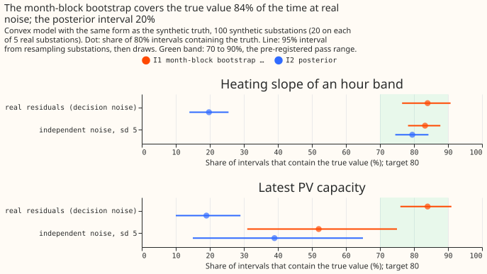
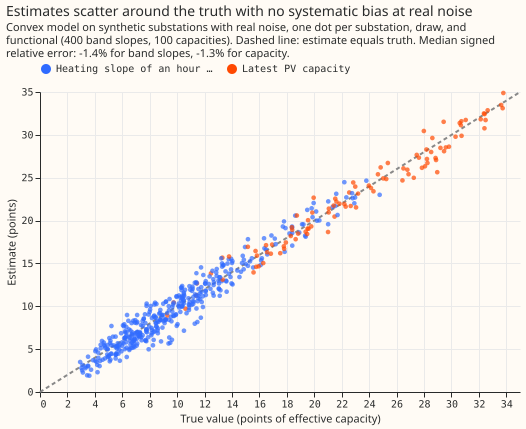
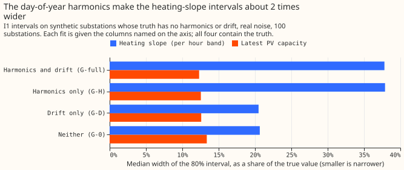
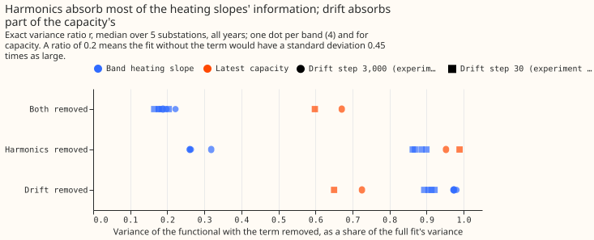
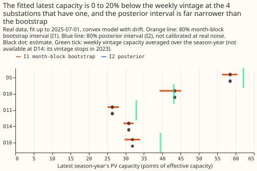

# Differentiable physics, N5: does the convex model identify heating slopes and PV capacity at realistic noise?

**At the noise the real fits have, the convex model's 80% month-block bootstrap intervals contain
the true heating slope and the true PV capacity 84% of the time each, but a heating slope is only
known to within about 38% of its size.** The pre-registered verdict is `refuted`, because the
capacity interval covers the truth only 52% of the time when the noise is independent. The shortfall
is a bias of about 0.24 points of capacity that comes mainly from the drift penalty at its tuned
step of 3,000, and it vanishes at Part 4's step of 30 (bias 0.02 points, coverage 78%, a post hoc
check). Against the noise-free fit's own value the same intervals cover 85%, so the interval method
works and the bias is the problem. The truth in this test has the model's own form, so the test
cannot show the bias that a wrong PV shape causes (experiment 112's gate test 1). The posterior
interval of the same fit covers only 20% at real noise and must not go on a card. The day-of-year
harmonics and the drift term can reproduce the seasonal cycles of temperature and of clear-sky PV,
and the harmonics absorb about 80% of a heating slope's variance, which is the first hypothesis for
why experiment 112 found slopes and capacities weakly identified; N5 does not test it on 112's
pooled model.

We built 100 synthetic substations on the real calendar, weather, and PV shape of 5 Primary
substations (20 each), put a known heating slope per hour band and a known PV capacity into each,
added either real residuals borrowed from other substations (the decision noise, standard deviation
4.97 points, autocorrelation 0.83 at one half-hour) or independent noise (standard deviation 5.0, no
autocorrelation), and asked how often each 80% interval contains the truth. No forecast is scored,
so there is no quantile score, tail table, or curtailment number. "Identified" means the data fix a
quantity within a narrow range. A "calibrated" interval contains the truth as often as its nominal
80%. The "effective sample size" is the number of independent half-hours that carry the same
information as the autocorrelated rows. The pre-registration is the planned commit of this page
(`ef25882da`, before any fit) and the private plan `briefs/dp_n5.md`.

## Figures

**Figure 1 shows the month-block bootstrap (I1) covering the truth 84% of the time at real noise for
both families, and the posterior interval (I2) 20%.** With independent noise the posterior interval
is fine for heating slopes (80%). The capacity row shows the bias: I1 covers the truth 52% of the
time and the noise-free fit's value 85%. The purple row is a post hoc rerun at Part 4's drift step
of 30, which covers 83% and 80% at real noise and 80% and 78% with independent noise.



**Figure 2 shows the estimates scattering around the truth with a median signed relative error of
-1.4% for band slopes and -1.3% for capacity at real noise.**



**Figure 3 shows the seasonal terms widening the heating-slope intervals.** Where the truth has no
harmonics or drift, the fit that omits both has an I1 interval about 0.55 times as wide (relative
width 0.21 against 0.38; real noise, band slopes). The harmonics alone account for the widening.



**Figure 4 shows which term absorbs the information.** At the drift step of 3,000, the harmonics
carry the heating slopes (removing them leaves 26 to 32% of the variance) and the drift carries part
of the capacity (removing it leaves 73%). At the step of 30 the drift absorbs more of the heating
slopes (removing it leaves 89 to 92%, against 97 to 98%), and the harmonics' unique share falls
(removing them leaves 86 to 90%).



**Figure 5 shows the real fits at the 2025-07-01 cut.** The fitted latest capacity is 5.8%, 19.8%,
and 19.4% below the weekly vintage's season-year mean at D5, D11, and D16, and 0.5% above it at D10;
D14's vintage stops in 2023. At the replicate cut (2024-07-01) D16 is 24.7% below the vintage,
outside experiment 40's 20% band.



## Headline numbers

- **Design:** convex model of `studies.dp_gam` with fitted capacity and D1 drift (ridge 0.1, drift
  step 3,000), one design per substation, cut 2024-07-01, all years, lockdown out. Every fit is a
  column subset of that design. 20 draws at each of D5, D10, D11, D14, and D16. Truth heating totals
  are U(0.7, 1.3) times the real fit's (floor 2 points per 10 °C); capacity is U(5, 25) points then
  U(1, 5) increments; truth T-HD keeps the real fit's harmonics and drift, and T-0 zeroes them. Real
  noise is whole months of other decision substations' residuals, other years, with a random sign;
  4.7% of slots were empty (set to zero). One draw can reuse a donor month for several of its
  months.
- **Decision rule, per family (I1 coverage of the truth in the real-noise cell and the
  independent-noise cell):** band slopes `calibrated` (84% with a site-clustered 95% interval of
  76.0 to 90.8%, and 83%, 78.5 to 88.0%); capacity `overconfident` (84%, 76.0 to 92.0%, and 52%, 32
  to 74%). Verdict `refuted`. The independent-noise cell is a gate cell with the same standard
  deviation as the real noise but no autocorrelation.
- **Width, real-noise cell:** band slopes 3.3 points per 10 °C, 38% of the truth, so `weak`;
  capacity 2.8 points, 12% of the truth, so `precise`. With independent noise 8% and 3%.
- **Posterior interval (I2) at real noise:** 20% (bands) and 19% (capacity). The inflated
  bootstrap-to-sandwich variance ratio is 27 (bands) and 25 (capacity), so the effective sample size
  is 0.23% (bands) and 0.70% (capacity) of the rows. I1 is 5.0 and 4.5 times as wide as I2 in the
  simulation, and on the real data 4.6 times (2.5 to 6.0) for slopes and 6.4 times (2.8 to 31) for
  capacity.
- **Penalty bias on capacity (analytic, full fit):** median -0.24 points (median absolute 0.35; the
  sign varies by site, 40% of draws positive) at drift step 3,000, of which -0.23 comes from the
  drift penalty and -0.01 from the ridge. At step 30 it is -0.02 points. The bias is 0.51 of the
  interval width with independent noise and 0.13 at real noise. For band slopes the median absolute
  bias is 0.07 points at step 3,000 and 0.004 at step 30.
- **Seasonal misfit in the donor residuals:** fitting the full model to the real noise alone,
  unbounded, returns -0.4 to -1.5% of the true slope and -1.0% of the true capacity on average. The
  bounded fit's 5 to 6% measures the zero bound (every fit sits on a bound), not misfit.
- **Absorption (G-0 against G-full):** r is 0.18 to 0.22 for band slopes and 0.67 for capacity at
  drift step 3,000, and 0.16 to 0.20 and 0.60 at step 30. The capacity ratio is above the 0.56
  limit, so the label is `absorption partial` at both penalties, though the heating slopes alone
  would be `absorption large`. The I2 width ratios (0.44 and 0.83 at real noise) equal the square
  roots of r (0.44 and 0.82) by construction. The I1 width ratios agree with them with independent
  noise (0.43 and 0.82) and at real noise for band slopes (0.53, 0.09 above, inside the 0.1
  tolerance) but not for capacity (1.08 against 0.82).
- **Other arms (I1 coverage, real noise, T-HD unless stated):** G-full-30 83% and 80%; capacity
  pinned to the truth 84%; pinned to 0.8 times the truth 83% (the median slope error moves by 1.2
  percentage points from the pinned-truth arm); no bounds 84% and 79% (95% of fits have an active
  heating bound); G-0 on T-HD 27% and 0%, with slopes overstated by 66% and capacity by 35%; the
  2-year window 85% and 81%, only 1.2 times as wide for slopes and 0.93 times for capacity. On T-0:
  G-0 73% and 71%, G-H 84% and 75%, G-D 75% and 80%. G-H has no drift and keeps the harmonics, as
  the pooled model does; its band intervals are as wide as G-full's.
- **Noise:** autocorrelation 0.83, 0.44, and 0.21 at lags of 1, 48, and 336 half-hours; standard
  deviation 4.97 points.

## Predictions against outcome

- **Held:** I1 coverage 70 to 90% in the decision cell for both families; band slopes `weak`;
  capacity width under 25%; I2 under 60% at real noise; tau between 3 and 30; I1 and I2 both 70 to
  90% for band slopes with independent noise; r at most 0.36 for every band slope; the I1 width
  ratio within 0.1 of the square root of r for band slopes; G-0 on T-HD under 50%; the pinned-0.8
  arm within 10%; an active bound in over 30% of fits; unbounded coverage within 5 points (exactly 5
  for capacity); spectral share over 70% in G-full; I1 2 to 5 times I2 in the simulation; the
  night-band slope excluding zero at all 5 real substations; the penalty bias under a quarter of the
  width at real noise (0.13); the noise-only bias under 5% (unbounded).
- **Failed:** I1 and I2 both 70 to 90% for capacity with independent noise (52% and 39%); the
  penalty bias under a quarter of the width with independent noise (0.51); r at most 0.56 for
  capacity (0.67); harmonics giving the smaller r for capacity (the drift does, 0.73 against 0.95);
  drift giving the smaller r for the night band (the harmonics do, 0.26 against 0.97);
  independent-noise widths at 30 to 60% of the real-noise widths (23% and 25%); G-0's spectral share
  under 50% (70 to 83%); 2-year widths 1.3 to 2 times the all-years widths (1.2 and 0.93); the I1
  width ratio within 0.1 of the square root of r for capacity at real noise; I1 2 to 5 times I2 on
  the real capacity (6.4 times).
- **Real data (2025-07-01 cut):** I1 capacity intervals are 2.7 to 5.9 points wide. They overlap the
  vintage's 20% band at the 4 substations with a vintage.

## Substation cards for the five decision substations

Provisional: fitted to past weather on a screening run, fit up to 2025-07-01, 80% month-block
bootstrap (I1), heating in points of effective capacity per 10 °C. Heating slopes carry the label
"80% month-block bootstrap; calibrated for noise on in-family synthetic data (N5); excludes PV-shape
bias; weak". The capacity family failed its gate, so it gets no convex interval on a card and Part
5's capacity rule may not use these intervals; the table below lists them only as reference. Pooled
or variable-projection numbers carry "weakly identified at real noise levels (experiment 112)"; none
are printed here, because this experiment did not read experiment 105's or 112's pooled fits.

| Substation | Night | Morning | Midday | Evening |
|---|---|---|---|---|
| D5 | 7.9 to 10.5 | 9.7 to 13.3 | 9.6 to 13.0 | 8.3 to 10.9 |
| D10 | 15.5 to 19.8 | 17.8 to 22.5 | 18.8 to 23.7 | 16.1 to 20.2 |
| D11 | 6.9 to 9.7 | 9.2 to 12.1 | 8.9 to 12.2 | 6.7 to 10.0 |
| D14 | 5.2 to 7.0 | 7.8 to 9.2 | 9.3 to 10.7 | 7.0 to 9.0 |
| D16 | 4.3 to 6.6 | 5.5 to 8.0 | 6.1 to 8.9 | 3.4 to 5.8 |

**Not calibrated per the pre-registered gate, so not for a card:** the latest season-year's
capacity, I1 80% interval against the weekly vintage's season-year mean (points).

| Substation | Fitted capacity | I1 interval | Vintage mean |
|---|---|---|---|
| D5 | 58.5 | 56.3 to 60.5 | 62.1 |
| D10 | 43.4 | 39.3 to 45.2 | 43.2 |
| D11 | 26.4 | 25.1 to 28.2 | 32.9 |
| D14 | 30.9 | 29.4 to 32.2 | not available (vintage stops in 2023) |
| D16 | 31.9 | 29.8 to 34.0 | 39.5 |

## Checks

- **Median forecast minus mean forecast, per site:** not applicable; no forecast is made. The
  estimates' own bias is the median signed relative error, -1.4% (bands) and -1.3% (capacity).
- **Mean-forecast error beside the quantile score:** not applicable for the same reason.
- **Triggers fired:** (2) the convex model's capacity is `precise` at real noise where experiment
  112's pooled fit failed, several predictions failed without a tested explanation, and the fitted
  capacity is more than 20% below the vintage at the replicate cut's D16 (24.7%); the explanation
  recorded here is the seasonal terms and the in-family truth; (7) the cards, Part 5's capacity
  reading, and the next pooled test depend on the result. Not fired: (1) all five controls pass (the
  largest relative difference from `fit_gam` is 4.6e-11, and from a dense bounded least-squares fit
  4.9e-10; noise-free recovery is exact to 1.6e-12 over 235 checks; I2 covers 79.5% of the
  noise-free value over 500 independent-noise draws; I1's coverage on the cell's 100 draws is 78%
  and 81%; every resample keeps every quarter's size; and no row is past its cut); (3) coverage and
  bias point the same way (the capacity bias lowers coverage); (4) leaving any one site out leaves
  the labels unchanged (the capacity row stays `overconfident` and the band row `calibrated`,
  absorption stays `partial`), and leaving D16 out moves the capacity independent-noise interval to
  26 to 61%, wholly below 70%; (5) G-full never beats the true smaller G-0 on T-0 in error, and the
  pinned-truth arm's slope error (14.65% root mean square) matches G-full's (14.62%); (6) cannot be
  checked yet, because Part 5 has not run. A fresh Opus audit ran; its findings are triaged in this
  pull request.

## Caveats and what to try next

- **Caveats:** ERA5 and CAMS flatter the solar term. In-family truths cannot show PV-shape bias
  (experiment 112's gate test 1). The donors are the other decision substations. The inflation is an
  approximation (uninflated I1 covers 83% and 80%). The noise is not 112's (whole months of the same
  season from another year, not weeks from any season). The capacity's supporting months, as
  counted, are 11 and not the planned 6. Season-years with under 1,000 training rows get no capacity
  column (see the data-processing page). The 2024-07-01 replicate cut is reported only for the
  capacity-against-vintage comparison, not for the intervals.
- **Next:** a pre-registered gate of the step-30 convex model (both noise cells) before any capacity
  interval is printed, with Part 5's capacity rule waiting on it; a test of the pooled model with
  the same real-residual noise before reading any pooled slope or capacity; Part 5's K-base ranges
  and `dp_pinned_capacity` beside the real intervals once Part 5 has run.

## Reproduce

```bash
uv run python ml-experiments/00113-*/e00113_grid.py reals
uv run python ml-experiments/00113-*/e00113_grid.py control
uv run python ml-experiments/00113-*/e00113_controls.py static
uv run python ml-experiments/00113-*/e00113_controls.py noisy
uv run python ml-experiments/00113-*/e00113_grid.py main
uv run python ml-experiments/00113-*/e00113_grid.py extra
uv run python ml-experiments/00113-*/e00113_analytic.py
uv run python ml-experiments/00113-*/e00113_real.py
uv run python ml-experiments/00113-*/e00113_summary.py
uv run python ml-experiments/00113-*/e00113_report.py
uv run python ml-experiments/00113-*/e00113_charts.py
```

Every number above is printed in `report.txt` next to this page.
