# Differentiable physics, N3 and N4: interaction terms and a per-site heating threshold

**Letting the convex model's heating response differ between the two halves of each hour band
lowers its day-ahead error after the recent-error filter by about 0.04 points, at all five
substations in both years.** The model is the convex per-substation model of Primary demand that
Part 6 ([experiment
111](../00111-differentiable-physics-6-ens-forecast-engine-against-bg2/result.md)) made the
differentiable-physics (DP) series' candidate (GAM-K), and every number here uses past weather. Letting heating or lighting differ between weekdays and weekends adds nothing.

**Choosing the heating threshold separately for each substation did not clearly help.** The score
changed by -0.012 points, and the interval spans zero. The profiled loss prefers a threshold below
the usual 15.5 degrees C at four of five substations, but only D10 passes the rule that allows a
threshold to be printed, and its threshold sits at the edge of the 12 to 19 degree grid. **The
verdict is `partly supported` (N3 `gain`, N4 `tie`), and two audit triggers fired (below), so an
Opus audit comes before the merge.**

We fitted GAM-K's convex model per substation at four yearly cuts, froze each fit for the year after
its cut, and corrected its day-ahead forecast with a Kalman filter of its recent errors. The base
model (B0) was compared with arms that add interaction terms (N3) or a per-site threshold (N4). The
tuning year chose the penalty weights and filter settings, the replicate year checked the sign, and
the scored year decided. N13 (the PV orientation mix) was dropped: [experiment
73](../00073-pvdis-6-orientation-mix-and-dc-ac-ratio/result.md) and
[77](../00077-pvdis-6b-fitted-solar-shape-in-arm-am/result.md) found it unidentified or
immaterial. The first commit of this branch (`ce188807d`) is the plan, written
before any fit.

## Terms

- **Points:** percentage points of a substation's effective capacity. A heating slope is in points
  per 10 degrees C below the threshold.
- **B0 and B0-K:** GAM-K's convex model (24-month window, no drift, pinned PV capacity, ridge 0.1)
  without and with the Kalman filter of recent errors. The suffix `-K` always means "after the
  filter".
- **T1, T2, T3, T-all:** B0 with each heating column split by day type (T1: weekday against
  Saturday, Sunday, and bank holiday), each heating column split by half of its hour band (T2:
  00 to 03 against 03 to 06 local time, 06 to 08:30 against 08:30 to 11, 11 to 13:30 against 13:30
  to 16, 16 to 20 against 20 to 24), each lighting ramp split by day type (T3), or all three
  together (T-all, where each heating column splits four ways). A difference penalty ties the
  pieces towards each other, and a weight lambda sets its strength.
- **H-site:** B0 with the heating hinge at the threshold, from 12 to 19 degrees C in 0.5 degree
  steps, that minimises the training loss at each substation and cut.
- **Effective nats:** a loss difference over 2 times the noise variance times tau, where tau (21.4
  here) is the factor by which autocorrelated noise inflates the variance of a heating slope.

## Figures

**Figure 1 shows T-all-K ahead of B0-K by 0.039 points, with the interval wholly below zero and the
replicate year matching.** The gain survives B0's filter settings (the control row) and is
about three times larger after the filter than before. The per-site threshold's interval spans
zero. T2 carries the whole gain.

**Figure 2 shows every arm's score beside the references.** The filtered convex models score
between 2.22 and 2.26 pooled over the five substations. Lagless XGBoost with the filter scores
2.50, the manual heuristic 3.49, and climatology 4.07.

**Figure 3 shows the gain sitting in the morning and evening bands, and in winter.** T-all-K gains
0.066 points in the morning and 0.061 in the evening, 0.022 at night, and loses 0.004 at midday.
T2-K carries the pattern, and T1-K and T3-K are near zero.

**Figure 4 shows each substation's loss over the heating thresholds at the scored cut.** D5 and D10
bottom out at the 12 degree edge, D11 at 12.5, D16 at 13.5, D9 at 14.5, and D14 at 15.5. The loss at
15.5 degrees is 39 effective nats above the minimum at D10, 15 at D11, 8 at D5, 6 at D16, and 0 at
D14.

**Figure 5 shows gate 3, the synthetic test of the threshold rule.** The 80% interval covered the
true threshold in 88 of 100 synthetic substations, and the median interval width was 3.0 degrees C.

**Figure 6 shows gate 2, the synthetic test of the interaction terms.** With a real interaction
sized to a 0.03 point gain, T-all beat B0 in 80 of 100 draws. Without one, T-all lost 0.006 points
on average.

## Checks

- **Median minus mean forecast, per site:** 0.000 points at every site for every arm, by
  construction, because the spread of each arm is centred on its median.
- **Mean-forecast error beside each contrast:** C1's mean absolute error of the mean forecast
  changed by -0.076 points (replicate -0.069), the same sign as its quantile score. C2's changed
  by -0.023 (replicate -0.034).
- **Triggers fired:** 2 and 7 of the seven in the `ml-experiment` skill. **Trigger 2** fired because
  gate 3 passed and one real substation (D10) passed the printing rule, against the plan's
  prediction of neither. **Trigger 7** fired because a `gain` would change GAM-K's base on one year
  plus a replicate at the screening tier. Triggers 1, 3, 4, 5, and 6 did not fire. An Opus audit
  runs before the merge, and its findings and their triage will be recorded here.
- **Not a trigger but worth reading:** gate 2 passed on the margin (80 of 100 draws against 80
  needed), and gate 3 passed on the margin (median width 3.0 against at most 3.0, placebo recovery
  0.70 against 0.70).

## Substation cards

**Provisional: fitted to past weather on a screening run.** One card per decision substation shows
B0's daily profile by day type, holiday and Christmas effects, the loss against heating threshold,
B0's heating slope by hour band, T-all's heating slope by half-band and day type, B0's
thermal-inertia mix, the lighting terms, the solar capacity, and the filter's daily level and
anomaly over the scored year. **Heating slopes are weakly identified at real noise levels
([experiment
113](../00113-differentiable-physics-n5-convex-identification-at-realistic-noise/result.md));
compare across substations with care.** A threshold appears only where it passes
the printing rule, which is D10 alone: 12 degrees C (80% interval 11.75 to 12.75), at the edge of
the grid, so the true minimum may lie lower. The other substations read "threshold not identified
at this substation". The fitted capacities carry no interval and are not measurements. The
transient anomaly is near zero at day-ahead leads, so its panel is flat. D9 has 9 months of history
at the replicate cut.

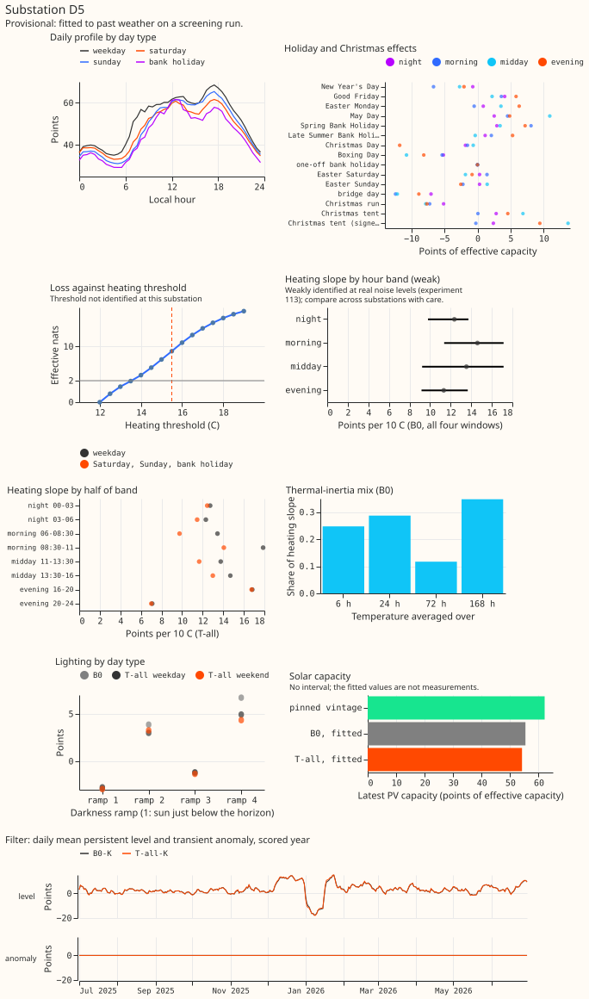

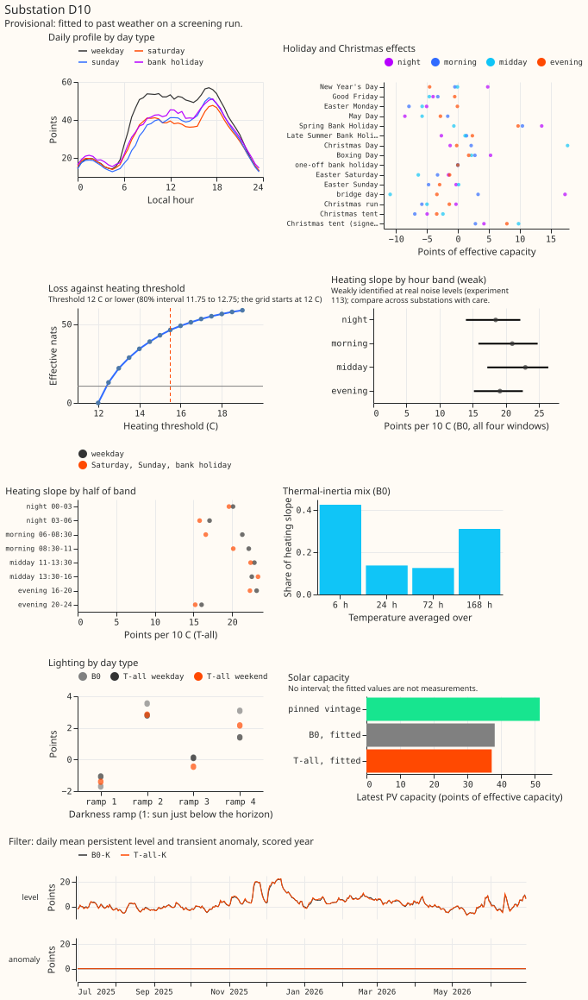

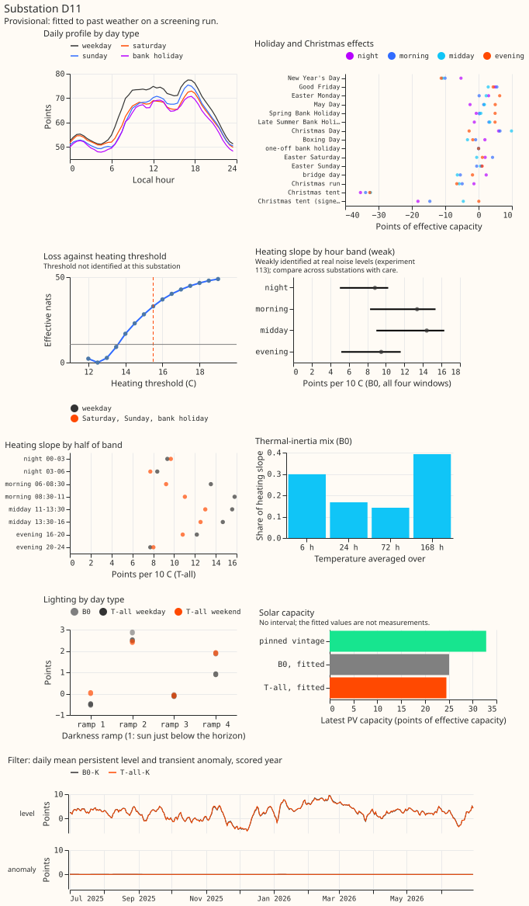

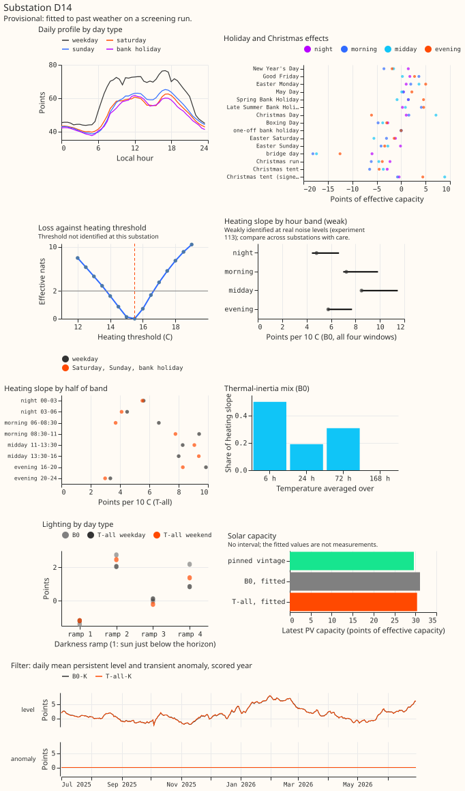

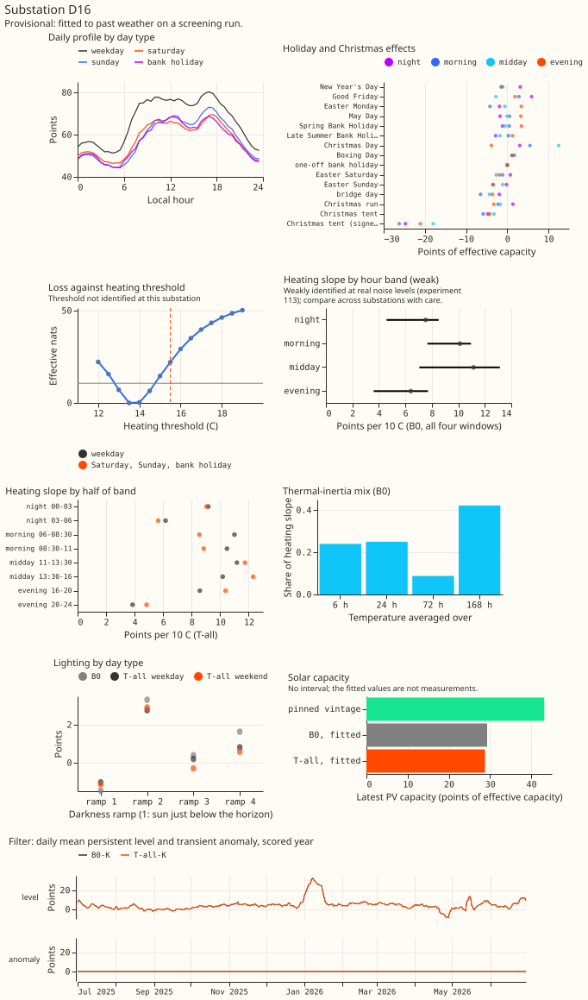

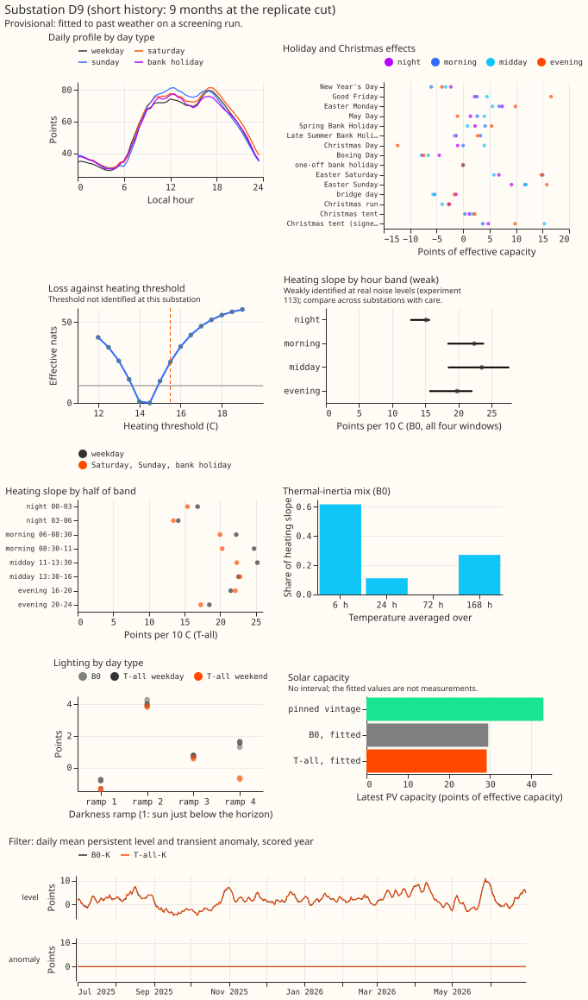

**Sample weeks.** Each figure shows one week per season of the scored year, chosen by one rule
before any score was read: the week that starts on the second Monday of the season's middle month.
B0-K sits beside T-all-K, with the median forecast, the 80% and 90% bands, and the observed power.
The panels show whether the half-band gain is visible in a single week; at this scale it is not,
because a gain of 0.04 points is under 2% of the score. Sample weeks are drawn for the five decision
substations only.

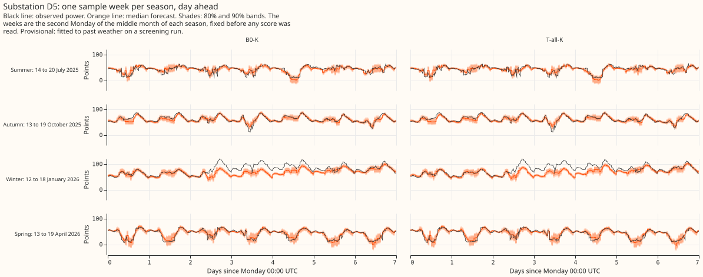

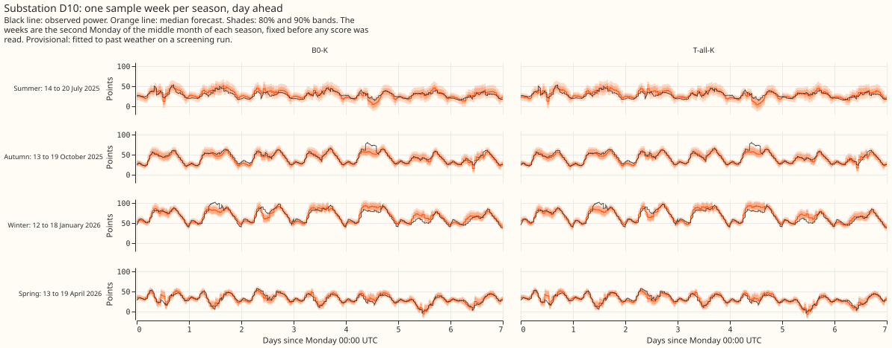

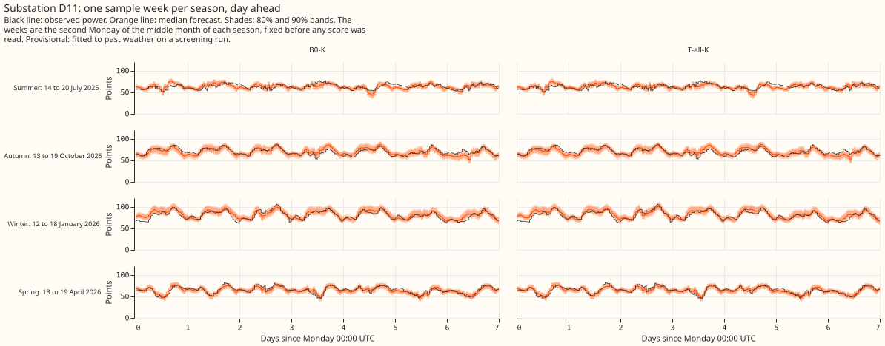

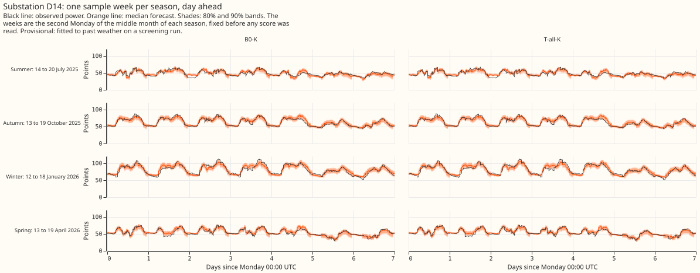

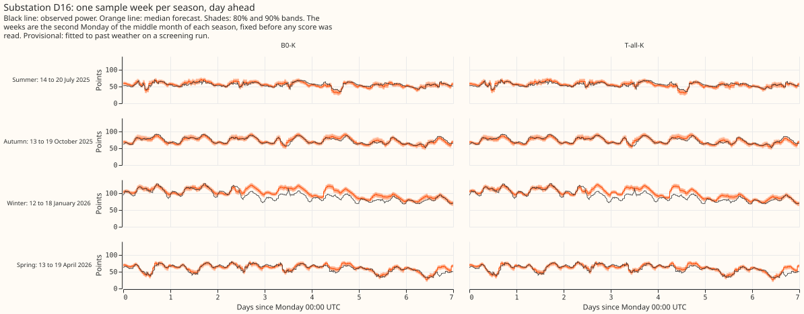

## Numbers

Every number on this page is printed by `e00114_report.py` into `report.txt`.

- **Arms and schedule:** B0, T1, T2, T3, T-all, and H-site, each unfiltered and filtered, fitted at
  2022-07-01 (the tuning year's replica), 2023-07-01 (tuning), 2024-07-01 (replicate), and
  2025-07-01 (scored). One frozen fit per arm and cut, no refits, one seed, day-ahead (09:00 UTC
  origins). The screening tier's monthly refits would be a follow-up.
- **Chosen settings (tuning year, filtered score):** lambda 1 for T1, T2, and T-all (the weakest of
  1, 100, and 10,000) and 10,000 for T3. New columns at lambda 1: about 42 effective degrees of
  freedom for T-all (median over the five substations).
- **Absolute scores, scored year (points, five substations pooled):** B0 2.884, B0-K 2.255, T-all
  2.872, T-all-K 2.216, H-site 2.882, H-site-K 2.243. Replicate year: B0-K 2.261, T-all-K 2.223,
  H-site-K 2.240. Tuning year: B0-K 2.099, T-all-K 2.067, H-site-K 2.101.
- **C1 (N3), T-all-K minus B0-K:** scored -0.0387 (97.5% interval -0.0696 to -0.0140), 5 of 5
  sites better; replicate -0.0384, 5 of 5; all rows including switching events -0.0428; November
  to March -0.0540, April to October -0.0288. **Label: `gain`.**
    - **Beside:** T-all minus B0 (unfiltered) -0.0119 (-0.0365 to +0.0116), 4 of 5 sites. T-all-K
      with B0's filter settings minus B0-K -0.0358 (-0.0601 to -0.0140), so the gain is not in the
      filter's settings (the filter-fit difference is -0.0029, -0.0120 to +0.0029).
    - **Exploratory (95%):** T2-K -0.0396 (-0.0590 to -0.0232), 5 of 5 sites, replicate -0.0334;
      T1-K +0.0019 (-0.0058 to +0.0094); T3-K -0.0001 (-0.0002 to +0.00004).
    - **Leaving one site out:** the estimate runs from -0.0296 (without D5) to -0.0470 (without
      D11), and every interval stays below zero.
- **C2 (N4), H-site-K minus B0-K:** scored -0.0120 (-0.0296 to +0.0069), 5 of 5 sites better by
  small amounts; replicate -0.0210, 5 of 5. Unfiltered -0.0023 (-0.0437 to +0.0405), 2 of 5.
  **Label: `tie`** (gate 3 passed, so the contrast is labelled).
- **D9, descriptive (scored year only):** C1 -0.0130, C2 -0.0140.
- **Gate 3 and the printing rule:** tau 21.4 (15.9 to 30.4 across substations; experiment 113's
  27). At the scored cut the arg-min and its 80% interval are D5 12.0 (11.75 to 14.75), D10 12.0
  (11.75 to 12.75), D11 12.5 (11.75 to 13.75), D14 15.5 (13.25 to 16.25), D16 13.5 (11.75 to
  14.75), and D9 14.5 (12.7 to 15.3). Only D10 passes the rule.
- **Capacity check (descriptive):** T-all with a fitted PV capacity minus B0 with a fitted capacity
  is -1.2 points at D5 down to -0.4 at D9 (every 80% interval lies within about -1.8 and -0.1), so
  no capacity move is flagged beyond 2 points.
- **Tails, scored year, five substations (coverage, pinball):**

    | Arm | q01 | q05 | q95 | q99 |
    |---|---|---|---|---|
    | B0-K | 0.0150, 0.1726 | 0.0536, 0.5832 | 0.9417, 0.5949 | 0.9837, 0.1813 |
    | T-all-K | 0.0142, 0.1716 | 0.0531, 0.5758 | 0.9408, 0.5878 | 0.9838, 0.1798 |
    | H-site-K | 0.0149, 0.1722 | 0.0530, 0.5799 | 0.9411, 0.5951 | 0.9831, 0.1826 |
    | Manual heuristic | 0.0423, 0.2477 | 0.0614, 0.7616 | 0.9060, 0.9163 | 0.9333, 0.3553 |

  The `gain` arm leaves tail coverage within 0.1 points of B0-K's, so no tail flag is raised.
  Nominal coverage is 0.01, 0.05, 0.95, and 0.99.
- **Reference contrasts (95%):** B0-K minus Part 4's window arm with the filter (WK) -0.0118
  (-0.0411 to +0.0049); minus Part 4's A2 -0.0201; minus lagless XGBoost with the filter -0.2412
  (-0.3558 to -0.1221); minus the manual heuristic -1.2334 and climatology -1.8127.

## Predictions against outcome

- **C1 between -0.06 and +0.01 in both years:** held (-0.039 and -0.038).
- **T2-K carries most of any gain, in winter and in the morning and evening bands:** held.
- **T2-K's unfiltered gain at least twice its filtered gain:** failed. The unfiltered gain (-0.013)
  is a third of the filtered one (-0.040).
- **T1-K and T3-K within 0.02 points, filtered or not:** held.
- **Gate 2 passes, and no capacity move is flagged:** held.
- **N4 gate fails on width, B0's tau 10 to 40, no real substation passes the printing rule, the
  profile flat over 3 degrees C or more at 4 of 5 substations, arg-min at a grid edge at 1 or
  more:** partly failed. The gate passed (median width exactly 3.0), tau was 21.4, and D10 passed
  the printing rule. No profile was flat over 3 degrees C, and the arg-min sat at the grid edge at
  D5 and D10.
- **C2 between -0.04 and +0.03, replicate negative at 3 of 5 sites at most:** half held. C2 was
  -0.012, but the replicate was negative at 5 of 5 sites.
- **B0-K within 0.06 of WK, run under 1.5 hours:** held (-0.012; about 10 minutes of compute).

## Caveats and choices made after the plan

- **Past weather:** both gains use ERA5 temperature at the target half-hour, a ceiling for a live
  forecast. Part 6's calibration moved ENS temperature by -1.15 to +2.05 K and its filter gain on
  ENS was about two-thirds of Part 4's. Only an ENS confirmation with monthly refits tests transfer.
- **One scored year plus a replicate, frozen fits, hindsight switching masks** shared by every arm.
- **Lambda sits at the weakest penalty tried** for T1, T2, and T-all. A weaker penalty was not
  tried, and the tuning-year gain was still growing towards it.
- **Edits to the plan, all before any fit:** test 1's tolerance for the fitted-value gap at lambda
  10^10 went from 1e-6 to 1e-5 points, because the penalised solve in float64 has a floor of 0.8e-6
  to 2.6e-6 points (the plan commit is amended in its own commit). Gate 2's amplitude was set on
  the gain attributable to the interaction (the gap to the true-parameter forecast under truth I,
  less the gap under truth 0), because the estimation error alone is about 0.1 points. T-all splits
  each heating column four ways, and its two difference penalties share one lambda.
- **Leaks, none reaching a scored row:** the 2022-07-01 replica, which supplies the tuning year's
  spread, reads the 2023-08-07 capacity vintage, 13 months late; the 2023-07-01 cut has the 5-week
  vintage leak; D9's 2024-07-01 fit reads the 2025-04-14 vintage; the replicate year's filter
  spread is in sample for the filter's hyperparameters.
- **In-family truths:** the synthetic substations have the model's own form, so gates 2 and 3 cannot
  show a wrong PV shape.
- **No new data-processing finding** for `docs/ml-experiments/data-processing.md`.

## What to try next

- **An ENS confirmation of T-all or of T2 alone as GAM-K's base,** with Part 6's monthly refits.
  A `gain` on past weather becomes a candidate only after that run, which needs its own plan.
- **A threshold grid that reaches below 12 degrees C,** to see where D5's and D10's minima lie
  before drawing any conclusion about the heating threshold.
- **Combining T2 with the shape state of the filter** (a later follow-up, outside this plan).
