**Take-home: a daily shape learned from recent readings lowers the physics-based forecast's
day-ahead error by 0.075 points (about 3%) at five Primary substations, but a simple average of the
last 14 days' errors gains as much, and the shape state failed its own speed check.** The shape
state cut the day-ahead score in two separate periods at 5 of 5 substations, and by 0.112 points in
the scored winter (a post hoc breakdown). The 14-day average (recipe R) scored 0.014 points better
than the shape state (interval -0.014 to +0.048, no difference), so the added machinery is not
justified yet. The shape state recovered 0.35 of an injected change in two weeks against a
pre-registered floor of 0.4, so the verdict is `inconclusive`. A faster shape state, tried
afterwards, chosen from the gate's formula before any score of it was read, and labelled post hoc,
passed that check and beat both K0 and R, and needs a
pre-registered rerun to count.

## What was asked, and the answer in plain terms

**The question was whether the part of a demand forecast's error that lies in the shape of the
day can be removed by learning that shape from the last few days of readings.** The forecast is for
the electricity demand of five Primary substations (the stations that step power down from 33 kV to
11 kV) for the day after the forecast is made, up to 168 hours ahead. It comes from a
physics-based demand model driven by ECMWF ensemble (ENS) weather forecasts, with a Kalman filter
that estimates from recent readings how far the model has been off ([experiment
111](../00111-differentiable-physics-6-ens-forecast-engine-against-bg2/result.md); [Kalman
(1960)](https://doi.org/10.1115/1.3662552)). That arm is called K0 here. The shape state (arm KW)
gives the filter 48 more numbers, one per half-hour of the day, which it adjusts from every
reading and adds to the forecast.

**Scores are in points of effective capacity, and lower is better.** A point is 1% of a
substation's effective capacity (the capacity its readings are scaled by). The quantile score is
twice the mean pinball loss over 11 quantiles, as in [experiment
87](../00087-bg2-best-guess-assembled-with-drop-one-ablations/result.md). Day D+1 is the UTC day
after the forecast's 09:00 UTC origin (leads of 15.5 to 39 hours). Every setting was chosen on the
odd months of July 2024 to June 2025 (the tuning months). The even months of the same year are the
replicate months, which no setting had seen. The scored year is 2 July 2025 to 29 June 2026, the 292
runs of experiment 87's `fold_a_daily_gap_v1`. Rows inside the hand-filtered switching events are
left out. Weather is ENS, and the demand model is fitted to estimates of past weather. The
recent-error filter follows the design of [experiment
106](../00106-differentiable-physics-4-all-years-drift-and-recent-level/result.md).

**The scored year chose the idea's form, which is why the replicate months exist.** A screening of
the same data, run by the session that planned this experiment and recorded in the [plan
commit](https://github.com/openclimatefix/nged-substation-forecast/commit/4c8382008), had suggested
the idea, so a gain in the scored year alone
would not count. Both periods showed the same gain.

**Gate failure: the verdict is capped at `inconclusive`.** The pre-registered check that the shape
state learns an injected change fast enough failed its floor, so all scoring below was run after a
failed blocking test. The first gate run is kept in full (see "The gate"), and the faster shape
state is a post hoc arm that never passed the pre-registered gate.

## Figures

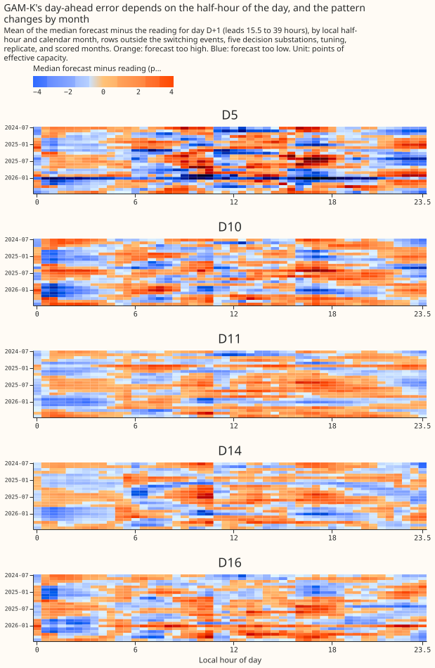

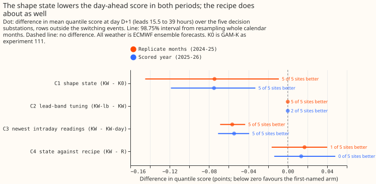

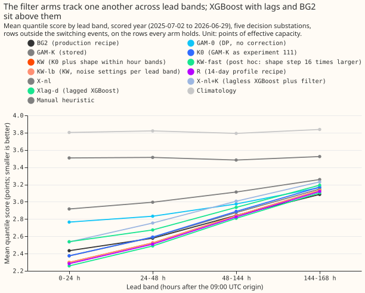

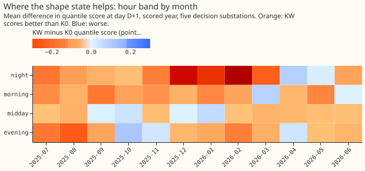

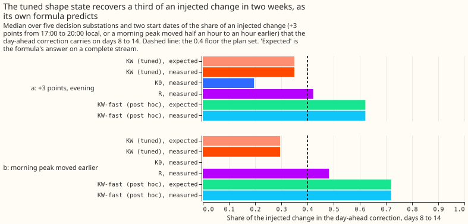

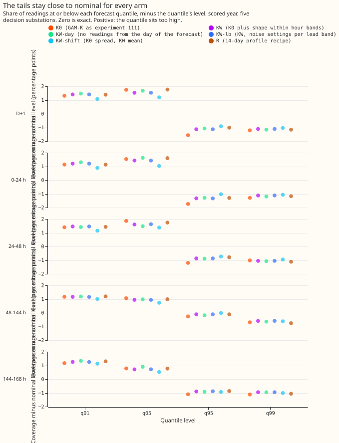

## Results

- **Arms.** K0 (GAM-K, reproduced exactly from experiment 111's stored output); KW (the decision
  arm: K0 plus a shape with zero mean inside each of the four hour bands); KW-lb and K0-lb (noise
  settings chosen per lead band); KW-day (no readings from the day of the forecast); R (K0 minus
  kappa times the 14-day mean D+1 error profile by local half-hour, kappa 0.75 chosen on the tuning
  months); R75 (the same as R, kappa fixed at 0.75, so identical); KS and KS1 (exploratory shape
  variants); KW-nomid (midday shape frozen at zero); KW-pl52 (the shape from 52 weeks earlier);
  delay arms at 0, 24, and 33 hours; and KW-fast (post hoc: the shape step 16 times larger).
  No arm refits the demand model, so the experiment reuses experiment 111's fits and member
  forecasts.
- **Rows and compute.** Five decision substations (D5, D10, D11, D14, D16) with D9 beside them;
  41,126 D+1 rows in the replicate months and 464,228 rows over all leads in the scored year on
  the rows every reference holds. Retraining schedule: none, because experiment 111's monthly
  refits are reused; the contrasts compare filters on one set of fits. Run time: about 13 minutes
  on 6 cores for all arms.
- **Headline: the shape state (C1, KW minus K0 at D+1, 98.75% intervals).** Replicate months
  -0.0745 (-0.1449 to -0.0091, 5 of 5 substations better); scored year -0.0750 (-0.1188 to -0.0329,
  5 of 5). Absolute scores in the scored year: K0 2.525, KW 2.450. Over all leads: -0.0661 and
  -0.0543. The gain at 48 to 144 hours is 0.049 (scored year), 66% of the D+1 gain, so more than
  half remains.
- **C2, lead-band tuning (KW-lb minus KW):** 0.0000 in both periods. The tuned multipliers
  ([4, 4, 0.5, 0.25] for KW) barely change the filter, because the observation noise sits at 0.05
  to 0.09 points at five of six substations, so the filter already trusts each reading.
- **C3, the newest readings (KW minus KW-day):** -0.0564 (replicate) and -0.0546 (scored) at D+1,
  5 of 5 substations. The gain is in the night and morning bands (-0.167 and -0.061 in the scored
  year) and none in the midday and evening bands, where the readings of the forecast day arrive too
  late to help.
- **C4, shape state against the recipe (KW minus R):** +0.0170 (-0.0164 to +0.0401) and +0.0136
  (-0.0138 to +0.0483); 1 of 5 and 0 of 5 substations favour KW. The plan's rule for
  choosing between them makes R the candidate, because C4 is not below zero.
- **Post hoc, KW-fast.** Against K0: -0.109 (-0.190 to -0.047) and -0.113 (-0.143 to -0.086), 5 of 5
  each. Against R: -0.0175 (-0.0405 to +0.0038) and -0.0244 (-0.0349 to -0.0141), 5 of 5 each.
  Intervals are 95%. The arm was chosen from the gate's analytic recovery (the smallest step factor
  on the grid 2, 4, 8, 16, 32, 64 giving at least 0.6), before any score of it was read. Only the
  docstring of `FAST_SHAPE_FACTOR` in `e00115_arms.py` and the file times of the private work
  folder record that order (the recovery search finished at 10:31 UTC and the KW-fast forecasts
  were written at 10:39 UTC on 20 October 2026); no commit predates the choice.
- **Exploratory (95%, scored year, D+1).** KS minus KW 0.0000: the whole-day zero-mean shape adds
  nothing over the band levels (KS and KW are different arms, whose corrections differ by 0.0002
  to 0.002 points on average and by at most 0.023 at D5, which is why their scores agree to four
  decimals). KS1 (one level and one transient, no bands) minus KW -0.0492
  (-0.0930 to -0.0158, 4 of 5): bands may not be needed. KW-nomid minus KW +0.0008: the midday shape
  does not hurt. KW-pl52 minus K0 -0.0337 and minus KW +0.0412: last year's shape gains about
  half as much as the current one, so the shape drifts. K0-lb minus K0 -0.0027.
- **Telemetry delay (assumed 3.5 hours, never measured).** KW minus K0 is -0.0751 at 0 hours,
  -0.0632 at 24, and -0.0634 at 33. K0's own score rises from 2.524 at 3.5 hours to 2.612 at 24 and
  2.644 at 33 (all on the rows the delay arms share; K0 is 2.525 on the rows it shares with the
  references).
- **References, scored year, on shared rows (D+1, all leads).** K0 2.525 and 2.812; KW 2.450 and
  2.757; R 2.436 and 2.743; KW-fast 2.412 and 2.725; BG2 2.535 and 2.780; Xlag-d 2.638 and 2.877;
  X-nl+K 2.693 and 2.934; GAM-0 2.830 and 2.951; climatology 3.826 and 3.804; manual heuristic
  3.520 and 3.497. KW minus BG2: -0.0855 (-0.2255 to +0.0625) at D+1 and -0.0230 (-0.1621 to
  +0.1212) over all leads, not like for like. K0 rebuilt with a refitted spread is 0.011 worse
  than experiment 111's stored GAM-K over all leads (2.812 against 2.800).
- **D9 beside the decision substations.** D+1 scored year: K0 2.194, KW 2.146; replicate months:
  1.942 and 1.860.

### Winter (November to March; post hoc, because scores were already read)

**KW does not lose to K0 in winter, but it loses to R, and KW-fast does not lose to either.** The
scored year holds one independent winter (2025-26). The replicate months hold two winter months of a
second one (December 2024 and February 2025), so those rows say little. A cold-snap day is a local
day from November to March whose mean ERA5 temperature at the substation is below 3 °C; the rule was
fixed before cold-snap scores were read, a fact that only the docstring of `cold_snap_mask` in
`e00115_report.py` records, because no commit predates the scores. The scored year has 25, 25, 18,
7, and 5 cold-snap days at D10, D11, D14, D16, and D5, so D16 and D5 have too few days to read
alone. The replicate months have 6 to 8 per substation in one or two calendar months, so their
cold-snap intervals are degenerate and are not quoted.

| Scored year, D+1 | Winter | Winter evening | Cold-snap days |
|---|---|---|---|
| KW minus K0 | -0.112 (-0.155 to -0.074), 5 of 5 | -0.056 (-0.111 to -0.005), 4 of 5 | -0.148 (-0.222 to -0.103), 5 of 5 |
| R minus K0 | -0.136 (-0.166 to -0.099), 5 of 5 | -0.134 (-0.181 to -0.084), 4 of 5 | -0.134 (-0.196 to -0.091), 4 of 5 |
| KW minus R | +0.024 (+0.004 to +0.055), 0 of 5 | +0.078 (+0.019 to +0.150), 0 of 5 | -0.014 (-0.043 to +0.023), 4 of 5 |
| KW-fast minus K0 | -0.155 (-0.192 to -0.115), 5 of 5 | -0.125 (-0.177 to -0.073), 5 of 5 | -0.201 (-0.275 to -0.176), 5 of 5 |
| KW-fast minus R | -0.020 (-0.031 to -0.010), 5 of 5 | +0.009 (-0.019 to +0.038), 2 of 5 | -0.067 (-0.092 to -0.052), 4 of 5 |
| KW minus BG2 | -0.330 (-0.426 to -0.255), 5 of 5 | not covered | -0.499 (-0.955 to -0.023), 4 of 5 |

Intervals are 95%, resampling whole months. The winter row for KW minus R is a winter loss for KW at
the tuned step, particularly in the evening, so under the rule that a winter loss holds an arm back
even when the annual mean improves, KW is held back in favour of R until a faster shape state is
confirmed. Annual gains and winter gains point the same way for K0, KW, and KW-fast; the loss is
only KW against R.

## The gate

**The gate failed its blocking test 1 on the first run, and the first run is kept.** All five tests
ran on the tuning months. The forecasts of every period were built before tests 1 and 2 ran, but no
replicate or scored score was read until the gate had run.

- **Test 1, an injected change is recovered: failed.** Median share of the injected change that
  KW's day-ahead correction carries on days 8 to 14: 0.350 of a +3-point evening shift and 0.295 of
  a morning peak moved earlier, against a floor of 0.4. K0 recovers 0.196 and 0.000; R recovers
  0.422 and 0.482. The tuned filter's own formula, evaluated on a complete stream, predicts 0.350
  and 0.295, so the code is right and the tuned shape state is slow. The brief's 0.6 to 1.0 target
  was not reached either.
- **Post hoc reading of test 1 for KW-fast:** 0.621 and 0.720, equal to its expected values. This
  is a labelled post hoc reading and never counts as passing the pre-registered gate.
- **Test 2, no false shape on clean data: passed.** On permuted real streams and synthetic streams,
  the refitted shape step falls to between 4e-5 and 1e-4 points² per day (0.1% to 2% of the tuned
  values), the refitted shape's root mean square is at most 0.053 points, and KW's score is
  within +0.0000 and -0.0051 of K0's.
- **Tests 3 to 5: passed.** K0 reproduces experiment 111's stored output exactly (worst difference
  0 in the stored quantiles and 2e-14 against the code in float64); a change after the cut changes
  no forecast (0 maximum difference, including the ensemble runs and the recipe); the shape sums to
  zero in its blocks to 1e-14.

## Predictions against results

- **Held:** C1 between -0.03 and -0.10 in both periods at 5 of 5 substations; largest in winter
  (-0.112 against -0.051 from April to October); at least half of the gain at 48 to 144 hours; C2
  between 0 and -0.04; C4 within 0.03 and kappa 0.75; KS minus KW within 0.02; KW-pl52 minus K0
  above KW minus K0; tails within the limits (largest coverage gaps at q05, q95, q01, and q99:
  1.60, 1.33, 1.46, and 1.12 points).
- **Failed:** the gain was largest in the night band (-0.154), not the evening band (-0.059); KW
  was not worse than K0 at midday (-0.004 scored, -0.026 replicate) and KW-nomid did not beat KW;
  C3 at D+1 was -0.055, not under 0.02; R75 minus K0 on the median's error was -0.177, not within
  0.02 of the screening's -0.14; the gate's test 1.
- **Not run:** the past-weather check against experiment 106's A2 residual streams, which the plan
  listed among the first arms to cut.

## Decision rule and verdict

**The verdict is C1's label, capped by the gate.** Without the cap, C1 meets `supported`: below
zero in both periods with 5 of 5 substations better, the scored-year interval wholly below zero,
and the estimate (0.075) above the 0.03 threshold. With the failed blocking test the plan's rule
gives `inconclusive`. The plan's follow-on rules give three readings: KW-lb does not replace KW
(C2 is zero); R, not KW, is the simpler candidate (C4 is not below zero); and a winter loss
against R holds KW back.

## Checks

- **Median forecast minus mean forecast per site at D+1 (scored year, points).** KW: D10 +0.002,
  D11 -0.031, D14 +0.022, D16 -0.010, D5 -0.114. K0: +0.003, -0.022, +0.014, -0.014, -0.097. R: D5
  -0.037. The shift of the mean at D5 is the only one over 0.04, and KW-shift (K0's quantiles
  moved by KW's correction) has K0's values by construction.
- **Error of the mean and median forecast beside each contrast (scored year, D+1).** C1: median
  -0.148, mean -0.150. C2: -0.0001 and -0.0001. C3: -0.089 and -0.089. C4: +0.029 and +0.029. The
  quantile score, the median's error, and the mean's error point the same way for every contrast.
- **Triggers that fired.** (1) A control failed: gate test 1, and the screening's R75 reproduction
  (-0.177 against -0.14 within 0.02). (2) A result contradicted its prediction: C3 at D+1, the
  midday band, and KW-nomid, listed above, each with an explanation in this page that no test
  has confirmed. (6) C1's 98.75% interval (width 0.086, scored year) is under a third as wide as the
  sister interval GAM-K minus GAM-0 from experiment 111 (0.291), because the sister contrast is
  four times larger. Triggers 3, 4, 5, and 7 did not fire: no sign differs across the quantile
  score and the errors; no leave-one-substation-out run flips a sign (C1 stays between -0.066 and
  -0.085 in the scored year); no nested arm beats its container (K0, which is KW with the shape
  step set to zero, does not beat KW, and KW-day does not beat KW); no later design depends on C1.
  Trigger 5 is a near miss: KW-fast beats KW by 0.038 and KS1 beats KW by 0.049 at D+1, but
  neither arm is nested in KW (KW-fast is KW with a different shape step, and KS1 has one level
  instead of four), so the trigger's definition does not cover them; the result says the
  marginal-likelihood step is not the best step for the score, and the audit may read it
  otherwise. The Opus audit these triggers call for has not run: status `done` means the runs and
  this page are finished, and the audit and a prose review are conditions of the merge. Its
  findings and their triage are added to the pull request.
- **Tails (scored year, KW, D+1).** Coverage minus nominal: q01 +1.41, q05 +1.53, q95 -1.13, and
  q99 -1.11 percentage points; pinball loss 0.190, 0.617, 0.656, and 0.210. No curtailment cost:
  experiment 87 found no event at the MW Primaries that could rank forecasts. Threshold-weighted
  CRPS is not computed, because `studies.tail_calibration` has no function for it.

## Caveats

- The scored year chose the idea's form, the tuning and replicate months interleave, the 3.5-hour
  delay is assumed, the switching masks are hindsight, the analysis proxy is the control member of
  the latest run, and there are five substations and one independent winter.
- Inherited from experiment 111: the calibration of ENS to past weather is fitted per hour band on
  the tuning months and applied in-sample there, which shrinks the daily error in the tuning stream
  and biases the shape step and kappa against this experiment; the pinned capacity reads
  hindsight weeks; the demand model's last training rows use past weather a live refit would not
  have; and the spread is fitted on the tuning months.
- The tuned observation noise sits at the lower bound (0.05 points) at D9 and close to it at D16,
  D11, D10, and D5, so the filter nearly interpolates the readings. D14 alone has 0.57.
- Generator series are not used. Two series with embedded generation are outside this experiment.

## What to try next

- **Rerun the shape state with its speed fixed in advance.** Tune the shape step so the injected
  change is recovered at or above 0.6 within two weeks, state the floor before scoring, and score
  it against R in winter evenings, which is where KW lost.
- **If KW-fast holds its gain against R, test one level and transient with a shape (KS1)**, which
  scored 0.049 better than KW and has no hour bands to tune.
- **Measure the live telemetry delay.** The shape state's gain and K0's score both depend on it.

## Substation cards

**Provisional: fitted to past weather, forecast on ENS, screening run (KW, scored year).** Each
card shows the shape state by week and local half-hour, the working-day profile at D+1 with and
without the shape, and the cold-snap panel (days counted by the rule above; "too few days to read"
where fewer than 10). The forecast panels show eight fixed weeks, two per season, which were fixed
by calendar before any score was read, plus the week with the largest mean absolute shape state
(chosen from the shape alone). Each week panel shows the readings against the K0 and KW median and
5% to 95% bands.

| Substation | Shape step q_s (points² per day) | Observation noise (points) | Cold-snap days, scored year |
|---|---|---|---|
| D5 | 0.0286 | 0.090 | 5, too few days |
| D10 | 0.0235 | 0.071 | 25 |
| D11 | 0.0042 | 0.057 | 25 |
| D14 | 0.0103 | 0.569 | 18 |
| D16 | 0.0203 | 0.053 | 7, too few days |
| D9 (beside) | 0.0116 | 0.050 | not counted |

The lead-band multipliers of KW-lb are shared by the substations: 4, 4, 0.5, and 0.25 for the
bands of 0 to 24, 24 to 48, 48 to 144, and 144 to 168 hours.

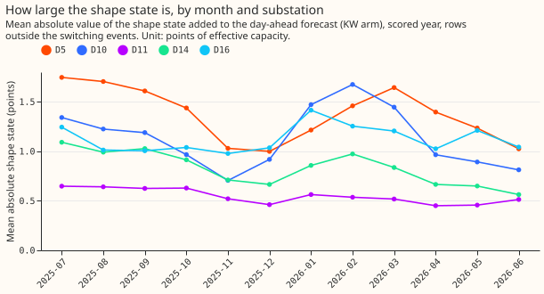

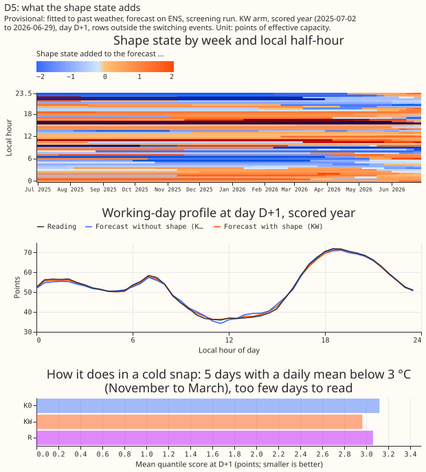

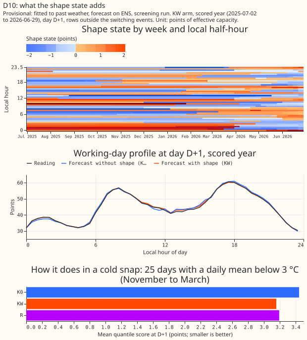

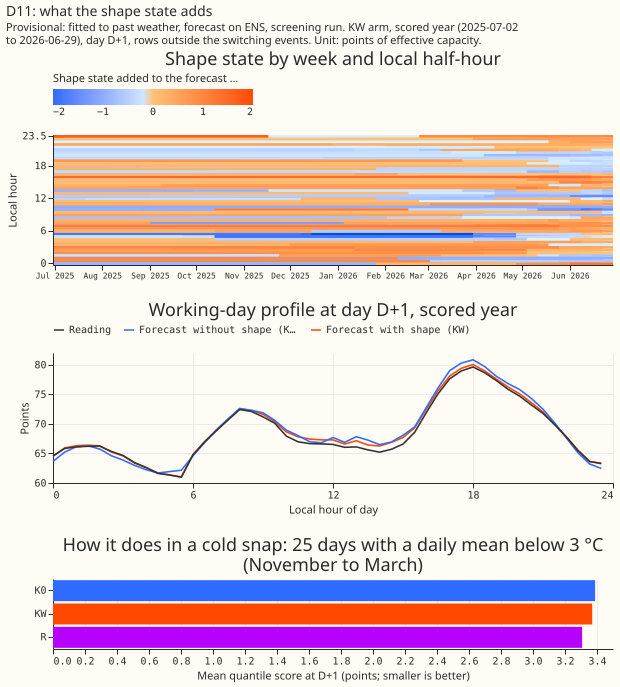

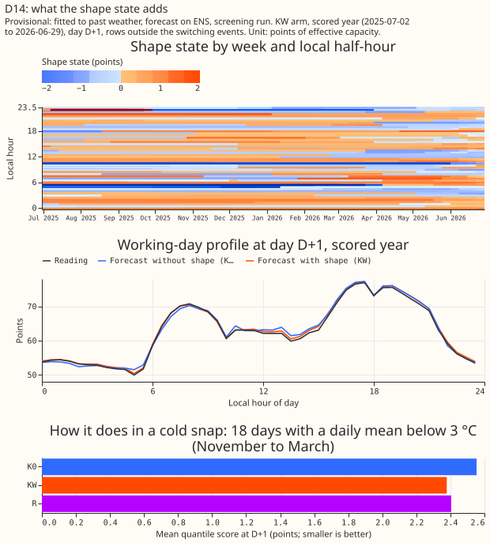

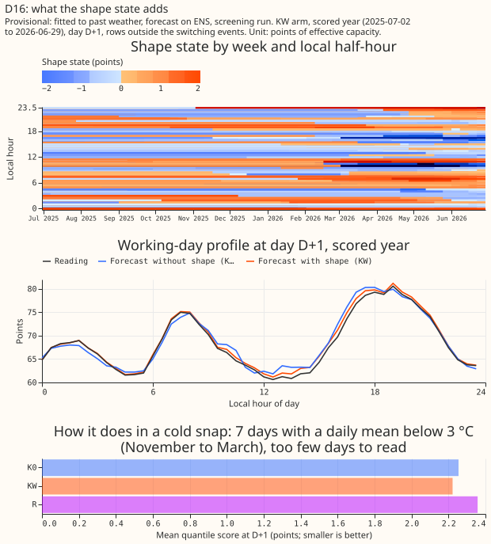

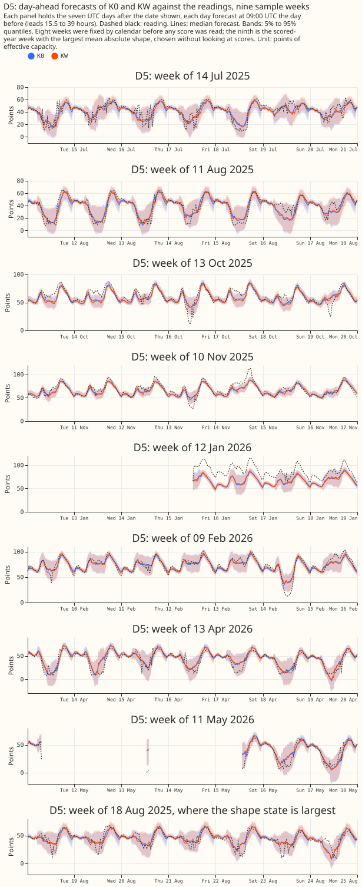

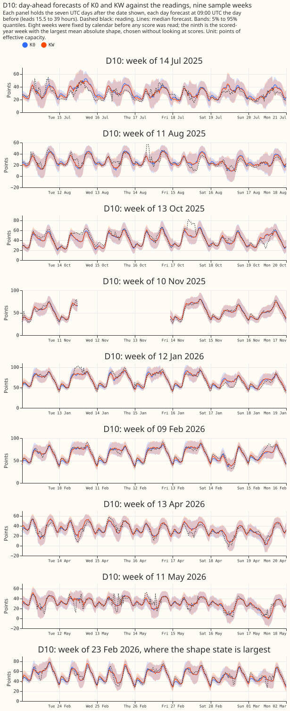

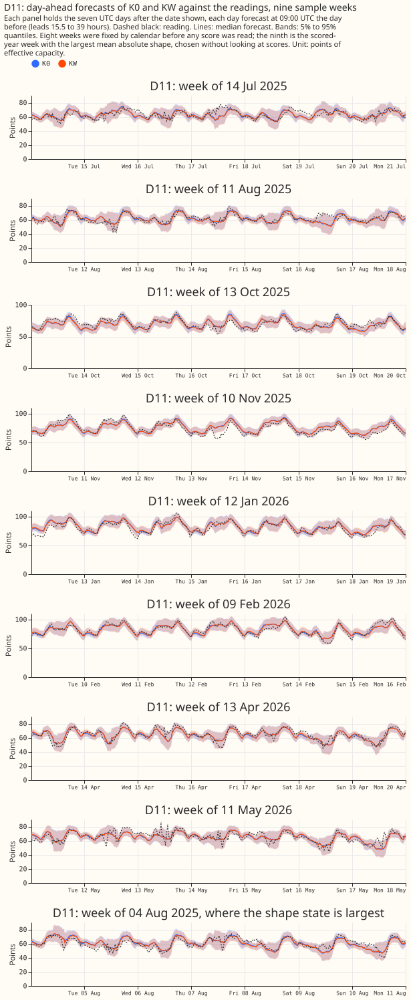

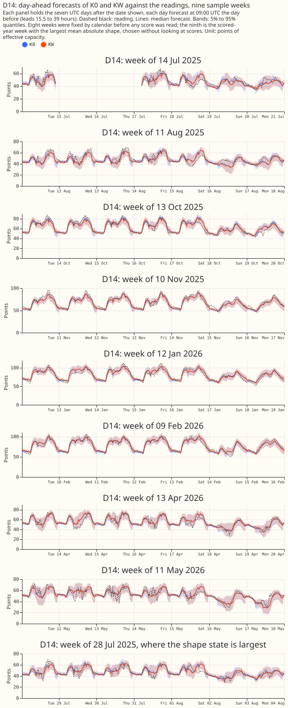

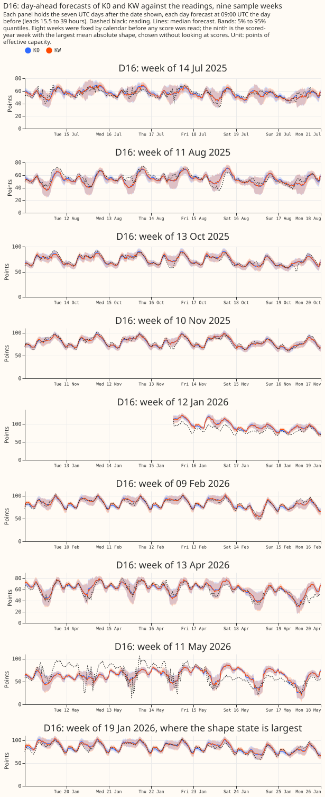

Every number above is printed by `ml-experiments/00115-*/e00115_numbers.py`; its output is
[`report.txt`](report.txt).
