**The registered flow fit failed its known-answer gate on all seven readings, so the verdict is
`inconclusive`.** Fitted with the settings chosen before any fit, the flows find 0.22 of the
megawatts that we injected as transfers over 1 day (the gate needs 0.77) and change no forecast.
Settings that find more also put flow on pairs of substations with no interconnection. In the tuning
grid, every configuration with recall above 0.5 put 17 to 30 MW-days a year on the two tuning
placebo pairs, against a limit of 0.05. The post hoc variants, which are exploratory and play no
part in the verdict, recover up to 0.86 of the injected megawatts over 1 day and put 18 and 29
MW-days on the two pairs. The placebo pairs probably soak up the opposite-signed slow drifts that a
demand model with no drift term leaves in its residuals. Flows fitted this way therefore cannot be
read as switching without a drift term or a topology check; this page proposes both as next steps
and does not commit the project to either.

**The failure is a limit of the registered objective, and the zero placebo is an ordering artefact.**
The Huber loss caps each row's pull on the flow, so a step in the flow appears only if the block of
rows is long enough to outweigh the step penalty. At the chosen step constant of 300 that is 174
hours on the D10–D11 edge and 207 hours on the D5–D16 edge, against a longest gate transfer of 113
hours. In 5 re-fitted gate transfers the fitted step at onset was exactly 0 each time, so the recall
of 0.22 comes from a flat offset across the whole window, not from detecting the transfer. A
level constant of 0 also makes the minimiser non-unique, because a constant flow costs nothing: the
constant lands on whichever path the fit visits first. The tuning placebo path was visited last, so
its flow read about 0 for every configuration with level constant 0. With the placebo path visited
first, the chosen configuration puts about 23 and 46 MW-days a year on the two tuning placebo pairs
(measured on 4 tuning tiles of 72 days in total, then scaled to a year), against a limit of 0.05. This
does not change the verdict.

We asked whether load that the network operator moves between two neighbouring Primary substations
can be found from the half-hourly power readings alone. The method fits a flow for each
interconnection between two substations to the residuals of a convex demand model (the model's
forecast error), with a penalty that keeps flows constant for hours. We checked the method by adding
known transfers of load between two substations to the real residuals (400 per set, on two
interconnected pairs, D5–D16 and D10–D11). We asked how much of the moved power the fit found again,
whether it found flow between pairs with no interconnection, and whether removing the flows from the
training data or adding them back to the forecast changed the day-ahead error. The method did not
pass: the registered settings find almost nothing, and the looser settings also find flow where none
can exist.

## Figures

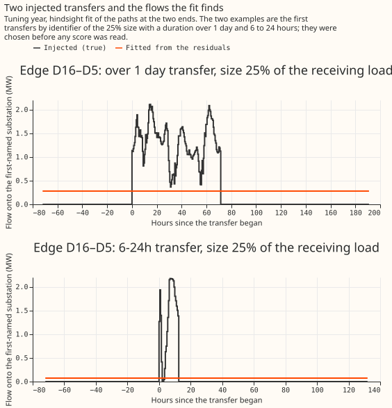

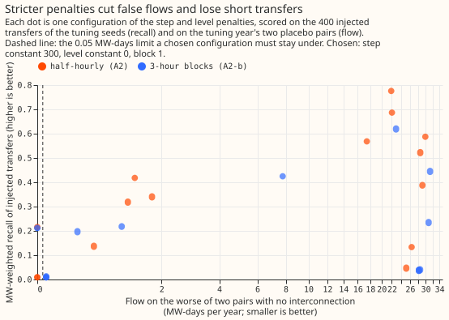

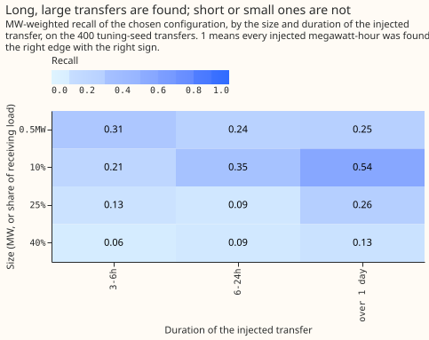

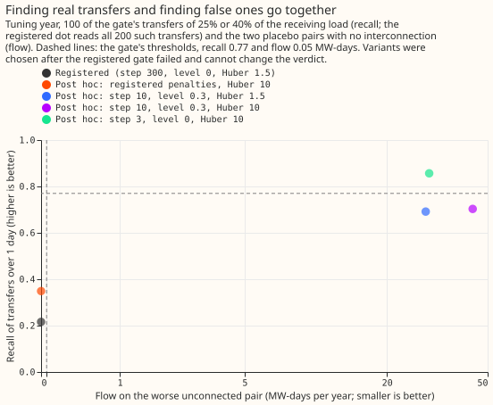

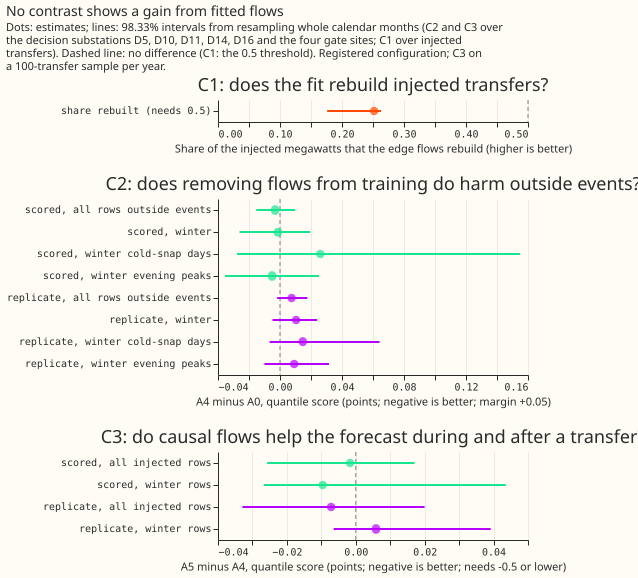

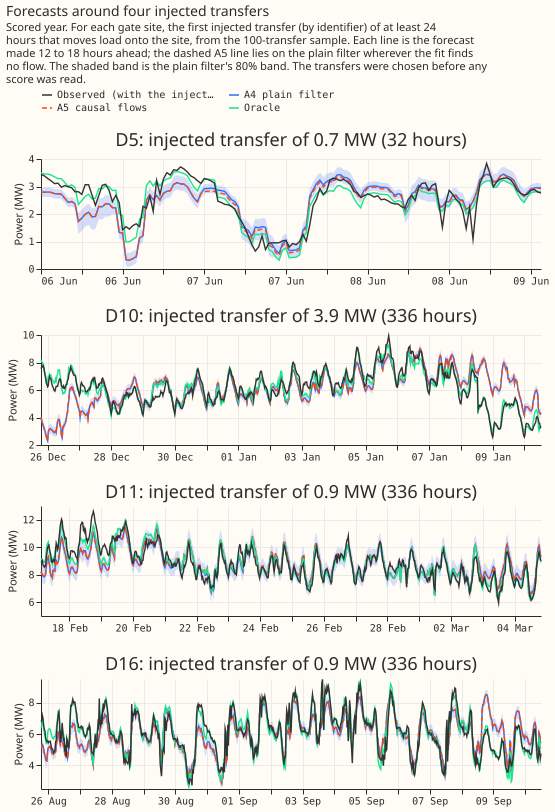

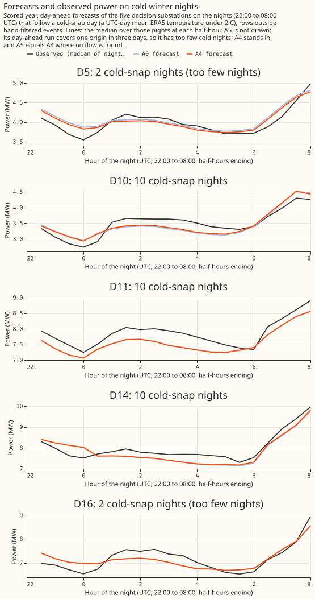

## Results

**The gate.** The registered configuration (half-hourly flows, step constant 300, level constant 0,
Huber threshold 1.5 noise scales) was chosen on 400 tuning transfers by the largest recall with
under 0.05 MW-days of flow on each tuning pair. The gate then read 400 other transfers in the tuning
year. All readings failed:

- moved-MW ratio, the median over transfers of the fitted mean flow over the true mean flow: 0.05
  (needs 0.8 to 1.25);

- release, the share of found transfers whose causal flow is under 20% of the moved MW at the
  deadline: 0 (needs 0.5), on one transfer, because only 1 of the 201 large gate transfers reached
  a recall of 0.5 and so entered the test;

- recall: 0.22 over 1 day (needs 0.77), 0.10 for 6 to 24 hours (needs 0.5), and 0.46 over 1 day on
  the realistic set (needs 0.5);

- placebo in the replicate year: 0.0 MW-days on replicate placebo pair 1 and 2.9 on pair 2 (needs
  under 0.05 each; the 0.0 on pair 1 is probably the same path-order artefact);

- normal-running gap: the forecast with the causal flows removed has a mean absolute error of 7.07
  points against 5.82 for the plain filter and 3.76 for the oracle (the share of the gap closed is
  -0.60, needs 0.5). The first run of this reading, 7.28 points and -0.71, removed each substation's
  outside path as well as its edge flows by mistake; it was corrected in the experiment's script
  `e00116_causal.py` (not in the module), and only arm A5 was re-run, on module commit 6a57d0944;
  both runs are on file. The negative gap closure probably comes from the same free constant: a
  constant offset in each 30-day window, carried forward by the warm start, may sit on the edge and
  then be removed from the filter's level (plausible, not measured).

**C1, the hindsight reconstruction.** The edge flows rebuild 0.25 (98.33% interval 0.179 to 0.264)
of the injected megawatts on 400 realistic transfers, against a requirement of at least 0.5 with the
lower end above 0.25. Models trained on the injected history forecast the clean scored year with
mean absolute errors of 5.82 (as trained), 5.79 (flows removed), and 5.78 points (oracle mask):
transfers of up to a fortnight barely move a model with no drift.

**C2, no harm outside events.** Training with the edge flows removed (A4) scores 2.258 points
against 2.262 for training on every row (A0) in the scored year: the difference is -0.003 (-0.015 to
+0.010), and in the replicate year it is +0.007 (-0.002 to +0.018). Both upper ends are under the
0.05 margin, so C2's interval sits inside its margin. The failed gate blocks C2, though, and the
flows are nearly empty, so this shows only that removing almost nothing changes almost nothing.
Dropping the hand-filtered events (A1) changes the score by -0.000 (-0.006 to +0.005) in the scored
year.

**C3, causal flows in the forecast.** On a sample of 100 injected transfers per year, A5 (A4's fit
with causal flows) minus A4 is -0.002 (-0.026 to +0.017) in the scored year and -0.007 (-0.033 to
+0.020) in the replicate year; it needs -0.5 or lower. The oracle, which knows the true flow, scores
4.02 points better than A4 in the scored year (-4.02, -4.69 to -3.12) and 4.46 points in the
replicate year, so a correct flow would matter a great deal: scaled by the 4.5% of rows that lie
inside hand-filtered events, the oracle gain is 0.18 points on all rows. A5 closes 0.0004 of the
gap. The absolute scores are row means (A4 6.522, A5 6.512 points, a difference of -0.010), while
the contrast is the mean over the 13 seeds of each seed's difference (-0.002), so the two do not
reconcile by subtraction. A5 minus A4 on real rows outside events is -0.0003 (scored) and +0.017
(replicate); the limit is +0.03.

**Post hoc variants (exploratory, chosen after the gate failed; the verdict does not use them).** On
100 gate transfers of 25% and 40% of the receiving load: registered penalties with a Huber threshold
of 10 noise scales give recall 0.35 over 1 day; step constant 10 and level constant 0.3 give 0.69
over 1 day with 28.6 MW-days on tuning placebo pair 2; adding the larger Huber threshold gives 0.70
and 43.7; step constant 3, level constant 0, and the larger threshold give recall 0.86 over 1 day,
0.74 for 6 to 24 hours, a moved-MW ratio of 0.79, and 18.4 and 29.5 MW-days on the two pairs.

**Real transfers (descriptive, no verdict role).** Three of the eight hand-filtered events on the
two gate edges fall in a year with hindsight flows. The registered fit puts a mean flow of 1.19 MW
on the edge over a 371-hour event that the labeller put at 1.5 MW, 0.10 MW over a 5.5-hour event
labelled 2.8 MW, and nothing over a 101-hour event labelled 0.8 MW.

## Winter

**Winter changes no conclusion: no winter contrast has an interval that excludes zero, apart from
one.** Winter is November to March, a cold-snap day has a UTC-day mean ERA5 temperature under 2 °C,
and an evening peak ends between 16:30 and 20:00 UTC; the rules were fixed before any score was
read. C2 on winter rows: A4 minus A0 is -0.001 (-0.026 to +0.020) in the scored year and +0.010
(-0.005 to +0.024) in the replicate year. On cold-snap days (10 days scored, 20 replicate) it is
+0.026 (-0.028 to +0.155) and +0.015 (-0.007 to +0.064), and on evening peaks -0.005 (-0.035 to
+0.025) and +0.009 (-0.010 to +0.032). The one exception is A1 minus A0 in the scored winter
(+0.007, +0.002 to +0.012; 0 of 5 sites better), where dropping the hand-filtered events is slightly
worse. The cold-snap intervals are wide. No arm is proposed for production, so none is held back. A
figure of the cold nights themselves is below: at the three substations with 10 cold-snap nights
(D10, D11, D14) both forecasts run about 0.2 to 0.5 MW under the median observed power overnight, A0
and A4 alike; D5 and D16 have 2 cold-snap nights, too few to read. A5 is not on that figure, because
its day-ahead run covers one origin in three days, which leaves too few cold nights; A5 equals A4
wherever the fit finds no flow, which is nearly everywhere. C3 on winter rows: A5 minus A4 is -0.010
(-0.027 to +0.044) in the scored year (28 transfers, too few) and +0.006 (-0.006 to +0.039) in the
replicate year (37 transfers). On cold-snap days it is -0.065 (-0.237 to -0.009) on 6 transfers in
the scored year and -0.052 (-0.052 to +0.002) on 11 in the replicate year, both too few to read. On
evening peaks it is -0.022 (-0.044 to +0.060) on 28 transfers (too few) and -0.003 (-0.019 to
+0.020) on 37. The evidence holds two independent winters (2024-25 and 2025-26); the 2023-24 winter
was used for tuning and the gate. The two series labelled G-c have no winter in the data, and the
injected transfers give no winter result at G-c.

## Checks and bullets

- **Arms.** A0: convex model (24-month window, no drift, pinned capacity) trained on every row. A1:
  the same with the hand-filtered events dropped. A4: A0 refitted on power minus the edge flows of
  the tuning and replicate years. A5: A4 with flows refitted causally at each origin on the trailing
  30 days and added back with a Kaplan–Meier decay. Oracle: the true flow removed and added back.

- **Example forecasts.** The four transfers in the forecast figure are, for each gate site, the
  first injected transfer by identifier in the 100-transfer scored-year sample that lasts at least
  24 hours and moves load onto the site; the rule was fixed before any score was read.
- **Rows and scoring.** 13 to 14 Primaries with data at each cut; scoring sites D5, D10, D11, D14,
  D16, with D9 beside them; quantile score in points of effective capacity, rows outside
  hand-filtered events; filter hyperparameters fitted on the tuning year; spreads from each arm's
  own run over the year before. C3 rows are origins every 6 hours from 6 hours before a transfer to
  48 hours after its end, leads 0.5 to 48 hours, both ends of the transfer.

- **Tails.** Scored year, rows outside events, day ahead: coverage at q01, q05, q95, q99 is 0.015,
  0.053, 0.941, 0.983 for A0 and 0.015, 0.053, 0.941, 0.983 for A4; pinball loss at q01 and q99 is
  0.173 and 0.183 (A0) and 0.173 and 0.183 (A4). On injected-transfer rows the plain filter's q01
  coverage is 0.124 and q99 coverage 0.872 (nominal 0.01 and 0.99), and the oracle's are 0.014 and
  0.983.

- **Checks.** The median forecast equals the mean forecast at every site by construction, because
  the spread is centred on its median (difference 0.000). The mean-forecast error beside each
  quantile-score contrast agrees in sign for every C2 contrast outside events (-0.007 and +0.009
  against -0.003 and +0.007 in the scored and replicate years). The plumbing controls pass: the
  module's 42 tests, causality of the causal fit (exact), A5 with zero flows equal to the plain
  filter (difference 0), the same fits with the label file emptied or the power after the cut
  changed (difference 0), noise scales from pre-cut rows (difference 0), and 66 hand-filtered events
  (35 conserved, 31 one-sided).

- **Audit triggers.** Trigger 1 fired (the gate failed). Trigger 2 fired (a contradiction): the real
  371-hour event is recovered at 1.19 of 1.5 MW although the injected recall is 0.22, and C1 and the
  gate recall are far below the predicted 0.55 to 0.85 and 0.8 to 0.95. Trigger 3 fired weakly for
  C3 in the replicate year (quantile score -0.007, mean error +0.000, both inside their intervals).
  Trigger 6 fired and is explained: the 98.33% intervals of C2 are 0.025 (scored) and 0.020
  (replicate) points wide, under half the 0.29 to 0.40 of experiment 111's 98.75% intervals, as
  expected when two arms differ only by nearly empty flows. Triggers 4 (leave one out) and 5 (nested
  arms, including A5 with S = 1) were not run: the exploratory arms were skipped after the gate
  failed. Trigger 7 did not apply, because there is no
  positive verdict. An Opus audit of this page and the module has been done, and its fixes are applied.
- **Deviations from the plan.** The block-coordinate sweeps stop at a tolerance of 1e-3 or 12
  sweeps, not the 1e-6 the plan states; all whole-year fits and all re-run local fits stopped at
  12 sweeps unconverged, and a re-run with 400 sweeps at 1e-9 left recall and the moved-MW ratio
  unchanged on 5 transfers. C2 and C3 were run although the plan says a failed gate stops them,
  to report them descriptively; C3 ran on a 100-transfer sample per year (seeds 0 to 12) instead of
  400, because the registered flows are nearly empty and the gate had failed. Injected transfers are
  fitted as neighbourhoods (the paths at the two ends, on a window of 3 days either side) instead of
  as whole-year fits. Realistic transfers last at most 14 days. Replica spreads use the 09:00 UTC
  origin of every third day. The step-size rule for outside paths takes the node's first edge by
  name. A5 takes out edge flows only. C1 and the gate readings use the replicate and tuning years'
  frozen fits. The exploratory arms (demand-shaped shares, S = 1, a larger outside factor, the MVA
  rescale, and the sensitivity with G-c) were not run, because the registered gate failed.

- **Module.** Tuning, the gate's first run, and the 400 tuning-year transfer runs used
  `studies.dp_edge_flow` at commit 6a57d0944; C1, C2, the replicate- and scored-year flows, the
  replicas, and C3 used commit abaac6097 (the Sonnet review's fixes). The Opus reviews
  of the module (causal window, then solver and audit) found no solver bug and no leak, and the
  tests that killed three surviving mutants were added before the merge.

- **What to try next (proposal only).** Add a slow drift term per substation to the convex model
  before fitting flows, and compare flows on connected and unconnected pairs again; or accept a
  candidate flow only where the topology says the two substations are connected and the residuals
  move oppositely over days. The oracle's 4-point gain on injected rows says the payoff of a correct
  flow is large; the problem is finding it.

- **Privacy and links.** Substations are shown by D-label; the two generator-carrying series are not
  shown. Plan and scripts are in [pull request
  1399](https://github.com/openclimatefix/nged-substation-forecast/pull/1399). The module is in
  [pull request 1400](https://github.com/openclimatefix/nged-substation-forecast/pull/1400). The
  numbers on this page are printed by `e00116_report.py`.

## Substation cards (provisional)

**Provisional: fitted to past weather on a screening run.** Each card shows two weeks fixed before
any score was read, the first full weeks of December 2025 and June 2026: the day-ahead forecast of
A4 with its 80% and 90% bands against the observed power, hand-filtered events shaded, the hindsight
flows on the substation's edges and its outside path, and how A4 and A0 score on cold-snap days
(with the day count, and "too few days" where there are under 10). The cards name each substation's
interconnected partners as pairs and show no other topology. The flows are small because the
registered penalties are stiff.

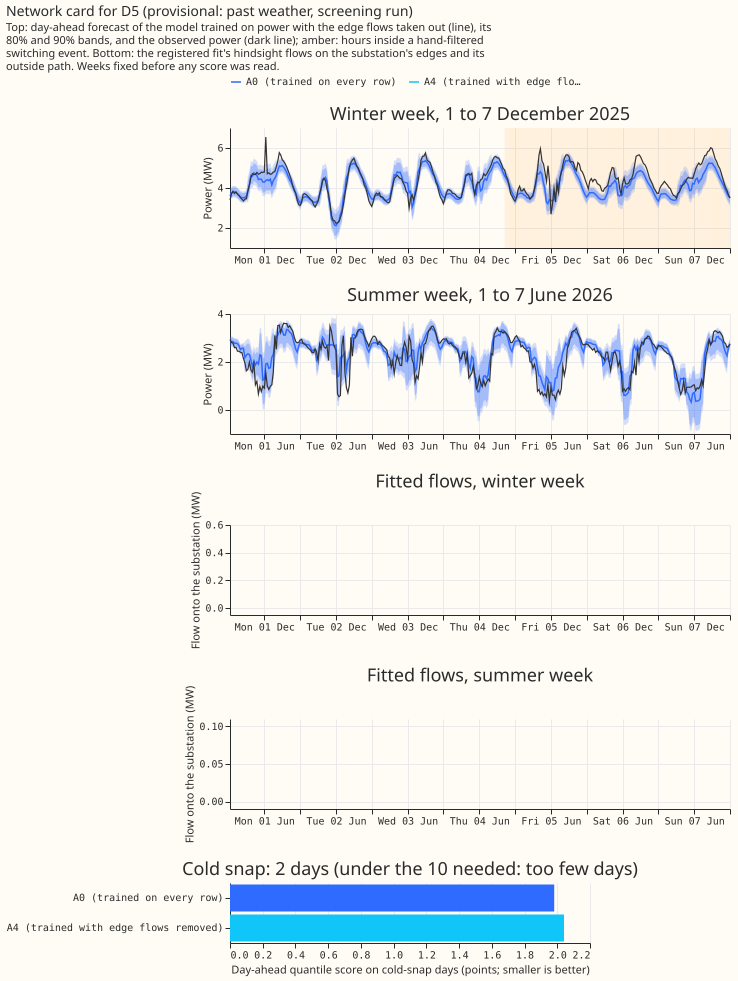

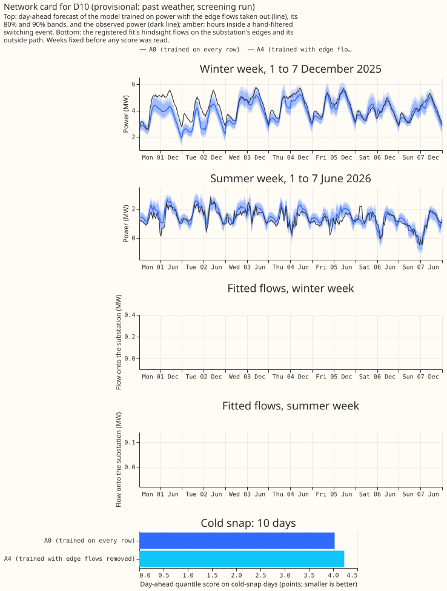

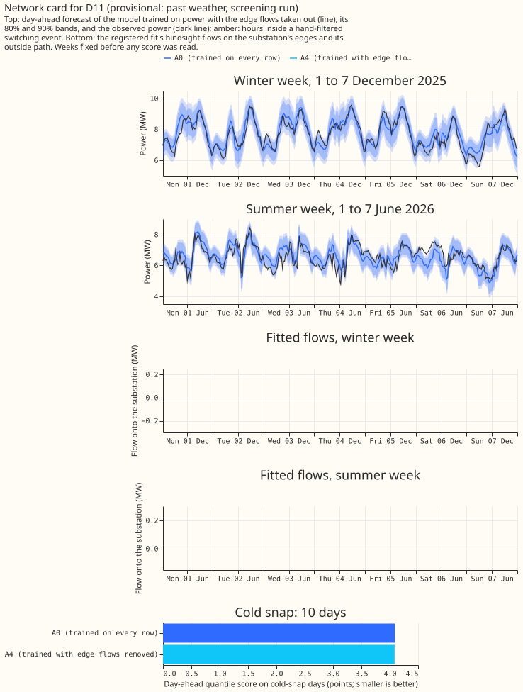

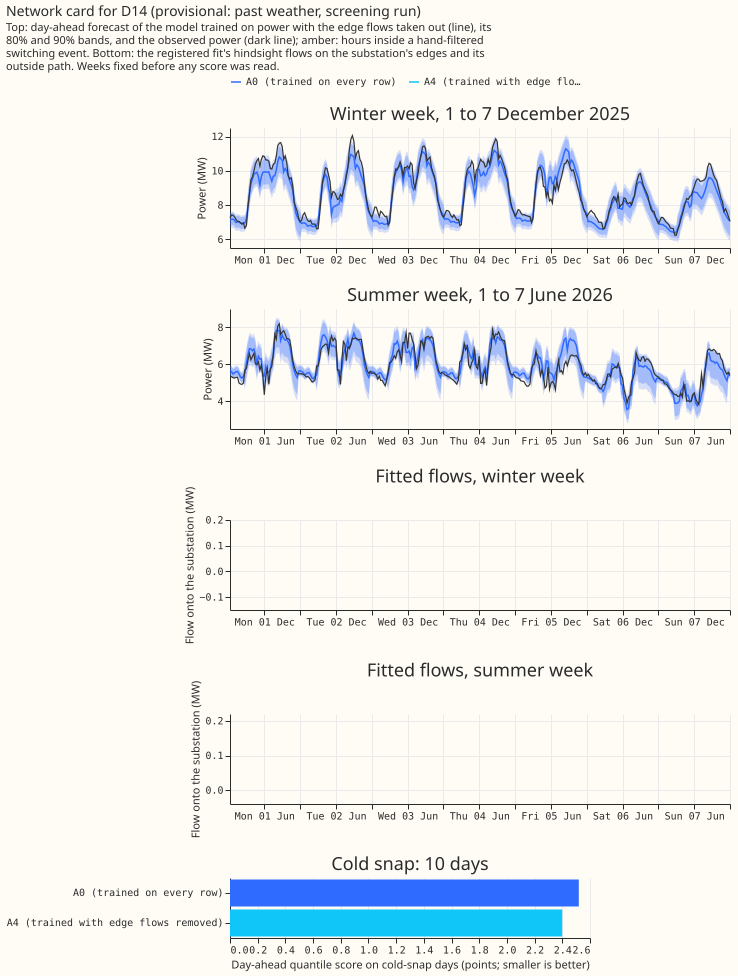

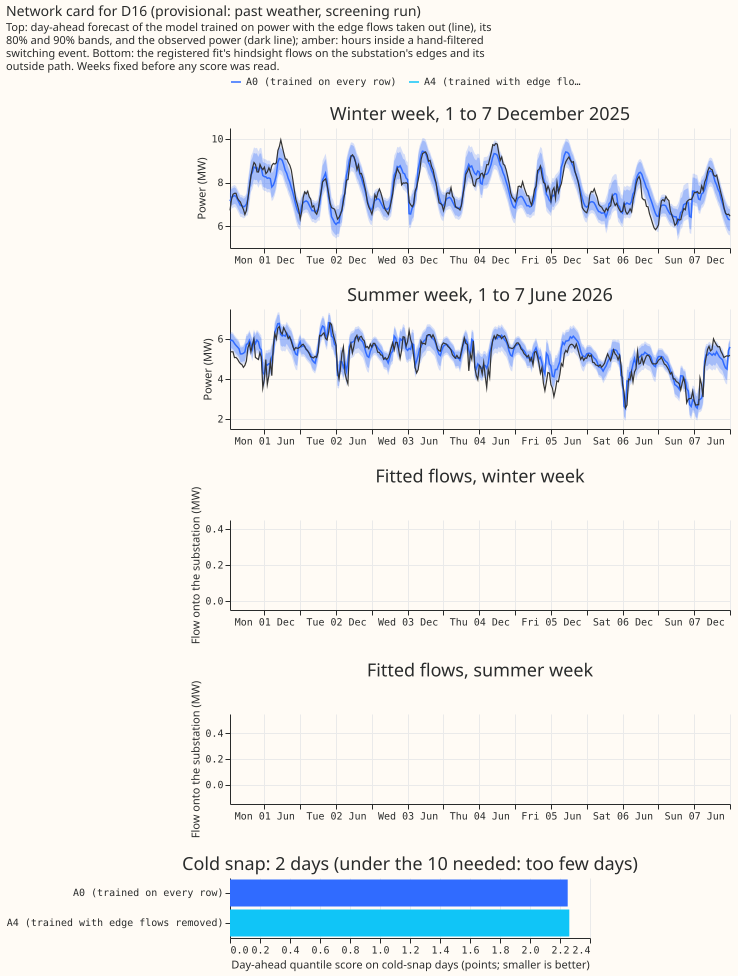

## The plan, as registered

The sections below are the plan committed before any fit, with the tuning result and the predicted
gate failure recorded before the gate ran. They are kept as registered.

**This plan's PR creates the Network theme** (stub pages, a navigation entry under "Differentiable
physics", a pointer in the two switching themes' `plan.md`). One id, one PR for plan and result;
the module has its own PR off `main`.

### What experiment A asks, and what the data allow

**Experiment A is a switching-and-NRA experiment, not a mean-forecast experiment.** A perfect
detector was worth 0.42% of the best guess's score ([experiment
44](../00044-sw2-2-switching-share-of-best-guess-score/result.md)), and label masks move the
out-of-event score by under 0.03 points ([experiment
75](../00075-sw2-11-nra-forecast-with-labelled-switching-masks/result.md)). Events touch 1 to 3% of
rows, so a 10-point in-event gain moves the all-row score by about 0.2 points at most; contrasts are
read on transfer rows, with that ceiling beside them.

**Only two MW–MW edges have data in the tuning and replicate years: D5–D16 and D10–D11.** The two
series labelled G-c have only a few months of usable history at the scored cut ([experiment
103](../00103-differentiable-physics-1-data-look/result.md)), so every edge that touches them is
exploratory. Of the 66 hand-filtered events, 6 have MW meters on both sides before the scored year,
all on D5–D16. The verdict rests on injected transfers alone.

**The gate, and every claim it licenses, covers those two edges.** MW–MVA edges are reported, not
gated; C3 injects only on D5–D16 and D10–D11 (sites D5, D10, D11, D16). D14 enters C2 only.

**The Kalman filter already carries long transfers** ([experiment
106](../00106-differentiable-physics-4-all-years-drift-and-recent-level/result.md): 0.94 of the
moved MW by day 2, all but 0.004 released within 3 days), so a causal flow can add skill only in a
transfer's first day, the two days after it ends, and transfers under a day. C3 is built around
those rows.

### The base model and the graph

**GAM-K is [experiment
111](../00111-differentiable-physics-6-ens-forecast-engine-against-bg2/result.md)'s decision form,
run on past weather.** The convex GAM has no drift, a 24-month window, and pinned capacity; Part 4's
Kalman filter runs under the 3.5-hour telemetry delay, hyperparameters fitted by marginal likelihood
on the tuning year per base arm. Weather is ERA5 and CAMS under the "lab conditions first" rule
([experiment 111](../00111-differentiable-physics-6-ens-forecast-engine-against-bg2/result.md):
ENS-driven residuals were as good for the filter, −0.008 points); ERA5-driven causal flows are not
available at forecast time, and the page says so. Residuals enter the edges in MW (points ×
`effective_capacity_mw` / 100); an MVA site's dark-row residual enters in MVA, rescaled by 0.97 in a
sensitivity.

**Decision graph: the 21 metered edges that do not touch G-c, plus an outside path g_i per node.**
The interconnection file holds 37 undirected edges (17 pairs listed twice), 25 of them metered at
both ends; the rest touch G-c. g_i carries transfers to unmetered partners, with step and level
penalties ρ times the edge penalties, ρ ≥ 1, so a conserved transfer costs λ_f on its edge and 2ρλ_f
on two g paths. MVA ends carry weight only on dark rows. The edges that touch G-c and the g paths of
the two G-c series are zero in every decision arm. **Exploratory sensitivity "with G-c":** each such
edge is split between the two G-c series and a link between them (30 edges, recounted by the
script), with one G-c series given a convex fit (drift D1, fitted capacity) on its short history;
its triangles are checked for circulations in P2. The script commits the edge counts before any
residual is read.

### Arms

| Arm | GAM | Flows | Filter |
|---|---|---|---|
| A0 | GAM-K, no switching masks | none | plain |
| A1 | GAM-K, hand-filtered masks ([experiment 111](../00111-differentiable-physics-6-ens-forecast-engine-against-bg2/result.md)'s form) | none | plain |
| A2 | A0's frozen fit | flat, half-hourly, hindsight | plain |
| A2-b | A0's frozen fit | flat, on 3-hour block means, hindsight | plain |
| A3 | A0's frozen fit | demand-shaped shares, hindsight | plain |
| A4 | A0's GAM refitted once on y minus the chosen edge flows | as chosen | plain |
| A5 | A4's GAM | the chosen model, refitted causally per origin | flows as known input, held by S |
| OR | A4's GAM | the true injected flows | as A5, true flow and true end (ceiling) |

**A2, flat flows.** For edge e = (i, j) with sign +1 at i and −1 at j, the path f_e minimises Σ_t
H_i(r_i,t − f_t) + H_j(r_j,t + f_t) + λ_f Σ|f_t − f_t−1| + λ_l Σ_obs |f_t|, with r each end's
partial residual (other paths removed) and H a [Huber](https://doi.org/10.1214/aoms/1177703732) loss
weighted by 1 / σ_i² and thresholded at 1.5 σ_i (σ_i the site's robust half-hourly residual scale in
MW, from pre-cut rows only). The level penalty acts only on observed rows, and a path is held flat
across rows with no reading at either end, so a gap neither pays λ_l nor ends a flow. A common shift
leaks into f unless the end weights are equal, and fully on an MVA edge in daylight, which is why
MW–MVA edges stay outside the gate. Block-coordinate descent stops when the objective's relative
change and the largest path change (in MW) both fall under 1e-6.

**Each path is solved exactly** by a dynamic programme in the style of [Johnson
(2013)](https://doi.org/10.1080/10618600.2012.681238) (stated there for squared error; the Huber,
weight, and level extension is this module's, guarded by P1). ADMM ([Boyd et al.,
2011](https://doi.org/10.1561/2200000016)) on a banded Cholesky factor solves a non-negative flow
and cross-checks the programme in the tests. Measured on the module branch: the exact programme
takes 1.8 seconds for a 17,520-point solve whatever the penalties and 0.14 seconds for a 1,440-point
window, and ADMM took 4.5 to 22 seconds at tolerances of 1e-3 to 1e-8, so the programme is the
solver. [Condat (2013)](https://doi.org/10.1109/LSP.2013.2278339) with soft-thresholding ([Friedman
et al. (2007)](https://doi.org/10.1214/07-AOAS131)) is the unweighted reference.

**A2-b answers the series brief's advice** ([experiment
67](../00067-sw2-15-joint-edge-flow-estimator/result.md)'s hourly fit found 0.108 of the moved MW
against 0.646 for a 24-hour step; [experiment
113](../00113-differentiable-physics-n5-convex-identification-at-realistic-noise/result.md)'s
half-hourly autocorrelation is 0.83): the same solver on 3-hour block means. A2 or A2-b is chosen on
seeds T by the placebo rule, before seeds G are drawn; "the chosen flows" below means that choice.

**A3 (exploratory), demand-shaped shares:** f_e(t) = a_ij(t)·D_i(t) − a_ji(t)·D_j(t), D each end's
fitted demand (fitted net power plus the pinned solar term), two non-negative piecewise-constant
shares, λ_l > 0 (alike shapes leave the shares unidentified), on the MW–MW edges only.

**A4** refits A0's GAM once on y minus the chosen edge flows, never minus g, whose level also
absorbs growth and new connections.

**A5, the causal metered forecast.** At each origin τ:

1. Build the trailing 30 days of residuals ending at τ − 3.5 hours with
   `dp_assimilation.stitch_out_of_sample_residuals`, so no origin reads in-sample residuals.
2. Refit every path touching a scored node causally on that window, warm-started; no path is taken
   from the hindsight fit.
3. Rerun the filter over the window on the residual minus that flow path, from the state the
   previous origin's run held at the window's start.
4. Forecast GAM + ℓ + φ^h·z + f_now · S(a + h) / S(a), with f_now the newest causal flow and a the
   age of its current run.

**S is a Kaplan–Meier estimate of the chosen hindsight flows' run lengths** (|f| over 0.1 MW;
runs cut by the window's end censored) in each cut's 24-month window, never fitted from labels.

**Injections** copy [experiment 43](../00043-sw2-1-detector-scoreboard/result.md)'s harness, with
two shapes (its donor-shaped share, and a flat block drifting between 0.5 and 2 times its start),
conserved on D5–D16 or D10–D11, never within 48 hours of a hand-filtered event or of D10's two
unlabelled windows (2024-11-08 to 2024-12-01, 2025-11-17 to 2025-12-14). **Counts are not limited by
the real event rate:** each seed holds up to 4 non-overlapping transfers per edge-year, at least 7
days apart, and each disjoint set (T, G, C1, C3) has 50 seeds drawn independently of the residuals,
about 400 transfers. T and G span 4 sizes (0.5 MW, and 10%, 25%, and 40% of the receiving load) by 3
durations (3 to 6 hours, 6 to 24 hours, over 1 day, log-uniform within), at least 30 per cell; gate
readings 1 to 3 use the 25% and 40% cells. The realistic set (C1, C3) draws size and duration
jointly from the 66 events (median 1.0 MW for 31 hours, with durations capped at 14 days because one
of the 66 lasts 31 days), the distribution S also sees. Expected 98.3% half-widths, measured on T
before G is drawn: about ±0.06 on a recall or ratio per duration band and ±0.2 points on C3; if C3's
exceeds 0.4 on T, every set doubles to 100 seeds.

**Hundreds of injected transfers are fitted as neighbourhoods, not as whole-year fits.** A
whole-year fit of the 33 to 35 paths takes about 8 minutes, so each injected transfer instead gets a
fit of the paths that touch its two ends, on a window that starts 3 days before the transfer and
ends 3 days after the transfer's 48 post-event hours, with every other path at zero. The tuning and
gate placebo flows are read the same way, on non-overlapping windows of 18 days that tile the year.
The whole-year fits (tuning, replicate, and scored years, from [experiment
111](../00111-differentiable-physics-6-ens-forecast-engine-against-bg2/result.md)'s base form)
supply the real-data flows that A4 removes and the run lengths for S. An injected transfer is added
to the frozen fit's residuals, which is exact for a fit that did not train on the injected rows; C1
is the exception, and refits A0 on the injected history.

### Years, rows, and the tuning split

| Period | Cut | Role |
|---|---|---|
| 2023-07-01 to 2024-06-30 | 2023-07-01 | tuning (seeds T; placebo pairs 1 and 2 of the tuning year); gate (G) |
| 2024-07-01 to 2025-06-30 | 2024-07-01 | gate placebo (replicate placebo pairs 1 and 2); replicate; C1 rows |
| 2025-07-01 to 2026-06-30 | 2025-07-01 | scored: the verdict |

**Tuned on seeds T only:** λ_f = c / σ_e, c in {3, 10, 30, 100, 300}; λ_l = c_l / σ_e, c_l in
{0, 0.3, 1} (A3: {0.3, 1}); σ_e is the robust MW scale of the edge target (r_i − r_j)/2 on pre-cut
rows; ρ = 1. The choice is the largest MW-weighted recall on T with under 0.05 MW-days per pair-year
on the tuning placebo pairs; ρ = 2 is kept only if it adds 0.05 recall. Placebo edges are fitted in
separate runs with the real graph present and never enter A2 to A5.

**Scoring rows.** Decision sites D5, D10, D11, D14, and D16 (MW ends); D9 beside them. C2 uses day
D+1 from 09:00 UTC origins, with and without D10's two unlabelled windows. C3 uses origins every 6
hours and leads 0.5 to 48 hours, because [experiment
88](../00088-sw2-21-nra-forecast-recovers-normal-arrangement-during-and-after-injected-switches/result.md)
found no 09:00 origin inside a real transfer with both sides at most half missing. Predictions carry
the keys, `q01` to `q99`, `actual`, `lead_hours`, `level`, `anomaly`, `flow`, and an in-event flag.
Spread: `LeadSpread` at day D+1; for C3 a lead-hours spread fitted on the replica through each arm's
own pipeline.

### Plumbing controls and the known-answer gate

**Plumbing controls run first; an unfixable failure makes the verdict `inconclusive`:**

- P1: the path solver matches a brute-force quadratic program on 200 random small problems (Huber,
  weights, zero weights, a gap inside a step, level penalty, non-negativity) to 1e-6; P1b:
  block-coordinate descent matches a joint program on a three-node graph, path by path;
- P2: with zero residuals, every injected flat transfer is recovered on its edge with a moved-MW
  ratio of 1 to 1e-6 as λ → 0, nothing appears on other paths, and the "with G-c" triangles
  carry no circulation;
- P3: changing any reading, residual, or flow input after τ − 3.5 hours leaves A5's forecast at τ
  unchanged; no fit trains on a row after its cut; σ_i, σ_e, and the Huber scale use pre-cut rows
  only; A0, A4, and A5 forecasts are unchanged when the label file is emptied; no origin's window
  holds in-sample residuals; A5 with flows forced to zero equals A4 exactly;
- P4: the 66 events filter as [experiment
  101](../00101-ro-nc-detector-on-real-hand-filtered-switching-events/result.md)'s `real_events`
  does (35 conserved, 31 one-sided).

**The gate is blocking: a failed reading stops C2 and C3 and caps the verdict at `inconclusive`.**
It runs on seeds G in the tuning year, both shapes pooled; the release clock runs from the end in
valid time, so the 6-hour allowance includes the 3.5-hour delay.

1. **Moved-MW ratio:** median fitted over true mean flow, true edge and window, in 0.8 to 1.25.
2. **Release:** the causal flow under 20% of the moved MW within the larger of 6 hours and 10% of
   the duration after the end, in at least half the transfers ([experiment
   101](../00101-ro-nc-detector-on-real-hand-filtered-switching-events/result.md)'s end rule).
3. **Recall:** MW-weighted recall (Σ min(fitted, true) MW-hours, right edge and sign, over Σ true)
   at least 0.77 over 1 day (RO-NC's injected figure) and 0.5 for 6 to 24 hours; at least 0.5 over
   1 day on the realistic set.
4. **Placebo, out of sample:** the two held-out replicate placebo pairs carry under 0.05 MW-days of
   |flow| per pair-year in the replicate year.
5. **NRA gap:** on in-event and 48-hour post-event rows, the NRA forecast (A5 without the flow added
   back) scored against the uninjected truth closes at least 50% of the gap from A0 to the oracle
   ([experiment
   88](../00088-sw2-21-nra-forecast-recovers-normal-arrangement-during-and-after-injected-switches/result.md):
   lag correction 51%, oracle-trained model 83%).

**Reported, not blocking:** reading 1 on in-sample residuals (injections in the 2023-07-01 cut's
window, GAM refitted); MW–MVA power curves; one-sided injections at D11 and D16.

### Winter breakdown

**Winter matters most, so every contrast is also read on winter rows.** The best model reaches
production in about a month, and the network operator first sees it in winter. Three winter scopes
are defined here, before any scored contrast is read: **winter** is a valid time in November to
March; a **cold-snap day** is a UTC day whose mean ERA5 temperature at the substation is under 2 °C,
read within winter; an **evening peak** is a half-hour ending between 16:30 and 20:00 UTC, read
within winter. C2 and C3 report each contrast on winter rows, on cold-snap days, and on evening
peaks, with the same paired intervals where the rows are numerous enough, and say "too few days"
where a scope holds fewer than 10 days or fewer than 30 transfers. A winter loss is a reason to hold
an arm back even when the annual mean improves, and the verdict text says so; the thresholds of the
decision rule below do not change.

**The evidence holds few independent winters.** The scored year holds the 2025-26 winter and the
replicate year the 2024-25 winter, so C2 and C3 have two. The tuning year (the 2023-24 winter)
carries the gate only, since A4 equals A0 there. Injected transfers are placed anywhere in the year,
so the winter subset of C3 holds about 5 of the 12 months of each year's transfers, from the same
two winters. The two series labelled G-c have no winter in the evidence, and the page says so.

### Planned contrasts

**Three contrasts, Bonferroni-corrected (98.3% intervals from `studies.bootstrap`, resampling whole
calendar months within each seed with seeds pooled, paired across arms), each with site counts,
every arm's absolute score, the mean-forecast error, and the replicate year's estimate.** Screening
tier: one frozen GAM fit per cut and arm; the seed spread is printed.

- **C1, hindsight NRA reconstruction on injected training transfers** (seeds C1, realistic set, in
  the 2024-07 to 2025-06 rows of the scored cut's window): 1 − Σ|y − f̂ − y_clean| / Σ|y − y_clean|
  over in-event rows at both ends, with the chosen flows f̂. Passes at an estimate of at least 0.5
  with the interval's lower end above 0.25. Beside it, descriptive: the clean scored year's forecast
  by A4, A0, and an oracle GAM masked on the injected windows, all trained on the injected history;
  with no drift in GAM-K this gap is expected within noise.
- **C2, the label-free NRA model does no harm outside events:** A4 minus A0 on real data, all rows
  outside the hand-filtered events, day D+1. Non-inferiority, margin 0.05 points (about 2% of
  GAM-K's day-ahead score): passes if the interval's upper end is at most +0.05 in the scored year
  and the replicate year. The power at a true zero, from the replicate's width, is printed. A4 minus
  A1 (can flows replace the labels?) and A1 minus A0 are reported beside it.
- **C3, the causal flow during and after transfers:** A5 minus A4 (plain filter) on seeds C3
  (about 400 realistic transfers) in the scored year, on in-event rows and the 48 hours after each
  end. Supported if the interval lies wholly below zero, the estimate is at most −0.5 points, 3 of
  the 4 sites improve, A5 closes 25% of the A4-to-oracle gap, and A5 minus A4 on real rows outside
  events is at most +0.03. **Ceiling beside it:** the oracle's gain, and that gain scaled by the
  in-event share of all rows (about 0.2 points at most). A5 minus A0 is reported beside it.

**Exploratory at 95%:** A2-b against A2; A3 minus A2; A5 with S = 1; C3 by event day; ρ = 2; the
MVA rescale; "with G-c". **Real events, a separate descriptive section with no verdict role:**
the 6 usable MW–MW events, the 66 by duration bin, and D10's two unlabelled windows.

**Tails, every arm:** coverage and pinball at q01, q05, q95, and q99 on all and in-event rows, per
role, and the receiver's q99 exceedance inside against outside transfers; no curtailment cost (no
generator forecast; [experiment
87](../00087-bg2-best-guess-assembled-with-drop-one-ablations/result.md) found 0 events at f = 0.9
here). **Comparators:** every arm, climatology, `manual_heuristic`, and [experiment
111](../00111-differentiable-physics-6-ens-forecast-engine-against-bg2/result.md)'s GAM-K (2.800)
and BG2 (2.780) on ENS.

### Tuning result, recorded before the gate runs

**The registered choice rule picked a configuration that finds little of the injected megawatts.**
Tuning ran on the 400 transfers of seeds T and the two tuning placebo pairs (module commit
6a57d0944). The chosen configuration is the half-hourly form with step constant 300 and level
constant 0; its MW-weighted recall is 0.216 and its placebo flow is about zero, because almost no
flow survives. Looser settings recover more (step constant 3, level constant 0: recall 0.776) but
put 9.6 and 21.9 MW-days a year on the two placebo pairs, against the 0.05 limit. A pair with no
interconnection absorbs the opposite-signed slow drifts of two substations, and a level penalty of
0.3 or more per megawatt leaves 25 to 31 MW-days on tuning placebo pair 2. The 3-hour block form (A2-b)
is no better: its chosen configuration has recall 0.212.

**Prediction added after tuning and before the gate:** the gate's recall readings (0.77 over 1 day
and 0.5 for 6 to 24 hours) will very likely fail with the registered configuration, which caps the
verdict at `inconclusive`. The gate runs exactly as registered and its first run stays on the page.
Any variant run afterwards, such as a larger Huber threshold or a looser step constant that ignores
the placebo limit, is labelled post hoc and exploratory, and cannot change the verdict.

### Predictions

Written before any fit; each line can fail, and none overrides the decision rule.

- **Gate:** moved-MW ratio 0.85 to 1.1; recall 0.8 to 0.95 over 1 day and 0.4 to 0.7 for 6 to 24
  hours (the reading most likely to fail, and better for A2-b than A2); realistic recall 0.5 to 0.8;
  release passes; placebo 0.01 to 0.04; NRA gap closed 0.5 to 0.8.
- **C1:** 0.55 to 0.85; the clean-year forecast gap between A0 and the oracle GAM within ±0.02.
- **C2:** A4 minus A0 within ±0.02; A1 minus A0 within ±0.03 ([experiment
  75](../00075-sw2-11-nra-forecast-with-labelled-switching-masks/result.md)).
- **C3:** −0.5 to −2.0 points, closing 25 to 60% of the oracle gap, over two-thirds of it in each
  event's first day and the first 24 hours after its end; the all-row effect under 0.05 points.
- **Other:** A3 beats A2 on donor-shaped injections only; S = 1 loses most of C3's post-event gain;
  A4's receiver q99 exceedance inside transfers is 3 to 10 times nominal, and A5 halves it.

### Decision rule

**The gate first, then C1, C2, and C3; C2 and C3 must hold in the replicate year too.**

- **`supported`:** the gate passes; C1, C2, and C3 pass in both years.
- **`partly supported`:** the gate and C2 pass, and only one of C1 and C3 passes, or C3 passes in
  the scored year but reverses sign in the replicate year.
- **`small gain`:** the gate, C1, and C2 pass, and C3's interval lies wholly below zero but misses
  its size, site, or gap condition.
- **`refuted`:** the gate passes and C2's interval lies wholly above +0.05 (the flows harm the NRA
  model), or C1's estimate is under 0.25 and C3's interval lies wholly above zero.
- **`inconclusive`:** a failed plumbing control or gate reading (the take-home names the reading and
  what it rules out), or anything else.

**The verdict rests on injected transfers only; real events never enter it.**

### Substation cards and privacy

**Each decision site's card gets a "network" panel:** hindsight and causal flows with labelled
events shaded, the g path, S, and A4's NRA forecast for a winter and a summer week. Edges are
labelled by D-label pair (for example "D5–D16"); no edge to G-c appears; one fleet figure shows
moved MW-days per D-label pair beside the placebo pairs. Labelled
"Provisional: fitted to past weather on a screening run".

**The published page uses "G-c" alone for the two generator-carrying series and their sum:** never
beside a D-label, name, or identifier; no dates; day counts on axes; own-capacity units;
`aria=False`; "with G-c" only as G-c ratios and counts. No generator's public name with its series.
The page may name interconnected D-label pairs, but no substation names and no other topology (no
supply-point membership, no unmetered partners, no edge counts per named site).

### Audit before merge: the seven triggers

1. **A control fails:** any plumbing control or gate reading.
2. **A contradiction:** C3 beyond the oracle; real-event recall above injected recall at the same
   size; A5 worse than A4 outside events while the placebo passes.
3. **Quantile score against mean error:** C2 or C3 with opposite signs in the two.
4. **Leave one out:** dropping D5–D16, D10–D11, or any decision site flips C2 or C3.
5. **Nested arms:** A5 with S = 1 beating A5; A3 losing to A2 on donor-shaped injections.
6. **Interval width:** C2's over twice or under half [experiment
   106](../00106-differentiable-physics-4-all-years-drift-and-recent-level/result.md)'s or 111's
   day-D+1 widths.
7. **Dependence:** v2's NRA design rests on C1 and C2, so any positive verdict triggers an audit.

"Checks" bullets: median minus mean forecast per site and arm, mean error beside each contrast.

### Module, run order, compute, and open questions

**Module `studies.dp_edge_flow` (own PR, two reviews, green tests):** graph builder, path
solver and ADMM fallback, block means, block-coordinate descent, stitched causal fit, Kalman
known-input wrapper over `run_kalman`, Kaplan–Meier survival, lead-hours spread; tests P1 to P3,
each under 5 minutes. Unmasked and oracle fits need no `dp_gam` change: scripts replace `y`,
`switching_mask`, and `default_rows` (`in_pool & ~lockdown & ~mask`) on `SiteFeatures`.

**Compute, CPU only, at most 6 cores: about 3 to 5 hours of wall clock.** GAM fits about 12 minutes;
hindsight flows (30 tuning fits of about 37 paths × 3 to 5 sweeps × 1.8 seconds per year-long solve,
so about 4 minutes a fit, then each seed warm-started from the uninjected fit) about 2 hours on 6
cores; causal flows (730 daily origins, plus about 400 transfers × 10 six-hourly origins per year,
each refitting the paths at the scored nodes on a 30-day window at 0.14 seconds a solve) about 1
hour.

**Thinning decision, made before any fit:** one 17,520-point solve takes 1.8 seconds, over the 1
second mark, and ADMM is slower, so the pre-registered thinning applies. C3's origins are every 6
hours, not every 3.

**Settled before the run:** C2's margin of 0.05 points stands, and the page reports A4 minus A0 (the
decision contrast) beside A4 minus A1. C3 is A5 minus A4, with A5 minus A0 beside it. A failed gate
caps the verdict at `inconclusive`, not `refuted`. The module adds no dependency.
