# Differentiable physics, KFE: a Kalman filter on the convex model's effects, on ENS

**The 14-weight filter (KEZ) does not beat experiment 111's level-and-anomaly filter (GAM-K) at day
D+1: it scored 0.015 points worse in the scored year (99% interval -0.013 to +0.048; 1 of 5
substations better), and it did no better in winter, on winter nights, or on cold days.** A point is
1% of a substation's capacity, and a smaller score is better. The arm that switches the filter's
correction off on holidays (KEZ-DT) is much worse on the 17 holiday days (+1.24 points), and the arm
that halves it (KEZ-DTs) is not better either (+0.09), so the filter's correction still helps on
holidays. The known-answer gate and control P4 both failed: the filter recovered an injected 30%
rise in the weight on the solar panels (PV) and a 30% fall in the heating weights when the noise
followed its own model, but not when the noise was resampled from real residuals, so the PV and
heating weights are not interpretable, and P4 adds that the PV and holiday variances are not
recovered (a holiday variance simulated at 0 was fitted between 9e-7 and 3e-2 per day in the first
run). The verdict is `inconclusive`. The evidence supports keeping GAM-K's filter, and fitting a new
filter's noise by a day-ahead likelihood with a wide bound on log q (the combined change improved
KEZ by 0.127 points here; the two changes were made together). The scored-year interval excludes any
gain over GAM-K above about 0.05, so the data answer "not worth porting"; `inconclusive` refers to
what the weights mean.

**This experiment re-implements the method of [de Vilmarest et al.
(2024)](https://doi.org/10.1109/TPWRS.2023.3310280) on our convex model and our data.** They froze
the fitted effects of an additive model of regional electricity load, put a random walk on one
weight per effect, and fitted a diagonal noise matrix by likelihood. We applied the same idea to the
convex model of the differentiable-physics series at 6 Primary substations, driven by ECMWF ensemble
(ENS) weather forecasts (ECMWF is the European Centre for Medium-Range Weather Forecasts), with the
noise choices of [de Vilmarest and Goude (2022)](https://doi.org/10.48550/arXiv.2110.00334) and the
greedy likelihood search of the R package [viking](https://CRAN.R-project.org/package=viking).
Everything builds on [experiment
111](../00111-differentiable-physics-6-ens-forecast-engine-against-bg2/result.md), whose monthly
fits, calibration, and forecasts the experiment reuses, and the code is the module
`studies.dp_effects_filter` in [PR
1407](https://github.com/openclimatefix/nged-substation-forecast/pull/1407).

**The question was whether a filter that lets 14 weights drift beats a filter that lets one level
per hour band drift.** In the tables GK is GAM-K, KEZ is the 14-weight filter with an anomaly state,
KE is the same without the anomaly, KEZ-Q0 moves only the level, and KEZ-QI shares one step variance
between the weights. The weights multiply the fitted effects of the convex model (the level, the
daily profile of each day type, the heating response, the PV capacity, and the holiday effects). A
"point" is 1% of a substation's effective capacity, and a score is twice the mean pinball loss over
11 quantiles (smaller is better). The experiment scored the day after the forecast is made (D+1,
leads of 15 to 39 hours) over the five decision substations D5, D10, D11, D14, and D16, with D9
beside them, on the 292 daily runs of the scored year (2025-07-02 to 2026-06-29) and on the
replicate months (the even months of 2024-07 to 2025-06). The noise matrix and the spread were
fitted on the odd months of 2024-07 to 2025-06 only.

## Figures

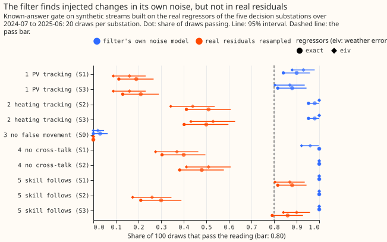

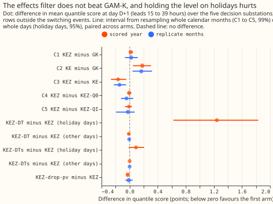

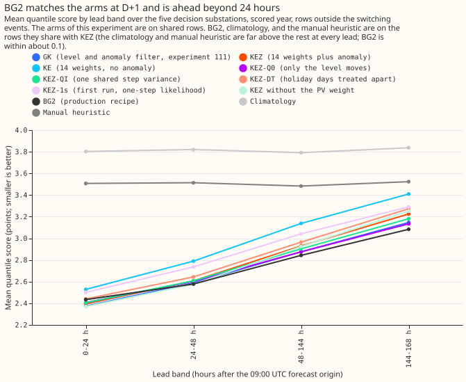

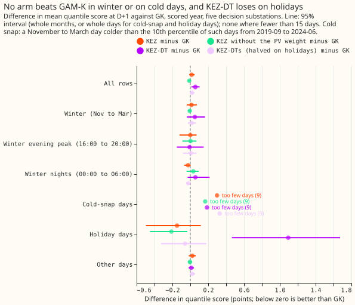

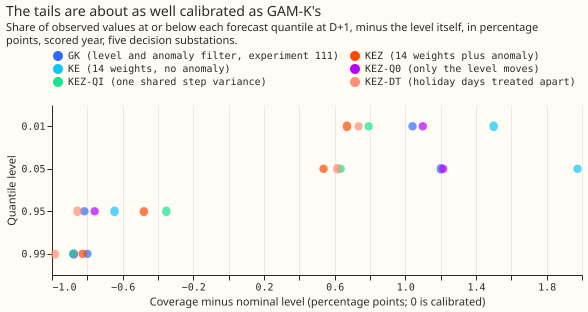

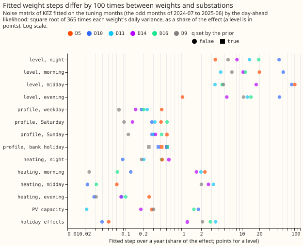

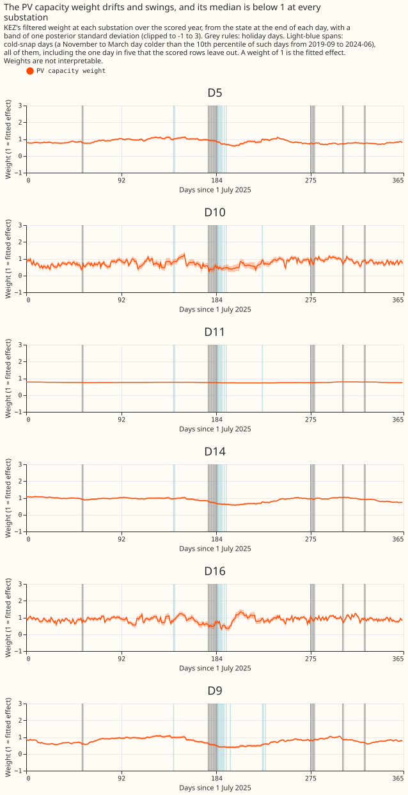

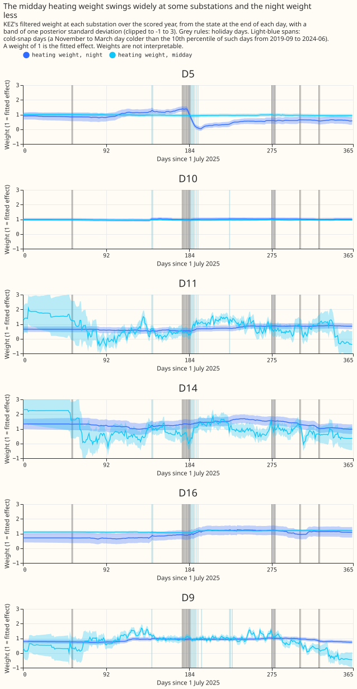

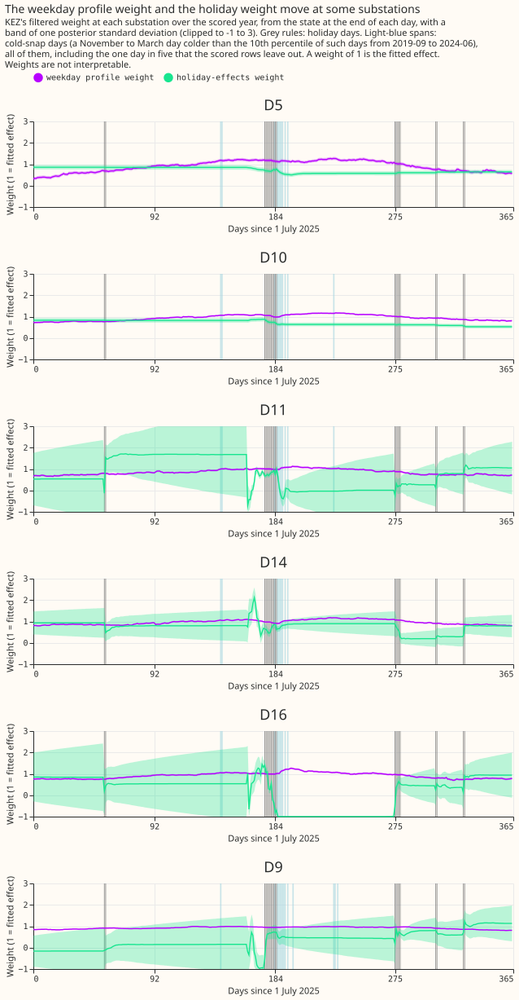

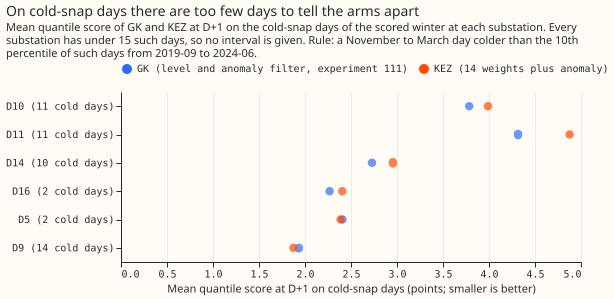

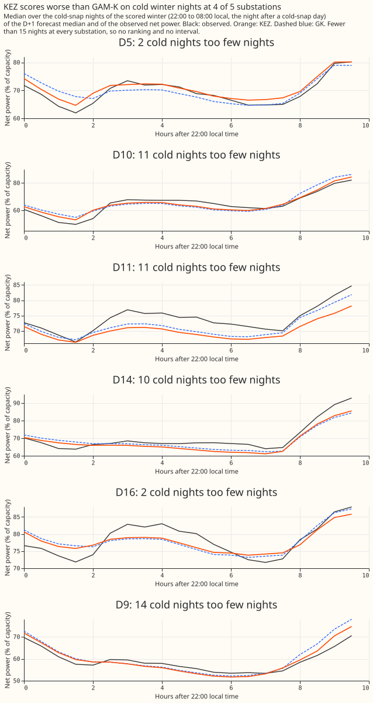

## Results

- **Verdict:** `inconclusive`. The known-answer gate failed, which caps the verdict (decision rule
  below). The planned contrast C1 shows no gain either way: +0.015 in the scored year and +0.021 in
  the replicate months.
- **GAM-K is reproduced:** 2.800 points over leads 0.5 to 168 hours in the scored year, as in
  experiment 111, and GK minus GAM-0 is -0.152 points (-0.264 to -0.039) there, against -0.151 in
  experiment 111. Controls P0 to P3 pass (see Controls).
- **Planned contrasts at D+1** (99% intervals from resampling whole calendar months, paired; "k of
  5" counts decision substations where the first-named arm scores better):

| Contrast | Scored year | Replicate months | |---|---|---| | C1, KEZ minus GK | +0.015 (-0.013 to
+0.048), 1 of 5 | +0.021 (-0.068 to +0.115), 1 of 5 | | C2, KE minus GK | +0.180 (+0.046 to +0.305),
0 of 5 | +0.166 (+0.041 to +0.318), 2 of 5 | | C3, KEZ minus KE | -0.164 (-0.267 to -0.048), 5 of 5
| -0.145 (-0.226 to -0.049), 4 of 5 | | C4, KEZ minus KEZ-Q0 (descriptive) | -0.006 (-0.035 to
+0.023), 3 of 5 | -0.045 (-0.124 to +0.052), 3 of 5 |
| C5, KEZ minus KEZ-QI | -0.010 (-0.066 to +0.032), 3 of 5 | -0.026 (-0.192 to +0.072), 3 of 5 |

- **Absolute scores, scored year, D+1 and over leads 0.5 to 168 hours** (five decision substations,
  shared rows): GK 2.521 and 2.800; KEZ 2.536 and 2.848; KE 2.701 and 3.039; KE-infl 2.558 and
  2.799; KEZ-Q0 2.543 and 2.805; KEZ-QI 2.546 and 2.828; KEZ-DT 2.577 and 2.887; KEZ-1s 2.663 and
  2.955; KEZ without the PV weight 2.508 and 2.841; shift-only check (KEZ's correction with GK's
  spread) 2.540 and 2.844. Replicate months: GK 2.412 and 2.735; KEZ 2.433 and 2.836.
- **References on the rows they share with KEZ** (scored year, D+1 and all leads): BG2 2.535 and
  2.780, so KEZ minus BG2 is +0.015 (-0.111 to +0.142) at D+1 and +0.066 (-0.063 to +0.196) overall;
  lagged XGBoost (Xlag-d) 2.637 and 2.877; lagless XGBoost with the filter (X-nl+K) 2.692 and 2.934;
  GAM-0 2.830 and 2.951; the manual heuristic 3.520 and 3.497; climatology 3.826 and 3.804. KEZ
  minus X-nl+K is -0.127 (-0.239 to -0.018) at D+1; the other contrasts against references are in
  `results_scored.json` in the private data folder.
- **What each group of weights does** (95% intervals, scored year, D+1, drop-one arms minus KEZ):
  without the profile weights +0.060 (+0.022 to +0.095), without the heating weights +0.032 (+0.015
  to +0.047), without the holiday weight -0.001 (-0.011 to +0.011), without the PV weight -0.028
  (-0.046 to -0.010; replicate months -0.013, -0.060 to +0.042). KEZ without the PV weight minus GK
  is -0.013 (-0.027 to +0.002) in the scored year and +0.008 (-0.070 to +0.073) in the replicate
  months.
- **The likelihood and bound change together were worth 0.127 points** (KEZ-1s minus KEZ, scored
  year, +0.084 to +0.171; replicate months +0.083, +0.031 to +0.139). The first run fitted the noise
  by the one-step likelihood and the narrower bound on log q (a pre-fit clarification, below), and
  KEZ-1s is that run. The two changes were made together, so this experiment cannot say which one
  caused the gain. KEZ-Q0 (level only, day-ahead-fitted noise) scored worse than GK, whose
  hyperparameters come from the one-step likelihood, by +0.022 (scored year) and +0.066 (replicate
  months), which points the other way.

## Controls

- **P0, initial state and vintages:** the five long-history substations use a real-time capacity
  vintage at every monthly cut (the vintage origin is 21 days before the cut); D9 uses a hindsight
  level scaled back at the growth prior for its cuts before 2025-04. The level and anomaly start at
  GAM-K's stationary values, and a non-level weight starts with a standard deviation of 0.1 of the
  effect.
- **P1, nesting:** KEZ with only the level weights moving equals experiment 111's filter: the level
  and anomaly differ from `studies.dp_assimilation`'s by at most 1.4e-14 in float64, and the
  quantiles of arm GK equal experiment 111's stored `gamk_tuning` files exactly on 13,440 rows per
  substation.
- **P2, decomposition:** the regressors plus the remainder equal the fit's prediction to 1.4e-14
  points for every member of every tuning run at every substation, and the PV regressor is exactly 0
  at night.
- **P3, causality:** changing every reading after the cutoff, or every ensemble run issued after the
  origin, leaves the filter's state and the members' forecasts unchanged; the noise fit's stream is
  empty after 2025-07-01, and the regressor scale uses the tuning months' readings only.
- **P4, known-q recovery: failed.** A stream simulated from known weight variances (PV 1e-4, heating
  1e-6, profile and holiday 0 per day, in weight units) on the real regressors and the filter's own
  noise was refitted at each decision substation. Heating was recovered within a factor of 3 at all
  5 substations (fitted 0.4e-6 to 2.8e-6), but PV was recovered within the factor only at D5
  (2.95e-4; the other four fitted 0.9e-5 to 2.7e-5, 4 to 11 times too small), and the holiday
  weight, simulated at 0, was fitted above the bar of 1e-7 at all 5 (0.9e-6 to 3.2e-2). A failed
  control is a trigger for the audit. A Sonnet diagnosis of the control found no plumbing fault: a
  naive dense Kalman filter matches the module's likelihoods, and the bounds, scale mapping, and
  starting covariance are right. **A post hoc repeat over 10 seeds per substation (50 fits; no bar
  changed, and the first run's result stands)** gave a median fitted PV variance of 7.4e-5 against
  the true 1e-4, with 58% of fits within a factor of 3 (10th to 90th percentile 6e-8 to 2.4e-4); a
  median heating variance of 6.8e-7 against 1e-6, 62% within the factor; and, for the holiday group
  simulated at 0, a median of 4.4e-6 with none of the 50 fits under the bar of 1e-7 (10th to 90th
  percentile 6e-7 to 6e-3). The median fit is slightly low (0.74 of the true PV variance, 0.68 of
  the heating variance), but the scatter runs over two to three orders of magnitude (10th to 90th
  percentile 6e-8 to 2.4e-4 for PV and 1.2e-7 to 5.7e-5 for heating), so the pre-registered bar of a
  factor of 3 asked for more than the fit delivers. One reading is that the variance of a rare
  effect is not identifiable from the likelihood (the holiday group is active at 480 half-hours in
  the tuning months).

## Winter, cold snaps, and holidays

- **Winter first:** the evidence holds one winter that chose nothing (2025-26, scored) and one
  winter whose odd months set the noise matrix and the spread (2024-25, with the even months as the
  replicate). No arm beats GK in winter. KEZ minus GK at D+1: winter (November to March) +0.013
  (-0.041 to +0.073), 2 of 5; winter evening peaks (16:00 to 20:00) 0.000 (-0.121 to +0.070), 3 of
  5; winter nights (00:00 to 06:00) -0.026 (-0.069 to +0.003), 3 of 5. Over all leads KEZ is worse
  in winter by 0.108 (-0.031 to +0.414). No winter interval excludes zero. The cold-snap point
  estimate (+0.298 at D+1, over 9 days) would trigger the winter cap of the plan at `partly
  supported`, which is moot because the verdict is already `inconclusive`.
- **Cold snaps:** a cold-snap day is a local November to March day whose mean ERA5 temperature is
  below the 10th percentile of such days from 2019-09 to 2024-06 at the site (thresholds 2.08 to
  3.36 degrees Celsius). The scored winter holds 2 to 14 such days per substation (D5 2, D10 11, D11
  11, D14 10, D16 2, D9 14), so every comparison says too few days and has no interval. Those counts
  are days in the scored rows: every fifth day of the scored year is a stride day that is never
  scored, so the weight figures, which mark every cold-snap day of the winter, show more spans than
  the counts. The point estimates favour GK at D10, D11, and D14 by 0.2 to 0.6 points (figure
  above).
- **Cold winter nights (the operator-visible case):** a cold winter night is 22:00 to 08:00 local
  after a cold-snap day. The scored winter holds 2 to 14 such nights per substation (D5 2, D10 11,
  D11 11, D14 10, D16 2, D9 14), too few for an interval. The mean quantile score of GK and KEZ on
  those nights at D+1 is 2.168 and 2.462 pooled over the five decision substations; by substation GK
  and KEZ score D5 1.593 and 1.698, D10 2.394 and 2.332, D11 2.755 and 3.674, D14 1.471 and 1.556,
  D16 1.821 and 1.916, so KEZ is worse at 4 of 5 and much worse at D11, where both filters
  under-forecast the observed night (figure below).
- **KEZ-DTs on winter nights** scores -0.023 (-0.045 to -0.003) against GK at D+1 (95%, uncorrected,
  one of many exploratory intervals), and against KEZ it is within 0.002 on winter rows.
- **Holiday days (KEZ-DT, pre-fit clarification):** KEZ-DT leaves holiday-day readings out of the
  filter and sets the level and anomaly corrections to 0 on holiday targets. KEZ-DT minus KEZ on the
  17 holiday days of the scored year is +1.242 (+0.623 to +1.832), 0 of 5 substations better (C6),
  and +1.222 on the replicate months (too few days: 14). On all other days it is -0.012 (-0.025 to
  +0.001), within the non-inferiority margin of 0.02 (C6b). The carried level helps on holidays, so
  the idea that the filter carries the wrong level into holidays is not supported by this arm. An
  exploratory arm added after the results, KEZ-DTs (KEZ's filter with the level and anomaly
  corrections halved on holiday targets, a post hoc choice of 0.5 that the tuning months, with 2 to
  3 holiday days, could not tune), scores +0.091 (-0.015 to +0.208) against KEZ on the same 17
  holiday days and -0.000 (-0.001 to +0.000) on other days, so a halved correction is no better than
  the full one; against GK it is -0.058 (-0.326 to +0.178) on holiday days and +0.019 (-0.004 to
  +0.045) at D+1 overall.

## The known-answer gate

- **What it tested:** each draw built a synthetic stream on the real regressors of one decision
  substation over 2024-07 to 2025-06, injected a known path (S1: the PV weight rising by 30% over
  180 days; S2: the heating weights falling by 30% over 90 days; S3: both; S0: nothing), added
  noise, refitted the whole noise matrix, and ran the filter. Noise came in two forms (the filter's
  own noise model, and a circular month-block resample of the substation's real tuning-year
  residuals) and the regressors came in two conditions (exact, and with weather error: the stream
  built from ERA5 and CAMS and the filter given the analysis proxy's regressors). A reading passes
  if at least 80% of 100 draws pass.
- **Result:** blocking readings 1, 3, 4, and 5 failed. In the filter's own noise model, PV tracking
  passed (0.87 to 0.93 of draws recovered 70% of the change), heating tracking passed (0.98 to 1.00
  recovered 50%, a non-blocking reading), cross-talk passed (0.96 to 1.00), and the filter beat GK
  on the stream in every draw; only the no-false-movement reading failed, passing in 2 to 3 of 100
  draws against a bar of 80 (the wander is modest: on a clean stream the heating weight wandered by
  a median 0.15 and the holiday weight by 0.13, against a bar of 0.10). With resampled real
  residuals, PV tracking passed in 0.16 to 0.21 of draws, heating tracking in 0.44 to 0.53,
  no-false-movement in none, and cross-talk in 0.37 to 0.51; the forecast-skill reading passed in
  the PV scenarios (0.86 to 0.90 in S1 and S3) and failed in S2 (0.26 to 0.30).
- **Power check:** the injected PV change was 1.5 to 14.7 posterior standard deviations (D10 1.5,
  D16 1.8, D5 4.5, D14 4.9, D11 14.7) and the heating change 0.9 to 3.4, so both weights are
  labelled "not interpretable". The doubled-amplitude rows were added as a check after the first
  gate run (post hoc, no bar changed): At doubled amplitude (the PV weight rising by 60% in the S1x2
  scenario and the heating weights falling by 60% in S2x2, 20 draws per substation; S3x2 was not
  run), PV tracking passed in 0.98 to 1.00 of draws and heating tracking in 0.99 to 1.00 in the
  filter's own noise model, and in only 0.39 to 0.42 (PV) and 0.55 to 0.62 (heating) with resampled
  real residuals, still under the bar of 0.80.
- **The maintainer's process rule was that the replicate and scored forecasts run after the failed
  gate** and that the contrasts are published as descriptive, with the verdict capped at
  `inconclusive`. The first-run gate fits are kept. Not run (reported, not blocking): the level
  step, the holiday step, the gate with the shared-step noise matrix, the 10% and 20% amplitude
  rows, and the doubled-amplitude S3x2 scenario.

## Checks

- **A Sonnet audit ran** (re-derived C1 to C5 from the stored predictions; leakage, spread, held
  values, and the gate failure checked). It found no bug in the forecasts, scoring, or likelihood.
  Its findings on the write-up are applied above.
- **Bar calibration.** Two gate readings failed on bars the filter cannot meet even when correct:
  the P4 zero-variance bar of 1e-7 is below the optimiser's grid (a true zero fits at 8e-7, a
  `GREEDY_GRID` value, the optimiser's grid of candidate variances), and the S0 no-false-movement
  bar of 0.10 is tighter than the filter's own posterior spread for the heating weights (0.09 to
  0.33). The failures that stand are PV and heating tracking on resampled real residuals, and the
  holiday variances (fitted 1e-3 to 3e-2).
- **Median forecast minus mean forecast, per substation** (all leads, scored year, points; GK /
  KEZ): D5 -0.117
  / -0.088, D10 -0.037 / -0.041, D11 -0.043 / -0.008, D14 +0.015 / +0.019, D16 +0.002 / -0.010, D9
  -0.014 / -0.005. The spread shifts no forecast by more than 0.12 points.
- **Mean-forecast error beside each contrast** (D+1, scored year, KEZ-first contrast of the mean
  forecast's absolute error): C1 +0.012, C2 +0.250, C3 -0.238, C4 -0.030, C5 -0.006. Every sign
  agrees with the quantile-score contrast.
- **Triggers that fired** (the seven triggers of the plan): 1, controls failed (the known-answer
  gate, and P4's known-q recovery for the PV and holiday weights); 2, a result contradicts its own
  prediction (C1 was predicted at -0.02 to -0.10; the PV weight explains part of the scored-year
  shortfall at three substations (D10, D11, D16) but not the replicate months, where the level noise
  fitted by the day-ahead likelihood is worse than GAM-K's, KEZ-Q0 minus GK +0.066; it is not
  settled); 4, leaving one substation out flips a sign (C1 in
  the replicate months turns negative without D5; C4 in the scored year turns positive without D11;
  C5 in the replicate months turns positive without D11; each flip is a move of about 0.01, inside
  an interval of plus or minus 0.05 or more, and C1 in the scored year is positive whichever
  substation is left out); 5, a nested arm beats the arm that
  contains it (GK beats KEZ by 0.015, inside the noise); 6, the replicate months' C1 interval
  (half-width 0.09) is about four times as wide as the sister experiment's. Triggers 3 and 7 did not
  fire. Triggers 1, 2, 4, 5, and 6 therefore call for an audit.
- **Tails at D+1, scored year** (coverage at q01, q05, q95, q99, and pinball loss at each): GK
  0.020, 0.062, 0.942, 0.982 and 0.189, 0.635, 0.656, 0.206; KEZ 0.017, 0.055, 0.945, 0.982 and
  0.187, 0.646, 0.672, 0.211. KEZ is within 0.7 percentage points of GK's coverage at every tail.
  Threshold-weighted CRPS and curtailment cost were not computed (experiment 87 found no event that
  could rank forecasts).

## Caveats and what to try next

- **Caveats:** the 3.5-hour telemetry delay is assumed; the hindsight switching masks apply in
  scoring; five decision substations and one winter of evidence that chose nothing; collinear
  weights can offset each other, and the posterior standard deviation is probably overconfident; the
  capacity vintage for D9 at the tuning cuts is hindsight (D9's vintages start in 2025-04); the
  in-sample ENS calibration, the pinned capacity reading hindsight weeks, ERA5 in the convex model's
  last training rows, and the spread fitted on the tuning months are inherited from experiment 111;
  the gain reported by de Vilmarest et al. is on regional load. The forecasts ran on module commit
  `2e356581b` of PR 1407; if its review changes the module, what the change affects re-runs and
  these first-run results stay on this page. The scripts import the module from `packages/studies`.
- **What to try next:** KEZ without the PV weight is the only one of the nine arms that scored below
  GK in the scored year, and it did not in the replicate months, so a filter that moves the profile
  and heating weights while fixing PV is a cheap follow-up. A day-ahead likelihood fit for GK's own
  level-and-anomaly filter is the fairer comparison for KEZ-Q0 (KEZ-Q0 minus GK is +0.022, +0.006 to
  +0.035).

## Pre-registered design

- **Weights:** 14 (level per hour band, profile scale per day type, heating per hour band, PV
  capacity, holiday), standardised, with an AR(1) anomaly per hour band in the arms that use it;
  noise matrix per substation fitted on the tuning months under a prior shared across substations;
  filter reads residuals at least 3.5 hours old, and no switching mask.
- **Arms:** GK (experiment 111's filter, reproduced); KE (no anomaly); KE-infl (KE with the
  observation noise held at the square root of 27 times KE's); KEZ (the decision arm); KEZ-Q0 (only
  the level moves); KEZ-QI (one step variance for every weight); KEZ-drop-g (g in profile, heating,
  PV, holiday); KEZ-DT (holiday days treated apart, added as a clarification); KEZ-1s (the first
  run's KEZ, kept). The KEZ-sh arm (experiment W1's shape state) is a follow-up with no number,
  because W1 has not merged a tested shape state.
- **Decision rule:** the verdict is C1's label (`supported` needs the scored-year 99% interval
  wholly below zero, an estimate of at least 0.05 points, at least 4 of 5 substations better in both
  periods, and C5 below zero), capped at `inconclusive` if the known-answer gate fails. The smallest
  gain worth porting is 0.05 points at D+1.
- **Predictions against the outcome:** C1 was predicted at -0.02 to -0.10 and observed +0.015
  (failed); C2 within +/-0.05, observed +0.180 (failed); C3 at -0.02 to -0.08 under 24 hours and
  under 0.03 in size at D+1, observed -0.134 and -0.164 (failed); C4, KEZ-Q0 within 0.02 of GK,
  observed +0.022 (failed narrowly); C5 at -0.01 to -0.06, observed -0.010 (held, with an interval
  that includes zero). The gate's readings 1 and 3 to 5 were predicted to pass and failed with real
  residuals; reading 2 (heating tracking), predicted likeliest to fail, passed in the filter's own
  noise model. The fitted steps were predicted at 0.1 to 0.4 a year for the level and holiday
  weights, 0.02 to 0.15 for PV, and under 0.05 for the profile scales; observed, the level steps are
  1 to 70 points a year, PV 0.02 to 1.8, and profile 0.07 to 0.55. The PV weight was predicted to
  stay within 0.15 of 1 at 4 of 5 substations; its median over the scored year is within 0.15 of 1
  at 2 (D14 0.95 and D16 0.89; D5 0.82, D10 0.74, D11 0.76).
- **Three clarifications were added before any replicate or scored forecast,** each recorded in the
  plan commits of [PR 1409](https://github.com/openclimatefix/nged-substation-forecast/pull/1409):
  the winter breakdown and the cold-snap rule (maintainer's winter-first rule); the day-type-aware
  arm KEZ-DT; and the lead-matched noise likelihood, which replaced the one-step likelihood after
  the first tuning-month fit scored KEZ at 2.524 against 2.420 for GK at D+1 (in-sample, tuning
  months) with the PV and level weights at the upper bound of `log q`. The change also widened the
  bound on `log q` to that of `studies.dp_assimilation`. The first run's KEZ is the arm KEZ-1s.

## Substation cards

**Provisional: fitted to past weather on a screening run, forecast on ENS.** Each decision
substation (D5, D10, D11, D14, D16, with D9 beside them) has the figures above for its own panel:
its filtered weights over the scored year, with bands and the holiday and cold-snap days marked (the
three weight figures), its fitted step per year for every weight (the step figure), its score on
cold-snap days (the cold-snap figure), and four example weeks (below).

- **Weak identification:** a heating slope is known to about 38% of its size at real noise
  ([experiment
  113](../00113-differentiable-physics-n5-convex-identification-at-realistic-noise/result.md)), and
  the gate labels the PV and heating weights "not interpretable", so no weight on a card is a
  measurement of that substation.
- **The PV weight against the vintage:** the middle 90% of the scored year's PV weights (5th to 95th
  percentile) run 0.68 to 1.08 at D5, 0.42 to 1.07 at D10, 0.73 to 0.79 at D11, 0.62 to 1.04 at D14,
  0.55 to 1.15 at D16, and 0.42 to 1.02 at D9, so the implied PV capacity is mostly below the pinned
  vintage capacity. D9's vintage is hindsight at the tuning cuts, so its PV weight is the least
  informative. The hindsight capacity estimates of experiment 45 are not drawn beside the weights.
- **Weights worth a second look:** D16's holiday weight sits at the clip of -1 from January to March
  (days 184 to 275 of the figure), and D11's holiday weight sits near 1.7 from late August to
  mid-December with a band that reaches the clip of 3. Both follow from a weight that updates only
  on the few holiday half-hours, so they are not measurements. D5's weekday profile weight rises
  from about 0.35 to 1.2 and falls to 0.55 within the year.
- **Cross-substation comparison:** the step figure shows, for every weight, the fitted random-walk
  step at all six substations side by side; the level steps range from 1 to 70 points a year, the
  holiday and PV steps differ by more than 10 times between substations, and the profile steps stay
  under 0.6 of their effect a year.
- **Example weeks, fixed in the plan before any score was read** (the weeks beginning 2025-07-14,
  2025-10-13, 2026-01-12, and 2026-04-13; D+1 forecasts chained from each 09:00 UTC origin; median
  with 80% and 90% bands against the observed series, GK and KEZ side by side):

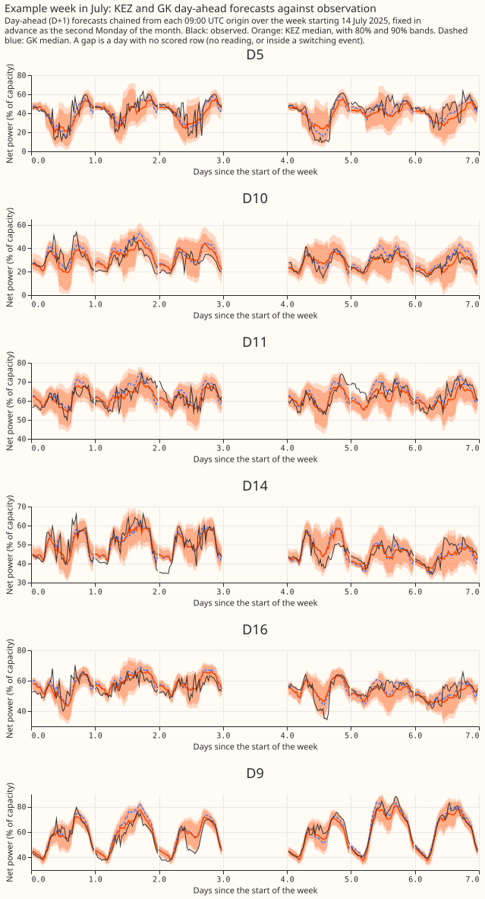

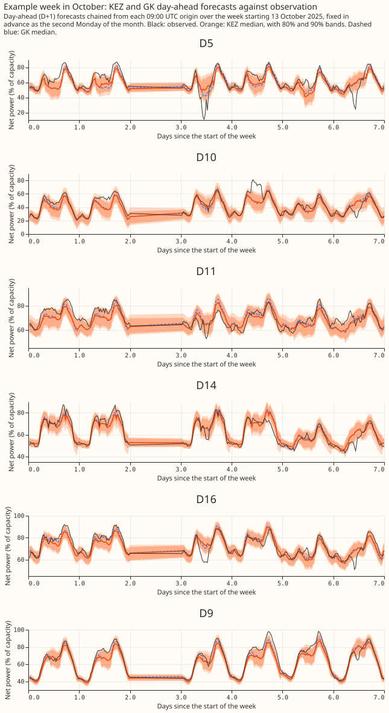

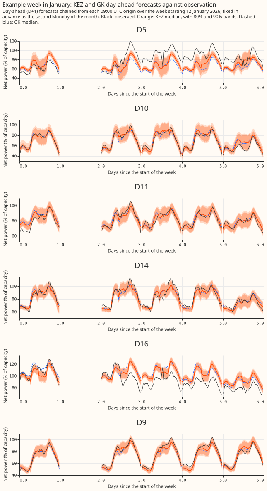

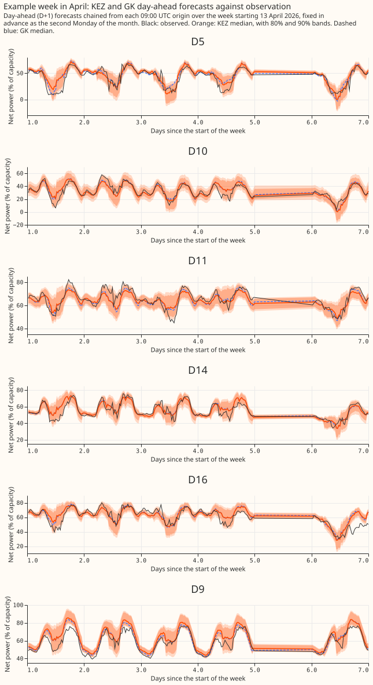
