**We asked whether a small neural network that reads the weather forecast for the boxes around a
Primary substation, and not only the box the substation sits in, would lower the error of our
current demand forecast (GAM-K, the generalised additive demand model with a Kalman filter that was
fitted in experiment 111).** The weather forecast is the 51-member ensemble (ENS) of the European
Centre for Medium-Range Weather Forecasts (ECMWF). We trained the network on one year of GAM-K's
forecasts and scored it on the other year. We then swapped the two years: direction F1 is scored on
2025-26 and direction F2 on 2024-25. We also trained copies that saw only the centre box, the box of
a distant substation, or the same substation's weather from another date, to find out where any gain
comes from. The network lowered the quantile score (a pinball-loss score of the 11 forecast
quantiles, in points of the substations' effective capacity, where smaller is better) by 0.062 in F1
and 0.035 in F2. The copy that read another date's weather kept about two-thirds of that gain, and
the copy that read only the centre box (the one ENS grid cell that holds the substation) kept nearly
all of it (0.060 and 0.038 points). Most of the gain therefore does not come from the surrounding
boxes, and is probably a recalibration of GAM-K's quantiles, which a later experiment has to test.

**The verdict is `inconclusive`: the known-answer gate failed its one rerun, and the pre-registered
plan, written before any scored-year prediction, caps the verdict there.** The gate checks that an
injected signal can be found, and that controls which cannot see the signal do not find it. On the
point estimates the pre-registered label would have been `supported` (it would be `partly supported`
if C3's F2 interval, which includes zero, is read as not below zero). Either label would mislead,
because the centre-only control scores as well as the full patch. Experiment 119 is not for
production.

## Result

**The arms.** ENC-c is the network with the full 37-cell patch, correcting GAM-K's quantiles. ENC-c0
sees only the centre box, ENC-cps the patch of the farthest decision substation, and ENC-cpt the
same substation's patch from another date (the placebos). ENC-r uses the full patch to replace
GAM-K's temperature and irradiance (through GAM-K's own sensitivities), and ENC-r0 sees only the
centre box. The five decision substations are D5, D10, D11, D14, and D16.

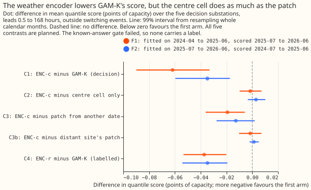

- **C1, the correction against GAM-K, is -0.062 [-0.090, -0.033] in F1 and -0.035 [-0.060, -0.017]
  in F2** (99% intervals, points of capacity), with 5 of 5 decision substations better in each year
  and the mean absolute error of the median moving the same way (-0.102 and -0.061). Leaving any one
  substation out changes C1 by at most 0.005. The pre-registered smallest gain worth porting is 0.04
  points, and F2 sits below it.
- **C2, the patch against the centre box alone, is -0.002 [-0.010, +0.007] and +0.003 [-0.003,
  +0.010].** The surrounding boxes add nothing the centre box lacks, although the plan predicted
  -0.01 to -0.05.
- **C3, the right date against another date, is -0.019 [-0.036, -0.006] and -0.013 [-0.028,
  +0.002].** Date-aligned weather in the centre box accounts for about a third of C1. C3b, against
  the distant substation's patch, is -0.002 and +0.001 and is read as a leak-through warning,
  because the six patches share 12 to 30 of their 37 cells.
- **C4, the replacement through GAM-K's own sensitivities, is -0.037 [-0.053, -0.020] and -0.035
  [-0.054, -0.019].** Its centre-only control scores the same (-0.037 and -0.036), and the gate
  shows ENC-r could not recover a small injection, so C4 carries no label.
- **ENC-c scores 2.739 in F1 and 2.698 in F2 against GAM-K's 2.800 and 2.733 (annual quantile score
  on shared rows, smaller is better).** All arms, F1: GAM-K 2.800, ENC-c 2.739, ENC-c0 2.740,
  ENC-cps 2.740, ENC-cpt 2.758, ENC-r 2.763. F2: GAM-K 2.733, ENC-c 2.698, ENC-c0 2.696, ENC-cps
  2.697, ENC-cpt 2.711, ENC-r 2.699. GAM-0 (no Kalman filter) scores 2.951 and 2.984 on the same
  rows.

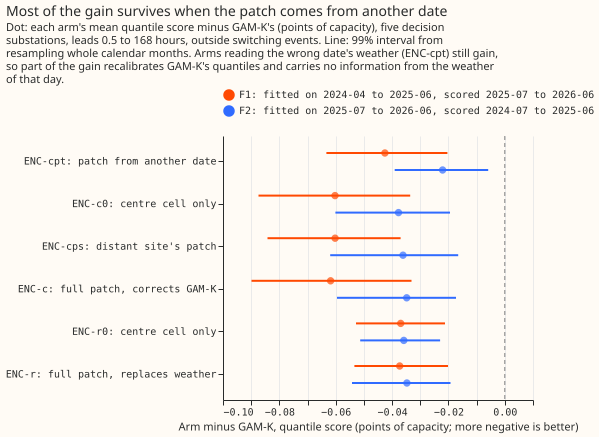

**Most of the gain survives when the network reads the wrong date's weather.** ENC-cpt gains 0.043
(F1) and 0.022 (F2), 69% and 63% of C1. The centre-only ENC-c0 gains 0.060 and 0.038. The gain
therefore comes from inputs that are not the weather of the right day: the lead, the hour, GAM-K's
own forecast, and the centre box's values. The median shift of ENC-c against lead (cards below)
follows the daily cycle. That pattern is consistent with a recalibration and does not prove one.

## Winter and the hard days

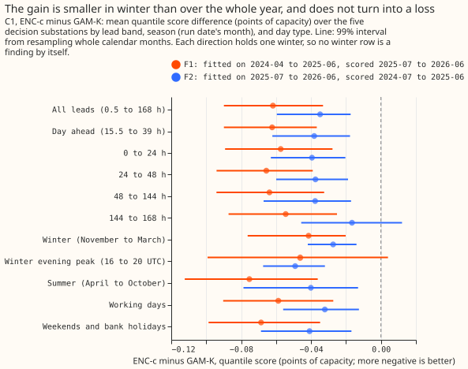

**The gain is smaller in winter than over the year, and it is never a loss.** In winter (November to
March, by the run's month) C1 is -0.041 [-0.076, -0.020] in F1 and -0.027 [-0.042, -0.014] in F2. On
winter evening peaks (16:00 to 20:00 UTC) C1 is -0.046 [-0.099, +0.004] and -0.049 [-0.067, -0.032].
The evidence holds two winters, one scored in each direction (2024-25 in F2 and 2025-26 in F1), so
no winter row is a finding by itself. The pre-registered rule holds an arm back for a winter loss,
and ENC-c has no winter loss.

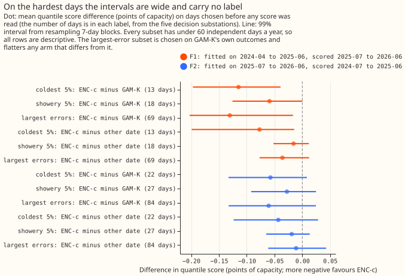

**On the hardest days the intervals are wide and carry no label.** The coldest 5% of days (13 days
in F1, 22 in F2) show C1 of -0.115 [-0.197, -0.039] and -0.057 [-0.133, +0.008], but C3 on the same
days is -0.077 [-0.199, -0.015] and -0.043 [-0.124, +0.028]. The showery days (18 and 27) and the
largest-error days (69 and 84, chosen on GAM-K's own outcomes) are in the figure. No subset has more
than 84 days a year, and its days cluster in weather spells, so none carries a label.

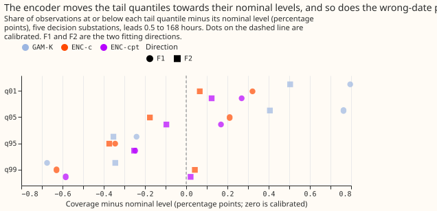

**The tail quantiles move towards their nominal levels, and the wrong-date copy does the same.** In
F1 the share of observations below the q01 quantile falls from 0.018 (GAM-K) to 0.013 (ENC-c and
ENC-cpt), and in F2 from 0.015 to 0.011. The q99 share moves from 0.983 to 0.984 (F1) and from 0.987
to 0.990 (F2).

## The known-answer gate

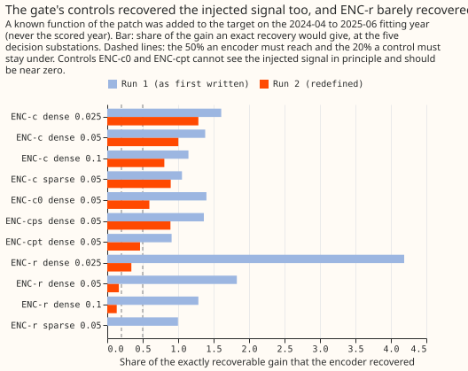

**The gate was redefined once after run 1 failed, and the rerun failed as well.** Run 1 used the
first-written gate: the controls ENC-c0 and ENC-cps recovered 140% and 136% of the injection, ENC-r
recovered it at 1 of 5 substations, and the permuted-actual test of "no false gain" gave a gain of
0.56 points because GAM-K was never calibrated to its target. The redefinition (committed before the
rerun) orthogonalised the injection against the non-patch inputs, sized ENC-r's injection per
substation, and replaced the null target with GAM-K's median plus another run's residual.

**In the rerun, ENC-c recovered the dense injection but missed the sparse one, and the controls and
ENC-r failed.** ENC-c recovers the dense 0.05-point injection (100%, 4 of 5 substations) and fails
the sparse one (2 of 5, interval upper bound 0.000). ENC-r recovers 16% (1 of 5). The controls
ENC-c0, ENC-cps, and ENC-cpt recover 59%, 89%, and 46% (the rule required under 20%, and ENC-cps is
read as descriptive). On the null target ENC-c (+0.009) and ENC-r (-0.002) stay within 0.01 and the
intervals include zero, and ENC-cpt misses by 0.003 (+0.013). The original clean-data test (at most
0.01 from GAM-K on the real targets) also fails for every arm (ENC-c +0.025, ENC-c0 +0.042, ENC-cps
+0.026, ENC-cpt +0.026, ENC-r +0.015), because a real gain is not a false one. Reproduction (largest
difference from GAM-K 0), causality (largest change 0 when later weather changes), the purge (0
violations), and the seed spread (0.008 points) pass. Run 1's readings and the redefinition are in
`gate_run1.json` and the commit history.

## More figures

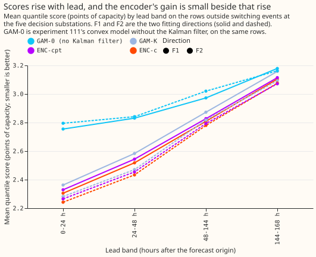

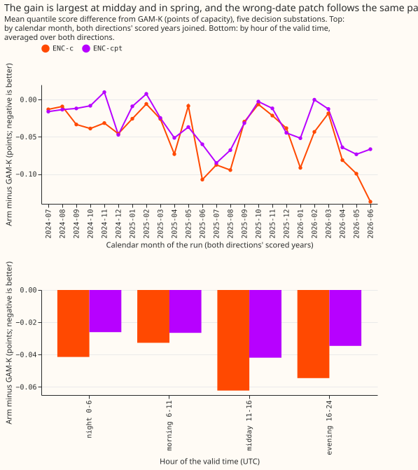

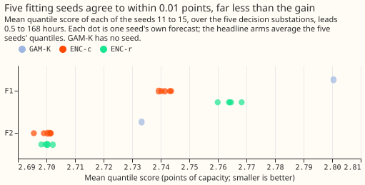

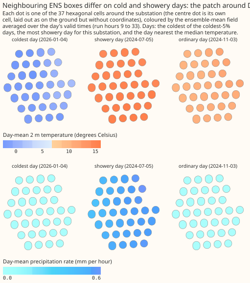

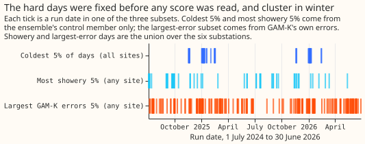

## Substation cards

Provisional: fitted to past weather, forecast on ENS, screening run. **Patch weights are not
identified individually (neighbouring cells share an ENS box); read the ring and east-west contrast,
not one cell. No physical direction is claimed from one site.** Each card shows the number of
distinct ENS boxes in the patch, the learned weight of each box (the change in the median forecast
per kelvin added to that box, with the five seeds' range in the tooltip), the median shift against
lead, the cold-snap scores, and four example weeks fixed before any score was read (the Monday to
Sunday weeks starting 2025-07-21, 2025-10-20, 2026-01-19, and 2026-04-20). The cold-snap panel uses
the coldest 5% of days, and says "too few days" below 10 days.

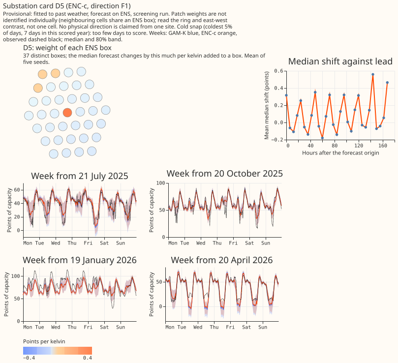

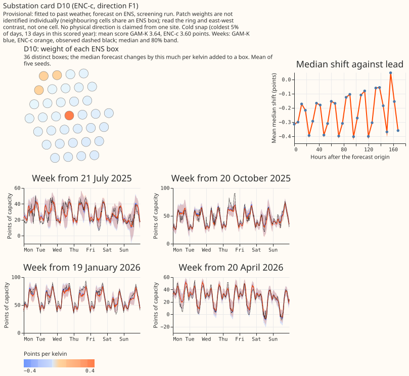

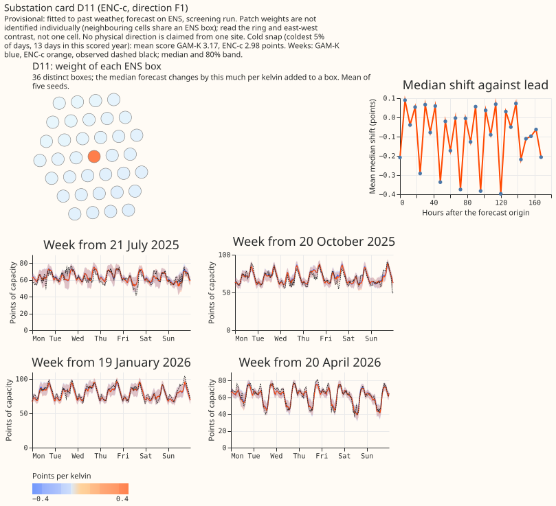

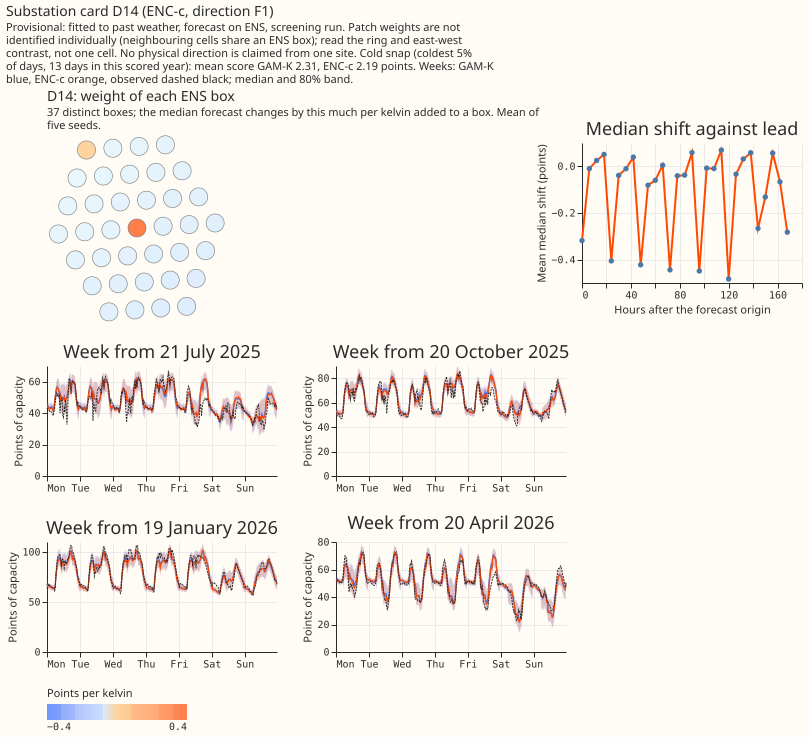

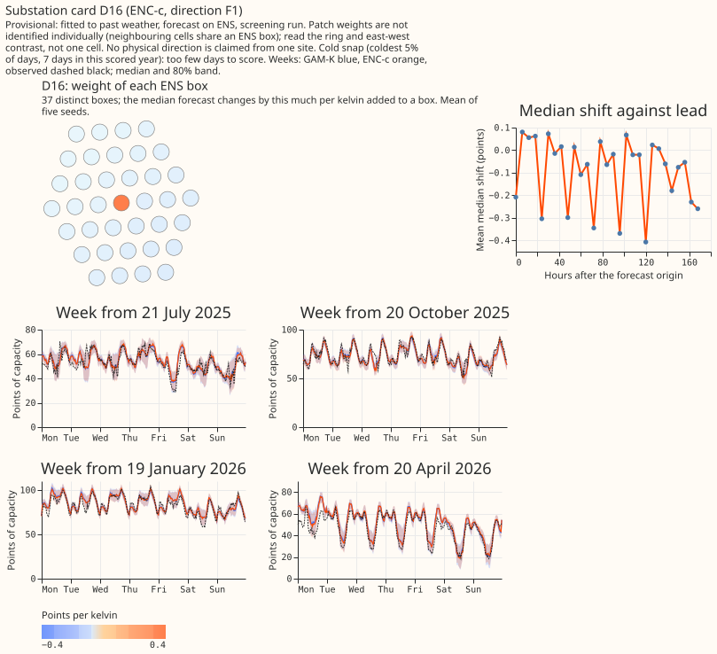

## Plan, predictions, and what changed

**Hypothesis and decision rule.** The pre-registered plan is in the plan commit (`c4430fd72`). The
verdict is C1's label (supported, small gain, partly supported, refuted, inconclusive), with a
smallest gain worth porting of 0.04 points, a second year, 4 of 5 substations better, and C3 below
zero in both years.

**Predictions against outcome.**

- **C1** (-0.02 to -0.08 overall, -0.03 to -0.10 day ahead, 3 to 5 of 5 substations, tail coverage
  within 3 and 1.5 points): held (-0.062 and -0.035; -0.062 and -0.038; 5 of 5; q01 coverage 0.013
  and 0.011).
- **C2** (-0.01 to -0.05), **C3** (-0.02 to -0.07), and **C3b** (about half of C3): failed (C2
  -0.002 and +0.003; C3 -0.019 and -0.013; C3b -0.002 and +0.001).
- **C4** (-0.01 to -0.05, smaller than C1): the range held, and C4 was smaller than C1 in F1 (-0.037
  against -0.062) but equal in F2 (-0.035 against -0.035).
- **C5** (coldest -0.10 to -0.40, showery -0.05 to -0.30, largest error -0.05 to -0.25 for ENC-c
  against ENC-cpt): failed (-0.077 and -0.043; -0.016 and -0.019; -0.036 and -0.011).

**Deviations from the plan, all fixed before any scored-year prediction.** The first nine runs of
2024-04 have no analysis-proxy week and experiment 111 never forecast them, so F1 trains on 447
runs, not 456. The run's half-hours reach 177 hours after initialisation, so the encoder reads 54
ENS steps, not 53. GAM-K for 2024-04 to 2024-06 was re-forecast from experiment 111's stored fits
and reproduces its stored rows exactly. No decision substation is free of shared ENS cells, so the
placebo ENC-cps uses the farthest decision substation. Settings: ENC-c uses c = 40 (the top of the
grid) in both directions, with 11 and 4 epochs. ENC-r uses c = 0.4 with 1 epoch in F1 and c = 40
with 2 epochs in F2. Lambda is 0.5 throughout. The rows with switching events are left out of every
score; the plan's "all-rows score beside" was not computed.

## Checks

- **Median forecast minus mean forecast, per substation (GAM-K's, the same for every arm):** F1 D5
  -0.117, D10 -0.037, D11 -0.043, D14 +0.015, D16 +0.002; F2 D5 -0.090, D10 -0.042, D11 -0.045, D14
  +0.009, D16 +0.001. The encoder shifts the median and the mean together by construction, so it
  adds no spread-induced shift.
- **Mean absolute error of the median beside every quantile-score contrast:** agrees in sign for C1
  to C4 in both years.
- **Audit triggers that fired:** trigger 1 (the gate's controls and ENC-r failed), trigger 2 (C2,
  C3, C3b, and C5 contradict the predictions, with an explanation recorded above and untested), and
  trigger 5 (ENC-c0 and ENC-cps score 0.003 and 0.001 better than ENC-c in F2, by their contrasts
  against GAM-K). An Opus audit is owed before the merge, and the manager runs it.
- **Triggers that did not fire:** quantile score and mean absolute error disagree in sign (no),
  leaving one substation out flips a sign (no), a headline interval more than twice or under half a
  sister's (C1's 99% half-width of 0.029 against about 0.027 at 99% for the paired contrast of Part
  4's experiment), and a later design depending on an unreplicated result (F2 replicates C1).

## Caveats and what to try next

- **Caveats.** One frozen fit per direction, no refits. F2 reverses time, K0's 2025-26 fits saw more
  history than its 2024-25 fits, and ECMWF may have changed its model cycle between the years. The
  largest-error subset is selected on outcomes. ENC-r is first-order and applied after the filter.
  The encoder sees the member mean and spread, not 51 members, and the 3.5-hour delay is assumed.
  The inherited leaks of experiment 111 (the ENS calibration fitted on odd months, hindsight pinned
  capacity, ERA5 in the GAM's last training rows) apply to GAM-K and the encoder alike. The
  out-of-fold gain on the F1 training year (0.025 on the clean data) is smaller than the scored
  gain, and out-of-fold scores are optimistic.
- **What the next experiment should answer.** Whether a plain recalibration of GAM-K's quantiles
  from lead, hour, and GAM-K's own forecast, with no weather at all, reproduces the placebo's gain
  of 0.043 and 0.022 points, and whether adding the centre box's dew point, pressure, precipitation,
  and member spread adds the remaining 0.019 and 0.013.

## Reproduce

```bash
uv sync --all-packages --group gpu
.venv/bin/python ml-experiments/00119-*/e00119_extract.py
.venv/bin/python ml-experiments/00119-*/e00119_gamk.py
.venv/bin/python ml-experiments/00119-*/e00119_sensitivities.py
.venv/bin/python ml-experiments/00119-*/e00119_hard_days.py
.venv/bin/python ml-experiments/00119-*/e00119_grid.py
.venv/bin/python ml-experiments/00119-*/e00119_checks.py
.venv/bin/python ml-experiments/00119-*/e00119_gate.py
.venv/bin/python ml-experiments/00119-*/e00119_final.py
.venv/bin/python ml-experiments/00119-*/e00119_score.py
.venv/bin/python ml-experiments/00119-*/e00119_extra.py
.venv/bin/python ml-experiments/00119-*/e00119_report.py
.venv/bin/python ml-experiments/00119-*/e00119_charts.py
.venv/bin/python ml-experiments/00119-*/e00119_cards.py
```
