# Differentiable physics, SH: a convex library of shared daily shapes

**The shared-shape library could not be shown to work, because the check that it can find a library
that exists failed, and the plain reason is that 5 Primary substations cannot pin down 3 shapes.** A
Primary substation is the last electricity substation before the feeders that serve homes and
businesses, and its **daily profile** is the average shape of its demand through the day, separately
for weekdays, Saturdays, Sundays, and bank holidays. Three shared shapes plus a small deviation
describe almost any 5 profiles, so the fitted shapes change with the starting point and the held-out
score cannot tell 2 shapes from 6. The known-answer gate failed on 7 of its 10 lines, so the verdict
is `inconclusive`. On the numbers alone the library scored the same as [experiment
109](../00109-differentiable-physics-n0-partially-pooled-convex-model/result.md)'s fleet-mean model
(0.001 points better, interval −0.005 to +0.002, scored year) and 0.030 points worse than one
profile per substation (interval +0.009 to +0.056), most of it in winter (0.068 worse in November to
March, interval +0.041 to +0.099). The library did not find the Economy 7 step at 01:00 as a shape
of its own, and its forecast reproduces about a third of that step on cold winter nights. A
hand-built night-step term, as in experiment 121, is the better route to the step.

We asked whether the Primary substations fall into a few kinds, so that each substation's profile
can be a mix of a few shared daily shapes instead of a pull towards one fleet-mean profile (the
[method](https://doi.org/10.1038/44565) is a non-negative matrix factorisation fitted by
[alternating constrained least squares](https://doi.org/10.1137/07069239X), inside the convex demand
model of experiment 109). We fitted 3 shapes (chosen on 2023-24 from 3 or 4) to 5 Primaries (D5,
D10, D11, D14, and D16) on the 2 years before each of three cuts (2023-07-01, 2024-07-01, and
2025-07-01), and scored the 12 months after the last two on the quantile score (twice the mean
pinball loss over 11 quantiles, in points of capacity; lower is better). Before scoring, a gate
asked whether the method recovers a library that we plant in synthetic substations on the real
weather and noise; the gate failed. Afterwards we looked for the Economy 7 night step, the
maintainer's priority, in the shapes and in the forecasts.

## Figures

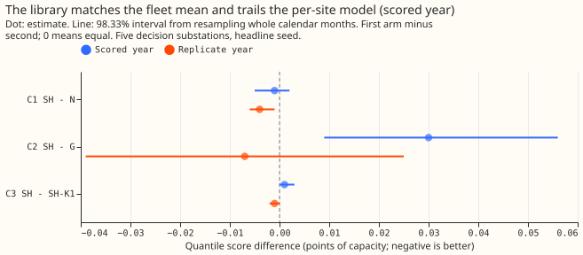

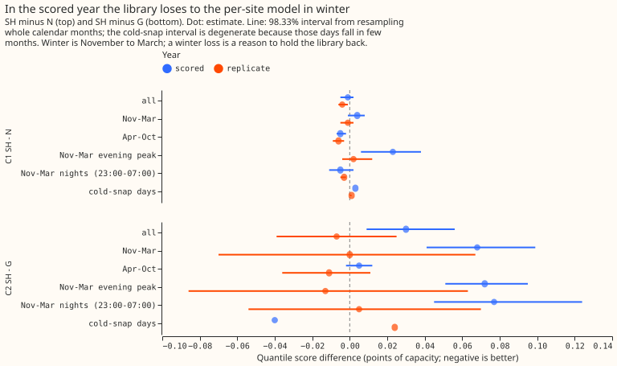

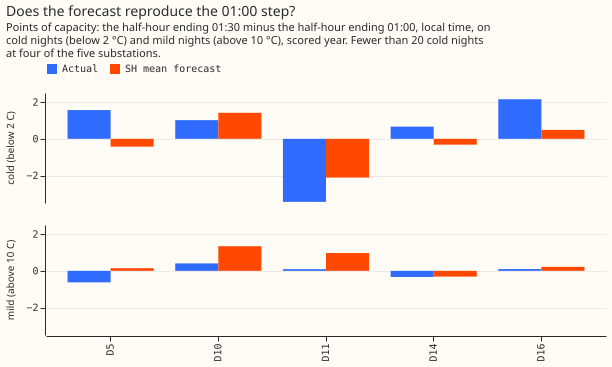

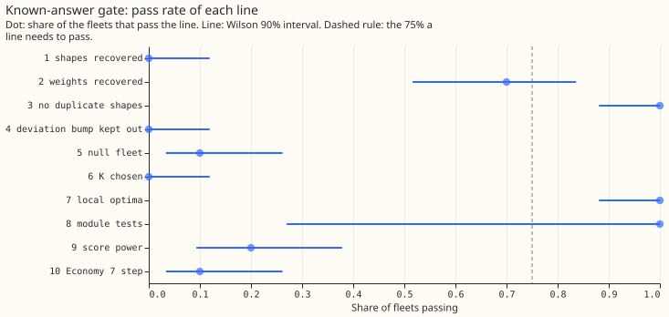

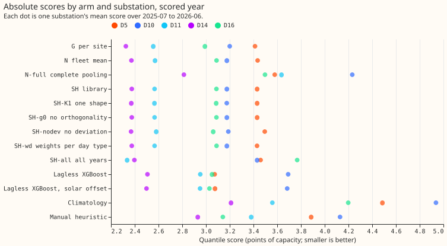

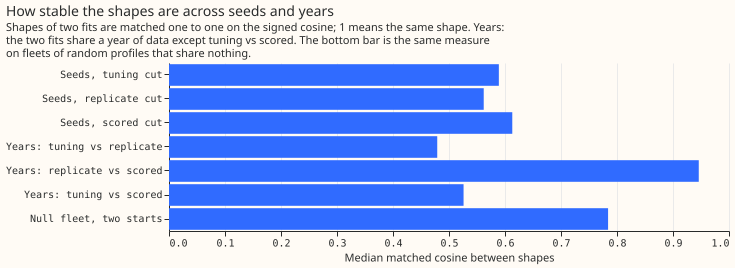

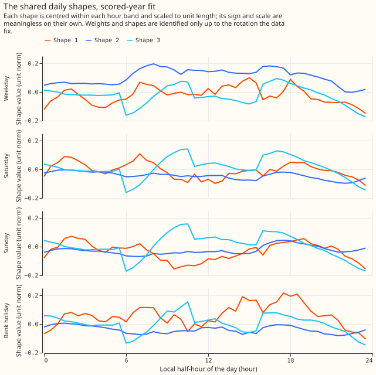

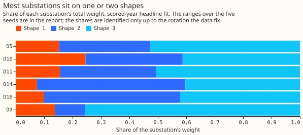

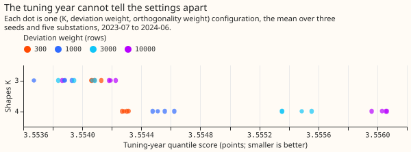

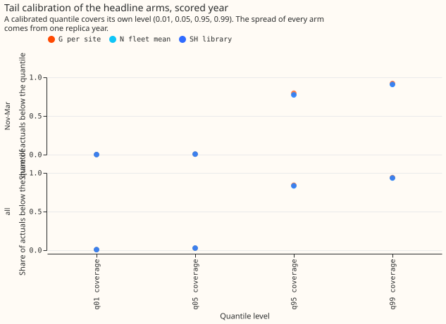

## Results

- **Arms.** G is the per-site convex model, N the fleet-mean model (deviation penalty 3,000 rows),
  N-full complete pooling, SH the library (K = 3, deviation weight 1,000 rows, orthogonality weight
  10 times the shape's data curvature, 5 seeds, headline seed the lowest training objective), SH-K1
  one shape, SH-g0 no orthogonality penalty, SH-nodev no deviation, SH-wd weights per day type, and
  SH-all all years. Capacity is pinned as in experiment 109, there is no drift, and the lockdown and
  the 66 hand-filtered transfers are out. Rows are the 12 months after each cut, outside the
  hand-filtered switching masks, at the day-ahead lead. Weather is ERA5 and CAMS (estimates of past
  weather), so every arm is flattered alike.
- **Schedule.** One frozen fit per cut and seed, no refits (the screening tier); intervals resample
  whole calendar months of stored predictions, paired across arms. The scored fits ran on module
  blob `library_module_blob` in `work/fit_run_replicate_scored_tuning.json`; the Opus module review
  is still to come, so the first-run results are kept if it changes the module.
- **C1, SH minus N.** −0.001 points (98.33% interval −0.005 to +0.002) in the scored year, 4 of 5
  substations better; −0.004 (−0.006 to −0.001) in the replicate year. The 0.05 smallest gain worth
  porting is far outside both intervals.
- **C2, SH minus G.** +0.030 (+0.009 to +0.056) in the scored year, 1 of 5 substations better, so SH
  is worse than the per-site profile and the interval reaches the 0.05 margin; −0.007 (−0.039 to
  +0.025) in the replicate year. Leaving any one site out leaves C2 positive in the scored year
  (+0.013 without D16 to +0.044 without D10).
- **C3, SH minus SH-K1.** +0.001 (−0.000 to +0.003) scored, −0.001 (−0.002 to +0.000) replicate:
  more than one shape adds nothing measurable.
- **Absolute scores, scored year, five sites.** G 2.884, SH-K1 2.912, SH 2.914, N 2.915, SH-nodev
  2.924, SH-all 3.063, lagless XGBoost with solar offset 3.048, manual heuristic 3.488, N-full
  3.553, climatology 4.068. Replicate year: SH-all 3.053, SH 3.159, N 3.163, G 3.166, lagless
  XGBoost 3.199, manual heuristic 3.839, climatology 3.910.
- **Exploratory (95%).** SH minus N-full −0.640 (−0.982 to −0.387): complete pooling is clearly
  worse. SH minus SH-g0 0.000 and SH-wd minus SH 0.000: the orthogonality penalty and per-day-type
  weights change nothing. SH minus SH-nodev −0.011 (−0.022 to +0.002). SH minus lagless XGBoost
  −0.135 (−0.375 to +0.082). SH-all minus SH +0.149 (−0.070 to +0.325) in the scored year and −0.106
  (−0.366 to +0.110) in the replicate year.
- **Winter first.** November to March, scored year: SH minus N +0.004 (−0.001 to +0.008), and +0.023
  (+0.006 to +0.038) in the evening peak (16:00 to 20:00); SH minus G +0.068 (+0.041 to +0.099), and
  +0.077 (+0.045 to +0.124) on winter nights (23:00 to 07:00). In the replicate year every winter
  contrast is within ±0.013 of zero. The scored-year winter loss to G is a reason to hold the
  library back whatever the annual mean does. The evidence holds 2 independent winters (2024-25 and
  2025-26); the tuning winter chose the settings. A cold-snap day has a mean 6-hour-smoothed ERA5
  temperature below 0 °C at the site: 20 site-days in the scored year and 25 in the replicate year,
  and the intervals on those rows are degenerate because the days fall in few months.
- **Tails.** SH matches N at q01, q05, q95, and q99 within 0.003 coverage in every year and season;
  q95 coverage was 83% (all rows) and 77% (November to March) in the scored year, so the upper tail
  is too low in winter for every arm, because the spread comes from one replica year.

## The Economy 7 step and the shapes

- **No shape of the library is a night step.** The rise at 00:30 (the half-hour that ends at 01:00)
  is 0.061, 0.011, and −0.006 per unit length for the 3 shapes, and the fitted profiles rise there
  by 0.3 to 3.3 points. The shapes are mixtures of 3 to 7 substations each; no shape belongs to a
  group of substations.
- **The forecast under-reproduces the step on cold winter nights and invents one on mild nights.**
  On cold nights (below 2 °C) in the replicate year (23 to 26 nights per substation) the actual step
  at 01:00 was 6.9, 9.0, 3.2, 1.2, and 6.9 points at D5, D10, D11, D14, and D16, against forecast
  steps of 2.6, 3.1, 1.5, 0.4, and 1.5. The scored year (4 to 13 cold nights per substation, so few)
  gives the same picture: 5.7, 11.3, 3.8, 1.6, and 7.1 against 2.6, 3.4, 1.5, 0.1, and 1.9. On mild
  nights (above 10 °C) the forecast step is 1.4 to 3.3 points at D5, D10, D11, and D16 against
  actual steps of −0.3 to 2.3. A visible miss on cold winter nights counts against release; the card
  for each substation shows the median cold night.
- **The step is UTC-fixed.** On cold nights (below 6 °C) the largest rise ends at 01:00 UTC in
  British Summer Time and in Greenwich Mean Time at 9 of 10 substation-years (the exception, D14 in
  the replicate year, has the smallest step), with 16 to 27 British Summer Time nights each. A
  local-clock step would rise an hour earlier in UTC in summer. This agrees with the finding that
  motivated the readout.
- **The window and the weight by winter cannot be read.** The profiles fall back at 06:00 and 11:00
  local time and rise at 06:30 to 08:00, which does not show a seven-hour window ending near 07:30,
  and the shapes of different cuts do not match (matched cosine 0.48 between the tuning and
  replicate fits, 0.53 between the disjoint tuning and scored fits), so a weight on the "step shape"
  by winter is "cannot tell".
- **The two-clock regression is uninformative.** The three windows overlap by 5 of 7 hours, and the
  coefficients (local window 2.0 to 4.5 points, UTC window −1.1 to +1.1) do not agree with the onset
  readout; the onset readout is the one to use. The learned shapes are indexed by local time only,
  so a UTC-indexed shape family and a heating-dependent shape (a winter and a summer version of
  each) are not tested here.

## Stability and shape mix

- **Across seeds, the matched shapes agree at a median cosine of 0.59 (tuning cut), 0.56
  (replicate), and 0.61 (scored), minimum 0.19 to 0.24.** The plan calls under 0.6 unstable; the
  null fleet of random profiles gives 0.78, so the real shapes are less stable than shapes fitted to
  profiles that share nothing.
- **Across years, the replicate and scored fits agree at 0.95 (their windows share a year), and the
  disjoint tuning and scored fits at 0.53.**
- **Shape mix.** Every substation puts 7% to 76% of its weight on every shape, so none sits wholly
  on one shape, and the deviation holds 0.7% to 2.3% of the profile's energy. The range over the 5
  seeds is wide (for example 0.24 to 0.88 for D10 on shape 1), so the shares are not identified. The
  plan's month-block intervals on the shares were not computed, because each needs a refit per
  resample; the range over seeds stands in, as a labelled departure.

## Known-answer gate

Twenty fleets per kind (the plan's cut order: 20 instead of 40, pass at 15 instead of 30, the same
75%). Each fleet has 5 synthetic substations on the real weather and pinned capacity of the tuning
cut, a 3-shape library, and block-resampled noise from the per-site model's residuals before the
cut.

- **Passed:** no duplicate shapes (line 3: 20 of 20, largest pairwise |cosine| 0.0002 at the tuned
  penalty against 0.43 without it), local optima (line 7: 20 of 20), and the module tests (line 8).
- **Failed:** shapes recovered at cosine 0.9 (line 1: 0 of 20; median of the worst shape 0.77),
  weights (line 2: 14 of 20, below 15), a bump absent from every shape (line 4: 0 of 20), K chosen
  (line 6: 0 of 20, the tie rule picked K = 2 every time), null fleet (line 5: 2 of 20), score power
  (line 9: 4 of 20; at an oracle gain of 0.084 SH minus N had a median of −0.026), and the Economy 7
  step (line 10: 2 of 20; time and size were found in every fleet, but the placebo step had a median
  of 1.4 points against a limit of 1.0). The dense weight prior (reported, not blocking) gave a
  median worst cosine of 0.33.
- **What the failure means.** With 5 substations, 3 shapes, and this noise, the shapes are
  identified only up to a rotation that the score cannot see, so every later number on shapes and
  shares is descriptive.

## Checks

- **Median minus mean forecast** is 0.000 points at every substation and arm, because the spread is
  median-centred.
- **Mean-error contrasts** point the same way as the quantile-score contrasts (C1 −0.003, C2 +0.033,
  C3 +0.001 in the scored year).
- **Reproduction of experiment 109:** G and N scored 2.884 and 2.915 (scored year) and 3.166 and
  3.163 (replicate), identical to the stored sets.
- **Audit triggers fired:** trigger 1 (the gate failed) and trigger 6 (C1's interval is 0.007 wide,
  under the 0.022 floor, because SH and N are nearly the same model). Triggers 2 to 5 and 7 did not
  fire. A fresh Opus audit is not run; per the manager the merge is held and the maintainer decides.

## Predictions against outcome

- **K from 3 or 4, within 0.023 of K = 2 and 6:** held (every K from 2 to 6 within 0.002).
- **C1 −0.01 to −0.04, 3 or 4 of 5 sites better:** missed on size (−0.001), 4 of 5 better. **C2
  −0.02 to +0.03:** at the top of the range (+0.030). **C3 −0.01 to −0.04:** missed (+0.001).
- **Seeds stable at 0.9 or more, disjoint years 0.7 to 0.9, null under 0.6:** all three missed (0.56
  to 0.61, 0.53, 0.78).
- **Most substations 70% or more on one shape, deviation under 20%:** the second held (under 3%),
  the first missed. **SH-g0 has a pair of shapes above 0.7 and SH does not:** missed (0.43 without
  the penalty).
- **q95 and q99 coverage within 3 points of N:** held.

## Caveats and post hoc labels

- **Post hoc.** Gate line 10 was missing from the first printed report (a replacement that did not
  match), and the module tests failed there only because they ran from the wrong folder; both were
  fixed before reading any line as a decision, and the bars were not changed. Three readouts were
  fixed after a first look because of code faults: minutes of the day overflowed an 8-bit hour (the
  night clock and step tables), the night-rise table averaged different nights at each half-hour,
  and the step slot was first set one half-hour late. No bar or contrast changed.
- **Screening tier on one year per cut**, with ERA5 and CAMS weather. The late vintage at the tuning
  cut and the single replica year behind the spread are known weak points.
- **A library fit with K above the pool size fails** (K = 6 with 5 substations gave a singular
  weights step in one tuning seed and in some gate fleets); those fits are reported as failed.

## What the next experiment should answer

- **Does a library find shared shapes when many substations share them?** Test it on the 8
  apparent-power Primaries and, later, the wider fleet, where a night step shared by a group of
  substations can show up as a shape, with the same gate.
- **Does a heating-dependent night-step term close the cold-night miss?** The hand-built arms of
  experiment 121 are the benchmark, and the shape arms that depend on heating and on UTC time wait
  for the Opus module review.

## Substation cards

**Provisional: fitted to past weather on a screening run.** One card per decision substation (D5,
D10, D11, D14, D16) from the 2025-07-01 headline fit: the daily profile per day type (library and
deviation drawn separately), the weights on the shapes, the heating response, the holiday effects,
the weight on the step shape by winter ("cannot tell" where the shapes do not match), four example
weeks fixed by calendar rule before any score was read (the first Monday on or after 15 July 2025,
15 October 2025, 15 January 2026, and 15 April 2026, with 80% and 90% bands for SH and the median of
N), and the median cold winter night (a night from 23:00 to 07:00 local time, November to March,
mean temperature below 2 °C, 4 to 17 nights per substation) against the forecast medians of SH, N,
and G. The pinned capacity is the real-time vintage, not a measurement, and weights and shapes are
identified only up to the rotation the data fix. The per-site model with recent-level assimilation
(GAM-K) is outside this experiment, so G stands in as the per-site reference on the cold-night
panel.

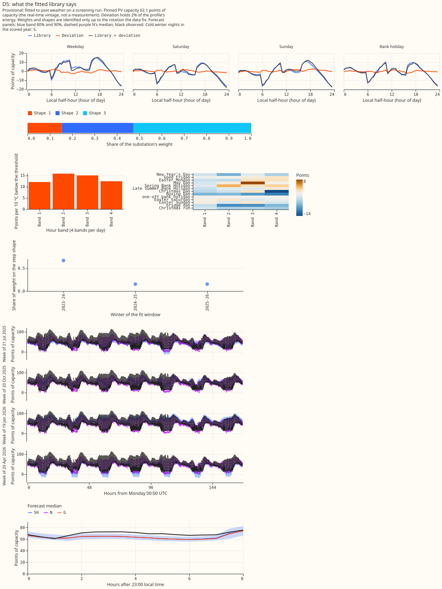

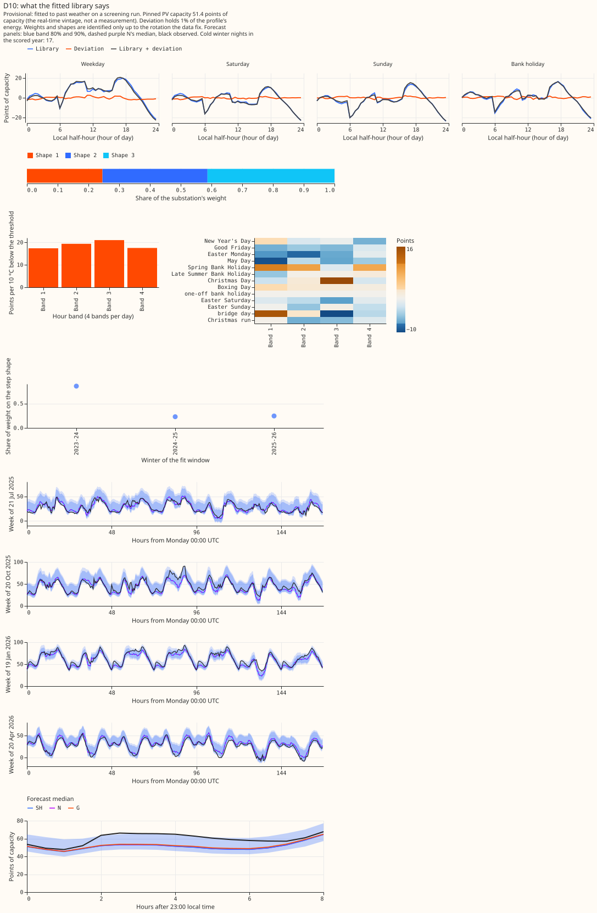

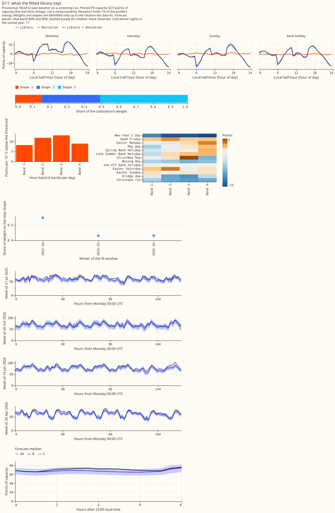

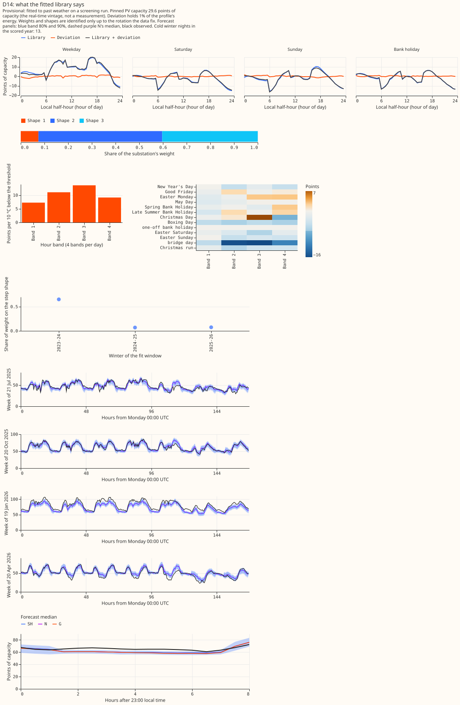

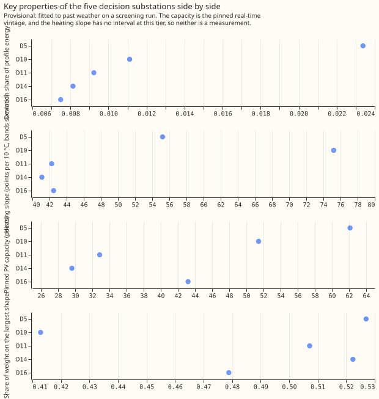
