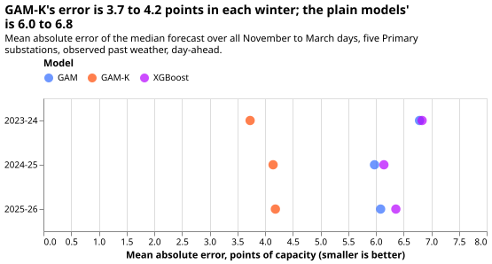

# Differentiable physics: GAM-K against the plain GAM and lagless XGBoost over three winters

**In all three winters, GAM-K forecast Primary demand one day ahead better than both the plain
convex model and lagless XGBoost, by 1.8 to 3.1 points of capacity.** GAM-K is the convex
differentiable-physics demand model with a Kalman filter of recent errors, which [experiment
111](../00111-differentiable-physics-6-ens-forecast-engine-against-bg2/result.md) chose as the
series' candidate. We rescored the stored day-ahead forecasts of [experiment
114](../00114-differentiable-physics-n3-n4-interactions-and-heating-threshold/result.md) (the plain
model and GAM-K) and [experiment
109](../00109-differentiable-physics-n0-partially-pooled-convex-model/result.md) (lagless XGBoost)
for November to March of 2023-24, 2024-25, and 2025-26, at five Primary substations. Nothing was
refitted. Each mean absolute error is a mean over the winter's days, in points of effective
capacity, and each interval comes from resampling blocks of 7 consecutive days.

**Past-weather scoring ranks model structure and does not give production skill.** The inputs are
observed temperature and irradiance, so no weather-forecast error enters, and a gap measured here
is a ceiling for the gap under live weather forecasts.

**Most of the gain is the filter removing a level error, not better winter structure.** The plain
convex model and lagless XGBoost are each frozen for a year after their fit and carry a level
error: both under-forecast by 2 to 7 points at most substations in 2024-25 and 2025-26, and both
over-forecast by 12 points at D10 in 2023-24 (figure 3). GAM-K's filter corrects that error from recent
residuals. Lagless XGBoost has no recent power as an input. On ensemble weather in 2025-26, a
read-only analysis found GAM-K only 0.3 to 1.5 points better than every other arm there, filtered
XGBoost and BG2 included, so the gap to a model that sees recent power is smaller.

**The verdict is `supported`.** All six planned contrasts meet the bar (estimate at most −1.0 points,
95% interval wholly below zero). There are three independent winters: separate weather samples,
whose fits share part of their 24-month training window. Two of the winters (2024-25 and 2025-26)
had been read in a read-only analysis before this plan, so only 2023-24 was a new test.

## Figures

**Figure 1 shows all six planned contrasts well past the 1-point bar.** The smallest estimate is
−1.83 points (GAM-K against the plain model in 2024-25, interval −2.47 to −1.28).

**Figure 2 shows GAM-K's error at 3.7 to 4.2 points in every winter, against 6.0 to 6.8 for the plain
models.** The plain convex model and lagless XGBoost are level with each other in each winter.

**Figure 3 shows why: the plain models are biased, and the filter removes the bias.** The bias is
the mean signed error over the winter, by substation.

## Results

Mean absolute error of the median forecast, all November to March days, points of capacity
(`report.txt` has every table):

| Winter | GAM | GAM-K | Lagless XGBoost | GAM-K minus GAM | GAM-K minus lagless XGBoost |
|---|---|---|---|---|---|
| 2023-24 | 6.79 | 3.73 | 6.83 | −3.06 (−3.54 to −2.52) | −3.10 (−3.57 to −2.63) |
| 2024-25 | 5.97 | 4.14 | 6.14 | −1.83 (−2.47 to −1.28) | −2.00 (−2.60 to −1.46) |
| 2025-26 | 6.09 | 4.19 | 6.36 | −1.90 (−2.49 to −1.36) | −2.17 (−2.99 to −1.45) |

**Exploratory: cold-snap days.** The coldest 10% of each winter's days (15 days in each winter) by
daily mean temperature. GAM-K minus the plain model is −3.33 (−3.99 to −2.65), −3.48 (−5.52 to
−1.65), and −2.11 (−3.92 to −0.66) in the three winters. GAM-K minus lagless XGBoost is −3.47
(−4.16 to −2.30), −3.26 (−4.53 to −1.33), and −0.99 (−3.03 to +0.29): the 2025-26 interval crosses
zero. Cold-snap days come in a few spells, so these intervals rest on about 8 blocks and are rough.

**Exploratory: evening peaks (16:00 to 20:00).** GAM-K minus the plain model is −3.33, −2.09, and
−2.13 points, and GAM-K minus lagless XGBoost −3.47, −2.17, and −2.45 points. Every 95% interval
lies wholly below zero (`report.txt`).

**Post hoc: a sixth Primary.** Adding D9 to 2025-26 gives −1.64 (−2.12 to −1.20) against the plain
model and −1.82 (−2.48 to −1.23) against lagless XGBoost, as in the earlier analysis. D9 has no
history at the 2023-07-01 cut, so the other two winters have five substations.

**Interval choice.** Consecutive days share weather, so a day-level resample would be too narrow,
and a month-level resample leaves 5 blocks in a winter. A 7-day block spans a typical weather spell.
A 14-day block gives the same estimates with wider intervals (for example −1.83 (−2.75 to −1.16) in
2024-25), and the verdict is unchanged. The intervals cover within-winter weather only, not the
differences between substations or between years.

## Predictions against outcome

The plan predicted GAM-K minus the plain model at −1.0 to −1.8 points, and minus lagless
XGBoost at −1.0 to −2.0, in 2023-24. **The outcome
was −3.06 and −3.10, outside the predicted range, and the explanation was tested.** In 2023-24 the
plain models over-forecast by 12.0 points at D10 and by 6.6 at D11 (figure 3), a level shift that
a frozen fit misses and the filter corrects. Leaving D10 out gives −1.62 (−1.94 to −1.28) against
the plain model and −1.85 (−2.21 to −1.48) against lagless XGBoost, inside the predicted ranges. The
plan's other predictions held: the cold-snap interval crosses zero in one winter, and GAM-K is ahead
on evening peaks in every winter.

## Checks

- **Median minus mean forecast:** the stored sets hold 11 quantiles and no mean forecast. As a
  stand-in, the median minus the mean of the 11 quantiles is between −0.5 and +0.8 points for every
  arm and winter (`report.txt`).
- **Quantile score beside the error contrast:** the quantile-score contrasts agree in sign with the
  mean-absolute-error contrasts in all six cases, for example −2.17 (−2.53 to −1.77) in 2023-24
  against the plain model.
- **Leave-one-substation-out:** every contrast in every winter still meets the bar (smallest −1.55,
  2025-26 against the plain model without D10).
- **Triggers fired:** trigger 2 only, a result outside the prediction. The explanation above was
  tested in this write-up, so no audit is called for. Triggers 1, 3, 4, and 5 did not fire. Trigger 6
  (interval width against a sister experiment) cannot be checked, because no sister experiment
  scored these rows. Whether a later experiment depends on this result (trigger 7) is for the
  manager to judge.
- **Code review:** one Sonnet review of the scoring script found no code change needed. It confirmed
  that each stored fit stops at its cut, and that every join, mask, and interval is as planned.

## Limitations

- **Settings chosen on the scored winters.** GAM-K's filter settings (four numbers per substation)
  were fitted on the 2023-24 residuals in experiment 114, and experiment 109 chose its XGBoost
  variant on 2023-24. The convex model's ridge penalty was tuned on 2024-07 to 2025-06 and its
  24-month window was chosen on 2023-24 (experiments 104 and 106). The first bias favours GAM-K in
  2023-24. The ridge and the window favour both convex models over XGBoost in 2023-24 and 2024-25,
  and cancel in GAM-K minus the plain model.
- **Past weather.** Every input is observed temperature and CAMS irradiance.
- **Five substations.** Substation D9 is left out of the planned contrasts, because it has no
  history before 2024.
- **Lagless XGBoost** is the weakest of the XGBoost recipes, because it has no recent power.
- **Quantile score uses stored quantiles,** so the check of the mean forecast is a proxy.

Substation cards are not needed: the experiment fits nothing and has no new fitted properties.

## Plan, written before any result existed

**Hypothesis.** On past weather, GAM-K forecasts Primary demand one day ahead better than both the
plain convex model and lagless XGBoost in each of the three winters, by at least 1 point of mean
absolute error.

**Decision rule.** A contrast meets the bar if its estimate is at most −1.0 points and its 95%
interval lies wholly below zero. The 1-point bar was set by the maintainer, and it reflects what the
filter adds: GAM-K adds a pipeline step over the plain model and a different model family over
XGBoost. One point is about a fifth of the winter error. Supported: all six contrasts meet the bar.
Partly supported: 3 to 5 meet it and none is wholly above zero. Small gain: at most 2 meet it and
all six intervals lie below zero. Refuted: any interval lies wholly above zero. Inconclusive:
anything else. The rule uses 95% intervals without a multiplicity correction, because "supported"
needs all six to pass.

**Size.** Simple. What gets stored: one private scoring table. Serving path: not touched.
Degradation rule: not touched. More than one defensible design: no, because the arms, cuts, row set,
and scoring follow experiments 107, 109, and 114. Code whose callers could not be named without
searching: none. The plan is the first commit of the branch.

**Cold-snap rule (fixed in the plan commit).** In each winter, the coldest 10% of covered days by
daily mean ERA5 2 m temperature over the five substations, at least 3 days.

**Planned contrasts.** GAM-K minus the plain model, and GAM-K minus lagless XGBoost, each in the
three winters, on all winter days. Everything else is exploratory.

**Row set.** `dp_mw_v1` at D5, D10, D11, D14, and D16, rows outside the hand-filtered switching
events, an inner join of the three arms, no valid time on or after 2026-07-01.

## Reproducing

    uv run python ml-experiments/00122-differentiable-physics-three-winter-backtest-gam-k/e00122_report.py
    uv run python ml-experiments/00122-differentiable-physics-three-winter-backtest-gam-k/e00122_charts.py
