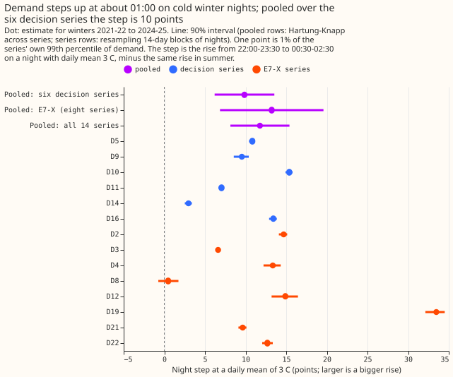
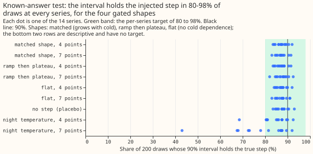
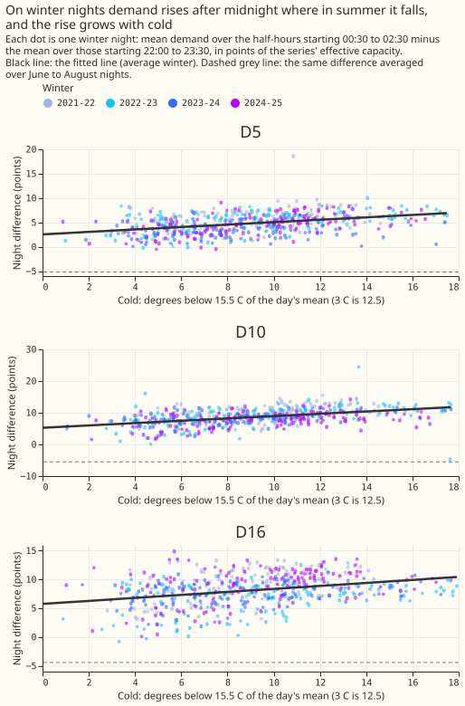
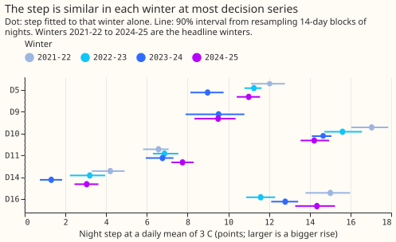
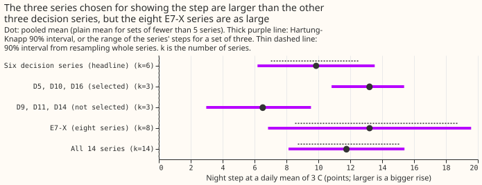
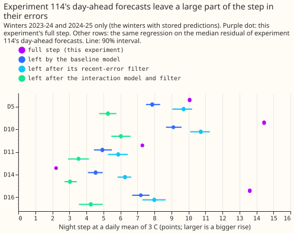
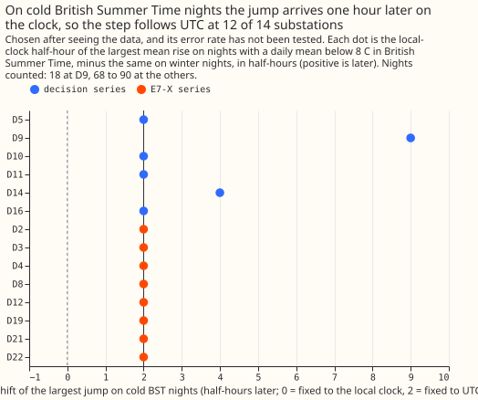
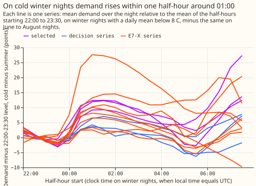
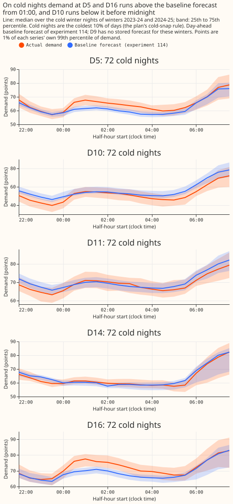
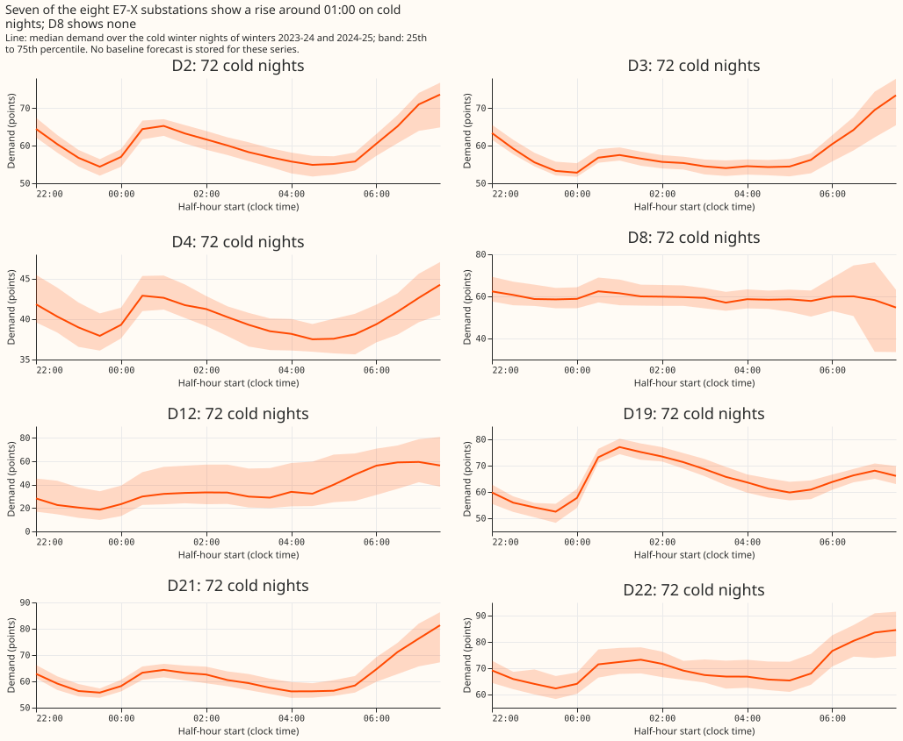

**Status: results for winters 2021-22 to 2024-25.** Winter 2025-26, the winter in which D5, D10, and
D16 were picked, has not been read yet, because it waits for the merge of experiment 114's pull
request (PR 1397). The plan, committed before any code ran, follows the results.

We examined 14 Primary substations, labelled D2 to D22 to keep them anonymous. Six of them (D5,
D9, D10, D11, D14, and D16) were set before any fit as the substations the conclusion rests on; we
call them the decision substations. D5, D10, and D16 are the three where earlier experiments first
saw a step in winter 2025-26 demand. The other eight (D2, D3, D4, D8, D12, D19, D21, and D22) were
added as a check; we call them E7-X.

We asked how much demand rises in the small hours of a winter night, the pattern that storage
heaters (heaters that charge from cheap night-rate electricity, switched on by timers) would
produce, and whether the rise grows with cold. On each winter night we took the mean demand over
the five half-hours starting 00:30 to 02:30 and subtracted the mean over the four half-hours
starting 22:00 to 23:30. We fitted that difference against how far the day's mean temperature (from
the ERA5 reanalysis, a weather-agency estimate of past weather) fell below 15.5 C. We then
subtracted the same difference measured on June to August nights, which we treat as the no-step
baseline. We measure demand in points, where one point is 1% of that substation's 99th percentile
of demand. On a night with a daily mean of 3 C, demand rises by 9.9 points averaged over the six
decision substations (90% interval 6.2 to 13.5; the average weights each substation by how
precisely its step is known, using Hartung-Knapp random-effects pooling). The eight E7-X
substations, which were not chosen for showing a step, average 13.2 points (6.9 to 19.6), above the
decision substations' 9.9.

**Take-home message: demand at 13 of the 14 Primary substations steps up around 01:00 on winter
nights, and the step is larger on colder nights. The step is not special to the three substations
that prompted the study.** The eight E7-X substations have an average step as large as the six
decision substations, so the analysis does not show that D5, D10, and D16 stand out (it does not
rule that out, because the eight were not a random sample). The full step depends on the assumption
that summer nights have no step. The part that grows with cold needs no such assumption, and that
part is smaller: 1.1 to 4.7 points at the six decision substations (the slope times 12.5 degrees,
the gap between 15.5 C and a 3 C night). The verdict word under the plan's decision rule is
`inconclusive`, because the gate's pooled-interval row failed (it over-covered); the estimates
above stand, and the verdict waits for the independent audit and for winter 2025-26.

**Summary, by question** (winters 2021-22 to 2024-25 unless stated; every number is printed in
[report.txt](report.txt)):

- **How large is the night step at a daily mean of 3 C?** Pooled over the six decision series, 9.9
  points (Hartung-Knapp interval 6.2 to 13.5; resampling whole series 7.0 to 12.6). Per series, from
  3.0 points at D14 to 15.4 at D10. D5, D10, and D16 (selected for showing the step) average 13.2
  points; D9, D11, and D14 average 6.5.
- **Does the step grow with cold?** Yes at all 14 series: every slope is positive and the 90%
  interval of every slope excludes 0. The slopes are 0.09 to 1.12 points per degree, and 0.25, 0.37,
  and 0.26 at D5, D10, and D16.
- **Is the step specific to the chosen substations?** No. The eight further Primaries (E7-X) pool to
  13.2 points, above the six decision series. One of the eight (D8) has no step (0.5 points, 90%
  interval -0.7 to 1.7).
- **Does the step have a fixed clock time?** The step starts in the half-hour starting 00:30 (ending
  at 01:00) at all 14 series (at D4 the interval reaches one half-hour earlier). On cold British
  Summer Time nights the largest jump falls one hour later by the clock at 12 of 14 series, which
  fits timers set to Coordinated Universal Time (UTC) (a post hoc check, chosen after seeing the
  data).
- **How much of the step do experiment 114's day-ahead forecasts already remove?** R, the step left
  in the errors of its baseline model divided by the full step, is 0.53 to 0.78 at D5, D10, and D16
  (stored predictions for winters 2023-24 and 2024-25 only).
- **Where does the baseline forecast miss on cold nights?** At D5 and D16 actual demand runs 5.6 and
  9.4 points above the forecast in the half-hour starting 01:00; at D10 it runs 12.2 points below
  the forecast in the half-hour starting 23:30 (figure 9).
- **What do the data and methods support?** An estimate of the size and shape of the night step in
  four winters of one weather product. They do not support a cause: daylight, lighting, and
  switching schedules also change at night, and NGED has not confirmed storage heating.

**Known-answer gate: per-series and pooled coverage pass; the pooled-interval row fails.** We added
a known step to the real nights, resampled in 14-day blocks, and asked whether the 90% interval holds
the true step. Coverage is 87.0 to 87.5% pooled over series for the four gated shapes (target 85 to
95%) and 82 to 93% for each series (target 80 to 98%). The mean estimate is within 0.20 points of the
truth everywhere (target 0.5). The Hartung-Knapp interval for the pooled mean covered the true mean
in 100% of the 200 draws (target 85 to 95%), so the pooled intervals are conservative, not too
narrow. If the true step follows the 18:00 to 08:00 mean temperature instead of the daily mean,
coverage falls to 79% pooled at 7 points and to 43% at the worst series (descriptive, no target),
so the daily-mean proxy matters. The gate tests only the shapes this plan chose, with noise that is
independent between 14-day blocks.

## Results

**The raw nights show the pattern before any fitting.** On winter nights demand rises after
midnight, where on summer nights it falls. At D10 the difference between the later and earlier
half-hours averages -5.5 points in summer, and the raw mean on cold nights (daily mean at most 8 C)
is 14.9 points above that summer value. That raw mean sits within 0.4 points of the fitted line at
all 14 series (the plan allowed up to 2 points).

**The step has the same sign in every winter at the six decision substations, and falls over the four
winters at D10.** At D10 it falls from 17.0 points in 2021-22 to 14.2 in 2024-25, and it falls
steadily at four E7-X substations (D19, D2, D3, and D22). At D5, D11, and D16 the four winters stay
within 3.4 points of each other, and at D14 the step is 1.3 to 4.2.

**The eight substations chosen for nothing have the same average step as the three that prompted the
study.** The mean over D5, D10, and D16 is 13.2 points against 6.5 for D9, D11, and D14, but the
eight E7-X substations also average 13.2. That does not rule out a selection effect, because the
eight were not a random sample of Primary substations. The between-series standard deviation is
4.1 points for the six decision series (profile-likelihood interval 2.7 to 7.2) and 8.9 for E7-X
(6.2 to 14.3). One series, D19, has a step of 33.5 points, which pulls the E7-X and all-series means
up.

**Experiment 114's day-ahead forecast errors still contain a large part of the step.** R is the
same regression run on the difference between actual demand and the median forecast of experiment
114's baseline model, divided by the full step over the same two winters. R is 0.78, 0.63, and 0.53
at D5, D10, and D16 (and 2.05 at D14, where the step in the errors exceeds the full step). With the
model's recent-error filter R is 0.96, 0.74, and 0.59, and with the interaction model and the
filter 0.52, 0.42, and 0.31.

**On cold British Summer Time nights the jump arrives one hour later on the clock.** The
pre-registered rule (the sign of the difference between the local-clock and UTC-clock windows) printed
`UTC` at all 14 series, but the rule did not separate the two clocks: by the arithmetic of the
windows, a step fixed to either clock makes that difference negative (reasoning after the fact, not
computed). The post hoc check in the figure compares the half-hour of the largest mean rise on cold
summer-time nights with the same half-hour on cold winter nights, and finds a shift of 2 half-hours
at 12 of 14 series (D14 shows 4; D9 shows 9, on 18 nights). The counts of cold summer-time nights in
the cards and the figure are the same (18 at D9 and 68 to 90 at the others).

**Demand rises within about one half-hour around 01:00.** Demand then stays raised until the morning
rise. The profile of cold-winter-night demand minus summer-night demand, relative to the 22:00 to
23:30 level, has the same shape at nearly all substations.

## Predictions against outcome

| Prediction (winters 2021-22 to 2024-25) | Outcome | Met |
|---|---|---|
| Pooled step over the six decision series 2 to 6 points, interval wholly above 0 | 9.9 (6.2 to 13.5) | No: above the range, interval above 0 |
| D5, D10, D16: 5 to 10 points; D9, D11, D14: 1 to 3.5 | 10.8, 15.4, 13.4; 9.5, 7.0, 3.0 | No: only D14 lies in its range |
| E7-X: each 0 to 3 points, pooled 0.5 to 2, below the decision series | pooled 13.2; one series (D8) at 0.5 | No |
| Slope 0.4 to 0.8 points per degree at D5, D10, D16 | 0.25, 0.37, 0.26 | No: below the range |
| Flat part within 2 points at every series | 1.8 and -2.0 at D14 and D8; the others 4.6 to 19.4 in size | No |
| R against the full step 30 to 60% at D5, D10, D16 | 0.78, 0.63, 0.53 | Partly: D16 only |
| Raw cold-night mean within 2 points of the line | gap at most 0.4 at all 14 series | Yes |
| Timing `cannot tell` at most series, or `local` if a label is printed | 68 to 90 cold summer-time nights at 13 series (18 at D9); `UTC` printed at all 14 | No |
| Gate coverage within the bands | the four gated shapes pass; the pooled-interval row fails (100%) | Partly |
| Run time under 1.5 hours | not recorded | Not checked |

## Checks

- **Median forecast minus mean forecast, and the quantile-score contrast beside the error of the mean
  or median forecast:** not applicable, because the experiment forecasts nothing.
- **Hand-filtered switching list:** refitting the six decision series without experiment 103's
  switching events changes no step by more than 0.3 points (11.0, 9.8, 15.4, 7.0, 3.0, and 13.5 for
  D5, D9, D10, D11, D14, and D16, against 10.8, 9.5, 15.4, 7.0, 3.0, and 13.4).
- **Block length:** with blocks of 7, 14, and 28 days (100 draws), the coverage in the matched and
  placebo cells is 88%, 86%, and 84%, and the mean interval width 1.7, 1.9, and 2.1 points. The
  28-day coverage is just below the 85% edge of the pooled band.
- **Audit triggers** (conditions in the plan under which a result needs an independent audit).
  Trigger 1 (a control fails: test 1, the rank check, or the placebo coverage) does not fire; the
  placebo coverage is inside its band, but the gate's pooled-interval row failed separately (100%
  against 85 to 95%), which is why the verdict is `inconclusive`. Trigger 2 fires: the E7-X pooled
  step (13.2) is above the decision substations' (9.9). Trigger 3 does not fire: no substation has a
  step and a raw contrast of opposite sign. Trigger 4 does not fire: leaving each decision
  substation out moves the pooled mean to between 8.8 and 11.2, inside 6.2 to 13.5. Trigger 5 does
  not fire: bounding the slope at 0 changes no slope. Trigger 6 does not fire: the widest
  decision-substation interval is 1.8 points (D9). Trigger 7 (a later design depends on the
  result) fires, because the cards and experiment 121's night arms use these numbers. The audit has
  not run yet; the code and write-up reviews are triaged in the pull request.

## Substation cards

**Provisional: fitted to past weather, estimation only.** The MW column converts points with each
substation's own 99th percentile of demand and is not a headline. D12 reports apparent power in
MVA, so its "MW" is MVA.

| Series | Step at 3 C, points (90% interval) | Step, MW (MVA at D12) | Slope, points per degree | Cold-dependent part, points | Flat part, points | Summer reference, points | Winters |
|---|---|---|---|---|---|---|---|
| D5 | 10.8 (10.4 to 11.2) | 0.62 | 0.25 (0.16 to 0.32) | 3.1 | 7.7 | -5.2 | 2021, 2022, 2023, 2024 |
| D9 | 9.5 (8.6 to 10.4) | 0.68 | 0.38 (0.18 to 0.52) | 4.7 | 4.8 | -13.4 | 2023, 2024 |
| D10 | 15.4 (14.9 to 15.8) | 0.83 | 0.37 (0.26 to 0.45) | 4.6 | 10.8 | -5.5 | 2021, 2022, 2023, 2024 |
| D11 | 7.0 (6.7 to 7.4) | 0.76 | 0.13 (0.05 to 0.19) | 1.6 | 5.5 | -3.0 | 2021, 2022, 2023, 2024 |
| D14 | 3.0 (2.5 to 3.4) | 0.35 | 0.09 (0.01 to 0.15) | 1.1 | 1.8 | -4.2 | 2021, 2022, 2023, 2024 |
| D16 | 13.4 (12.9 to 13.8) | 1.22 | 0.26 (0.13 to 0.37) | 3.2 | 10.2 | -4.4 | 2021, 2022, 2023, 2024 |
| D2 | 14.7 (14.1 to 15.1) | 2.67 | 0.53 (0.36 to 0.62) | 6.6 | 8.1 | -9.5 | 2021, 2022, 2023, 2024 |
| D3 | 6.6 (6.4 to 6.8) | 0.85 | 0.16 (0.12 to 0.20) | 2.1 | 4.6 | -7.3 | 2021, 2022, 2023, 2024 |
| D4 | 13.3 (12.2 to 14.3) | 1.62 | 0.41 (0.28 to 0.49) | 5.1 | 8.3 | -11.4 | 2021, 2022, 2023, 2024 |
| D8 | 0.5 (-0.7 to 1.7) | 0.05 | 0.19 (0.09 to 0.29) | 2.4 | -2.0 | -0.7 | 2021, 2022, 2023, 2024 |
| D12 | 14.9 (13.2 to 16.4) | 0.70 | 0.46 (0.16 to 0.67) | 5.7 | 9.2 | -2.3 | 2021, 2022, 2023, 2024 |
| D19 | 33.5 (32.1 to 34.5) | 1.82 | 1.12 (0.84 to 1.29) | 14.0 | 19.4 | -10.5 | 2021, 2022, 2023, 2024 |
| D21 | 9.6 (9.1 to 10.1) | 0.54 | 0.19 (0.10 to 0.25) | 2.4 | 7.2 | -5.9 | 2021, 2022, 2023, 2024 |
| D22 | 12.7 (12.0 to 13.3) | 0.41 | 0.16 (0.04 to 0.26) | 2.0 | 10.7 | -6.0 | 2021, 2022, 2023, 2024 |

Start of the step, timing, and share left by the baseline model (R):

| Series | Start of the step (half-hour starting) | Cold BST nights | Pre-registered label | Post hoc jump shift on BST nights, half-hours | R / full step (baseline model) |
|---|---|---|---|---|---|
| D5 | 00:30 | 75 | UTC | 2 | 0.78 |
| D9 | 00:30 | 18 | UTC | 9 | n/a |
| D10 | 00:30 | 88 | UTC | 2 | 0.63 |
| D11 | 00:30 | 90 | UTC | 2 | 0.68 |
| D14 | 00:30 | 75 | UTC | 4 | 2.05 |
| D16 | 00:30 | 68 | UTC | 2 | 0.53 |
| D2 | 00:30 | 83 | UTC | 2 | n/a |
| D3 | 00:30 | 75 | UTC | 2 | n/a |
| D4 | 00:30 | 83 | UTC | 2 | n/a |
| D8 | 00:30 | 75 | UTC | 2 | n/a |
| D12 | 00:30 | 75 | UTC | 2 | n/a |
| D19 | 00:30 | 83 | UTC | 2 | n/a |
| D21 | 00:30 | 83 | UTC | 2 | n/a |
| D22 | 00:30 | 75 | UTC | 2 | n/a |

## Cold nights: actual demand against the baseline forecast

**On cold nights the baseline forecast of experiment 114 runs below actual demand from 01:00 at D5
and D16, and above it before midnight at D10 (-12.2 points in the half-hour starting 23:30).** The
figure shows the median and the 25th to 75th percentile, across the 72 cold winter nights per
substation (the coldest 10% of days, the plan's cold-snap rule), of actual demand and of the day-
ahead median forecast, in points. The largest median misses, from the same nights: D5 +5.6 points in
the half-hour starting 01:00, D10 -12.2 starting 23:30, D11 -3.6 starting 23:00, D14 +2.8 starting
02:00, and D16 +9.4 starting 01:00 (actual minus forecast). The half-hour of the largest rise
between 05:00 and 08:00 differs between actual and forecast at D5 (07:00 against 06:00) and at D16
(06:00 against 06:30), and matches at D10, D11, and D14. D9 has no stored forecast for these
winters.

## Follow-up readouts (post hoc and exploratory)

**These readouts come from an unverified summary of Economy 7 tariff practice, whose claims are
hypotheses to test; nothing here cites it as a source.** They were chosen after seeing the main
results, so they are post hoc, and they read winters 2021-22 to 2024-25 only (cold British Summer
Time nights up to October 2025), leaving the scored-year lock unchanged. The script is
`e00123_followups.py`, and `report.txt` prints every number.

- **No substation shows a local-clock component on cold British Summer Time nights.** For each cold
  night we found the half-hour entered by the largest rise between 23:30 and 03:00. On cold winter
  nights that half-hour is the one starting 00:30 on 66% to 100% of nights (11 of 14 substations are
  at 85% or more). On cold British Summer Time nights it falls at the local-clock step (starting
  00:30) on at most 11% of nights (D22) and at the UTC step (starting 01:30, one hour later on the
  clock) on 24% to 100% of nights, with the remainder at other half-hours. D14 (24%) and D9 (50%)
  have the weakest UTC share, and their steps are the smallest or the least observed (3.0 points at
  D14, 18 cold British Summer Time nights at D9), so a mixture of clocks is not shown, and not ruled
  out.

- **The step ramps over about one half-hour and has no visible second window.** Averaged over cold
  winter nights and minus the summer shape, demand reaches 7% to 56% of its plateau in the half-hour
  starting 00:00 and 81% to 119% in the half-hour starting 00:30. No substation has a second rise of
  at least 30% of the main one. The end of the window is not visible: the largest fall between 05:00
  and 10:00 is small (0.5 points or less at seven substations) and falls at 07:30 at only four
  substations (D9, D10, D2, and D19), where the roughly 7-hour window would end if it began at
  00:30. The morning demand rise overlaps the end of any window.

- **The step by winter falls at five substations, rises at one, and cannot be told at eight.** The
  label compares the first and last winter's 90% intervals. It falls at D10, D2, D3, D19, and D22,
  rises at D11, and is `cannot tell` elsewhere, including D9, which has two winters. Only winter
  2024-25 is the latest winter here, so the step by year cannot yet say anything about the 2025 and
  2026 closures; that waits for winter 2025-26.

- **Descriptive only for now:** fixed-window heat-pump and electric-vehicle tariffs that would add a
  night step on the local clock, and bespoke half-hourly contracts.

Follow-up card rows, one per substation (percentages are shares of cold nights; the reference
columns are the same two shares on cold winter nights; fall sizes are in points):

| Series | Largest rise at the local-clock step, cold BST nights | At the UTC step, cold BST nights | Same two shares, cold winter nights | Plateau reached by the half-hour starting 00:00 / 00:30 | Largest fall 05:00 to 10:00 | Second rise | Step by winter |
|---|---|---|---|---|---|---|---|
| D5 | 0% | 92% | 100% / 0% | 0.18 / 0.93 | 09:30 (-1.2) | none | cannot tell (-1.0) |
| D9 | 0% | 50% | 90% / 0% | 0.36 / 0.91 | 07:30 (-0.5) | none | cannot tell (-0.0) |
| D10 | 0% | 72% | 97% / 0% | 0.34 / 0.99 | 07:30 (-0.4) | none | falls (-2.8) |
| D11 | 3% | 59% | 75% / 1% | 0.27 / 0.85 | 08:00 (+0.2) | none | rises (+1.2) |
| D14 | 0% | 24% | 72% / 0% | 0.07 / 1.16 | 05:30 (-0.4) | none | cannot tell (-1.2) |
| D16 | 0% | 85% | 87% / 0% | 0.47 / 1.09 | 09:30 (-0.3) | none | cannot tell (-0.7) |
| D2 | 0% | 100% | 100% / 0% | 0.44 / 1.19 | 07:30 (-0.8) | none | falls (-2.8) |
| D3 | 0% | 100% | 100% / 0% | 0.17 / 1.09 | 09:30 (+0.3) | none | falls (-2.1) |
| D4 | 0% | 96% | 100% / 0% | 0.56 / 1.03 | 09:00 (-2.7) | none | cannot tell (-0.5) |
| D8 | 8% | 65% | 85% / 0% | no step | 09:30 (-1.2) | none | cannot tell (+0.2) |
| D12 | 3% | 59% | 66% / 4% | 0.19 / 0.81 | 08:30 (-9.1) | none | cannot tell (-1.3) |
| D19 | 0% | 99% | 100% / 0% | 0.38 / 1.02 | 07:30 (-4.8) | none | falls (-9.9) |
| D21 | 1% | 81% | 94% / 0% | 0.45 / 1.13 | 09:30 (+0.2) | none | cannot tell (+0.3) |
| D22 | 11% | 73% | 90% / 0% | 0.36 / 1.02 | 09:30 (-1.3) | none | falls (-2.6) |

### UTC-fixed and local-clock shares by year (post hoc and exploratory)

The step could come from a tariff fixed to the local clock as well as from the legacy step fixed to
UTC. The following start and end times are hypotheses from a search for equivalents, to be checked
against Elexon's public tables, and are not sources: the legacy Economy 7 standard window 00:30 to
07:30 on Greenwich Mean Time, Intelligent Octopus Go 23:30 to 05:30, Octopus Go 00:30 to 05:30, and
a Cosy heat-pump tariff. This page does not say which of them follow Greenwich Mean Time or local
time.

For each cold British Summer Time night (daily mean below 8 C, March 2021 to October 2025) we found
the half-hour entered by the largest rise between 23:30 and 03:00 on the local clock. The first
percentage in each cell is the share of nights where it is the half-hour starting 01:30 local, where
a step fixed to UTC at 00:30 would fall. The second is the share where it is the half-hour starting
23:30 or 00:30 local, where tariffs fixed to the local clock would fall. The number of nights is in
brackets, and `cannot tell` marks a year with fewer than 10 nights. The 2025 column holds spring and
summer nights only. The shares do not sum to 100% because the largest rise can fall elsewhere.
`e00123_clock_by_year.py` prints the table, and the night profiles in figure 8 and figure 9 are
indexed on the local clock, with UTC one hour earlier in British Summer Time.

| Series | 2021 | 2022 | 2023 | 2024 | 2025 |
|---|---|---|---|---|---|
| D5 | 96% / 0% (25) | 100% / 0% (12) | 100% / 0% (13) | 92% / 0% (13) | cannot tell (4) |
| D9 | cannot tell | cannot tell | cannot tell (1) | 55% / 0% (11) | cannot tell (6) |
| D10 | 45% / 0% (31) | 79% / 0% (14) | 71% / 0% (14) | 100% / 0% (15) | cannot tell (5) |
| D11 | 61% / 3% (31) | 57% / 7% (14) | 57% / 0% (14) | 53% / 7% (15) | cannot tell (5) |
| D14 | 12% / 0% (25) | 25% / 0% (12) | 46% / 0% (13) | 15% / 8% (13) | cannot tell (4) |
| D16 | 100% / 0% (26) | 92% / 0% (12) | 77% / 0% (13) | 69% / 0% (13) | cannot tell (4) |
| D2 | 100% / 0% (31) | 100% / 0% (12) | 100% / 0% (13) | 100% / 0% (11) | cannot tell (6) |
| D3 | 100% / 0% (25) | 100% / 0% (12) | 100% / 0% (13) | 100% / 0% (13) | cannot tell (4) |
| D4 | 100% / 0% (31) | 100% / 0% (12) | 100% / 0% (13) | 100% / 0% (11) | cannot tell (6) |
| D8 | 88% / 0% (25) | 67% / 0% (12) | 31% / 31% (13) | 62% / 8% (13) | cannot tell (4) |
| D12 | 76% / 0% (25) | 58% / 0% (12) | 15% / 8% (13) | 46% / 15% (13) | cannot tell (4) |
| D19 | 100% / 0% (31) | 92% / 0% (12) | 100% / 0% (13) | 100% / 0% (11) | cannot tell (6) |
| D21 | 97% / 0% (31) | 58% / 0% (12) | 85% / 0% (13) | 45% / 9% (11) | cannot tell (6) |
| D22 | 88% / 0% (25) | 83% / 0% (12) | 38% / 38% (13) | 62% / 8% (13) | cannot tell (4) |

The UTC share is 100% in every year with a reading at D2, D3, and D4, and 92% to 100% at D19, and a
local-clock share above 10% appears only at D8 and D22 in 2023 (31% and 38%) and at D12 (15%) in
2024. A local-clock component is therefore visible at a few substations in single years, and cannot
be separated from noise with 13 nights; it would need a second winter or a larger sample to say.

## Limitations

- **Summer is assumed step-free.** On summer nights the later half-hours average 0.7 to 13.4 points
  below the earlier ones, which is the ordinary decline of demand through the night, and the
  winter-night shape differs from it for reasons besides storage heating. The full step carries
  that difference. The slope does not.
- **Four headline winters of one weather product, from one set of substations.** The winters are
  separate years, and neighbouring cells share one ERA5 product.
- **The pooled intervals were wider than needed in the gate, and may be too narrow in practice.**
  The gate showed coverage of 100% against a target of 85 to 95%. The substations share one weather
  product, so their errors are not independent, which would make the intervals too narrow.
- **The daily mean temperature is a proxy** for the temperature that sets heater charging. In the
  gate, a step that follows the 18:00 to 08:00 mean temperature was covered by the interval in 79%
  of draws pooled at 7 points, and in 43% at the worst substation.
- **Winter 2025-26 has not been analysed yet.**

## The plan, as committed before any fit

**E7 is an estimation experiment. The result is a table of estimates with intervals, not a win-or-
lose verdict, and the experiment forecasts nothing.** The word `calibrated` is used only for the
known-answer gate (interval coverage within a stated band), and `detectable` only for the per-series
reading. The plan follows `briefs/dp_series.md`, then `briefs/common.md`. The Sonnet plan review is
triaged at the end of this page. No data on or after 2026-07-01 is read, nothing in `packages/`
changes, and no dependency is added.

## Pre-fit clarification: what the headline is (written before any fit)

**The headline is the pooled step over all six decision series (D5, D9, D10, D11, D14, and D16),
with a random effect across series, at a daily mean of 3 C.** The extension series, E7-X, are
shown separately. D5, D10, and D16 are reported as the subset that prompted the study, labelled
"selected for showing the step", and no verdict rests on them alone. Every fitted series, including
each with no step, appears in the unpooled table. This replaces the earlier draft, in which the
verdict rested on D5, D10, and D16.

**The selected subset is expected to look larger than the pool, and the gap is the selection
effect.** Experiment 121 read winter 2025-26 and found a step at 01:00 of 4.3, 7.1, and 5.3 points
in the residuals of the day-ahead model at D5, D10, and D16, and 1.9 to 3.4 points at D11, D14, and
D9. The choice of those three series came from that winter, so winter 2025-26 is labelled the
selection winter.

## Pre-fit clarification 2: the unit is points of effective capacity (written before any fit)

**Every size in this plan is in points of effective capacity, and the first draft mislabelled the
unit as megawatts.** One point is 1% of the series' effective capacity, which is the series' own
99th percentile of cleaned demand and not an electrical rating. Experiment 121's step figures (4.3,
7.1, and 5.3 at D5, D10, and D16) are in points: its quantile scores are in points, and a 7.1 MW
step at D10 would exceed the series' 5.4 MW effective capacity. The wrong label was found in test 1,
which showed D10's night difference to be about 0.4 MW (about 8 points). Every number in the plan
(the predictions, the injected shapes `S` of 4 and 7, the bias bound of 0.5, the trigger thresholds
of 4, 8, and 15, and the 1.7 summer step) keeps its value and now reads in points. Each series'
night difference `d` is converted to points before any fit, so the pooled steps average comparable
quantities, and the page also prints each series' step in MW (one point at D10 is 0.054 MW). Test 1
printed raw night differences for one series in the design winters and a per-series mean `d` over
all nights of winters 2021-22 to 2025-26; no estimate, interval, or fit was computed before this
clarification.

**Units clarification: what "effective capacity" is, and the raw step in MW.** The table's
effective capacity is a scale taken from the demand itself: it matches each series' 99th percentile
of cleaned half-hourly demand (D10: 5.398 MW against a 99th percentile of 5.413 MW; D5: 5.723 against
5.734; D16: 9.115 against 9.143). It is neither the electrical rating of the substation nor a PV
capacity. A point is therefore 1% of that near-peak demand. Computed from the stored cleaned power
on cold GMT nights (daily mean at most 3 C) of winters 2023-24 and 2024-25 (printed in `report.txt`
under `raw_cold_step`), the half-hour ending at
01:00 minus the mean of the 22:00 to 23:30 half-hours is 0.27 MW (4.8 points) at D5, 0.44 MW (8.2
points) at D10, and 0.87 MW (9.5 points) at D16. The raw step is therefore a few tenths of a
megawatt, and the figures of 1.9 to 10.7 "MW" in the earlier descriptive check of the night step
are points: that check divided by a proxy capacity of about 100, which is the scale of points.

## Pre-fit clarification 3: actual demand against the baseline forecast on cold nights (written before the figure was computed)

**A figure on the substation cards shows actual demand and experiment 114's baseline forecast (B0)
on cold winter nights, so that a visible miss at 01:00 shows up.** The maintainer asked for it after
the first fits. The rule is fixed here, before any residual is computed: cold winter nights are the
cold-snap nights of the plan (the evenings whose next day lies in the coldest 10% of days of its
July-to-June year by the mean ERA5 temperature across the six decision series, on Greenwich Mean
Time nights that are not excluded), for winters 2023-24 and 2024-25, the winters with stored B0
predictions before the scored winter is unlocked. Each panel shows the median across nights, with
the 25th to 75th percentile band, of actual demand and of the B0 median forecast (day D+1), for the
half-hours starting 22:00 to 07:30, in points. The eight E7-X series have no stored B0 forecast, so
they appear with actual demand only. A one-line list of other visible misses follows, from the median
B0 residual per half-hour: the half-hour with the largest median residual, and the half-hour of the
largest 30-minute rise between 05:00 and 08:00 in the actual and in the forecast. The figure is
descriptive: it adds no contrast and no verdict. Winter 2025-26 enters only after PR 1397 has merged.

## The question, and what earlier experiments already say

**The night step is real in one winter and unmeasured across winters.** Experiment 121 tried to
detect the step through quantile scores over all 20 night half-hours, where a step of 4 points is
diluted to about one noise standard deviation, and its fourth gate had to be redefined twice.

**E7 changes the instrument.** E7 compares five window half-hours with four baseline half-hours of
the same night, so the dilution disappears and a slow level error cancels. The estimator is a
regression of the night difference on cold, in the spirit of the degree-day regressions used for
load, and the pooling is the random-effects meta-analysis of [DerSimonian and Laird
(1986)](https://doi.org/10.1016/0197-2456(86)90046-2) with the [Hartung and Knapp
(2001)](https://doi.org/10.1002/sim.1009) interval. The block bootstrap follows [Künsch
(1989)](https://doi.org/10.1214/aos/1176347265). The earlier experiments this plan builds on are
[111](../00111-differentiable-physics-6-ens-forecast-engine-against-bg2/result.md),
[113](../00113-differentiable-physics-n5-convex-identification-at-realistic-noise/result.md),
[114](../00114-differentiable-physics-n3-n4-interactions-and-heating-threshold/result.md),
[120](../00120-differentiable-physics-sh-convex-daily-shape-library/result.md),
[121](../00121-differentiable-physics-mh-multi-hinge-heating-curve-and-night-step/result.md), and
[122](../00122-differentiable-physics-three-winter-backtest-gam-k/result.md). One targeted search
for a DOI on Economy 7 or storage-heating load found none on temperature dependence. The nearest
sources are [Elexon CP1058A](https://assets.elexon.co.uk/wp-
content/uploads/sites/11/2012/02/28171857/cp1058a.pdf), which describes the Economy 7 profile class,
and a [statistical review of UK residential electrical loads](https://arxiv.org/pdf/1306.0802);
neither was checked for a temperature-dependent night step.

## Estimand

- **Window rows:** the five half-hours starting 00:30, 01:00, 01:30, 02:00, and 02:30. Test 1 prints
  the timestamp convention of the observed file against experiment 121's code, and the window
  follows the documented convention only. It is fixed in test 1, before any estimate, and never
  moved. Sensitivity (descriptive): the three-row window 00:30 to 01:30.
- **Baseline rows:** the four half-hours starting 22:00 to 23:30 of the same night, on the same
  clock as the window. A night is labelled by its evening's local date, and its day type (weekday,
  Saturday, Sunday) is that date's.
- **Night difference `d`:** the mean of the window rows minus the mean of the baseline rows, in
  points.
- **Cold `c`:** `max(0, 15.5 - T)` degrees, where `T` is the daily mean of hourly ERA5 temperature
  at the substation's cell over the local calendar day containing the window rows. The daily mean
  is a proxy for the temperature that sets storage-heater charging, and it includes the afternoon
  after the step. Its correlation with the mean temperature from 18:00 to 08:00 is printed, and a
  night-temperature `c` is a descriptive sensitivity.
- **Primary rows (GMT nights):** nights between the October and March clock changes, when the local
  and UTC clocks agree. Clock-change nights, bank-holiday nights, and the Christmas to New Year run
  are dropped from every fit.
- **Summer reference `d_summer`:** the mean of `d` over June to August nights on the local clock.
  Experiment 121's one summer pair found a step of 1.7 points or less; the page states the
  assumption that the summer night has no step.
- **Slope `b`:** the points change in `d` per degree of `c`, from `d = a_w + b*c + day-type terms +
  noise` on GMT nights, with a separate intercept `a_w` for each winter `w` and a common `b` across
  winters. The slope needs no summer assumption.
- **Step at a stated cold night:** `step = a_hat + b*c_ref - d_summer`, with `c_ref = 12.5` degrees
  (daily mean 3 C, inside experiment 122's cold-snap range of -2.0 to 3.1 C), where `a_hat` is the
  mean of the winter intercepts. The step is the full cold-dependent and flat step, with no demand
  model removed. The flat part is `a_hat - d_summer`, so reading the step at `c = 0` is an
  extrapolation, because few GMT nights are warmer than 15.5 C. The flat part is reported separately
  from `b`.
- **Excess over B0 (cross-check R):** the same regression on experiment 114's stored B0 residuals
  measures only the part of the step that B0's free daily profile and its 00:00 to 04:00 heating
  band do not already absorb. R is a different, smaller quantity, expected at 30 to 60% of D, and
  is compared with D only as a measure of the absorption, never as an error.

## Substations and histories

**Fitted series: the six decision series, which are DP Primaries, and the eight E7-X Primaries.**
The rule-based flag of `nged_data.cleaning` is applied to all 14 series, so E7-X needs no
hand-filtered switching list. The six decision series are also run with their hand-filtered list as
a sensitivity. E7-X has its own row set, `e7_nights_v1`, outside `dp_mw_v1`. D12 reports apparent power
in MVA, so its night difference is an apparent-power step, converted to points in the same way.

| Series | Observed from | Winters (2021-22 to 2025-26) | Role |
|---|---|---|---|
| D5, D10, D11 | 2019-09-17 | 5 | decision series; D5 and D10 prompted the study |
| D14 | 2019-10-21 | 5 | decision series |
| D16 | 2020-12-22 | 5 (the history covers 2021-07 onwards) | decision series; prompted the study |
| D9 | 2023-08-23 | 3 (2023-24 to 2025-26) | decision series |
| D2, D3, D4, D8, D12, D19, D21, D22 | 2019-09-17 | 5 | **E7-X**: not chosen for any step |
| D15, D18 | 2025-02-06, 2024-12-11 | n/a | generator-linked, shown only as G-c, not fitted |

**Winters 2021-22 to 2025-26 only.** Winter 2019-20 is not added: its window would leave about 6
months after the lockdown months go out, with no summer and no pinned-capacity vintage.

**Winter roles.** Winter 2023-24 (tuning) and winter 2024-25 (replicate) are used for design checks
(block length). Winters 2021-22 and 2022-23 are not opened for any design choice, and their
estimates are read only after the gate has run. Winter 2025-26 is the selection winter, and the
maintainer ruled that it is fitted only after PR 1397 (experiment 114) has merged. Headline winters
are 2021-22 to 2024-25 (the winters that did not choose the three series), and winter 2025-26 is
reported beside them. There are at most four headline winters and five in all, from one weather
product and one set of substations, so the winters are separate years and not independent
experiments. The page prints the winter count at every estimate.

## Estimators

- **D (primary): the direct per-night regression above.** Intervals come from a 14-day-block
  bootstrap of nights stratified by winter, 1,000 draws, the same count in the real fits and in the
  gate. A bounded (non-negative) `b` is fitted only as a descriptive variant, never in the gate.
- **R (cross-check): the same regression on stored B0 residuals** (`predictions/{tuning,replicate,
  scored}_b0`, median, day D+1), for winters 2023-24 to 2025-26 only, at the six decision series.
  Experiment 114 stores no earlier residuals. R is not injected into the gate, because injected data
  would need B0 refitted per draw. R reads winter 2025-26 only after PR 1397 has merged, and the run
  pins the merge commit's SHA in `decisions.json`.
- **E7-K (descriptive):** R on the stored `*_b0_k` and `*_t_all_k` predictions, which shows how much
  of the step the Kalman filter removes.
- **Cold-snap subset (winter-first rule):** the coldest 10% of days of a winter by the mean ERA5
  temperature averaged across the six decision series (experiment 122's rule). The day count is
  stated, and `too few days` where under 5. On the subset the page prints the raw mean of `d` minus
  `d_summer`. November to March is reported beside November to February.
- **Event-day rule:** not applicable, because E7 has no scored contrast across calendar events.

## Pooling

**The pool is a random effect across series, with limits.** With `k` series the pooled mean has a
Hartung-Knapp interval (t with `k - 1` degrees of freedom) and, beside it, a percentile interval
from resampling whole series. The between-series standard deviation `tau` is printed with a profile-
likelihood interval. The pooled mean is marked `cannot tell` if the two intervals disagree on
whether 0 lies inside. With fewer than 5 series in a set, the page prints the plain mean and range,
with no `tau`. Neighbouring cells share one ERA5 product, so the series are not independent, and the
page says the pooled intervals are optimistic.

**Pooled sets, side by side:**

1. **the six decision series** (headline);
2. D5, D10, and D16 (selected for showing the step);
3. D11, D14, and D9 (not selected);
4. the eight E7-X series;
5. all 14 series.

The gap between sets 2 and 3 shows the selection effect.

## Known-answer test and gate

**Order: test 0, test 1, the rank check, design checks, the gate, and only then the estimates of
winters 2021-22 and 2022-23, and winter 2025-26 after PR 1397 has merged.** The gate can fail by
design. A failed gate is recorded as it stands and is not redefined, and it removes the `detectable`
label, so the raw means carry the page.

0. **Feasibility.** Each fitted series has the rule-based flag, at least two winters, and a night
   table with every window and baseline row present on at least 90% of its nights. Failures are
   named and dropped.
1. **Reproduction (blocking).** The night table's `d` equals a hand-computed `d` on 20 printed
   nights; the timestamp convention and window rows are printed; no row on or after 2026-07-01; R's
   stored residuals reproduce experiment 114's stored B0 quantile score for the tuning year to 1e-4.
2. **Known-answer injection (can fail).** Noise: real nights of the same series with D's fitted
   cold-dependent part removed from the five window rows, resampled in 14-day blocks within winter,
   with the real covariates. Injected shapes, in points at `c_ref`, scaled by `c / 12.5`, for `S` in
   {4, 7} plus a placebo `S = 0`:
    - **matched:** an equal amount on the five window rows (the fitted form);
    - **ramp-plateau:** weights 0, 0.5, 1, 1, 1 on the five window rows, continuing at weight 1
      until 07:00. The truth is the mean weight over the window times `S`;
    - **flat:** `S` on the window rows of every GMT night, not scaled with cold (truth `b = 0`,
      step `= S`);
    - **night-temperature:** the matched shape driven by the 18:00 to 08:00 mean temperature instead
      of the daily mean (descriptive: its bias is reported, and no coverage target is set).

   There are 200 draws per cell per series, at all fitted series.
    - **Target (the label rests on these rows):** coverage of the truth by the 90% interval of the
      step at `c_ref`, for the matched, ramp-plateau, and flat shapes and the placebo, is 85 to 95%
      pooled over series and 80 to 98% for each series. With 200 draws the Monte Carlo standard
      error is about 2.1 points per series and about 0.9 points pooled over 14. Block resampling
      makes the draws less independent, so these errors are lower bounds.
    - **Bias:** the mean estimate lies within 0.5 points of the truth for the matched and flat
      shapes at 4 and 7.
    - **Power (descriptive):** the share of draws with the 90% interval above 0, at 4 and 7 points,
      per series. A series under 80% at 4 points is marked "weak".
    - **Pooled interval:** `S` is drawn per series from {0, 0, 4, 4, 7, 7} across the six decision
      series, and the pooled mean's Hartung-Knapp interval covers its true mean in 85 to 95% of 200
      draws.
3. **Rank check (blocking).** The design matrix (`1`, `c`, day-type terms, winter intercepts) has
   full rank, its smallest singular value and the variance inflation of `c` are printed per series,
   and a series with a variance inflation above 10 is dropped.

**Gate result:** the table says `interval coverage within 85 to 95%` or names the failing cell. The
page does not say the estimate is right, because the gate tests the estimator on shapes this plan
chose.

## Timing (descriptive)

**The gate cannot calibrate timing, because cold British Summer Time (BST) nights are few.** A cold
BST night is a night in BST with a daily mean below 8 C. Per series and per winter-pair, the page
prints the count and says `cannot tell` where it is under 10. Where it is 10 or more, the estimator
is `delta`, the mean over those nights of `d` measured with the local-clock window minus `d`
measured with the UTC-clock window (the baseline on the matching clock). A step fixed to the local
clock makes `delta` positive, and a step fixed to UTC makes it negative. A 90% block-bootstrap
interval is printed and the label (`local`, `UTC`, `unresolved`) is marked uncalibrated.

## Reporting

- **Table 1 (unpooled, first):** per series, `b`, the flat part, and the step at `c_ref`, each with
  90% intervals, the winters used, the raw cold-night mean of `d` minus `d_summer`, R and its ratio
  to D, and the `detectable` flag. Every fitted series appears, including those with no step.
- **Table 2 (winters):** the step at `c_ref` per winter per series, the selection winter marked.
- **Table 3 (pooled):** the five sets above, with both intervals, `tau`, and `cannot tell` where it
  applies. The first set is the headline.
- **Table 4 (timing):** counts, `delta`, and the label.
- **`detectable`:** the 90% interval of the step at `c_ref` lies wholly above 0, and the gate row
  for that series is within its band. No multiplicity correction is made: with 14 series, about 0.7
  false positives are expected under no step (5% one-sided each), and the page says so.
- **Winter breakdown:** every estimate is shown per winter, with the count of winters.

## Predictions

Written before any estimate; each line can fail.

- **Headline pooled step at `c_ref`, six decision series, headline winters:** between 2 and 6
  points, with the Hartung-Knapp interval wholly above 0.
- **Selected subset (D5, D10, D16):** 5 to 10 points, above the pooled step of D11, D14, and D9,
  which is 1 to 3.5 points and may include 0. The selected subset's larger value is the selection
  effect.
- **E7-X:** each series 0 to 3 points, and the E7-X pooled step 0.5 to 2 points, below the pooled
  step of the decision series.
- **Slope `b`:** positive at D5, D10, and D16, between 0.4 and 0.8 points per degree.
- **Flat part:** `a_hat - d_summer` within +-2 points at every series. A series whose 90% interval
  lies wholly outside +-2 points fails the line.
- **R against D:** 30 to 60% at D5, D10, and D16.
- **Raw contrast:** the raw cold-night mean of `d` minus `d_summer` lies within 2 points of D's step
  at the mean `c` of those nights (about 8 to 10 degrees), not at `c_ref`.
- **Timing:** `cannot tell` at most series; if a label is printed, `local`.
- **Gate:** coverage within the bands. The chance of a failing cell is judged about one in three,
  because the ramp-plateau shape changes the window mean.
- **Run time:** under 1.5 hours of wall clock on CPU.

## Decision rule

**There is no win-or-lose verdict on a hypothesis about a model. The verdict word summarises the
estimates and the gate:**

- **`supported`:** the gate rows are within their bands for all six decision series, the headline
  pooled step over the six decision series has a Hartung-Knapp interval wholly above 0 in the
  headline winters, and the percentile interval agrees.
- **`partly supported`:** the gate is within its bands and the pooled step is positive but `cannot
  tell`, or positive only in the selection winter.
- **`inconclusive`:** a gate row for a decision series fails, or fewer than 2 headline winters are
  available at those series. **`invalid`:** a leak (a row on or after 2026-07-01). **`failed`:**
  test 1 or the rank check cannot pass.
- The estimate does not choose between models and does not change the production forecast. A
  `supported` result feeds the substation cards and a calibrated `b` can serve as a prior for
  experiment 121's night arms; neither is part of this plan.

## Audit before merge: the seven triggers

**The seven triggers are those of `briefs/common.md` and `briefs/dp_cal.md`, applied to these
results.**

1. **A control fails:** test 1, the rank check, or the placebo coverage outside its band.
2. **Contradiction:** a pooled step above 15 points, a negative step at a series whose raw cold-
   night mean exceeds 4 points, or an E7-X pooled step above that of the decision series.
3. **Estimate and raw contrast disagree in sign** at a series.
4. **Leaving one series out** moves the pooled mean outside the all-series pooled interval.
5. **A null control moves:** the unbounded and bounded D disagree at a series with `b` far from 0.
6. **Interval width:** D's interval at `c_ref` is wider than 8 points at a decision series.
7. **A later design depends on it:** the cards and experiment 121's night arms use the numbers, so
   trigger 7 fires. The manager runs the Opus review of the estimator and the gate after the quota
   resets (01:00 UTC on 2026-10-21); this session runs one Sonnet code review for leakage (the cut
   at `train_end`) and one Sonnet write-up review.

## Privacy

**D-labels only, with dates, for the Primaries; no substation names, no topology.** D15 and D18 are
generator-linked and appear only as G-c, normalised, with no dates, and are not fitted. Fitted steps
in points are acceptable for Primaries, which are not generators. Per-series slopes are shown only
where the rank check passes and the gate row is within its band, because experiment 121 forbade per-
site slopes from weakly identified fits.

## Substation cards in the plan

**Section label: "Provisional: fitted to past weather, estimation only".** One card per fitted
series shows:

- the step at a stated cold night (daily mean 3 C), in points, with its 90% interval, the slope in
  points per degree, and the winter-versus-summer contrast;
- the flat part and the summer reference;
- the **start time**: the first half-hour whose mean (observed minus baseline), on cold GMT nights
  minus the summer mean, exceeds half of its value at 02:30, with a bootstrap interval in half-
  hours;
- the **timing label** (local or UTC, where estimable) or `cannot tell`, with the count of cold BST
  nights;
- R's ratio to D and the Kalman filter's removal (E7-K);
- an example forecast week, where the series has one in `dp_series.md`'s selection rule, drawn from
  stored predictions.

## Comparison with experiments 121 and 120

**Experiment 121 (MH).** Its night-arm estimates are compared with D's step per series, with both
intervals and their overlap. **Experiment 120 (SH)** learns an unsupervised daily-shape library with
a 01:00 shape. When SH reports, the comparison per series is SH's integrated 01:00 jump over the
five window rows, in points at the same cold night, beside D's step. A series where SH shows no jump
and D's interval lies wholly above 0 is a case the learned library misses, and the card says so. The
plan does not decide which is right.

## Run order, reuse, compute, and time

**Scripts import only their own folder, `studies.*`, and reviewed packages.** The scripts read the
series' power through `studies.power.scan_power` (cleaned readings), ERA5 temperature from the
stage 1 pilot's `era5_features.parquet`, and the copy of experiment 114's and experiment 121's
window and block-resampling conventions. D needs no demand model.

**Order:** night table and tests 0, 1, and 3; design checks on winters 2023-24 and 2024-25 (block
length); the gate; then winters 2021-22 and 2022-23; then winter 2025-26 after PR 1397 has merged;
tables, cards, write-up.

**CPU only, 6 cores, with `OMP_NUM_THREADS=1`, `MKL_NUM_THREADS=1`, and `OPENBLAS_NUM_THREADS=1` in
every worker (one process per series).** The run pauses when the 1-minute load average is above
about
35. The budget is 1.5 hours of wall clock, no GPU.

## What the write-up must contain

The take-home says how large the full night step is at a daily mean of 3 C, pooled over the six
decision series and per series, whether it grows with cold, what the selection effect is, how much
of the step B0 already absorbs, and that the clock is not identified where cold BST nights are few.
The page is figure-led: raw first (the mean of `d` against `c` with the fitted line and the summer
reference), then the step per series with intervals, the same per winter with the selection winter
marked, known-answer recovery per shape, the pooled forest plot with the five sets, and cold BST
night counts.

**Caveats:** the three large series were chosen on the selection winter; the five winters share one
weather product; the summer reference may hold a step of up to 1.7 points; the flat part is an
extrapolation; the step has the pattern of storage heating and NGED has not confirmed the cause
(daylight, lighting, and switching schedules also change at night); the daily mean temperature is a
proxy for the temperature that sets charging; the gate tests only the shapes this plan chose.

## Size: the five triggers

1. **Stored:** private estimates and figures under `data/ml-experiments/`, and the write-up under
   `docs/ml-experiments/`; nothing in Delta. 2. **Serving path:** not touched. 3. **Degradation
   rule:** not touched. 4. **More than one defensible design:** yes (window, cold variable,
   estimator); this plan pre-registers D. 5. **Callers not nameable without searching:** none.
   Size: medium.

## Review triage

**The plan was reviewed once by a Sonnet agent (30 findings), and the manager and maintainer rulings
were applied: D replaces the earlier joint estimator; the bound is removed from the gated estimator;
the gate tests the used estimator on misspecified shapes; the pooled estimate is reported after the
unpooled table; E7-X runs on the rule-based flag; no winter 2019-20.** The full review is private. A
second change, the pre-fit clarification at the top of this page, makes the six decision series the
headline.
