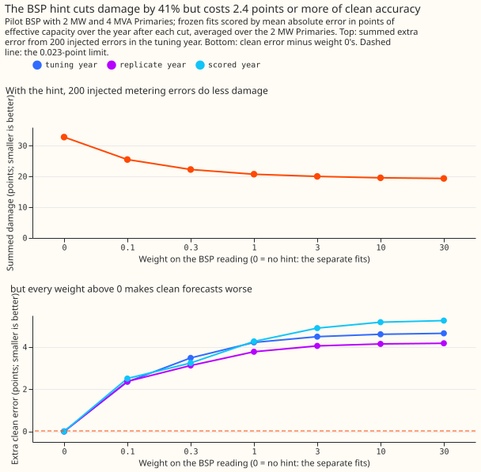
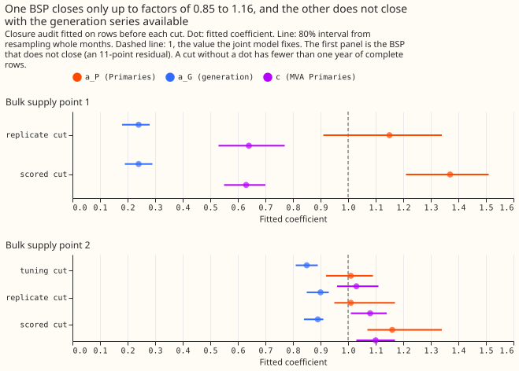
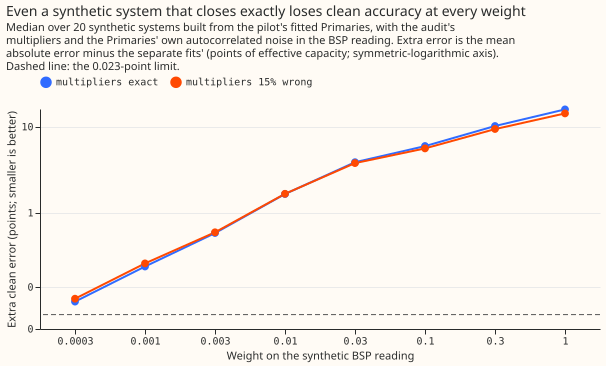

# Differentiable physics, H: does a bulk supply point reading limit the damage from a Primary's metering error?

**Adding the bulk supply point reading to the Primary substations' fit halved the damage from a
scale error in one Primary's history, but it made forecasts on clean data worse at every weight
above zero, so the reading should not go into the Primaries' loss.** The smallest clean-data loss
was 0.385 points, about 17 times the 0.023-point limit. An exactly specified synthetic system lost
clean accuracy the same way, so the loss does not come mainly from a wrong multiplier. The cause is
untested. The next thing to try is the bulk supply point reading as a separate monitor, outside the
Primaries' fit. The verdict is `not supported`, for this joint fit with the multipliers on the
Primaries' and generation sums fixed at 1.

**Why `not supported` and not `inconclusive`.** The pre-registered tuning rule allows a
clean-forecast rise of at most 0.023 points, the limit on extra clean error fixed before any fit.
That rule failed at every weight tried, so the result stands on its own. Arm B was an extra arm that
stopped at its plumbing check, and it does not change the verdict.

A **Primary substation** is a substation that takes power from a bulk supply point. A **bulk supply
point (BSP)** is where the distribution network takes power from the transmission network. The BSP
reading is roughly the sum of the Primaries' power minus the power of the metered generators beneath
it. We fitted each Primary's forecast together with the BSP reading. The **weight** says how closely
the fit must match that reading, and weight 0 means separate fits. We then injected metering errors
into one Primary's history (gaps, stuck values, and scale errors) and measured the **damage**, which
is the rise in that Primary's forecast error, with and without the BSP reading. A **point** is 1% of
a Primary's effective capacity, and every error below is a mean absolute error in points. The data
come from [experiment 103](../00103-differentiable-physics-1-data-look/result.md), and [experiment
36](../00036-hierarchy-aware-bsp-gsp-forecasts/result.md) had found that summing the Primary
forecasts added little at the BSPs. The plan was committed before any fit, and the commit order
proves it.

**Figure 1 shows two runs of the same tuning.** The *tuning cut* is 2023-07-01: the fit reads only
earlier data, and the *tuning year* is the 12 months after it. The *first run* set the BSP row's
scale to 1.2 MW, from a regression on the Primaries' readings. Arm B's plumbing check showed that
the joint fit's BSP row carries the Primaries' fitted variation, 2.9 MW, so the *re-run* used 2.9 MW
and a grid reaching lower weights. A given weight then acts about 6 times weaker (2.9 over 1.2,
squared). Both runs use the same 200 injected errors. The re-run came after seeing the first run, so
it is post hoc, and it changes the numbers and not the verdict.

**Figure 2 shows the closure audit's multipliers.** The audit fits, per BSP, how much of each
Primary's reading and of the generation enters the BSP reading.

**Figure 3 shows arm B's plumbing check.** Synthetic systems built exactly as the fit assumes still
lose clean accuracy at every weight.

## Arms and rows

- **Hint fit (the pilot).** One BSP, the one that closes in the audit, with a joint fit of its
  Primaries and one remainder step penalty. Each Primary's demand has a smooth drift, and the fit is
  made once before each scored year with no Kalman filter re-learning the level. The plan caps
  a pilot at `partly supported`.
- **Arm B (plumbing check only).** It asked whether the hint stops hurting clean forecasts once its
  multipliers are fixed at the closure audit's fit. The check used 20 synthetic systems built
  exactly as the fit assumes, plus a control with the multipliers 15% wrong. The stop rule was that
  a failed check ends the arm, and the check failed twice (see the findings below), so arm B's
  tuning grid was never run.
- **Row set.** `dp_mw_v1` and `dp_mva_dark_v1` from experiment 103. Tuning year 2023-24, replicate
  year 2024-25, scored year 2025-26. Only the clean-error grid was fitted at the replicate and
  scored cuts.
- **Injections.** 200 errors at two Primaries (60 gaps, 60 stuck runs, 80 scale errors of 20%), 10
  seeds per cell and Primary.
- **Not produced.** The score is the mean absolute error of a point forecast, so there are no
  quantile scores, tail rows, climatology or `manual_heuristic` rows, BSP-forecast arms, or
  intervals. The known-answer gate was not run, because the tuning rule chose weight 0.

## Headline numbers

- **The BSP reading halves the damage from scale errors.** The summed extra error from scale errors
  fell from 33.0 points at weight 0 to 16.3 at weight 30 in the first run and to 16.8 in the re-run
  (51% and 49% of the damage left), about 0.2 points per injection. Pooling all 200 injections
  gives a 41% cut in the first run (32.8 to 19.4 points) and 40% in the re-run.
- **The BSP reading does nothing for gaps and stuck runs.** Neither did measurable damage at
  weight 0 (summed -0.1 points each), and weight 30 added 1.2 to 1.8 points in both runs.
- **The BSP reading makes clean forecasts worse.** The tuning-year clean mean absolute error rose
  against separate fits as follows, with a limit of 0.023 points (the replicate and scored years
  are in `tuning_report.txt`):

  | Weight | First run (1.2 MW), points | Re-run (2.9 MW), points |
  |---|---|---|
  | 0.003 | not tried | 0.385 |
  | 0.03 | not tried | 0.765 |
  | 0.1 | 2.355 | 1.083 |
  | 1 | 4.222 | 2.989 |
  | 30 | 4.652 | 4.564 |

- **The tuning rule chooses weight 0 in both runs,** so the damage-reduction gate (a cut of at least
  0.30) cannot pass. No interval was computed.
- **The BSP reading is a weak monitor.** At the tuning cut a 30-day 25% scale error is found in 0%
  of injections when the fit includes the injected series, and in 50% when the fit is trained only
  on earlier rows (2% and 29% at the replicate cut). The earlier-rows fit raises a false alarm on
  1.2% of windows in the data it was fitted to and on 61% of windows in the year after the cut.

## Closure-audit findings

- **One BSP closes in the training years, and the other does not.** At the pilot BSP the in-sample
  residual is 2.2 to 3.2 points (1.2 to 1.8 MW) at the three cuts, over six winters with a median
  residual within 1 MW.
- **The fitted multipliers are 1.01 to 1.16 on the Primaries and 0.85 to 0.90 on the generation.**
- **Out of sample, the frozen fit drifts.** The residual scale is 5.5 points with a +3.7 MW median
  offset. The other BSP has an in-sample residual of 11 points.
- The full numbers are in `audit_report.txt` (first run: `audit_report_first_run.txt`).

## Arm B plumbing check

- **First run (before the BSP-row scale correction).** The exact synthetic systems rose by 13.0
  points at weight 0.1, and the control with multipliers 15% wrong rose by 12.0, so the check could
  not tell them apart. The check exposed the 1.2 MW scale fault described under Figure 1.
- **Second run (after the correction).** The exact systems still rose by 6.0 points at weight 0.1
  and by 0.05 points at the smallest weight, 0.0003, above the 0.023 limit. The control rose by
  about the same, so the check cannot detect a wrong multiplier. Numbers are medians of the 20
  systems (`armb_plumbing_first_run.json`, `armb_plumbing.json`).
- **Cause of the loss (untested).** We hypothesise that the BSP reading carries the sum of the
  Primaries' own autocorrelated noise, and the fit bends to explain it. We did not run a control
  without that noise.

## Checks

- **Mean and median forecasts, and quantile scores, do not apply,** because the pilot scores a
  point forecast by its mean absolute error.
- **Trigger 1 (a control fails) fired:** arm B's plumbing check failed twice.
- **Trigger 2 (a contradiction) fired.** The result contradicts the prediction that clean error
  would change by no more than 0.02 points, and it contradicts the finding of
  [experiment 36](../00036-hierarchy-aware-bsp-gsp-forecasts/result.md) that bottom-up children add
  0.04 to 0.19 points at the BSPs. The cause was not tested.
- **Trigger 7 (dependence) also applies,** because a possible follow-on experiment depends on this
  result.
- **Triggers 3 to 6 do not apply or were not run:** the score is a mean absolute error (trigger 3),
  no leave-one-out was run (4), no arm is nested in another (5), and no interval was computed (6).
- **Predictions that failed:** the chosen weight W* was predicted at 0.3 to 3 and came out at 0, and
  the extra clean error at W* was predicted within +/-0.02 points. The extra clean error at weight
  30 was predicted 0.05 to 0.15 points worse than at W*, and it came out at 4.564 points.

## Caveats

- A coding fault is not excluded, because the known-answer gate was not run.
- The filter-on reading, the production-relevant one, was not produced.
- Only one BSP was fitted, so the finding may not carry to a BSP with different Primaries.

## What to try next

- **Keep the BSP reading out of the Primaries' loss,** and use its residual against the Primaries'
  fitted values as a monitoring signal, scored for detection and false alarms in the year after the
  cut. Whether to run it is the maintainer's decision.
- **Test the cause directly:** a synthetic control with no autocorrelated noise in the BSP reading.
