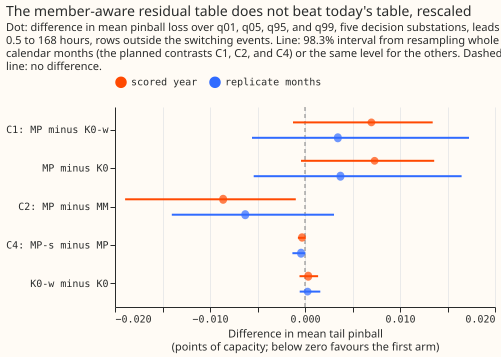
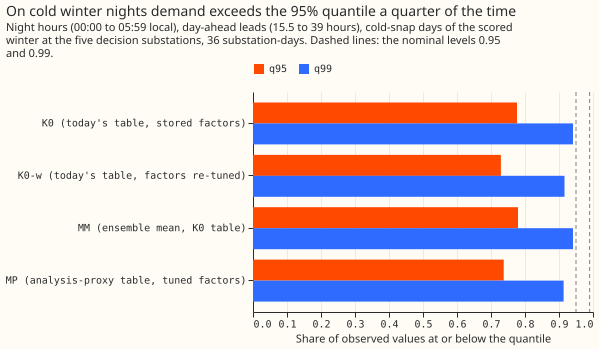
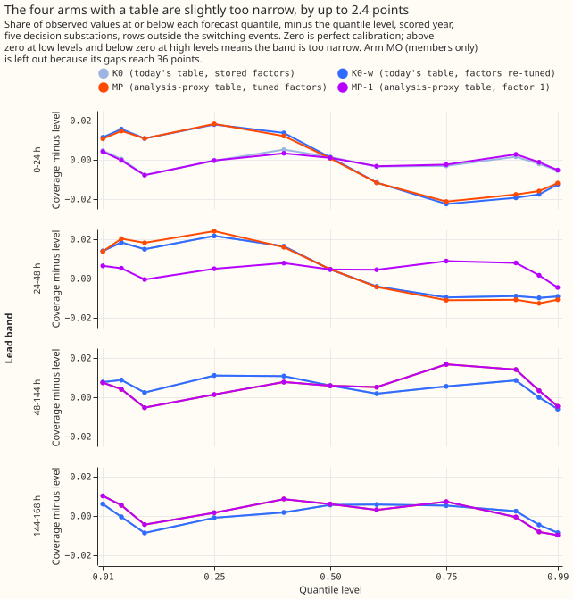
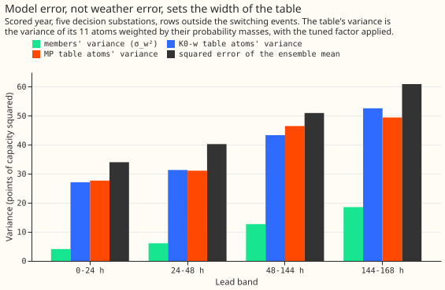
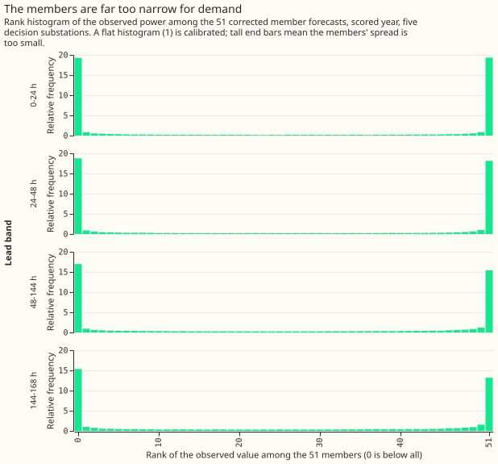

**This experiment asked whether the weather forecast error is counted twice in the uncertainty bands
of our demand forecast, and tested a fix.** The forecast comes from GAM-K, a generalised additive
model with a convex heating response that forecasts a substation's demand (from [experiment
111][e111]). GAM-K runs on each of the 51 members of the European Centre for Medium-Range Weather
Forecasts (ECMWF) ensemble, where each member is a separate simulation of the weather. It then puts a
table of past forecast errors, as quantiles by lead time and time of day, around every member's
demand forecast. The table was measured as observed demand minus the ensemble's average forecast, so
it already contains the weather error that the 51 members' spread also carries. The weather error is
therefore counted twice: once in the spread of the members and once in the table. We refitted the
table on forecasts driven by the weather model's best estimate of the true weather (almost no weather
error), placed it around each member, and compared the bands with today's bands and with today's bands
after re-tuning their width factors on the same grid. The test used the same rows at five Primary
substations. **Refitting the table did not improve the tails.** The weather members' variance is 4 to
19 (percentage points of the substation's effective capacity, squared) against 27 to 53 for the table,
so the double count exists in the code and is too small to matter. The verdict is inconclusive,
because no arm reached 14 of 16 calibration checks (four tail quantiles in each of four lead-time
bands), which the decision rule needs. On cold winter nights (days at or below each site's 10th
percentile of winter temperature, in runs of two or more), every arm's 95% quantile covered only 73%
to 78% of the observed values, so demand exceeded it about a quarter of the time.

## Results

**Take-home message.** Placing a table of forecast errors around each of the 51 weather members,
fitted so that it holds no weather error, scored 0.007 points of tail pinball worse than today's
table re-tuned on the same grid in the scored year (98.3% interval −0.001 to +0.013, five
substations, 291 runs). The replicate months agree in sign (+0.004, −0.006 to +0.017). The reason is
in the variance accounting: demand error is dominated by the model's own error, and the weather
members carry little of it. The larger finding is on cold winter nights, where the 95% quantile of
every arm sits too low. The `verdict` is `inconclusive`: MP had 6 of 16 calibration cells in band in
the scored year and 12 in the replicate months, and K0-w had 5 and 11.

**The known-answer gate passed every blocking test.** The synthetic twin
recovered the injected weather variance within 5% per lead band, the analytic double-count ratio of
K0's variance to MP's within 4%, and a halved member spread as an s of 2.0 in 3 of 4 lead bands
(the second lead band chose 1.0 against a true factor near 2.0). K0 rebuilt from the cache reproduced
experiment 111's stored tuning quantiles to 8e-6 (float32 rounding). A positive control confirmed
that the causality test detects a changed reading before the filter's cutoff. The twin's numbers are
in `work/gate.json`, printed by `e00125_gate.py`. The twin confirms the arithmetic and the code, and
does not show that the real ensemble behaves like the twin.

**Figure 1 shows that MP does not beat K0-w on any measure (C1), the decision contrast.** The key to
the arms: K0 is today's table with its stored factors, K0-w is today's table with factors re-tuned,
MP is the analysis-proxy table placed around each member, MP-s is MP with the members rescaled, MM
centres on the ensemble mean, and MO uses the members alone.

- **C1, MP minus K0-w (decision):** quantile score +0.0077 (95% interval +0.0006 to +0.0133) and
  tail pinball +0.0070 (−0.0013 to +0.0134) in the scored year; +0.0006 (−0.0092 to +0.0121) and
  +0.0035 (−0.0056 to +0.0173) in the replicate months. MP improved tail pinball at 1 of 5
  substations in the scored year and 2 of 5 in the replicate months.
- **MP minus the stored K0:** the same within 0.0005, so re-tuning K0's factors on the wide grid
  (K0-w minus K0: +0.0001, −0.0008 to +0.0013) changed the scores by under 0.001 and cut the cells
  in band from 9 to 5.
- **C2, MP minus MM (two designs compared):** −0.0254 in quantile score (−0.0379 to −0.0139) and
  −0.0086 in tail pinball (−0.0189 to −0.0010) in the scored year. Pooling the members as a mixture
  with the proxy table beats the ensemble-mean design, but the contrast changes the centres and the
  table together, so it does not isolate the members.
- **C4, MP-s minus MP:** −0.0005 (−0.0009 to −0.0001). Rescaling the members about their mean by an
  s chosen on the tuning months (1.25 at 0 to 24 hours, 1.0 elsewhere) is a gain of no practical
  size.
- **Absolute scores, scored year, leads 0.5 to 168 hours** (points of capacity; smaller is better):

  | Arm | Quantile score | Tail pinball | Cells in band (of 16) | Mean absolute error of the median |
  |---|---|---|---|---|
  | K0 (today's table, stored factors) | 2.800 | 0.4685 | 9 | 4.907 |
  | K0-w (today's table, factors re-tuned) | 2.801 | 0.4689 | 5 | 4.907 |
  | MP (analysis-proxy table) | 2.808 | 0.4759 | 6 | 4.904 |
  | MP-s (members rescaled) | 2.808 | 0.4756 | 8 | 4.904 |
  | MP-1 (MP, every factor 1) | 2.808 | 0.4753 | 12 | 4.904 |
  | MM (ensemble mean, today's table) | 2.834 | 0.4845 | 8 | 4.912 |
  | MO (members only) | 3.747 | 1.3508 | 0 | 4.910 |

  K0's 2.800 is experiment 111's score, reproduced. The replicate months give the same ordering,
  except that K0-w and K0, and MP-s and MP-1, swap places by under 0.001. The day-ahead (D+1) score
  was not computed separately; the lead bands are in `e00125_tables.py`.

**Figure 2 shows that the cold winter nights are the main miss, and no arm fixes it.** A cold day is
a local day whose ERA5 mean temperature is at or below the 10th percentile of the site's winter days
in 2019 to 2024; a cold snap is two or more such days in a row. The rule was fixed in
`work/decisions.json` (hash `019a763a…`) before any score was read. On the 36 substation-days of the
scored winter's cold snaps, K0's q95 covered 77.7%, K0-w's 72.9%, MP's 73.7%, and MM's 77.9% of the
observed night half-hours at day-ahead leads (the target is 95%); the q99 covered 91% to 94%. The
lower tail is also off, in the other direction: the q05 covered 7.3% (nominal 5%) in every arm. In
the four arms tested, which share GAM-K's centre, the miss therefore lies in the centre or the width
of the day-ahead forecast on cold nights, and not in the residual-table variants tried.

**Figure 3 shows all four arms with a table slightly too narrow, and the tuned factor of 0.9 makes
it worse on calibration cells.** Coverage lies within 2.4 points of the level at every level and
lead band. The calibration rule is stricter than that (a half-width of 2.5 standard errors with one
effective case per substation-day), so MP-1 with every factor at 1 had 12 cells in band while MP,
with factors of 0.9 to 1.0 tuned on the odd months, had 6. The factors tuned on the tuning months
narrowed bands that were already slightly too narrow out of period.

**Figure 4 shows why the fix cannot matter: the table's variance is several times the members'.**
The members' variance (σ_w², the variance of the 51 corrected member forecasts) is 4.1, 6.1, 12.7,
and 18.6 points squared in the four lead bands, against 27 to 53 for the table's 11 atoms and 34 to
61 for the squared error of the ensemble mean. The total variance of K0-w's mixture over MP's is
0.98, 1.01, 0.95, and 1.05, not the 1.05 to 1.8 predicted. The residual table fitted on
ensemble-mean residuals and the one fitted on analysis-driven residuals have nearly the same width,
which suggests the ensemble mean's error is mostly model error and filter error, if the members'
spread is a fair measure of weather error. The rank histogram of ERA5 temperature that would test
this was not drawn.

**Figure 5 shows that the 51 members alone are far too narrow for demand.** The observed value fell
outside the range of all 51 members in 74%, 71%, 62%, and 55% of rows in the four lead bands (a flat
histogram would put 4% there). The fair CRPS of the members is 3.69 to 4.46 points
([Ferro (2014)](https://doi.org/10.1002/qj.2270)). The threshold-weighted CRPS of the two mixtures
([Gneiting and Ranjan (2011)](https://doi.org/10.1198/jbes.2010.08110)) differs between K0-w and MP
by at most 0.005 in any band (upper tail 0.2975 against 0.2976 at 0 to 24 hours).

**Predictions and what happened.** The prediction that K0's variance was 1.05 to 1.8 times MP's failed
(0.95 to 1.05). The prediction that K0-w moves its factor to 0.7 to 0.8 at long leads failed (K0-w's
factors are 0.9 in every band). MP's factors are 0.9 to 1.0, as predicted, but MP was in band in
fewer than 14 cells (6 and 12). The predicted gain on cold nights (MP's night q95 within 1 to 3 points
of K0-w's) holds in the sense that MP is within 1 point of K0-w, and both are 21 to 22 points from nominal.
The decision rule gave `inconclusive`, not `refuted`, because the quantile-score interval of C1 does
not lie wholly above +0.02.

**Checks.**

- **Median minus mean forecast per site (scored year, points):** MP's median lies 0.14 below the
  ensemble mean at D5, 0.05 below at D11, 0.02 below at D10 and D16, and 0.02 above at D14. K0-w's
  are −0.10, −0.04, −0.04, +0.00, and +0.01 at D5, D11, D10, D16, and D14. MM has zero by
  construction.
- **Mean absolute error of the median beside C1:** MP is 0.003 points better (4.904 against 4.907)
  while its quantile score is 0.0077 worse.
- **Triggers fired:** trigger 2 (the variance-ratio and C1 predictions failed; the variance accounting
  above is the tested explanation), trigger 3 (the error of the median and the quantile score point
  in different directions, by 0.0025 points, and MP's median at D5 sits 0.04 points below K0-w's,
  above the plan's 0.01 threshold), trigger
  4 (leaving out D5 or D16 flips the sign of C1's replicate quantile-score estimate, which is within
  0.001 of zero and has an interval spanning zero; the scored-year sign and the verdict do not
  change), and trigger 6 (C1's 95% score interval has a half-width of 0.0064, under half of experiment
  111's sister contrast at 0.016, because the two arms differ only in the width of the table).
  The audit has not been run; the maintainer decides whether it is needed.

**Caveats.**

- K0's scored-year tails were read before the plan, so the scored year is not blind for K0.
- The analysis proxy is a control member of the ensemble and not an independent analysis.
- The replicate months are interleaved with the tuning months and are not out of time.
- The scored year has 291 runs (the 2026-06-30 run is excluded, as in experiment 111), and one
  winter. The cold-snap read rests on 36 substation-days.
- The 11-atom mixture caps q01 and q99, for every arm alike.
- The substation cards of the plan were not produced.
- The rank histogram is of demand among the members. The plan's rank histogram of ERA5 temperature
  was not drawn, because the cache holds demand forecasts and not member weather.
- The cold-snap rule was written after the predictions were stored and before any score was read.
- The known-answer gate has limits. On the twin, K0 also reaches 16 of 16 calibration cells, so
  that check alone cannot tell the double count from its absence. The variance-ratio check (2b)
  does, but only in the two longest lead bands. The members-only arm under-covers more than the
  analytic formula predicts (shortfall 0.60 to 0.80 against 0.41 to 0.76), and the gate does not
  explain the gap. No known-answer test covers the analysis-proxy centre built from the real
  cache.
- The tables for K0, K0-w, and MM come from experiment 111's stored fit, which includes a few
  replicate-month rows near month ends. That favours those arms over MP in the replicate months.
- The replicate-month bootstrap uses two month blocks, so its intervals are rough. The bootstrap
  uses one random seed, not the three the plan asked for.
- Not computed, though the plan listed them: the all-rows score beside the switching-filtered
  score, the share of rows beyond the most extreme atom, and the 80% and 90% coverage by lead band.
- The night band and the month blocks take local hours and dates from the half-hour's end time, so
  the 23:30 to 00:00 half-hour falls in the next day.

**Lessons for later experiments.** In this experiment the cold-night shortfall is the clearer target
of the two we measured: a quantile of demand on cold nights, conditioned on temperature, is one
option. A factor tuned on alternate months was not reliable out of period here (6 of 16 cells
against 12, with no detectable difference in tail pinball). At five substations in one scored year,
the members did better as a mixture (C2) than alone (MO).

## What N8 asks, and why it starts from the code

**GAM-K already runs the 51 members, so the question is whether the weather error is counted
twice.** `studies.dp_ens.forecast_run` drives the monthly GAM-K fit with each usable ENS member's
weather, adds the filter's correction to each member's mean, puts a residual table around every
corrected member, and pools the members with `mixture_quantiles`. The residual table
(`LeadHourSpread`: one table per lead band, hour band, and quarter, times a factor per lead band) is
fitted by `fit_spread_from_frame` (`e00111_ens.py:243-255`) on observed minus the corrected
ensemble mean. That residual already contains the weather-forecast error that the 51 members
carry, so the scored distribution counts it twice.

**The evidence for the double count is mild, so the effect size to expect is small.** Experiment
111's tuned factors are [1.0, 0.9, 0.9, 0.9] (0.9 is the floor of its grid in the three bands from
24 hours up), and moving them changed the score by 0.003 to 0.013 points. A factor of 0.9 is a
variance of 0.81 of the table, whereas a double count of half the table's variance would force about
0.7. So the double count is real in the code and probably modest in the numbers.

**Literature.** Ensemble model output statistics
([Gneiting et al. (2005)](https://doi.org/10.1175/MWR2904.1)) fit a predictive variance that is an
affine function of the ensemble variance. Bayesian model averaging
([Raftery et al. (2005)](https://doi.org/10.1175/MWR2906.1);
[Fraley et al. (2010)](https://doi.org/10.1175/2009MWR3046.1) for exchangeable members) and kernel
dressing ([Bröcker and Smith (2008)](https://doi.org/10.1111/j.1600-0870.2008.00333.x)) centre one
kernel on each member. The dressing paper fits the kernel width on the errors of the individual
members, not of the ensemble mean, for the reason N8 tests: the mean's error holds the spread
already. Arm MP is that dressing, with the proxy-driven residual table as the kernel.
[Rasp and Lerch (2018)](https://doi.org/10.1175/MWR-D-18-0187.1) is the neural form, not used here.

**Why members help a demand forecast in particular.** GAM-K's heating response has a hinge near
15.5 °C, so equal temperature spread gives a large demand spread on a cold night and almost none in
mild weather. Passing members through GAM-K captures that heteroscedasticity, which one residual
table cannot.

**Overlap with CAL.** The tail-calibration plan (CAL, postponed on 2026-10-20) listed arms MP, MO,
and MM as its fourth method. N8 owns those arms, and CAL's plan has dropped them, which leaves CAL
four planned contrasts. CAL's arm KE (ENS spread as a width input) is a rival way to use the same
spread and stays CAL's. N8 does not depend on CAL, and CAL's step of tuning a passing MP further
depends on N8.

**Builds on** experiments [111][e111] (GAM-K, tuned factors, ENS store), 114 (T-all-K), and
[115][e115] (W1). N8 changes only the spread; the median-defining mean, the filter, and the fits are
experiment 111's. The Kalman filter is the level-and-anomaly filter as it stands on main, which
[experiment 118][e118] kept over its 14-weight filter. N8 does not redesign the filter, and the
Kalman-on-ensemble-residuals arm uses it unchanged.

**Experiment 119 asks for a plain recalibration of GAM-K's quantiles.** Arm K0-w (the stored table
re-tuned on the wider factor grid) is that recalibration, so N8 also answers 119's next step.

[e111]:
https://openclimatefix.github.io/nged-substation-forecast/ml-experiments/00111-differentiable-physics-6-ens-forecast-engine-against-bg2/result/
[e115]:
https://openclimatefix.github.io/nged-substation-forecast/ml-experiments/00115-differentiable-physics-w1-diurnal-shape-state-on-ens/result/
[e118]:
https://openclimatefix.github.io/nged-substation-forecast/ml-experiments/00118-differentiable-physics-kfe-kalman-filter-on-the-gam-effects-on-ens/result/

## Data on local disk, and the periods

**Only data already on the workstation is read. No fetch, no AWS.**

- **ENS store:** experiment 111's `work/ens_store/<site>.npz` holds 821 daily 00:00 UTC runs
  (2024-04-01 to 2026-06-30), 51 members, 702 half-hours, for D5, D9, D10, D11, D14, D16, and D18
  (centre box only). Extraction counts usable members per run (`usable_members()`) and prints any
  run under 51 (experiment 111 dropped member 36 where its shortwave value was missing). Every
  statistic uses the usable members of that run. The longer Source Cooperative ENS history is not
  used.
- **Nothing on or after 2026-07-01 is read.** Rows whose valid time falls on or after 2026-07-01
  are dropped, which removes the far leads of the last runs, and the 2026-06-30 run is excluded, as
  experiment 111 excluded it.
- **Sites:** the decision sites D5, D10, D11, D14, and D16 (all five are needed for the gate; the
  verdict counts sites improving at 4 of 5); D9 beside them. D15, D18, and the MVA Primaries are
  out.

| Period | Role |
|---|---|
| Odd months of 2024-07 to 2025-06 | tuning: the proxy residual table, factors, and s |
| Even months of 2024-07 to 2025-06 | replicate: never used to choose a setting |
| 2025-07-02 to 2026-06-29, the 292 runs | scored: the verdict |

**A tuning or replicate row needs both its origin and its valid time in the period's months.**
**The replicate months are interleaved with the tuning months, not out of time:** the residual table
for August to December 2024 is fitted partly on data from 2025, so a replicate agreement shows
robustness to which months were held out, not a forecast made with only past data. The scored year
is out of time, but its table is up to two years stale. The verdict rule treats the scored year as
the test and the replicate months as a second, weaker check. The same holds for K0 and K0-w.

**The data holds two independent winters, and neither period holds a whole one.** The replicate
months hold December and February of 2024-25, the tuning months hold November, January, and March,
and the scored year holds all of 2025-26. Experiment 111's scored-year tails were read before this
plan, so the scored year is not blind for K0; every setting of every other arm is chosen on the
tuning months.

## Arms

**Screening tier: no new GAM fit and no refit.** Every arm reuses experiment 111's monthly GAM-K
fits, pinned capacity, ENS calibration, solar shrink, filter hyperparameters, and ENS store. The 51
member means and the filter's level and anomaly are cached once per run, and every arm is a
post-processing step on the cache. One seed (the fits are deterministic).

| Arm | Centres | Residual table around each centre | Role |
|---|---|---|---|
| K0 | 51 corrected members | ensemble-mean residuals, 111's factors, mixture | benchmark, reproduced |
| K0-w | 51 corrected members | as K0, factor re-tuned on MP's grid | fair control: is the double count only a scale error? |
| MP | 51 corrected members | proxy-driven residuals, factor on the wide grid, mixture | decision arm |
| MP-s | members rescaled about their mean by s | as MP | spread-scaled variant |
| MM | corrected ensemble mean | K0's table, factor re-tuned, no mixture | exploratory |
| MO | 51 corrected members | none | exploratory: weather error only |
| MP-1 | as MP | every factor 1 | exploratory: MP with no tuned factor |

- **The wide factor grid** is {0.7, 0.8, 0.9, 1.0, 1.15, 1.3, 1.5}, used for K0-w, MP, MM, and MP-s.
  K0 keeps 111's grid {0.9, 1.0, 1.15, 1.3} only as the stored benchmark. **C1 is MP minus K0-w.**
  If K0-w matches MP, the double count is a scale error and no member-aware residual table is
  needed.
- **MP's residual table.** Per tuning-month origin, the proxy cache (the control member of the
  latest run, NWP lead 9 to 33 hours) supplies the weather, and the forecast is made with the
  filter's level and anomaly at each lead, through `forecast_frame` with a zero-spread frame, not
  through `proxy_residual_stream` (which has no filter and no lead dependence). The residual is
  observed minus that forecast; its centred quantiles per hour band, quarter, and lead band form the
  table. Lead bands are experiment 111's four, in hours from the origin (0–24, 24–48, 48–144,
  144–168).
- **MP-s** replaces each member's mean μ_m by μ̄ + s·(μ_m − μ̄), with s per lead band from {0.8,
  1.0, 1.25, 1.5, 2.0, 3.0}. The ensemble mean does not move. **s is chosen first, with the factor
  held at MP's value, by the mean pinball at q05, q95, q01, and q99 on the tuning months; the factor
  is then re-tuned given s.** The two trade off along a flat ridge, so the report prints the
  score surface for each lead band, and a tie goes to the smaller s. s above 1 means the member
  spread is too small for demand at that lead band, a hypothesis here and not a finding.

**Operational definitions.** σ_w² is the variance across members of the corrected member means at a
target. σ_m² is the variance of the residual table's 11 atoms, weighted by their probability
masses (the 11 levels are unevenly spaced, so the weights are the mass each atom carries under
`mixture_quantiles`). Every variance and coverage statement below is computed on the same 11-atom
mixture that is scored, never on an analytic mixture.

**Mixture tails.** The mixture of 11-atom members is a distribution whose lowest and highest atoms
carry 3% mass each, and the mixture's q01 and q99 cannot lie beyond the members' own q01 and q99
atoms. So q01 and q99 coverage is capped for every arm alike, including K0. The tail rows therefore
compare arms under the same definition and are not a claim about the 99% tail of the true
distribution. The report prints the fraction of rows whose actual lies beyond the most extreme atom
of the whole mixture, for each arm.

## Known-answer gate (blocking, on the tuning months, before any replicate or scored row)

**A failed blocking test stops scoring; if it cannot be fixed inside the experiment, the verdict is
`inconclusive`.** Tests 1 and 2 use a synthetic twin of each decision site's tuning-month runs.

**The twin.** The truth weather W is ERA5 temperature and CAMS irradiance. Member weather is
W_m = W̄ + e_m with e_m zero-mean, standard deviation σ_w(lead) known (temperature 0.6 K at 12
hours rising to 2.0 K at 7 days; irradiance ratio 0.04 rising to 0.20), and W = W̄ + e_0 is a fresh
draw, so truth and members are exchangeable by construction. The twin's analysis proxy is W plus an
error of 0.1 K. Fake demand is GAM-K's prediction on W plus AR(1) noise η with known σ_m (the
fitted φ and σ_z). Because the twin is exchangeable by construction, it confirms the arithmetic and
the code, and not that the real ECMWF ensemble behaves so. The exact predictive distribution is
simulated by 500 further draws of W, and the 11-atom mixture of the 500 draws' fake members is
the reference.

1. **Variance transfer (blocking).** The mixture's σ_w², pooled over all tuning-month runs of a
   site (a 51-member sd is only about 10% accurate on one run), is within 10% of the 500-draw
   variance of GAM-K(W) per lead band, in every cell with Monte-Carlo sd above 0.5 points. Pass at
   all five sites. The ratio is also printed for cold-night cells (ERA5 temperature below 3 °C),
   where the hinge makes the transfer largest.
2. **Known σ_w and σ_m are recovered, and the double count appears at the predicted size
   (blocking).** (a) The operational σ_w² and σ_m² are within 10% of the injected values per lead
   band. (b) K0's total variance divided by MP's total variance equals the analytic ratio
   (2σ_w² + σ_m²)/(σ_w² + σ_m²), computed from the injected values and the 11-atom mixture, within
   10% per lead band; the twin's analytic ratio is printed before the real arms run, and the central
   90% interval's over-coverage that follows is the expected value, not a fixed 3 points. (c) MP's
   coverage is in band in at least 14 of 16 cells. (d) MO under-covers at q05 and q95 by more than
   the analytic amount minus 2 points. (e) With the members' weather spread halved against the
   truth, the true demand-space factor s* is computed from the 500-draw reference (it is not 2,
   because the hinge is non-linear), s* must lie inside the s grid, and MP-s recovers s* within 25%
   in at least 3 of 4 lead bands.
3. **Reproduction.** Rebuilding K0 from the cache reproduces experiment 111's stored
   `gamk_tuning_<site>.parquet` quantiles to 1e-4. `mixture_quantiles` of 51 identical members
   equals a single member's quantiles. MP with a zero residual table equals MO. MP-s with s = 1
   equals MP. MP's table fitted on an all-zero residual stream is exactly zero.
4. **Causality.** Changing any actual from a half-hour that ended after τ minus 3.5 hours, or any
   ENS run issued after τ, leaves every arm's forecast at τ unchanged. The cache records the fit's
   cut per run, and the pinned-capacity vintage date is printed against each origin. The residual
   table, factors, and s use the tuning months; for the replicate rows that is not past-only data
   (see "Data on local disk, and the periods").
5. **Mean and order.** The mean over members of each arm's centre equals the cached corrected
   ensemble mean to 1e-9 (for MP-s with s = 1 and for MP); quantiles are non-decreasing after every
   transformation, at every row.

**Reported, not blocking:** the rank histogram of ERA5 temperature (and irradiance) among the
calibrated members per lead band, as a diagnostic of under-dispersion. It is new code (below).

## What counts as calibrated

**A cell is calibrated if its coverage lies within nominal ± 2.5·√(p(1 − p)/n_eff)**, with n_eff the
number of distinct (site, local valid date) pairs in the cell, the rule of the CAL plan. A cell is
one of four tail levels in one of four lead bands, 16 in all. **A calibrated forecast passes all 16
cells only about 80% of the time per period** (CAL plan), so "all 16" is not the target. **The
target is at least 14 of 16 cells in band, and no more failing cells than K0-w.** The gate measures
the pass rate on the twin (test 2c) and the report prints it.

**Variance accounting (reported).** Per arm, site, lead band, and season, the variance of the
mixture splits into σ_w² and σ_m², beside the variance of the actual error of the ensemble mean. The
report prints whether K0's total follows 2σ_w² + σ_m² and MP's σ_w² + σ_m² on the real data.

## Metrics

Per arm and period, on rows shared across a contrast's arms, outside the hand-filtered switching
events, with the all-rows score beside; the four lead bands, 12–36 hours, and D+1 (15.5 to 39 hours
from the 09:00 UTC origin):

- **Quantile score** over the 11 levels (points). It approximates the CRPS by a sum over unevenly
  spaced levels, so it is called the quantile score, never "the CRPS".
- **Coverage** of the central 80% and 90% intervals and at q01, q05, q95, and q99, with the band
  above, from `studies.tail_calibration`'s coverage and pinball tables.
- **Tail pinball** at q01, q05, q95, and q99 (same module), and the mean over the four.
- **The mean absolute error of the median** beside each contrast.
- **New metric code, in a separate module PR to `packages/studies`, with tests and a mutation
  pass:** the rank histogram, the fair CRPS of the 51 members (MO only, reported in its own table,
  not beside the quantile score), and the tail-weighted CRPS of the quantile mixtures (the upper and
  lower tail weights of [Gneiting and Ranjan (2011)](https://doi.org/10.1198/jbes.2010.08110)).
  Scores are proper ([Gneiting and Raftery (2007)](https://doi.org/10.1198/016214506000001437)), so
  a sharper calibrated arm wins. `studies.tail_calibration` has none of these today. The module PR
  gets one Sonnet code review and does not merge before the Opus review. Tuning and the known-answer
  gate run before it merges, and no replicate-year or scored-year fit runs until its Sonnet review
  is triaged.
- **No curtailment cost** (experiment 87 found no event that could rank forecasts).

## Winter and the operator's cold nights

**Winter is November to March, local time, and comes first in the write-up.** It is five month
blocks in the scored year and two in the replicate months (December, February). Month-block
bootstrap on two non-adjacent blocks is empty, so **the replicate-months winter rows have no
interval**. The scored winter's intervals resample **days within months, in blocks of 7 days**, and
are descriptive. The decision is on the full year.

**The cold-snap rule is fixed now, before any score is read.** A cold day is a local calendar day
whose ERA5 daily-mean 2 m temperature at the site's grid box is at or below the 10th percentile of
that site's November to March daily means over 2019-09-01 to 2024-06-30. A cold snap is a run of two
or more consecutive cold days. The thresholds and episode lists are computed from ERA5 alone and
hashed into `decisions.json` before any arm is scored. With about two winters the count is probably
3 to 8 episodes per site, so cold-snap rows carry no interval.

**Which direction the cold nights should move.** Experiment 111's night band (00:00 to 05:59 local)
under-covered at q95 (92.3% in the planner's read of experiment 111's stored predictions) and D5 in
winter more so (89.0%), while the pooled tails are near nominal. Removing the double count narrows
the general band, which would worsen those cells. The members' own heteroscedastic spread widens the
band on cold nights, because the hinge turns their temperature spread into a large demand spread. So
MP is expected to be narrower than K0 in mild weather and at least as wide on cold nights. The
cold-night figure includes K0-w, to separate this from a scale change.

**The operator-visible figure** shows, for each decision site, the cold nights of the scored winter:
actual demand (in points of effective capacity) against the D+1 median and 90% band of K0-w and MP,
with the nights outside each band marked and the Economy 7 step visible at D5, D10, and D16, plus a
table of night-band tail coverage per arm. The nights shown are fixed by the cold-snap rule, never
by an arm's score.

## Planned contrasts and margins

**Three planned contrasts: C1, C2, and C4, each in the replicate months and the scored year.** The
quantile-score non-inferiority test uses **95% month-resampled intervals** (`studies.bootstrap`,
paired across arms, 3 seeds), because the +0.02 margin was set against a 95% half-width of about
0.016 (experiment 111's sister contrast). The tail-pinball and calibration reads use **98.3%
intervals** (Bonferroni over three contrasts), each period separately.

- **C1 (decision), the double count:** MP minus K0-w. MP minus the stored K0 is reported beside it.
- **C2, two coherent designs compared:** MP minus MM changes the centres (members against their
  mean) and the residual table (proxy against ensemble-mean) together, so it compares designs and
  does not isolate the members.
- **C4, the spread-scaled variant:** MP-s minus MP.

**Exploratory at 95%:** MP minus MO (the model-error spread is needed; its size is too large to
inform a decision), MP-1 minus MP, D9, 12–36 hours, the best arm against Xlag-d, X-nl+K, and BG2,
and the winter and cold-snap rows.

**Non-inferiority margin +0.02 points** on the quantile score over 0.5 to 168 hours: above the
sister contrast's noise (−0.008, half-width about 0.016) and below the 0.03 that W1 and N3 + N4
treat as the smallest gain worth porting.

**Power.** At a 95% half-width of about 0.016 on the quantile score, a score change under 0.02
cannot be told from zero, and the double count's expected effect (a factor of 0.9 against 1.0, a
0.003 to 0.013 points change in experiment 111) is below that. So the verdict will rest on
calibration cells and tail pinball, and a `small gain` is the likeliest positive outcome. The report
states the detectable tail-pinball effect from the bootstrap half-width before reading the contrast.

## Predictions

Written before any fit; each line can fail, and none overrides the decision rule.

- **Variance ratio.** Weather error grows with lead, so K0's total variance divided by MP's is
  near 1 at 0–24 hours (1.05 to 1.2) and approaches 2 at 144–168 hours (1.4 to 1.8), if σ_w² is
  large against σ_m² there. MP's central 90% interval is 2 to 6% narrower than K0-w's at 0–48 hours
  and 10 to 25% narrower at 144–168 hours.
- **K0-w.** The wide grid moves K0's factor to 0.7 to 0.8 at 144–168 hours and 0.8 to 0.9 elsewhere;
  K0-w captures most of MP's narrowing at long leads, and MP differs from K0-w mainly in cold
  weather and at long leads.
- **C1.** MP has its factor at 0.9 to 1.15 and is in band in 14 or more of 16 cells; tail pinball
  falls by 0.002 to 0.01 against K0-w; the quantile score is within ±0.01 of K0-w.
- **C2.** MP minus MM is −0.01 to −0.04 in the quantile score, mostly in the tails and in winter.
- **C4.** s is 1.0 to 1.25 at 0–48 hours and 1.0 elsewhere; MP-s minus MP within ±0.01, no lead band
  at a grid edge.
- **Cold nights.** MP's night-band q95 coverage is within 1 to 3 points of K0-w's, closer to 95%.
- **Gate.** Test 1's ratio is 0.9 to 1.1 in every cell, with the largest departure on cold nights.
- **Run time.** 2 to 3 hours on 6 cores.

## Decision rule

**The verdict reads C1, because the question is whether the member-aware residual table beats a
re-scaled version of today's.** An arm **passes** in a period if it has at least 14 of 16 cells in
band and no more failing cells than K0-w, the upper end of its 95% quantile-score interval against
K0-w is at most +0.02 points, and its mean tail pinball against K0-w is below zero.

- **`supported`:** the gate passed; MP passes in the scored year and in the replicate months; the
  98.3% interval of MP's tail pinball minus K0-w's lies wholly below zero in the scored year; and 4
  of 5 decision sites improve in the scored year.
- **`small gain`:** MP passes in both periods and the tail-pinball interval includes zero.
- **`partly supported`:** MP passes in the scored year only; or MP passes pooled but its night-band
  q95 coverage is further from nominal than K0-w's; or MP beats the stored K0 but not K0-w.
- **`refuted`:** MP's quantile-score interval against K0-w lies wholly above +0.02 in either period.
- **`not supported`:** both periods' tail-pinball intervals lie within ±0.002 of zero and MP and
  K0-w have the same number of cells in band.
- **`inconclusive`:** anything else, including K0-w already at 14 or more cells in both periods
  with MP indistinguishable (the double count is then a scale error, reported as the finding), or a
  gate test that cannot be fixed.

**The best arm** is the passing arm with the lowest scored-year tail pinball; ties within 0.002 go
to the simplest (K0-w, MP, MP-s). **Handed on:** a passing MP becomes GAM-K's spread candidate, and
CAL (if restarted) tunes it further.

## Audit before merge: the seven triggers

"Checks" bullets: median minus mean forecast per site and arm; mean error beside each contrast.

1. **A control fails:** any gate test, K0's reproduction of 2.800, the nesting identities.
2. **A contradiction:** the variance accounting against 2σ_w² + σ_m²; MP's factor far above 1 (the
   proxy table too narrow, because the proxy is a control member and not an analysis); C1 against
   a later CAL run of the same arm.
3. **Quantile score and mean error of the median disagree in sign,** or the median moves by over
   0.01 points.
4. **Leaving one site out flips a calibration pass, a sign, or the verdict.**
5. **A nested arm beats its container:** MP-s losing to MP at s = 1 after tuning; MO beating MP.
6. **Interval width:** C1's score interval more than twice or under half as wide as the sister's.
7. **A later design depends on an unreplicated result:** MP adopted from one period.

## Substation cards (Provisional: fitted to past weather and forecast on ENS, screening run)

**One card per decision site (D9 beside), showing only what experiment 111's cards cannot:** the
proxy table's width against the ensemble-mean table's width per hour band (the double count made
visible); the members' spread by lead band, winter against summer; s and the factor by lead band;
tail coverage for K0-w and MP; and example D+1 forecasts for the second Monday of July, October,
January, and April (weeks beginning 2025-07-14, 2025-10-13, 2026-01-12, and 2026-04-13, fixed now,
before any score is read), median and 80% and 90% bands against the observed series. The demand
panels are experiment 111's cards, linked.

## Privacy

**D-labels only, with dates, for D5, D9, D10, D11, D14, and D16.** D15 and D18 are not used. Never
name or guess D15's generator, and show no topology or substation name.

## What the write-up must contain

The take-home says whether the weather error was counted twice, how much of the fix is a scale
change that K0-w also gets, and what happens on cold winter nights.

- **Order:** the winter analysis and the cold-night figure first, then the tails table (coverage and
  pinball at q01, q05, q95, and q99, every arm, per lead band, both periods, cells outside the band
  in bold), then the headline chart (cells in band and mean tail pinball, with intervals).
- **Figures, raw data first:** a winter and a summer week per site; the variance accounting;
  reliability diagrams per lead band; the rank histograms; the gate (twin coverage for K0, K0-w, MP,
  MO); conditional coverage by site, season, and hour band.
- **Absolute scores** of every arm and reference at D+1 and over 0.5 to 168 hours, on shared rows.
- **Caveats:** K0's scored-year tails were read before the plan; the proxy is a control member and
  not an analysis; interleaved months; a stale table in the scored year; two winters; five
  substations; the capped q01 and q99; the assumed 3.5-hour delay; hindsight masks; the ENS
  calibration shifts the ensemble mean and not each member; the twin's weather error is simulated.

## Compute and module

**CPU only, 6 cores, under 8 GB per script** (one site at a time; mixtures in chunks of 20,000
cases; the member-mean cache is about 20 MB per site and period). GAM-K's hinge basis is not a
linear sum, but 51 members per run is a few milliseconds of numpy, so a GPU gains nothing.
**Estimate:** the member-mean cache about 10 minutes per period; the proxy pass over the tuning
months about 10 minutes; the factor and s grids are the slow step, since each pair re-sorts 51×11
atoms per case over roughly 170,000 tuning cases, so 20 to 40 minutes per arm; the gate's twin about
20 minutes. **Total 2 to 3 hours.** Cut first: MP-1, MM, D9.

**One new module, no change to a reviewed one.** `studies.dp_ens`, `ens_members.mixture_quantiles`,
`tail_calibration`, and `bootstrap` are on `origin/main`, and the experiment's scripts import them.
The rank histogram, the fair CRPS, and the tail-weighted CRPS go into a new module in
`packages/studies` (the separate PR above). The member rescaling and the twin live in the
experiment folder, which has no tests of its own scripts, so the gate's own checks (tests 3 to 5)
cover them. **If MP is adopted,** `forecast_run` needs a way to take a proxy-fitted table, which is
a further module PR.

## Size: the five triggers

- **Changes what gets stored:** no (private files only).
- **Touches the production serving path:** no.
- **Touches a degradation rule:** no.
- **Admits more than one defensible design:** yes, narrowly (the residual table's fit, the member
  rescaling), each pre-registered, every arm a post-processing step.
- **Spans code whose callers could not be named without searching:** no.

**Medium.** One Sonnet plan review (done), one Sonnet code review of the experiment's scripts for
leakage (every fit and table cut at the origin's training end), one Sonnet write-up review, and the
module PR's own Sonnet review; the Opus reviews run later. The mutation pass covers the new metric
module.

## Run order

Code; gate tests 3 to 5; member-mean cache and the proxy pass on the tuning months; tuning (K0-w,
MP, MP-s); gate tests 1 and 2; replicate months; scored year; variance accounting; write-up and
cards.
