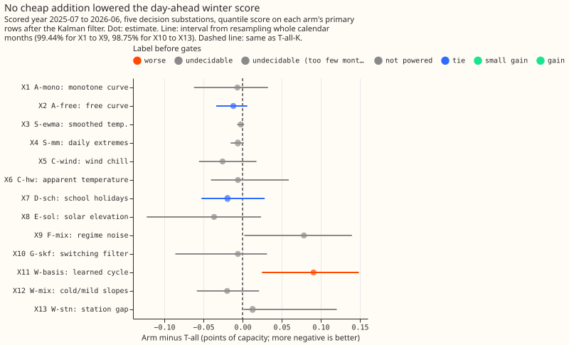
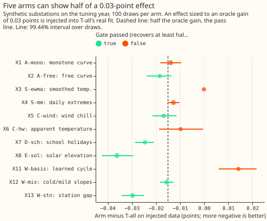

# Differentiable physics, S1: do cheap additions to GAM-K lower the day-ahead score?

**Take-home: no cheap addition showed a gain we can trust.** Of thirteen screens (nine in the first
family, four exploratory), none earned the label `gain`. Five were `undecidable` because the
interval was wider than the margin, four were `tie`, three were `worse` (F-mix, W-basis, W-stn),
and G-skf is `inconclusive`. Every powered screen except W-stn had an estimate in the predicted
direction, so the result narrows the search to E-sol on a larger row set and rules out learned year
cycles and regime noise as forecast terms. Past weather was used throughout, so every number is
a ceiling for ENS weather. **Verdict: inconclusive.**

The question was whether adding one cheap term to T-all-K (experiment 114's day-ahead model with the
Kalman filter) lowers the quantile score on November-to-March rows. The scored year is 2025-07 to
2026-06 on five decision substations, with the penalty weight (1.0) taken from experiment 114 and
the filter re-tuned per arm on the tuning year.

## Checks

- **Median minus mean forecast (T-all-K, per site):** 0.0 at all five substations, because the
  residual spread is centred.
- **Mean-forecast error beside each contrast:** the sign of the mean absolute error of the mean
  forecast matches the sign of the quantile-score contrast for all thirteen screens.
- **Triggers fired:** trigger 1 (a control failed): G-skf's power gate failed (it recovered the
  regime on 98% of half-hours but its state error was 0.38 above the plain filter's, interval
  -1.9 to +6.1), and W-basis's injected-effect gate moved the wrong way. Trigger 2: F-mix predicted
  tails moving towards nominal and the cold-snap score within noise, and got +0.078 points. An Opus
  audit is therefore due before merge. Triggers 3 to 7 did not fire (no leave-one-out run was
  needed, because no contrast is a gain).
- **Reproduction:** B0 equals `fit_gam` to 3e-13, T-all equals experiment 114's stored scored-year
  forecast to 1e-4 points, and every appending arm with zeroed columns equals T-all to 1e-11 points.

## Contrasts (scored year, arm-K minus T-all-K, points; negative is better)

| Arm | Primary rows | Estimate | Interval | Replicate | Sites better | Label | Gate 3 |
|---|---|---|---|---|---|---|---|
| X1 A-mono | Nov-Mar | -0.007 | -0.062 to 0.032 | +0.025 | 4 | undecidable | not powered |
| X2 A-free | Nov-Mar | -0.012 | -0.034 to 0.006 | -0.010 | 5 | tie | powered |
| X3 S-ewma | Nov-Mar | -0.002 | -0.007 to 0.002 | 0.000 | 4 | tie | not powered |
| X4 S-mm | Nov-Mar | -0.006 | -0.015 to 0.002 | +0.013 | 4 | tie | not powered |
| X5 C-wind | Nov-Mar | -0.026 | -0.056 to 0.018 | -0.012 | 5 | undecidable | powered |
| X6 C-hw | Nov-Mar | -0.006 | -0.040 to 0.059 | -0.007 | 3 | undecidable | not powered |
| X7 D-sch | school-holiday weekdays | -0.019 | -0.052 to 0.028 | -0.020 | 5 | tie | powered |
| X8 E-sol | dark winter evenings | -0.036 | -0.122 to 0.024 | -0.017 | 5 | undecidable | powered |
| X9 F-mix | cold-snap days | +0.078 | 0.002 to 0.140 | +0.011 | 1 | worse | n/a |
| X10 G-skf | Nov-Mar | -0.006 | -0.086 to 0.031 | +0.004 | 2 | inconclusive (power gate failed) | n/a |
| X11 W-basis | Nov-Mar | +0.091 | 0.025 to 0.149 | +0.021 | 0 | worse | not powered |
| X12 W-mix | Nov-Mar | -0.020 | -0.058 to 0.021 | +0.005 | 4 | undecidable | powered |
| X13 W-stn | Nov-Dec 2025 | +0.013 | 0.001 to 0.120 | -0.005 | 2 | worse (partial year) | powered |

- **Intervals:** 99.44% for X1 to X9, 98.75% for X10 to X13, resampling whole calendar months. The
  pilot half-width for the primary rows (Nov-Mar) was 0.028 points, so a screen cannot be called
  below about 0.03 points.
- **Labels:** a screen whose gate-3 label is "not powered" cannot be called a tie. Labels follow
  the pre-registered rule; no screen reached `gain` or `small gain`, so the parity placebo gate did
  not run.
- **`-b0` control:** every arm run with T-all's filter settings gave an estimate within 0.002 of its
  `-K` estimate, except W-basis (+0.100 against +0.091), so no label depends on the filter fit.
- **Absolute score (scored year, all rows):** T-all-K 2.216, A-free-K 2.196, E-sol-K and W-mix-K
  within 0.02 of that, W-basis-K 2.273, F-mix-K 2.223, G-skf-K 2.238 points.

## G-skf's pass rows (2023-07 cut, injected into the tuning year's out-of-sample residuals)

- **Detection passed:** at 25% and 40% transfers, recall was 0.34 and 0.48 against 0.05 and 0.12 for
  the plain filter, and scale errors of 25% were found 0.48 against 0.21 of the time (30 days).
- **Delay and recovery failed:** median delay hit the 48-hour cap for both detectors, and median
  recovery was 1.0 to 1.5 hours against 0.5 for the plain filter.
- **False alarms passed:** 0.65 alarms per 100 days against 1.14 for the plain filter, and none on
  cold-snap days.
- **Power gate failed** (see "Checks"), so X10 is capped at `inconclusive`. The 2024-07 and 2025-07
  cuts were not run, because the 2023-07 cut already failed pass rows.

## Tails (scored year, T-all-K; coverage / pinball)

| Level | T-all-K | F-mix-K | G-skf-K |
|---|---|---|---|
| q01 | 0.0143 / 0.172 | 0.0142 / 0.173 | 0.0150 / 0.180 |
| q05 | 0.0531 / 0.576 | n/a | 0.0554 / 0.589 |
| q95 | 0.9408 / 0.588 | n/a | 0.9446 / 0.592 |
| q99 | 0.9838 / 0.180 | 0.9839 / 0.181 | 0.9846 / 0.184 |

## Caveats and deviations from the plan

- **Past weather:** every arm uses ERA5 temperature and CAMS irradiance, so each number is a ceiling
  for ENS. W-stn's station data have no assumed live feed, and the scored year was compared to
  2025-12-31 only.
- **G-skf's expectation-maximisation is forward-only:** it uses filtered, not smoothed, regime
  probabilities, and counts only readings one half-hour apart. The injection harness adds steps,
  stuck-meter runs, and scale errors to a single substation's residual stream, not experiment 43's
  multi-series transfers. The edge-flow comparison was not run.
- **Gate 3 for W-basis** kept the basis learned from real data, and its oracle gain overshot (0.053
  points), so its "not powered" label is partly a fault of the gate.
- **S-ewma** could not reach the target oracle gain at 3 of 5 substations (its columns nearly
  repeat T-all's smoothings), so its gate rests on 2 of 5.
- **Schedule:** frozen yearly fits (monthly-refit shortcuts not used), one seed.

## What to try next

- E-sol on ENS weather and the earlier winters, with a row set that makes the interval narrower
  than 0.03 points.
- G-skf as a load-transfer detector with its multipliers re-tuned on injected events.
