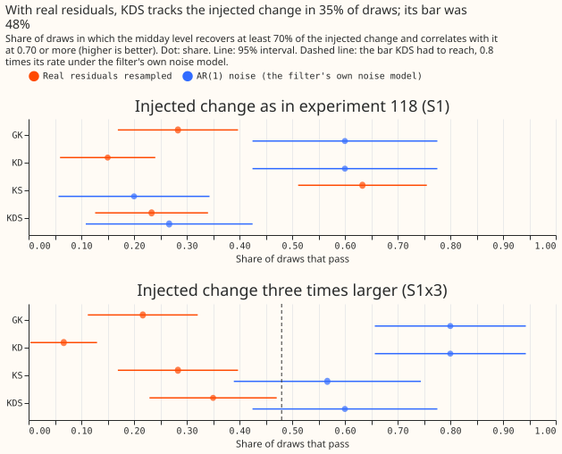
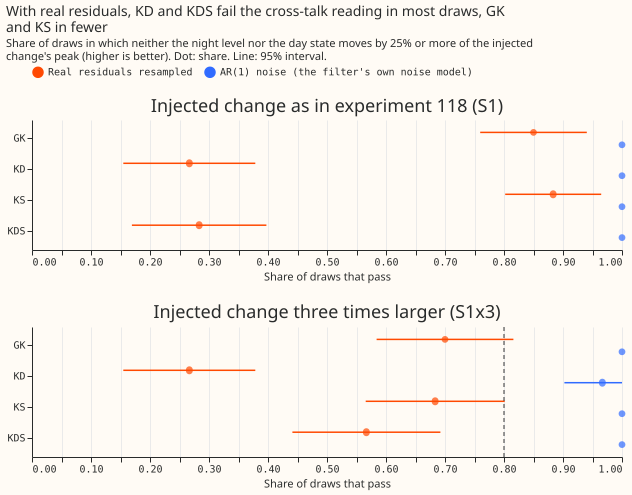
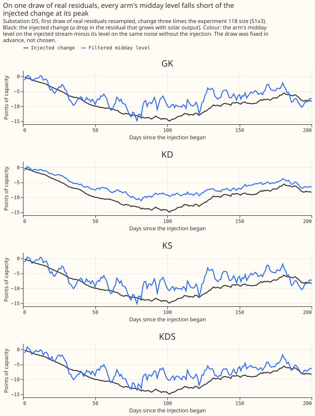
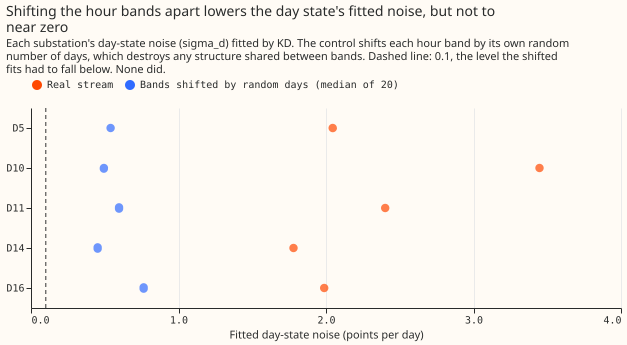
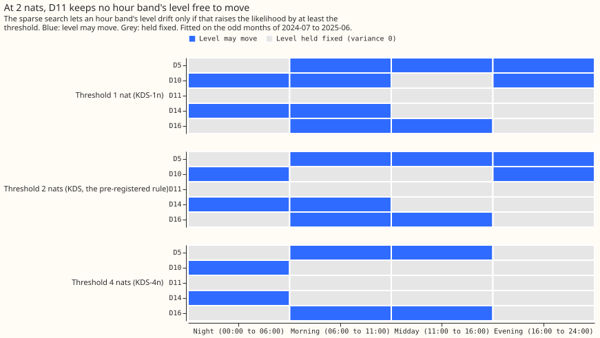

# Differentiable physics, KFD: a shared day-level error state and a sparse process noise in GAM-K's filter

**This experiment asked whether one extra number per day, shared by every time of day, lets the
correction to a Primary substation's day-ahead demand forecast follow recent errors more closely,
and it stopped before any forecast was scored.** The forecast comes from a convex model (a physical
demand model fitted by least squares) driven by ECMWF ensemble weather forecasts. A Kalman filter (a
method that updates an estimate of the current forecast error each time a new reading arrives)
corrects each forecast with the recent errors, separately for four times of day: night, morning,
midday, and evening. Errors and scores are in points, where one point is 1% of a substation's
effective capacity.

**We added a day-level error that all four times of day share, and changed how the filter decides
which of its estimates may drift.** The second change keeps an estimate fixed unless the data show
that letting it drift raises the likelihood by a stated amount. Before scoring any forecast, we
injected a known change, shaped like a rise in solar-panel capacity, into real recorded errors at
five substations and checked whether each version of the filter found the change. The plan said to
stop if the new filter tracked worse than the old one under the filter's own error model. It did, so
we stopped. No replicate month or scored year was run, and no forecast was scored.

**The new filter did not recover the injected change reliably, and the day state failed a control
that shifts the four times of day apart.** The midday level of the new filter (KDS) recovered the
injected change in 35% of the 60 draws of real errors, against a bar of 48%. Experiment 111's filter
(GK) recovered it in 22%. Under the filter's own AR(1) error model, KDS recovered it in 60% of 30
draws and GK in 80%. The verdict is `inconclusive`: the plan's decision rule needs a scored contrast
to say `supported` or `not supported`, and none exists. The errors at different times of day do
move together, but a single shared state also absorbs errors that belong to one time of day, and the
test could not detect the change at four of five substations at the experiment 118 size.

**The filter and the search for its noise re-implement published methods.** [de Vilmarest et al.
(2024)](https://doi.org/10.1109/TPWRS.2023.3310280) put a random walk on the weights of a frozen
additive regression model of regional electricity load and fitted a sparse, diagonal noise matrix by
likelihood. [de Vilmarest and Goude (2022)](https://doi.org/10.48550/arXiv.2110.00334) describe the
greedy search that starts every noise variance at zero, and the R package
[viking](https://CRAN.R-project.org/package=viking) implements it. The shared day-level state is the
experiment's own addition. The code builds on [experiment
111](../00111-differentiable-physics-6-ens-forecast-engine-against-bg2/result.md), whose monthly
convex fits, calibration, and filter settings it reuses, and on [experiment
118](../00118-differentiable-physics-kfe-kalman-filter-on-the-gam-effects-on-ens/result.md), whose
periods, rows, and known-answer gate it copies.

## Figures

## Arms that ran at the gate

| Arm | Filter state | Level noise | Role |
|---|---|---|---|
| GK | level and AR(1) anomaly per hour band | one shared variance (experiment 111's) | benchmark |
| KD | GK plus one day-level state d shared by all four bands | one shared variance, refitted | day state alone |
| KS | GK | one variance per band, sparse from zero | sparse noise alone |
| KDS | GK plus d | one variance per band, sparse from zero | hypothesis arm |

The hour bands are local time: 00:00 to 05:59, 06:00 to 10:59, 11:00 to 15:59, and 16:00 to 23:59.
The state d is constant within a local day and follows an AR(1) across days, with its persistence
bounded at 0.90 per day. The sparse search sets each band's level variance to exactly zero unless
a likelihood gain of 2 nats justifies it. The exploratory arms KDS-1n, KDS-4n, KDS-floor, and KDS-da
were fitted (KDS-da fitted by the day-ahead likelihood), but none was run through the gate or scored.

## The known-answer gate on real residuals

**The gate injects a change shaped like a rise in solar-panel capacity into streams of residuals, and
asks whether each arm's midday level follows it.** The injected change is experiment 118's: the
solar-panel weight rises from 1 to 1.30 over 180 days, so the stream gains a negative deviation that
grows with the solar regressor. S1 is that size and S1x3 is three times that size. Each arm is
refitted on every stream, GK included. Noise is either a circular month-block resample of the
substation's real residuals (60 draws over 5 substations, the decision form) or the filter's own AR(1)
error model (30 draws). Each injected stream is paired with a stream on identical noise and no
injection, and an arm's reading is the difference between the two.

**Power check.** At S1 the injected change peaks at 1.0 (D10), 1.7 (D16), 1.8 (D14), 2.1 (D11), and
3.4 (D5) posterior standard deviations of the midday level, a median of 1.7. The plan requires 3, so
S1 was underpowered at 4 of 5 substations and the decision amplitude became S1x3.

**Readings at S1x3** (share of draws passing; 60 real-residual draws, 30 AR(1) draws):

| Arm | 1 tracking, real | 1 tracking, AR(1) | 2 no cross-talk, real | 2 no cross-talk, AR(1) | 4 error follows, real | 4 error follows, AR(1) |
|---|---|---|---|---|---|---|
| GK | 0.22 | 0.80 | 0.70 | 1.00 | (reference) | (reference) |
| KD | 0.07 | 0.80 | 0.27 | 0.97 | 1.00 | 1.00 |
| KS | 0.28 | 0.57 | 0.68 | 1.00 | 0.15 | 1.00 |
| KDS | 0.35 | 0.60 | 0.57 | 1.00 | 1.00 | 1.00 |

- **Reading 1 failed the relative bar.** KDS's real rate of 0.35 is below 0.8 times its AR(1) rate of
  0.60, which is 0.48. KDS minus GK in the real-form tracking rate is +0.13 (95% interval -0.44 to
  +0.56), below the required +0.10 with an interval excluding zero.
- **Reading 2 failed the relative bar.** KDS's real rate of 0.57 is below 0.8 times its AR(1) rate of
  1.00, which is 0.80. KD fails it worst (0.27), so the day state carried the injected change onto
  the night level or moved by more than a quarter of its peak.
- **Reading 4 passed and reading 3 passed.** KD and KDS lowered the stream's day-ahead error below
  GK's in all 60 real draws. At S0, the median largest movement of the midday level after day 60,
  in units of the injected peak, was 0.35 for KDS against 0.78 for GK on real residuals (ratio 0.45,
  bar 1.25), and 0.024 against 0.085 under AR(1) noise.
- **The stop rule fired.** KDS minus GK under AR(1) noise is -0.20 (95% interval -0.44 to 0.00), past
  the -0.10 limit.
- **Sparse noise alone (KS) tracked best at S1** (0.63 of real draws against GK's 0.28) **but not at
  S1x3** (0.28), and its forecast error followed in only 17% and 15% of real draws (S1 and S1x3).
  KS is not part of the gate rule.

## Controls

| Control | Result |
|---|---|
| P1, nesting: KD with `sigma_d` 0 and KS with equal `q` reproduce GAM-K | pass (differences below 1e-9; stored quantiles equal exactly on 13,440 rows per substation) |
| P2, causality: later readings change no state | pass |
| P-day: local-day bookkeeping across both clock changes | pass |
| P-ident: recovery of a known `sigma_d` of 1.5 in 150 simulated draws | pass (98.7% within a factor of 2; median fit 1.57); a permanent step of 3 points went mostly to the level for KD (85%, d 9%) and to d for KDS with all `q_b` zero (60%) |
| P-sparse: AR(1) streams with a true zero or a true 0.05 | pass (a band kept at 2 nats in 7% of true-zero draws, and in 100% of true-0.05 draws) |
| P-premise: cross-band correlation of daily innovations; lag-1 autocorrelation of their mean | 0.18 to 0.23 (mean 0.20, predicted 0.25 or more); 0.25 to 0.37 (mean 0.32, bar 0.3). The correlation is above the stop limit of 0.10 and below the predicted 0.25 |
| P-shift: KD refitted with each band shifted by its own random number of days | **fail** at 5 of 5 substations (below) |

**P-shift failed at all 5 decision substations.** The median shifted-band `sigma_d` was 0.49 (D10),
0.60 (D11), 0.45 (D14), 0.76 (D16), and 0.54 (D5) points, against 3.45, 2.40, 1.78, 1.99, and 2.05
on the real stream. The criterion was below 0.1 at 4 of 5 substations, and no shifted fit reached
it. The shift keeps each band's own day-to-day behaviour, so the shared state also absorbs
single-band structure. The pre-registered consequence is an audit. The manager ruled that no audit
runs now, so the failure is recorded as an unresolved caveat.

**The 2-nat rule left D11 with every level frozen.** At D11, all four `q_b` are 0 under KDS, and also
under KDS-1n and KDS-4n, so the day anomaly was not supported by the sparse rule there. The plan's
stop rule fires on that state, because a frozen level lets d take any permanent shift. KDS-floor
(each `q_b` at least 1e-4 points squared per day) keeps D11's levels able to move, as pre-registered.
D10 keeps bands 0 and 3 only at 2 nats.

## Decision rule and stop rules

**The verdict follows the plan's decision rule as written.** The rule says: "`inconclusive`: every
other result, and any result that would be `supported` or `small gain` but has a failed gate [...] A
failed P-shift [...] also gives `inconclusive` and triggers an audit." The stop rule says: "If KDS
tracks worse than GK by more than 0.10 in the AR(1) form, the added state damages tracking under the
filter's own error model. Stop and report before any scored forecast." The second stop rule says to
stop and report if all four `q_b` are zero at any decision substation, which happened at D11. The
verdict cannot be `not supported`, because that label needs the lower limit of C1's interval, and C1
does not exist. The experiment manager ruled that the page is written up as stopped, with no post hoc
run.

## Predictions and what happened

| Quantity | Prediction | Result |
|---|---|---|
| Gate tracking, real form, S1x3 | KDS 50% (30% to 70%); GK 40% (20% to 60%); KDS minus GK +0.10 (0.00 to +0.25) | KDS 35%; GK 22%; +0.13 (-0.44 to +0.56) |
| Gate tracking, AR(1) form | KDS within 0.10 of GK, both at least 70% | KDS 60%, GK 80%; -0.20 |
| Gate, S0 movement | KDS at most 1.25 times GK's | 0.45 times |
| Cross-band control (P-shift) | passes at 4 or more of 5 substations | fails at 5 of 5 |
| Premise (P-premise) | correlation at least 0.25; lag-1 at least 0.3 | 0.20 mean; 0.32 mean |
| Fitted d | `sigma_d` above its floor at 5 of 5; `phi_d` 0.4 to 0.8 | `sigma_d` 1.78 to 3.47 at 5 of 5; `phi_d` 0.62 to 0.90 (0.90 at D10, the bound) |
| Sparse support at 2 nats | at least 3 of 4 bands nonzero at 4 or more of 5 | 3 bands at D5, 2 at D10, 0 at D11, 2 at D14, 2 at D16: 1 of 5 meets it |

## Checks

- **Triggers that fired.** Trigger 1 (a control failed): the known-answer gate and P-shift. Trigger
  2 (a result contradicts its prediction): P-shift was predicted to pass and the gate's real-form
  rates fell short of the predicted ranges, and the explanation (single-band structure absorbed by d)
  rests on P-shift alone and was not tested separately. Trigger 5 (a nested arm beats the arm that
  contains it): GK tracked in 22% of real S1x3 draws and KD, which contains GK, in 7%; KS tracked
  in 63% at S1 and KDS, which contains KS, in 23%. The manager ruled that no audit runs now, and
  the audit trigger stays an open caveat.
- **Triggers 3, 4, 6, and 7.** Triggers 3 and 4 compare scored contrasts and so could not fire;
  trigger 6 compares a headline interval with a sister experiment's and none exists; trigger 7 was
  not assessed.
- **The mean-forecast checks were not run, because nothing was scored.** The median-forecast minus
  mean-forecast difference per substation and the mean-forecast error beside each quantile-score
  contrast need forecasts.

## Caveats and what to try next

- **Caveats:**
    - The P-shift failure is unresolved and no audit ran.
    - The gate had low power at S1 and a wide interval at S1x3: the paired interval on the tracking
      difference spans -0.44 to +0.56 with 60 draws over 5 substations, which share real streams.
    - The 2-nat threshold is calibrated only under the filter's own error model.
    - The gate reads the midday level alone, so a change that the arm carried in the day state
      instead counts as a failure of reading 1.
    - The injected change is shaped like the solar-panel term, and a different slow change might
      behave differently.
    - The hyperparameter likelihood counts the odd months only, while the warm state also saw the
      even months' readings, as in experiment 111.
- **What to try next, stated as options and not commitments:**
    - A day-level state for each hour band plus a smaller shared part, so that single-band
      structure does not have to land in one shared state.
    - An explicit solar-panel term, so that the midday level need not carry a slow solar change
      (experiment 118 suggested fixing the weight on the panels and moving the others).
    - A known-answer gate with an injected change large enough to detect at every decision
      substation, for example S1x3 from the start, with the S1 results reported beside it.
    - Judging the day state by a forecast score at D+1 with the gate as a diagnostic only, which
      the plan's decision rule did not allow once the stop rule fired.

## Pre-registered but not run

The plan pre-registered these, and none ran, because the experiment stopped at the gate. The plan as
committed with status `planned` is in this page's git history.

- **Scored arms and contrasts:** the contrasts C1 to C5 (KDS, KD, and KS against GK, and against each
  other) at day D+1 over the scored year and the replicate months, with 99% month-block intervals,
  and the exploratory arms KDS-shuf, KDS-nod, KDS-1n, KDS-4n, KDS-floor, and KDS-da.
- **Breakouts:** winter, winter nights, winter evening peaks, cold-snap days, cold winter nights, the
  17 holiday days and the day after each, and the non-inferiority check on other days.
- **Tails:** coverage and pinball loss at q01, q05, q95, and q99, split for the reverse-flow side
  and winter evening peaks.
- **KDS-dow:** the shrunken same-weekday correction on KDS and its last-week reference. It waited on
  the gate and was not run.
- **Substation cards and the figures of scored results.**

## Earlier advice

**Followed:** keep experiment 111's filter as the benchmark; read residuals up to the 3.5-hour
telemetry delay; test the speed of a new filter state with an injected change before scoring it
(experiment 115); test on resampled real residuals before reading a state as a measurement
(experiment 118). **Departed from:** experiment 118 advised fitting a filter's noise by a day-ahead
likelihood with a wide bound on log `q`. KD, KS, and KDS use the one-step likelihood, as GAM-K does,
so that the contrasts differ in the state and the noise search only.

All figures and numbers on this page are printed by `e00128_gate.py report` and
`e00128_charts_gate.py numbers`, and the figures are drawn by `e00128_charts_gate.py figures`.
