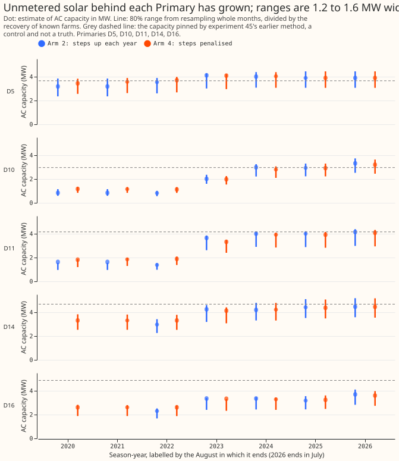
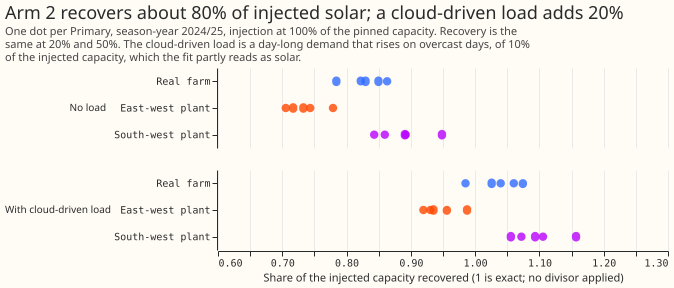
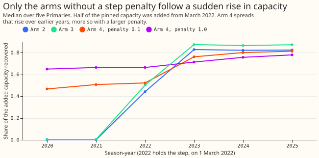
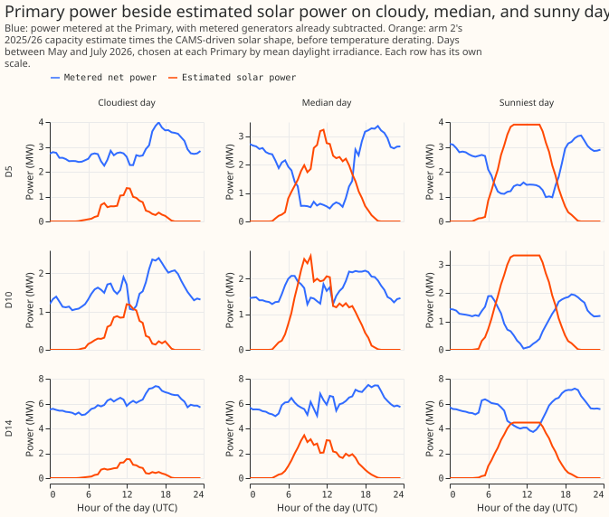

# Differentiable physics: can the embedded solar capacity behind a Primary be inferred, with an honest range?

**Take-home message: the capacity of the unmetered solar behind five Primary substations can be read
from their power, but the range around each estimate is a spread over test scenarios and not yet a
calibrated 80% interval.** The arm 2 estimate of AC capacity in 2025/26 is 3.3 to 4.5 MW across the
five Primary substations, which is 0.4 to 2.8 MW above the 2021/22 estimate (figure 1). The range is
1.2 to 1.6 MW wide. Arm 2 and arm 4 passed every pre-registered gate, so the pre-registered rule
gives `supported`. The verdict is `partly supported` because the coverage test is close to circular
and the known-answer recovery was measured on farms and not on embedded panels (see "Limitations").
That downgrade is a judgement beyond the rule. No forecast gain is scored.

**Terms used below.** D5, D10, D11, D14, and D16 are the five decision Primary substations of
experiment 103's data set. A season-year runs from July to June and is labelled by the year of the
July, so 2025/26 is the label 2025. The plan below says September to August, which is not what the
convex model uses. The four arms are the experiment 45 frozen capacity (arm 1, a control and not a
truth), arm 2 (a capacity that steps up each season-year), arm 3 (arm 2 plus demand terms that
cannot see the sun), and arm 4 (arm 2 with a penalty on the steps). Recovery is the capacity found
with a known solar farm's output added to a Primary's power, minus the capacity found without it,
divided by the added capacity. The divisor is the median recovery of the other real farms at the
same Primary, which rescales a recovery to 1; the published estimates are already divided by it. A
coverage cell is one Primary, one plant class, and one load, with the known capacity checked against
the range. CAMS is the Copernicus Atmosphere Monitoring Service's satellite irradiance, ERA5 is the
European Centre's reanalysis of past weather, and DESNZ is the UK Department for Energy Security and
Net Zero.

**The fits stop at 2026-07-31 and add one month to the original cut.** The maintainer approved
fitting to 2026-08-31 as an exception to the hold-out, on the understanding that season-year 2025/26
would then be complete. Season-years run from July to June, so 2025/26 was already complete at
2026-06-30. The final ERA5 for August 2026 is not out, so the exception added July 2026 only, and
the model fits July 2026 at the 2025/26 level because it has no 2026/27 increment. The code
constants that mark where the hold-out begins, and the grid end, are moved inside this experiment's
scripts only (`E00129_THROUGH_JULY=1`), and `packages/` is unchanged.

**Capacity rose at all five Primaries, and experiment 45's pinned value sits above the range at D16
in every year.** The estimates at D10 and D11 step up in 2022/23, and the cause of the step was not
tested. The figure starts in 2021/22. Season-year 2020/21 has no training rows at any Primary
because of the lockdown exclusion, and 2019/20 has none at D14 and D16 and only winter rows at D5,
D10, and D11, so the fit copies or barely identifies a capacity there and the page does not show it.

## Gates

**Arm 2 and arm 4 passed all four gates; arm 3 failed the placebo gate.** Arms 2, 3, and 4 were
tested against the gates fixed before stage C. Arm 3 is descriptive and cannot win. Arm 4 uses an
increment penalty of 0.1, and the plan ran arm 4 only if arm 2 failed the drift gate, which it did
not in the final run. Coverage is 23 of 30 cells for arm 2 (77%), against a nominal 80%, so the
range reaches the 21-cell gate but not its nominal level.

| Gate | Limit | Arm 2 | Arm 3 | Arm 4 |
|---|---|---|---|---|
| Recovery of both mismatched plants within 0.75 to 1.25 after the divisor | 4 of 5 Primaries | 5 | 5 | 5 |
| Semi-synthetic coverage cells with the truth in the range | 21 of 30 | 23 | 22 | 23 |
| Placebo difference of fits, share of the real-sky recovery (median, max) | at most 0.20 | 0.12, 0.13 | 0.21, 0.22 | 0.12, 0.12 |
| Drift per 5 years, pooled mean (max Primary), data years only | under 0.05 | 0.041 (0.047) | 0.039 (0.047) | 0.034 (0.038) |

**A first run of the drift gate counted season-years with no training rows and failed arm 2
(0.095).** The Opus science review found that the convex model copies the capacity of a season-year
with no rows from its neighbour. The gate was re-run on season-years with at least 12,000 training
half-hours (a full season-year has 17,520), which are 2021/22 to 2025/26. The first run is kept in
`work/before_data_year_filter/`. The recovery gate does not discriminate: divided recoveries are
about 0.9 for the east-west plant and 1.1 for the south-west plant, so every arm passes at 5 of 5
Primaries, and the pre-registered prediction of 3 of 5 was wrong.

**Real farms' output was recovered at about 0.8 before the divisor, at 20, 50, and 100% of the
pinned capacity alike.** A synthetic load that rises on overcast days, of 0.1 of the injected
capacity, adds about 0.2 to the recovery at every Primary. The 0.2 is twice the assumed load, so it
measures the model's sensitivity and not a bias found in real data. When that load is present, the
true capacity lies inside the range for the south-west plant in only 1 of 5 cells and for real farms
in 3 of 5.

**Arm 4 follows a sudden rise in capacity more slowly than arm 2 does.** Half of experiment 45's
pinned capacity was injected as a step-up on 1 March 2024, in 2023/24. At the median Primary, arm 2
recovers -0.07 and -0.06 in the two years before (no leakage) and 0.84 and 0.87 in the two years
after. Arm 4 at penalty 0.1 recovers -0.04 and 0.04 in the two years before and 0.77 and 0.85 after,
and at penalty 1.0 recovers 0.19 and 0.26 before and 0.57 and 0.64 after.

## Primary power beside the estimated solar power

**The estimated solar power is not visible as a one-for-one dip in the metered power.** Figure 4
shows the metered power of D5, D10, and D14 on a cloudy, a median, and a sunny day in May to July
2026. At each Primary the days are the lowest, the median, and the highest mean CAMS irradiance
      between 06:00 and 18:00 UTC among days with a full day of readings outside the switching
      events, chosen before any plot was drawn: D5 on 4 May, 15 June, and 2 July; D10 on 3 May, 1
      July, and 2 July; D14 on 4 May, 1 July, and 2 July. On the sunny days the metered power falls
      during daylight by about 1.6 to 2.3 MW between the 06:00 UTC level and the noon level (D5
      about 1.6, D10 about 1.7, D14 about 2.3), against estimated solar peaks of 3.9, 3.3, and 4.5
      MW. Two explanations fit: the demand that the solar hides is not constant through the day, or
      the estimate is too high (see "Limitations"). The flat tops of the estimated solar power are
      the inverter limit in the solar shape. The estimated solar power is arm 2's capacity times
      that shape before temperature derating.

## Every range reaches the register totals

- **The Feed-in Tariff (FiT) register lies below every range.** The register, shared to each Primary
  by postcode district, lists 1.9 to 2.6 MW of declared net capacity at sites of at most 1 MW (2.0
  to 2.8 MW of DC capacity) and 2.1 to 3.2 MW at sites of at most 5 MW (2.2 to 3.5 MW of DC
  capacity). The ranges reach these totals at all five Primaries. The register's "declared net
  capacity" is its name for AC capacity. A lower-bound check cannot detect an overestimate.
- **DESNZ's domestic solar by constituency, shared by area, gives 2.1 to 3.8 MW.** Its capacity
  basis (DC or AC) is not stated.
- **Holding the 1 July 2025 estimate forward undershoots the hindsight 2025/26 estimate by 0.00 to
  0.70 MW for arm 2.** The as-of fit at that origin sees season-years to 2024/25, and the held value
  is its 2024/25 capacity. The largest gaps are at D16 (0.70) and D10 (0.30), where capacity is
  still growing. The as-of divisors come from known-answer fits that use data to 2026-07-01, which
  is future information, with a small effect because recovery varies only from 0.78 to 0.86
  across the Primaries.
- **CAMS' own beam and diffuse irradiance changes the latest arm 2 estimate by 0.04 MW or less.**
  The beam and diffuse columns were already in the downloaded files, so no new download was needed.
  Recovery falls by 0.02 and the divided estimate rises by at most 0.04 MW, partly because the
  divisor moves with the raw estimate.

## Limitations

- **The range is a spread over test scenarios.** A bootstrap over resampled months spreads the
  2025/26 capacity by only 3 to 7% of the estimate (reviewer's check). The rest of the width comes
  from dividing by 240 recovery ratios (10th to 90th percentile 0.73 to 1.08) measured on three
  plant shapes, with and without the overcast-day load, at the other four Primaries. A coverage cell
  is covered when its own recovery lies inside that pool, so 23 of 30 is close to guaranteed, and
  the cells that fail are the extreme scenarios. The test does not say how often the range holds on
  real panels.
- **The point estimate sits near the top of its range.** The point divides by the Primary's own
  median real-farm recovery (0.78 to 0.86), and the range divides by the pooled ratios (median about
  0.92).
- **The divisor may overstate embedded capacity by roughly 5 to 10%.** A farm's recovery rises with
  the correlation of its irradiance with the Primary's (r = 0.79 over 25 farm and Primary pairs,
  reviewer's check). Embedded panels sit at the Primary's irradiance point, so their recovery is
  probably above the farms'. The unit is also the 99th-percentile output of a farm-like plant, not
  nameplate AC capacity. A synthetic plant driven by the Primary's own CAMS would test both.
- **The semi-synthetic target flatters every arm.** It uses arm 3's demand terms, which the fit can
  represent exactly, and shuffles residuals across years by month, which removes demand trends and
  weather-correlated residuals. Coverage, drift, and the placebo were measured with no demand
  misspecification. Coverage was tested only for 2024/25 at 100% injection.
- **Growth is not separated from demand trends.** The convex model has no drift term here, so a
  multi-year fall in daytime demand would load onto the capacity steps. The D10 and D11 steps in
  2022/23 are unexplained. The sign of the growth survives resampling, which covers sampling error
  only.
- **The arm 4 penalty was not tuned.** The plan tuned it on D9 from semi-synthetic drift, but D9's
  drift is undefined (under 3 estimable years) and every penalty from 0.001 to 1.0 gave a recovery
  of about 0.75. The middle value 0.1 was fixed, and arm 4 was not needed under the plan's rule.
- **The placebo limit of 0.20 is a post-pilot choice,** set after seeing arm 2 at 0.10 of the
  injection in the pilot. It changes no verdict among arms 2 and 4.
- **The fits use mixed cuts.** The known-answer, coverage, semi-synthetic, and step fits stop at
  2026-07-01, and the real, as-of, and beam fits stop at 2026-08-01. The four gates rest on the
  first group, so they do not use the July 2026 rows. July 2026 may contain unmasked
  switching, because the switching labels may not cover April to July 2026.
- **Four planned comparisons were not run.** They are the December-factor comparison, experiment
  45's semi-synthetic constant-path re-run, and the Embedded Capacity Register and the Renewable
  Energy Planning Database comparisons, because experiment 45's processed files do not hold the last
  two.
- **The monotone-arm and sun-blind-arm fits are copied from experiment 110 and are not yet in
  `packages/studies`.** Moving them there needs a separate module PR.

## What a later experiment must not take for granted

- **That the range is a calibrated 80% interval,** or that the estimate is nameplate AC capacity.
- **Any capacity for 2019/20 or 2020/21,** and any year-to-year change beyond what the step test
  shows arm 2 can follow.
- **That hindsight capacities can be used in a forecast test.** A net-demand forecast test must use
  an as-of fit at each forecast origin and must never use capacities fitted through July 2026 when
  scoring rows on or after 2026-07-01.

## What the next experiment should answer

**The next experiment should test whether explicit solar modelling lowers the net-demand forecast
error on the sunniest half-hours without raising it on dark ones.** Refitting each March instead of
each September, or each quarter, is a further question.

## Plan (written before any fit)

**This section is the plan as written before any fit and is kept unedited, except for two facts the
finished work overturned.** The convex model's season-years run from July to June, not September to
August. The stage B drift figures below were measured before the data-year filter described under
"Gates", so they include season-years with no training rows.

The full plan, with the Opus review's triage, is `data/ml-experiments/briefs/dp_pv_design_note.md`
(private). Its content is repeated here in short.

- **Deliverable:** a capacity-over-time estimate with an 80% range per Primary, for a substation
  card and for NGED. A forecast gain is not scored here. A follow-on experiment tests whether
  explicit solar modelling lowers the net-demand forecast error on the sunniest half-hours, without
  raising it on dark ones.
- **Inputs:** CAMS global irradiance at the Primary (beam and diffuse, found already in the
  downloaded files, for one sensitivity row), ERA5 2 m temperature, cleaned Primary net power with
  metered generators already subtracted, the hand-labelled switching events of experiment 103 (66
  events, plus and minus 24 hours), and five metered solar farms as the injection source.
- **Model:** experiment 110's convex model, with a fixed south-facing tilt-35 shape (orientation is
  not identified at a Primary, experiment 73) and one capacity per season-year, each year the
  previous year plus a non-negative increment. Fits run on the GPU where possible.
- **Arms:** (1) the experiment 45 frozen vintage as control; (2) monotone season-year capacity; (3)
  arm 2 with sun-blind demand; (4) arm 2 or 3 with a penalty on the increments, run only if arm 2's
  measured drift exceeds 0.05 per 5 years.
- **Known-answer test:** farm output at 20, 50 and 100% of the Primary's pinned capacity, as a
  matched plant and two mismatched synthetic plants (east-west, tilt 15, DC:AC 1.3, clipped;
  south-west, tilt 25), each with and without a day-long cloud-driven load of 10% of capacity, plus
  a step-up injection. Recovery is the difference of two fits divided by the injected capacity; it
  measures bias only, because the fit is nearly linear in its target. Coverage, drift and the
  placebo run on a semi-synthetic target with a known capacity.
- **Stages, each ending in a one-line report:** A, a beam and diffuse fetch at the five points (not
  needed: the columns were already downloaded); B, pilot on two Primaries; C, full grid; D,
  real-data tables; E, register comparison and write-up.

## Register comparison

The write-up compares the hindsight capacity per Primary with the Embedded Capacity Register,
Renewable Energy Planning Database and Feed-in Tariff figures that experiment 45 processed. The
registers are lower bounds, so the check is that our range lies above the register total of sites
below 1 MW (sensitivity at 5 MW).

## Stage B findings and rules fixed before stage C

Stage B ran on D10 and D16, on the feature cache that stops at 2026-06-30. The numbers are the
pilot's and are not results.

- **Fits cost about 0.5 s, and the GPU and CPU give identical capacities,** so the whole experiment
  takes minutes.
- **The ridge does not matter.** Ridge 0.01, 0.1 and 1.0 move the recovery by 0.01 or less, so the
  ridge pilot is dropped and 0.1 (experiment 104's value) is kept.
- **A real farm's output is recovered at 0.73 to 0.88 without load,** as experiments 39 and 63
  found. A day-long cloud-driven load of 10% of capacity adds about 0.21 to arm 2's recovery and
  0.20 to arm 3's.
- **Arm 3 recovers 0.02 to 0.03 more than arm 2 and does not cut the cloud-load bias.** Its placebo
  difference of fits (0.17 to 0.18 of the injection) is larger than arm 2's (0.10).
- **On the semi-synthetic target (true capacity zero), the capacity found from noise is 1 to 4% of
  the injected capacity.** The recovery's drift on a constant farm is +0.18 per 5 years at D10
  (standard deviation 0.16 over 10 draws and 5 farms) and +0.045 at D16, against a limit of 0.05.

**Rules for stage C, written before it runs.**

- **Arm 3 is descriptive.** It cannot win the verdict if it only matches arm 2. Its purpose is the
  stated claim that sun-blind demand does or does not cut the cloud-load bias, at five Primaries.
- **Arm 4 runs,** because arm 2's drift exceeds 0.05 per 5 years at D10. Its increment penalty is
  tuned on D9, which is not a decision Primary, from the semi-synthetic drift alone.
- **Post-pilot choice:** the placebo gate is "placebo difference of fits at most 20% of the real-sky
  recovery of the same arm and Primary". The 20% is a round number chosen after seeing arm 2 at 0.10
  of the injection, so the gate is not independent of the pilot.
- **Grid:** the five decision Primaries; 20, 50 and 100% of the pinned capacity; the five real
  farms, the east-west plant, and the south-west plant; with and without the cloud-driven load.
- **Divisor:** recovery is divided by the median recovery of the other four farms (matched plants,
  no load, 100%) at the same Primary and arm; the two synthetic plants use the median of all five.
- **Coverage cells:** 30 cells, one per Primary, plant class (matched with a rotating farm,
  east-west, south-west), and load, each at 100%. The interval is the stratified month-block
  bootstrap of the last complete season-year, divided by recovery ratios from the other Primaries
  and other farms.
