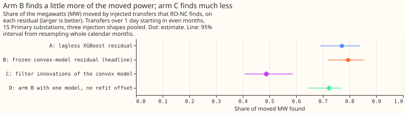
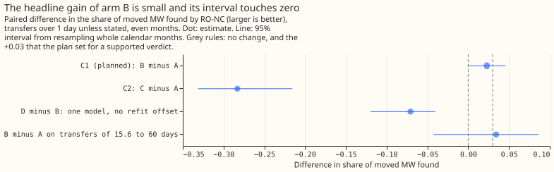
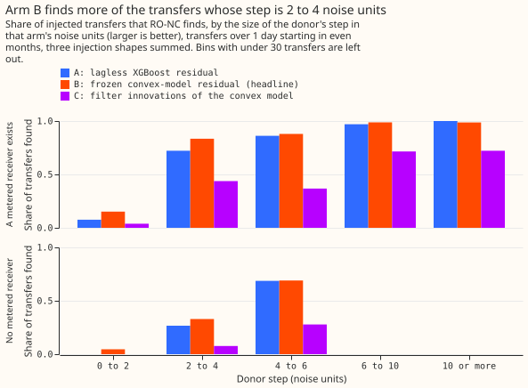
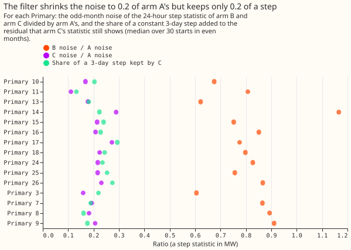

# Experiment 130: does a better demand forecast help the detector find load transfers?

**A better demand forecast lifts the share of moved power that the detector finds only a little,
and the Kalman filter's one-step errors make the detector much worse.** A load transfer is a
switching operation that moves part of one Primary substation's demand onto neighbouring Primary
substations for hours or days. We added synthetic transfers to real power history, and counted the
share of the moved megawatts (MW) that the detector raised an alarm on. Built on the convex
demand model's forecast (arm B), the detector found 0.794 of the moved MW, against 0.772 when
built on the lagless XGBoost model's forecast (arm A). The difference of +0.023 (95% interval
-0.001 to +0.046) is under the +0.03 that the plan set as the bar for a worthwhile gain, and its
interval includes zero, so the verdict is `inconclusive`. On the 35 real transfers lasting over
1 day, arm B found 18 and arm A found 12, a count that flatters arm B because the convex demand
model trained with those real transfers masked. Most of the remaining misses are small steps with
no metered receiving substation, so a stronger signal for those transfers is the next idea to try,
more than a better forecast.

The detector is [experiment 82](../00082-sw2-18-19-combined-refit-offset-and-same-sign-count/result.md)'s
refit-offset neighbour-count detector (RO-NC). It subtracts a forecast from a Primary substation's
measured power, and raises an alarm when the 24-hour average of the difference steps by 4.0 noise
units or more. One noise unit is the usual size of that step in odd-numbered months. We added
synthetic transfers to the real power history of 15 Primaries, and swapped the forecast for the
convex demand model of [experiment
122](../00122-differentiable-physics-three-winter-backtest-gam-k/result.md), with and without the
Kalman filter that experiment added (together called GAM-K). A Kalman filter, as in [Kalman
(1960)](https://doi.org/10.1115/1.3662552), tracks a slowly moving level in the recent errors of a
forecast, and its one-step error is the next reading minus the level it predicted.

## Results

- **Arms.** A: lagless XGBoost residual (experiment 82). B (the headline): residual of the convex
  model, frozen between fits, with the model fitted on the 1st and on the 16th of each month for
  the refit offset. C: one-step innovations of the Kalman filter on that residual, filter re-run on
  each injected power series. D: arm B with one model and no refit offset. Every arm is RO-NC with
  its own noise unit, its own logistic score, and 80 unexplained odd-month alarms.
- **Row set.** The 602 fresh headline-band transfers per injection shape that start in even months
  and do not start at the excluded series (shapes S2, S3, and S4 pooled), and 214 long transfers
  (15.6 to 60 days). The draw is experiment 82's.
- **Sanity.** On all 16 series the lagless arm reproduces experiment 82: RO-NC 0.770, PF14 0.656.
  The harness check reproduces the stored flags of [experiment
  70](../00070-sw2-19-same-sign-neighbour-count/result.md) and [experiment
  71](../00071-sw2-18-refit-offset-and-gap-bridging/result.md) exactly.
- **MW-weighted recall (95% interval).** A 0.772 (0.688 to 0.840); B 0.794 (0.719 to 0.855); C
  0.488 (0.407 to 0.588); D 0.724 (0.644 to 0.770).
- **Planned contrast C1, B minus A:** +0.023 (-0.001 to +0.046); the lower end is not above zero,
  so the rule gives `inconclusive`. By shape, +0.020 (S2), +0.022 (S3), +0.027 (S4).
- **Descriptive contrasts:** C2, C minus A, -0.283 (-0.331 to -0.216); D minus B -0.071 (-0.120 to
  -0.040); B minus A on long transfers +0.034 (-0.043 to +0.086).
- **Donor step 2 to 4 noise units.** With no metered receiver, A finds 147 of 550 and B 181 (C 42).
  With a metered receiver, A finds 109 of 151, B 126, and C 66. Such misses are 0.637 of arm A's
  missed transfers (445 of 699) and 0.623 of arm B's (394 of 632).
- **Real transfers over 1 day (35, descriptive).** RO-NC found 12 (A), 18 (B), and 11 (C). The
  convex demand model trained with the hand-filtered switching events masked. Those events include
  these real transfers, so the count favours arms B and C.
- **Why arm C loses.** Its step statistic has 0.11 to 0.29 of arm A's noise, but a constant 3-day
  step keeps only 0.13 to 0.29 of its size (median 0.22). We predicted arm C within -0.03 to +0.03
  of arm A and it landed far below. Across the 15 series, the median 99.9th percentile of the
  absolute statistic over its scale is 6.0 for arm C against 5.4 for arm A, so tails do not
  explain the gap on medians (arm C's heaviest series reaches 17.8 against 8.4, and arm B's median
  is 8.0 yet it wins). The hypothesis we think most likely is that the filter's level and
  transient follow the step within hours and so absorb the transfer. We did not test it further.

## Pre-run deviations

These were found before any detector was scored. The diagnostic read only residual noise and step
retention, not recall.

- **Headline moved from arm C to arm B.** A plan review asked for a positive control on the filter.
  The control adds a constant 4-noise-unit, 3-day step to the frozen residual and re-runs the
  filter. The filter kept a median 0.22 of the step, and arm B's noise was 0.6 to 1.2 times arm A's
  (median 0.8). Arm B was therefore expected to gain, and arm C stayed as a descriptive arm.
- **15 Primaries, not 16.** One Primary has no usable history for the convex demand model, so
  every arm is scored on the other 15 Primaries.
- **Fitted PV capacity, not pinned.** The real-time capacity vintages exist for only 8 of the 16
  series, so the convex model fits its PV capacity from the training window.
- **Own filter settings.** The four filter settings of each series are fitted on its odd-month
  frozen residual, with the prior of [experiment
  106](../00106-differentiable-physics-4-all-years-drift-and-recent-level/result.md), because the
  settings of [experiment
  111](../00111-differentiable-physics-6-ens-forecast-engine-against-bg2/result.md) cover 6 series.

## Checks

- **Median forecast minus mean forecast, and error beside the quantile score.** Not applicable: the
  experiment scores detector alarms against injected transfers and makes no probabilistic forecast.
- **Trigger 2 (a result contradicts its prediction), fired for arm C.** The positive control and
  the tail check are the tests above. The cause stays an untested hypothesis. Arm C is descriptive
  and carries no verdict, so the audit was not run.
- **Trigger 4 (leaving one site out changes the verdict), fired weakly for C1.** Without donor 3,
  8, or 9 the lower end rises above zero (+0.002, +0.007, and +0.003), which would read as `small
  gain`. Without donor 18 C1 falls to +0.013 (-0.003 to +0.032). The sign never flips, and the
  point value stays between +0.013 and +0.030, so no leave-one-out result reaches the +0.03 bar for
  `supported`. The audit was not run, because the verdict is below the bar either way.
- **Triggers 1, 3, 5, 6, and 7 did not fire.** The sanity arm reproduces experiment 82, and arm D
  is below arm B as expected. C1's 95% interval is 0.047 wide, against the 0.08 that the plan
  expected.

## Caveats

- **Lab conditions.** The convex model uses past weather (ERA5), which arrives about 5 days late, so
  a live service could not build these residuals. The convex model is `not-for-production`
  (experiment 122).
- **Hindsight in training.** The convex demand model leaves out the hand-filtered switching events
  when it trains. The injected-transfer contrast is unaffected, because the injection is added after
  the fit.
- **Code location.** The residual builder and detector scripts live in this experiment's folder.
  Moving them into `packages/` needs a review.

## What the next experiment should answer

**Can a signal other than a better forecast find steps of 2 to 4 noise units with no metered
receiver?** Arm B still finds only 181 of 550 such transfers. One untried route is a signal from
the sum of the neighbouring Primaries' power, or from the electricity network's topology above
them.
