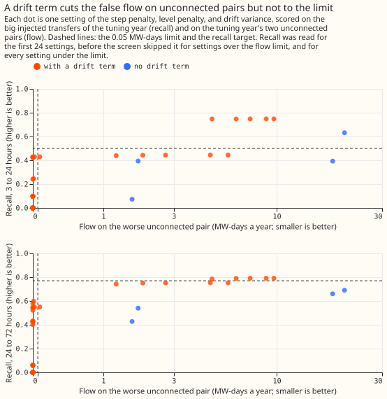
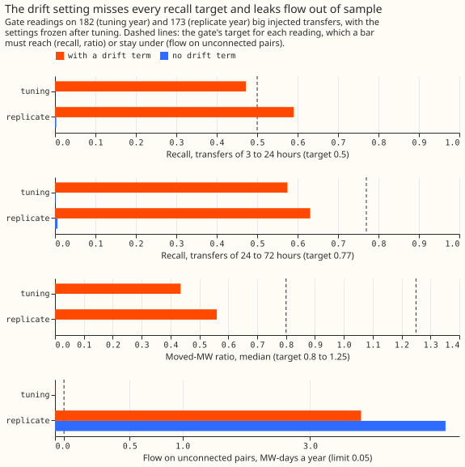
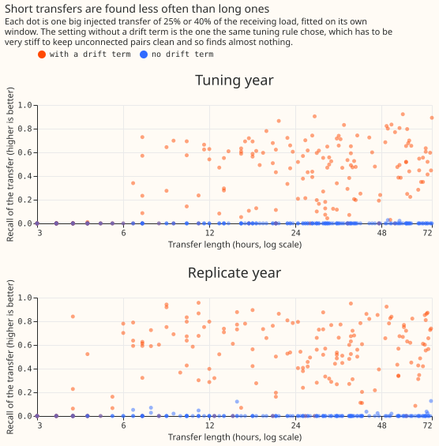
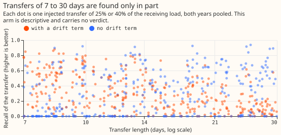
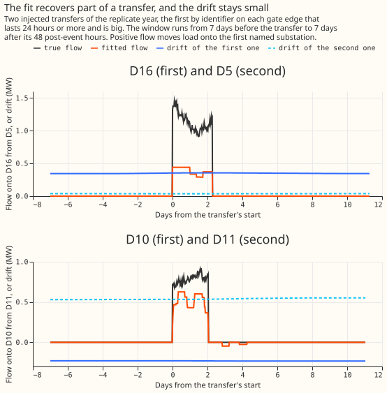

**The drift term halves false flow at equal recall, but the fit still fails the known-answer gate,
so the verdict is `inconclusive`.** At the matched setting (step constant 3, level constant 0.3)
the placebo flow falls from 20.42 MW-days a year without a drift term to between 9.70 and 4.83 with
one, while recall stays near 0.75 for transfers of 3 to 24 hours. No setting of the 96 we screened
met the recall targets and the 0.05 placebo limit together. The setting the tuning year chose finds
0.575 of the injected megawatts of 24 to 72 hours in the tuning year and 0.631 in the replicate
year, against a target of 0.77, and it reports the transfers it does find at 0.64 to 0.72 of their
true size.

**In the replicate year the chosen setting puts 4.27 MW-days on one pair with no interconnection,
and part of that flow sits in two unlabelled jumps.** The pair is D16 and D10. D10 has two jump
windows that carry no label, and 1.58 MW-days of the flow lie inside them. A further 0.41 MW-days lie
within 48 hours of a hand-filtered event, and 3.86 lie away from one. The other replicate placebo
pair, D5 and D11, holds 0.82 MW-days, all away from events. The placebo failure therefore partly
reflects real, unlabelled structure in D10's data, and partly reflects drift that the model leaves
unexplained. Only the replicate year is independent of tuning.

## Question and results

**Question.** With a per-substation drift term, can a flow fit recover injected transfers that last
hours to days without putting flow on pairs of substations that are not connected? The plan
(registered before any fit) is unchanged except for one deviation, below.

**Tuning found no setting that meets both targets.** Of the 96 settings screened, 38 were under the
0.05 MW-days limit on the placebo pairs, and 36 of those had a drift term. The best margin among
them was 0.714, where a margin of 1 would meet both recall targets. The chosen setting is step
constant 3, level constant 1.0, drift variance 0.0016 points squared a day. Its tuning-year recall is
0.429 for 3 to 24 hours and 0.548 for 24 to 72 hours, with 0.0007 MW-days a year on the full-year
placebo.

**The gate fails on all four readings in at least one year.** Big transfers number 182 in the tuning
year and 173 in the replicate year.

| Reading | Needs | Tuning year | Replicate year |
|---|---|---|---|
| Moved-MW ratio | 0.8 to 1.25 | 0.434 (fail) | 0.560 (fail) |
| Recall, 24 to 72 h | at least 0.77 | 0.575 (fail) | 0.631 (fail) |
| Recall, 3 to 24 h | at least 0.5 | 0.472 (fail) | 0.590 (pass) |
| Placebo, MW-days a year | under 0.05 | 0.0007 (pass) | 4.27 (fail) |
| Release share | at least 0.5 | 0.987 on 75 found (pass) | 0.95 on 100 found (pass) |

**The benchmark without a drift term is degenerate.** At its best setting (step constant 100, level
constant 1.0) the fit finds almost nothing (recall 0.002) and puts no flow on the tuning pairs. In the
replicate year it still puts 7.35 MW-days on a placebo pair. The comparison that matters is
therefore the matched-recall one above.

**The level penalty shrinks the transfers that are found.** The median ratio of fitted to true mean
flow over found transfers is 0.644 in the tuning year (75 found) and 0.721 in the replicate year
(100 found). The moved-MW reading fails for that reason, whatever the recall.

**Transfers of 7 to 30 days are partly absorbed, as predicted.** Recall is 0.30 in the tuning year
and 0.36 in the replicate year with the drift term, and 0.36 and 0.47 without it. This arm is
descriptive and carries no verdict.

## Real events

**On real data the fit finds 1 of 16 big labelled transfers, and 6 of its 120 flow runs match a
logged event.** This comparison is descriptive and was fitted after the gate. The whole decision
graph holds 24 labelled transfers on decision edges (10 in the tuning year, 6 in the replicate
year, 8 in the scored year), of which 16 are big and 4 have no known direction. The one big event
found is on D3 and D8, lasts 54.5 hours, and is labelled 2.5 MW against a fitted mean flow of 1.52
MW. Of the 120 fitted flow runs (7 in the tuning year, 55 in the replicate year, 58 in the scored
year), 6 matched a labelled transfer within 24 hours, 2 in each year, so precision is 5%.

## Deviation, checks, and what follows

**Deviation: 36 extra settings, recorded before any gate reading.** The registered grid of 60
settings straddled the target: level constant 0.3 gave recall but not the placebo, and level constant
1.0 gave the placebo but poor recall. With the manager's approval we added 36 intermediate settings on
the tuning year only, before any gate read, keeping the 0.05 limit unchanged. The screen also reads
the placebo first and skips the recall reading whenever the placebo is at least 0.05, to save compute.

**Step 6 was skipped.** The plan allowed a cheap list of the transfers that experiment 130's refit-offset
neighbour-count detector misses, with this fit's recall on them. Experiment 130 injected a different
draw on other edges, so a subset comparison was not cheap, and the page reports none.

- **Checks.** No forecast contrast ran, because the gate failed, so the median-minus-mean forecast
  check per site does not apply. The thresholds, seeds, and chosen settings were written before
  the gate was read. The module change passed its 56 tests, and the numbers on this page come from
  `report.txt`.
- **Audit triggers.** Trigger 1 fired: the placebo control failed in the replicate year. The manager
  agreed that no Opus audit is needed, because the placebo failure is the finding and the post hoc
  diagnostic above tests an explanation for it. Triggers 3 and 4 do not apply, because no forecast
  contrast ran. The prediction put the chance of all four readings passing at about one in three, so
  the failure does not contradict it.
- **Scope.** Windows around injected transfers are shorter than the 72-day placebo tiles, and a
  year-long fit may behave differently from either.

**What the next experiment should answer.** The drift term reduces false flow but does not close
the gap, and the level penalty shrinks the flows that survive. A candidate next step is a topology
check on candidate flows, or a smaller level penalty combined with a check for unlabelled jumps in
the placebo pairs. This page does not commit the project to either.
