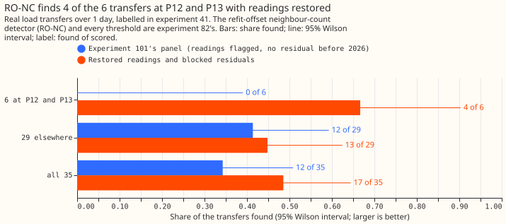
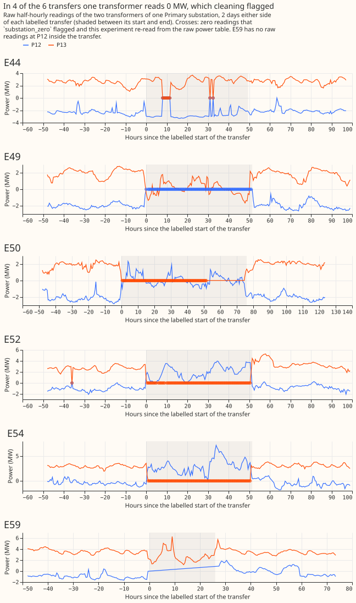
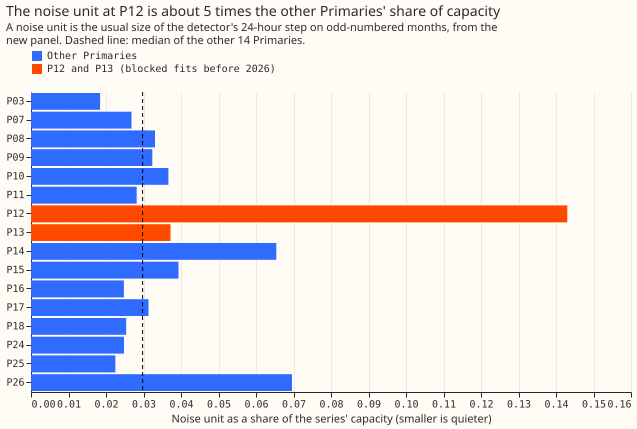

# Experiment 132: does RO-NC find the real transfers at P12 and P13 with their readings restored?

**The refit-offset neighbour-count detector (RO-NC) missed the 6 real transfers at P12 and P13
because the cleaning step had flagged and removed the readings that show them, and with those
readings restored it finds 4 of the 6.** A load transfer is a switching operation that moves load
from one substation or transformer to another. P12 and P13 are the two transformers of one Primary
substation, and the 6 transfers last more than 1 day. In 4 of the 6, one transformer reads exactly 0
MW for nearly the whole transfer, and in a fifth (E44) for 10 half-hours. The cleaning rule
`substation_zero` flags a reading of exactly 0 at a Primary substation as a telemetry fault. We
re-read the 426 flagged half-hours from the raw power table. We also fitted an XGBoost forecasting
model to each series and took its errors (the residual, observed minus predicted power, in MW)
over 2025, each error from a model that never saw the block of time it scores. Experiment 17's
residuals start only in 2026, because its XGBoost model needs a year of history. We then rescored
RO-NC with the alarm thresholds and logistic-regression alarm scores that
[experiment 82](../00082-sw2-18-19-combined-refit-offset-and-same-sign-count/result.md) saved.
[Experiment 101](../00101-ro-nc-detector-on-real-hand-filtered-switching-events/result.md), which
scored RO-NC against the labelled real transfers, found 12 of the 35 that last more than 1 day. With
the readings restored, RO-NC finds 17 of the 35 (a fraction of 0.49; 95% Wilson interval 0.33 to
0.64). The 35 are the transfers over 1 day among the 66 labelled in experiment 41, and 6 of the 35
are at P12 and P13.

## Results

- **At P12 and P13:** 4 of the 6 transfers are found (E49, E50, E52, and E54), against 0 of 6 (0.67;
  0.30 to 0.90). The steps of those 4 transfers are 10.4 to 17.1 noise units. A noise unit is the
  usual size of the detector's 24-hour step on odd-numbered months, and a step is the largest
  24-hour change in the residual within 2 hours of the labelled start. The 2 transfers not found
  are E44, where only 10 of the 99 half-hours read 0, and E59, where P12 has no raw readings inside
  the transfer. Their steps are 0.6 and 0.9 noise units.
- **Elsewhere:** 13 of the other 29 transfers are found (0.45; 0.28 to 0.62), against 12 before the
  restoration. The extra transfer found is E55 at P13 and P14, whose step rises from 1.9 to 11.4
  noise units now that P13 has readings. No transfer found before is lost.
- **MW-weighted recall on the 35:** 0.631 (0.433 to 0.787), against 0.357 (0.169 to 0.554).
- **Injected transfers:** these are synthetic transfers that experiment 82 added to the real power
  readings. The panel without the P12 and P13 residuals reproduces experiment 82's 31,200 stored
  rows exactly. On the panel with them, RO-NC's MW-weighted recall on the headline band of
  experiment 82 is 0.772 (0.669 to 0.858), against 0.770. Injected transfers that touch P12 or P13
  are found 0.196 of the time, MW-weighted 0.767 (0.645 to 0.869), over 56 transfers and 3 shapes.
- **Restored half-hours:** 426, all exactly 0 MW, none invented: E44 10 at each series, E49 102 at
  P12, E50 103 at P13, E52 1 at P12 and 100 at P13, and E54 100 at P13. E50 at P13 has 43
  half-hours absent from the raw power table, and none are restored.
- **The guess:** the pre-registered guess of 3 to 5 found was right on the count, and the step
  sizes were not the guessed ones: 4 transfers have steps over 10 noise units and 2 under 1.
- **Variants:** blocked fits with equal sample weights, and fits with the 6 transfer windows masked
  from the training rows, give the same 17 found and the same outcome on every transfer.

## Checks

- **No leakage:** every blocked fit has 0 training rows inside its held-out block or the 7-day
  purge, for all 3 variants and both residuals. `e00132_report.py` also lists the held-out block of
  each transfer.
- **Noise:** the noise unit at P12 is 0.431 MW, 0.143 of capacity, against a median of 0.030 over
  the other 14 Primary substations (4.8 times). The noise unit at P13 is 0.037 of capacity (1.2
  times). The 4 transfers found have steps over 10 noise units, so the larger noise unit at P12 does
  not decide them.
- **Alarm rate:** at the stored thresholds, the unexplained alarms (alarms matching no labelled
  transfer and no logged closure) on odd-numbered months rise from 80 to 95 for PF14 (the
  single-series detector), from 75 to 88 for X (the refit-offset detector), from 80 to 87 for
  LOGIT_SAME (the same-sign neighbour count), and from 80 to 87 for RO-NC. The thresholds were not
  re-tuned, so the comparison with experiment 101 is not at a matched alarm rate. No sweep of the
  threshold was run.
- **Audit triggers:** none fires. The control, experiment 82's injected rows on the panel without
  the P12 and P13 residuals, reproduces exactly.

## Caveats

- **Six transfers, descriptive only.** Five of the 6 have readings at both transformers, and the
  load moves between the two transformers of one Primary substation, unlike the injected transfers,
  which move load between Primary substations. E59 has no readings at P12 inside the transfer.
- **The expected count does not separate the two rules.** The pre-registered rule, injected recall
  at each transfer's step band and metering, gives 0.8 expected of the 6. The injected draw holds
  no transfer of 10 noise units or more without a metered receiver, so the rule fell back to a cell
  holding 4 injected outcomes. Using the metered cell (injected recall 0.949) gives 3.8 expected of
  the 4 transfers with steps over 10 noise units. The 4 found match the second figure.
- **The residuals use data from after each transfer.** The held-out fits are out of sample, but they
  train on rows from after each transfer, and have at most 17 months of history.
- **The injected draw changed.** More series have power readings, so the random sample of injected
  transfers accepts different transfers. RO-NC's recall on the long injected transfers (shape S1,
  even-numbered months) is 0.449, against 0.519.

## What the next experiment could test

A next experiment could re-tune the thresholds on the new panel and check that the 4 found
transfers survive. Whether RO-NC can find the 2 transfers with steps under 1 noise unit depends on
how the detector is built, not on which readings are restored.

Code: `ml-experiments/00132-ro-nc-rescored-with-p12-and-p13-residuals-in-2025/`; every number
above is printed by `e00132_restore.py`, `e00132_report.py`, and `e00132_inj_report.py`.
