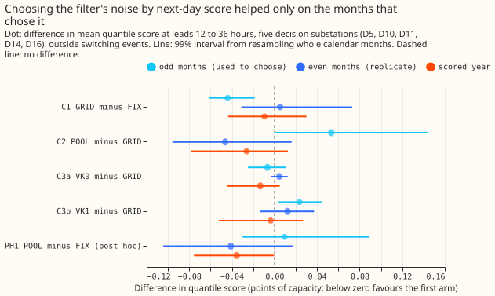
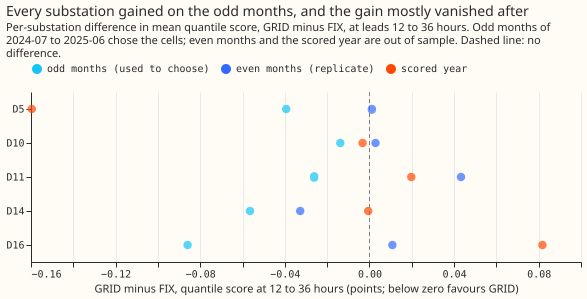
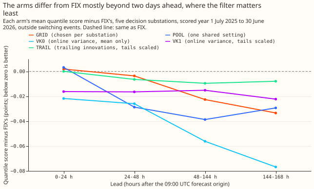
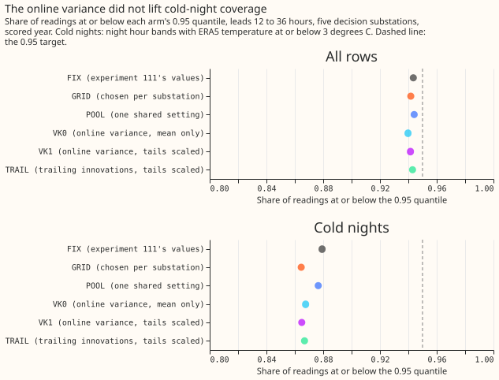
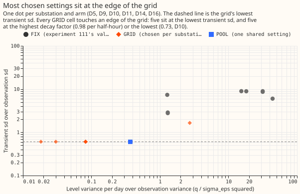

# Experiment 133: do learned noise settings beat the fixed ones in GAM-K's filter?

**Choosing the filter's noise settings for each substation by next-day score did not improve the
forecast on later months.**
The gain was 0.044 points on the months that chose the settings and 0.009 points (99% interval
-0.044 to +0.030) on the scored year. A single setting shared by every substation did as well, and
letting the observation variance follow recent errors did not widen the 0.95 quantile where it
fell short, on cold nights. The verdict is `inconclusive`. The scored-year gain is too small to
justify building either change, and the grid did not find a minimum, so this experiment cannot say
whether a wider search would.

We asked whether the Kalman filter of the convex demand model with the filter (GAM-K, [experiment
111](../00111-differentiable-physics-6-ens-forecast-engine-against-bg2/result.md)) forecasts the
next day better when its noise settings are chosen by next-day score instead of by likelihood. The
filter tracks, in each of 4 bands of hours of the day, a slowly moving level and a quickly decaying
transient of the convex model's error. [Experiment
118](../00118-differentiable-physics-kfe-kalman-filter-on-the-gam-effects-on-ens/result.md) and
experiment 128 found that the likelihood of such settings scatters about 10 times between fits, so
we ran the filter on a grid of 1,323 settings per substation on a graphics processing unit (GPU),
ranked the cells by next-day error on the odd months of 2024-07 to 2025-06, re-scored the best 20
with the full ensemble forecast, and judged the winner on the even months and on the scored year. We
also tried the scalar variant of VIKING (variance-inferring Kalman filter; [de Vilmarest and
Wintenberger (2022)](https://arxiv.org/abs/2104.10777)), which tracks the observation variance
online, and used it to scale the spread of the forecast. The design is in [Plan](#plan) below.

## Results

- **Arms.** FIX: experiment 111's stored settings. GRID: the cell chosen per substation. POOL: one
  cell shared by all substations. VK0: GRID's cell with the online observation variance, mean
  correction only. VK1: VK0 with each row's spread scaled by the online variance. TRAIL: GRID's
  cell with the spread scaled by the trailing 7-day root mean square of the filter's one-step
  errors. Every arm reads experiment 111's stored monthly fits, calibration, and solar shrink, and
  refits its own spread on the odd months, so only the filter and the spread differ.
- **Row set and period.** `fold_a_daily_gap_v1`'s 292 scored runs (2025-07-01 to 2026-06-30) at
  D5, D10, D11, D14, and D16, with D9 scored beside them; the even months of 2024-07 to 2025-06 are
  the replicate; rows outside the hand-filtered switching events. The convex model refits monthly
  (experiment 111's stored fits), so the contrasts between filter settings do not depend on the
  refit schedule.
- **Absolute scores, 12 to 36 hours, scored year** (mean quantile score, points of effective
  capacity): FIX 2.498, GRID 2.488, POOL 2.462, VK0 2.475, VK1 2.485, TRAIL 2.486. Over all leads
  (0.5 to 168 hours): FIX 2.800 (it reproduces experiment 111's GAM-K), GRID 2.783, POOL 2.771, VK0
  2.751, VK1 2.784, TRAIL 2.793. Replicate months, 12 to 36 hours: FIX 2.393, GRID 2.398, POOL
  2.352, VK0 2.403, VK1 2.410, TRAIL 2.394.
- **C1, GRID minus FIX (headline), 12 to 36 hours.** Scored year -0.009 (99% interval -0.044 to
  +0.030; 3 of 5 substations better, 8 of 12 months negative). Replicate +0.005 (-0.031 to
  +0.073). Odd months -0.044 (-0.062 to -0.019; 5 of 5 substations better). The prediction was
  -0.02 to -0.08 with a replicate gain of at most 60% of the odd-month gain, so the prediction
  failed on the replicate. Verdict by the decision rule: `inconclusive`, because the gain lives on
  the months that chose the cells.
- **C2, POOL minus GRID.** Scored year -0.026 (-0.078 to +0.013), replicate -0.046 (-0.096 to
  +0.016), odd months +0.053 (+0.0004 to +0.144; POOL is worse on the months that chose GRID, as it
  must be). The interval is wider than the +/-0.03 equivalence band, so the contrast is undecided,
  with the sign favouring POOL out of sample.
- **C3a, VK0 minus GRID.** Scored year -0.013 (-0.045 to +0.005), replicate +0.005 (-0.003 to
  +0.012); not under the -0.03 bar. **C3b, VK1 minus GRID.** Scored year -0.004 (-0.052 to +0.027),
  replicate +0.012 (-0.014 to +0.037). Over all leads, C3a is -0.032 (-0.104 to -0.004) in the
  scored year and -0.007 (-0.014 to +0.000) in the replicate, a descriptive result, because the
  settings were not tuned for all-lead score. C3b over all leads is +0.001 (-0.101 to +0.051) and
  +0.029 (+0.012 to +0.044).
- **Cold-night coverage of the 0.95 quantile, 12 to 36 hours, scored year:** FIX 0.879, GRID 0.864,
  POOL 0.877, VK0 0.868, VK1 0.865, TRAIL 0.867, against 0.95 and against all rows at 0.940 to
  0.944. The change against GRID is +0.003 (-0.003 to +0.011) for VK0 and +0.000 (-0.013 to
  +0.015) for VK1, so the predicted rise of 3 to 8 points is excluded.
- **Mechanism.** The log correlation of the tail statistic at the cutoff with the next day's
  absolute error is 0.29 (online variance) and 0.30 (trailing innovations) over all rows, and -0.03
  and +0.06 on cold nights. Recent residual size predicts error on average and not on the nights
  that matter.
- **Tails, 12 to 36 hours, scored year** (coverage; pinball loss): the 0.01 quantile covers 0.016
  to 0.020 and the 0.99 quantile 0.982 to 0.984 for every arm, and the pinball loss at the 0.95
  and 0.99 quantiles is 0.633 to 0.646 and 0.195 to 0.204. POOL has the lowest pinball loss at the
  0.05 quantile (0.620) and ties TRAIL at the 0.01 quantile (0.178).
- **Breakouts, descriptive, 12 to 36 hours, scored year** (mean quantile score for FIX, GRID, POOL):
  winter 2.550, 2.539, 2.497; winter nights 2.112, 2.055, 2.025; cold nights 2.351, 2.304, 2.279;
  holidays and Christmas 2.889, 2.846, 2.778. POOL has the lowest score in each.
- **Post hoc PH1, POOL minus FIX** (added after the scored year was read; no verdict). 12 to 36
  hours: scored year -0.036 (99% interval -0.076 to -0.0003; 4 of 5 substations better, 9 of 12
  months negative); replicate -0.041 (-0.104 to +0.017; 5 of 5 substations better). All leads,
  scored year: -0.030 (-0.070 to +0.010).
- **Fitted values.** Every GRID cell touches an edge of the grid (figure 5): five of six sit at
  the lowest transient standard deviation of the grid (0.61 times the observation standard
  deviation), five at the highest decay factor (0.98 per half-hour), and D10 at the lowest (0.73).
  POOL is one cell at both edges (level variance 0.37 times the observation variance per day,
  transient standard deviation 0.61, decay factor 0.98). FIX's values are 1.3 to 44 and 2.8 to
  9.0 for the same two ratios. The grid did not find a minimum, so a wider grid could change C1.
- **Selection.** The Spearman correlation between the proxy-error ranking of the 20 best cells and
  their ensemble quantile-score ranking was 0.70 to 0.94 across substations, so the cheap ranking
  does track the target score. The online variance's random-walk variance went to the edge of its
  grid (e^-5 per half-hour), with mean tuning scores of 2.2939, 2.2928, and 2.2928 for the three
  values, so the random-walk variance barely mattered.

## Checks

- **Median minus mean forecast, GRID, 12 to 36 hours (points of capacity):** D5 -0.117, D9 -0.041,
  D11 -0.018, D14 +0.011, D16 +0.008, D10 -0.007. FIX's D5 is -0.097; no arm's spread shifts the
  forecast by more than 0.12 points.
- **Error of the mean forecast beside each contrast, 12 to 36 hours, scored year** (99% intervals):
  C1 -0.013 (-0.070 to +0.053), C2 -0.049 (-0.136 to +0.021), C3a -0.019 (-0.051 to +0.002), C3b
  -0.019 (-0.051 to +0.002). Each has the sign of its quantile-score contrast, so the audit trigger
  for a disagreement between mean and quantile scores did not fire.
- **Controls.** The reproduction control passed: FIX's scored median forecast matches experiment
  111's stored GAM-K rows with a maximum absolute difference of 0 at every substation. The selection
  control passed: on simulated streams the cell chosen on odd-month cases scored 1.0031 times the
  true setting's error on even-month cases for the filter's own model, and 0.9997 times for a model
  with a seasonal wobble added.
- **Tracking gate (not informative).** The pre-registered pass rate is 100% for every arm on real
  residuals and on AR(1) noise at three injected sizes (half, 0.2, and 0.1 of the residual standard
  deviation as the peak; the last two are post hoc), because the filter is linear and the shifted
  and unshifted streams share one noise realisation, so every draw gives the same answer. The
  tracking ratio (filtered midday gain over the injected midday shift) is 0.97 for FIX, 1.13 for
  GRID, 1.06 for POOL, and 1.21 for VK0 on real residuals (first-order autoregressive noise, AR(1):
  0.98, 1.14, 1.07, 1.24), so none of the chosen settings loses a slow change. The figures of 0.22
  (real) and 0.80 (AR(1)) from experiment 128 are for a refitted filter and are not comparable. This
  experiment makes no claim about identifying any weight.
- **Audit triggers.** Audit trigger 2 (a result against its own prediction) fired for C1, and the
  explanation, that choosing among the 20 best of 1,323 cells on a flat surface overfits the chosen
  months, is recorded but not tested here. Audit trigger 4 (one substation drives the contrast)
  fired: leaving D5 out turns C1 from -0.009 to +0.024, because D5's scored gain is -0.160. Audit
  trigger 7 (a later experiment builds on the result) may apply, because experiment 135 takes GRID's
  values as a baseline. No second-model audit has been run.
- **Not run.** The curtailment-cost saving against the manual heuristic, because it needs a node's
  forecast and its generators' forecasts.

## What to try next

- A wider grid, and a smoothed or blocked choice of the cell, to see whether the odd-month gain
  of 0.044 survives when the cells are not at the grid's edge.
- One filter setting shared by every substation, as the default for GAM-K, tested on its own
  with the same planned contrast against FIX (PH1 here is post hoc, and its interval barely
  excludes zero).
- A spread that responds to cold weather directly (the temperature itself), because the size of
  recent errors did not predict cold-night error.

## Plan

The plan, as committed before any fit and triaged after one plan review, is in the git history
of this file (the commit "Experiment 133 plan"). The changes made after the review were: `sigma_eps`
held at 1 for the grid arms because the correction depends only on ratios; a two-step choice of
cell; VK0 and VK1 as separate arms; a trailing-innovation arm (TRAIL); decision rules for every
contrast; and the gate made larger. Pre-run clarifications made before the first fit: POOL is one
shared cell in ratio units (the filter is scale-free, so "scaled per substation" adds nothing) and
is chosen on the step-1 error alone; the gate's injected shift peaks at half of each substation's
residual standard deviation, because the stored fits do not expose the PV effect in points.
