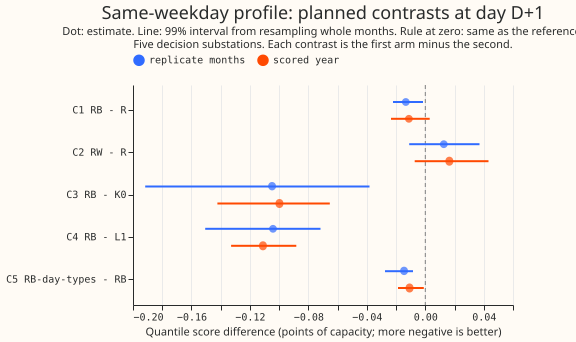
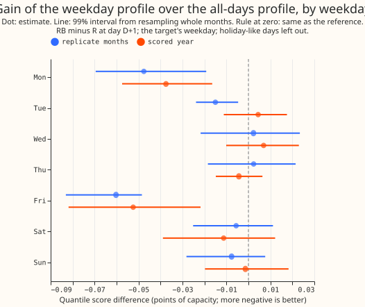
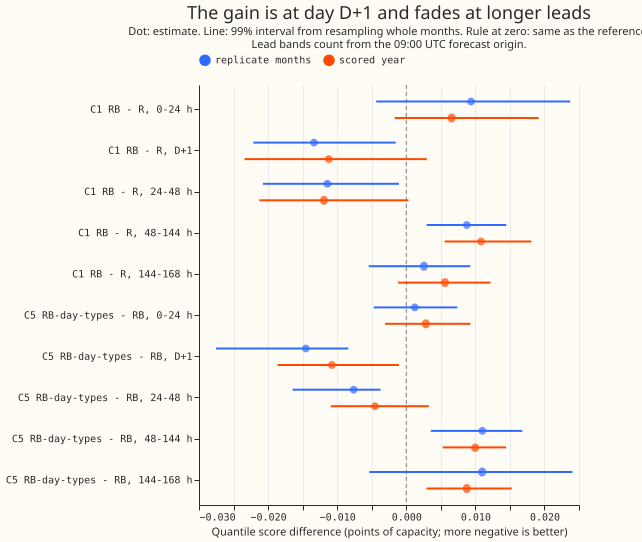
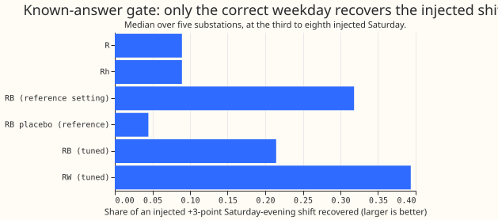

**Take-home: using the same weekday's recent errors, instead of the last 14 days' errors alike,
lowers the day-ahead quantile score by only about 0.011 points (0.5% of 2.44), so it is not worth
adding to recipe R.** Recipe R is the baseline correction: it subtracts 0.75 times the mean of the
last 14 days' errors by half-hour from GAM-K's forecast. One point is 1% of a substation's
capacity, and lower scores are better. The gain is below the 0.02-point threshold set in the plan
before any fit, and the scored-year interval includes zero. The gain sits on Mondays and Fridays
and is absent from Tuesday to Thursday. A variant that groups days into five day types did better
(0.022 points against recipe R, exploratory) and is the version worth testing next, limited to day
D+1. The verdict is `not supported`.

## What was asked, and the answer in plain terms

**The question was whether the correction to the day-ahead forecast should look at the same weekday
as the day being forecast.** The forecast is the electricity demand of five Primary substations
(the stations that step power down from 33 kV to 11 kV) for the day after the 09:00 UTC forecast
origin, from the physics-based demand model with a Kalman filter on ECMWF ensemble weather (GAM-K,
arm K0; [experiment 111](../00111-differentiable-physics-6-ens-forecast-engine-against-bg2/result.md)).
[Experiment 115](../00115-differentiable-physics-w1-diurnal-shape-state-on-ens/result.md) found that
subtracting 0.75 times the mean of the last 14 days' errors by half-hour (recipe R) lowers the
day-ahead score by 0.09 points. We kept R and added a shrunk same-weekday profile to it.

**Answer.** The shrunk weekday profile (arm RB) scored 2.424 points against 2.436 for R in the
scored year. Scores are in points of effective capacity (1 point is 1% of a substation's capacity),
lower is better, and rows inside the hand-filtered switching events are left out. The settings were
chosen on the odd months of July 2024 to June 2025 (tuning months); the even months are the
replicate months, and the scored year is 2 July 2025 to 29 June 2026 (292 runs).

## Figures

## Results

- **Arms.** K0 (GAM-K); R (recipe R, agreeing with experiment 115's stored correction to 9e-16
  points); Rh (R with the holiday rule, kappa 0.75); L1 (last week's same-weekday error, kappa 0.5);
  RW (mean same-weekday error of the last 3 weeks, kappa 0.5); RB (kappa, the correction weight,
  0.75; lambda, the weekday share, 0.25; n, the number of weeks, 3); RB-day-types (kappa 0.75,
  lambda 0.5, n 4 weeks). Settings are fleet-wide and were chosen by the tuning rows' D+1 mean
  absolute error of the median. No demand model was refitted (experiment 111's monthly refits are
  reused).
- **Rows and compute.** 66,844 D+1 rows in the scored year and 41,126 in the replicate months at
  the five decision substations (D5, D10, D11, D14, D16), with D9 beside them. Fits take seconds;
  the tuning, gate, and frame builds took about 20 minutes on 3 cores.
- **Absolute scores, scored year, D+1 (all leads).** K0 2.524 (2.812), R 2.436 (2.744), Rh 2.440
  (2.745), L1 2.535 (2.879), RW 2.452 (2.803), RB 2.424 (2.750), RB-day-types 2.414 (2.756). D9
  beside them: K0 2.194, R 2.123, RB 2.127.
- **C1 RB minus R (decides the verdict, 99%).** Scored year -0.0112 (-0.0234 to +0.0030), 3 of 5
  substations; replicate months -0.0134 (-0.0221 to -0.0015), 3 of 5. Excluding holiday-like days
  the scored year is -0.0135 (-0.0243 to -0.0034). Over all leads the C1 estimate is +0.0062
  (+0.0016 to +0.0138), 0 of 5 substations: the score is worse beyond day D+1 (48 to 144 hours:
  +0.0108).
- **C2 RW minus R.** +0.0165 (-0.0073 to +0.0432) scored; +0.0126 (-0.0110 to +0.0371) replicate: a
  pure same-weekday profile is noisier than the all-days one, as predicted.
- **C3 RB minus K0.** -0.0998 (-0.1423 to -0.0654), 5 of 5; replicate -0.1049. **C4 RB minus L1.**
  -0.1111 (-0.1328 to -0.0883), 5 of 5; one week of same-weekday errors alone is no better than K0
  (L1 minus K0 +0.011).
- **C5 RB-day-types minus RB.** -0.0108 (-0.0186 to -0.0010), 4 of 5; replicate -0.0145 (-0.0275
  to -0.0084), 5 of 5. Against R (exploratory, 95%): -0.0220 (-0.0364 to -0.0065) scored and
  -0.0279 (-0.0414 to -0.0161) replicate.
- **C6 RB minus Rh (diagnostic, 95%).** -0.0153 (-0.0225 to -0.0086), 5 of 5 substations: with the
  holiday rule held fixed, RB scores 0.015 points better than Rh. Rh minus R is +0.0041 (-0.0001 to
  +0.0116): the holiday rule alone raises the score by 0.004 points, mostly in the Christmas
  window (C1 there:
  +0.0726, +0.0285 to +0.0842, 0 of 4 substations).
- **Weekdays (scored year, C1).** Monday -0.0375 (-0.0575 to -0.0165), 4 of 5; Friday -0.0525
  (-0.0819 to -0.0218), 5 of 5; Tuesday +0.0044, Wednesday +0.0069, Thursday -0.0043, Saturday
  -0.0113, Sunday -0.0014, all with intervals that include zero. The replicate months show the same
  pattern, with Tuesday also negative (-0.0150).
- **Winter (scored year, C1).** November to March -0.0115 (-0.0364 to +0.0271), 3 of 5; winter
  evening 16:00 to 20:00 -0.0488 (-0.0654 to -0.0333), 5 of 5; non-winter -0.0110 (-0.0185 to
  -0.0013). Cold-snap days (daily mean under 3 degrees C): +0.0036 (-0.1191 to +0.1565) with 2400
  rows, too few to read. Easter has one set of 720 rows.
- **COPY7.** On the 7-days-ago subset, scored year, COPY7 scored 7.067 at D+1 against 2.521 for K0
  and 2.421 for RB; copying last week is much worse, as predicted.
- **Tails (scored year, D+1; coverage gap in points, pinball).** RB: q01 +1.41 (0.1883), q05 +1.81
  (0.6087), q95 -1.02 (0.6554), q99 -1.12 (0.2115); R: +1.39, +1.76, -1.01, -1.16 with pinball
  0.1875, 0.6138, 0.6573, 0.2124. The tails barely move.
- **Predictions.** Held: C1 within -0.01 to -0.04 (at its upper edge); RW minus R within 0.00 to
  +0.05; COPY7 worse than K0; best lambda 0.25 (inside 0.25 to 0.75). Failed: RB-day-types was
  expected within 0.01 of RB and was 0.011 better.

## Gate

**The known-answer gate passed, and it was run on the tuning months before any replicate or scored
forecast was read.** A +3-point shift on Saturdays 17:00 to 21:00 for 8 weeks (2 November to 21
December 2024) was recovered at the third to eighth Saturday as follows (median of five
substations, share of the shift): R 0.089, Rh 0.089, RB at the reference setting 0.318 (at least
0.15 and more than twice R), RB tuned 0.215, RW 0.394, and the placebo (weekday labels shifted by 3
days) 0.045 at the reference and 0.067 tuned (at most R plus 0.05). On the tuning rows, the
placebo's mean absolute error at D+1 (4.217) is above Rh's (4.130) and RB's at the reference
(4.098), so the placebo's error does not improve: the benefit needs the correct weekday.

## Checks

- **Median forecast minus mean forecast per site (scored year, D+1, points).** K0: D10 +0.003, D11
  -0.022, D14 +0.014, D16 -0.014, D5 -0.097. R: +0.009, -0.019, +0.002, -0.015, -0.037. RB: -0.003,
  -0.010, -0.012, -0.002, -0.039. No shift over 0.04 except D5 for K0.
- **Mean absolute error of the median and of the mean forecast beside each contrast (scored year,
  D+1).** C1: median -0.0183, mean -0.0183;
  C2 +0.0436 and +0.0439; C3 -0.1955 and -0.1977; C4 -0.2133 and -0.2112; C5 -0.0172 and -0.0183.
  The quantile score and both errors point the same way.
- **Triggers.** None fired. The gate passed; the results agree with the predictions except C5's
  size; the quantile score and the errors agree; leaving out one substation never flips C1's sign
  (-0.0053 to -0.0161 scored; the interval includes zero in four of five leave-one-outs, as in the
  full set); no nested arm beats its container (RB beats Rh and RW, which it contains); the
  closest sister interval, experiment 115's KW minus R, is a different contrast; no later
  experiment depends on this result. No audit was run.

## Caveats

- Five substations and one independent winter. Settings were chosen on the tuning months with the
  mean absolute error of the median, not the quantile score, and R's kappa was not re-tuned.
- The shift applies at every lead as recipe R does, so the weekday of the target is only right at
  day D+1 (leads 15.5 to 39 hours); this is the likeliest reason for the loss beyond 48 hours.
- Weekday labels use UTC days of the valid time while the profile uses local half-hours. The
  gate's Saturday is the UTC day. The 3.5-hour telemetry delay is assumed, as in experiment 115.
- RB-day-types was not pre-registered as the best arm; its advantage over R is exploratory.

## What to try next

- **Test day-type profiles at day D+1 only,** with lead-aware weights, tuned on the quantile
  score, and replicated on the even months.
- **Test a Monday and Friday weekend-edge term** on its own, since all of the gain sits there.

Every number above is printed by `ml-experiments/00134-*/e00134_report.py`; its output is
[`report.txt`](report.txt).

## Plan, committed before any fit

**This experiment asks whether the forecast's recent-error correction should look at the same
weekday as the day being forecast, rather than at the last 14 days alike.** It reuses experiment
111's stored GAM-K forecasts and experiment 115's K0 and recipe R, and refits no demand model. It
follows [experiment 115](../00115-differentiable-physics-w1-diurnal-shape-state-on-ens/result.md),
whose recipe R is a plain average of the last 14 days' errors by half-hour. None of experiments 111
to 115 tested a weekday-specific version. Shrinking a weekday profile towards an all-days profile
is a partial-pooling step of the kind described by [Gelman and Hill
(2006)](https://doi.org/10.1017/CBO9780511790942). The naive baseline of repeating the value from
seven days ago is a seasonal-naive forecast, as defined by [Hyndman and Athanasopoulos
(2021)](https://otexts.com/fpp3/simple-methods.html).

## Arms

- **K0.** GAM-K as stored (control).
- **R.** Recipe R reproduced exactly as experiment 115 stored it: K0 minus kappa times the mean of
  the last 14 UTC days' D+1 errors by local half-hour, each day's mean removed, kappa 0.75, no
  holiday rule.
- **Rh.** R with the holiday rule below, kappa re-chosen on the tuning months. It separates the
  effect of the holiday rule from the effect of the weekday.
- **COPY7.** The actual power at the same half-hour 7 days earlier as a point forecast (all 11
  quantiles equal), reported beside the arms and never corrected, on its own subset: the rows where
  that reading exists, with K0 and RB rescored on the same subset.
- **L1.** K0 minus kappa times last week's same-weekday D+1 error profile (one sample).
- **RW.** K0 minus kappa times the mean same-weekday error over the last n weeks; n from 2, 3, 4.
- **RB (lead arm).** Profile = A + lambda (W - A), where A is Rh's 14-day all-days profile, W is
  the n-week same-weekday profile, and lambda lies in 0 to 1. Where W has no usable day, W is A.
- **RB-day-types.** As RB, with W built from days of the same day type: Monday, Tuesday to
  Thursday, Friday, Saturday, Sunday.

**No lookahead.** At the 09:00 UTC origin on day D the target is D+1. Each source day is a UTC day
fully observed by D 00:00 UTC, so the same weekday of the target last counts on day D-6. A day
enters a profile when at least 40 of its 48 half-hours have a reading, as in experiment 115.

**Holiday rule (Rh, RW, L1, RB, RB-day-types).** A holiday-like day is an English bank holiday,
Easter Saturday or Sunday, or 24 or 27 to 31 December. Holiday-like days are left out of every
profile as source days, and a holiday-like target gets no correction. Holiday-like targets are
scored separately.

### Settings and how they are chosen

- **Grids.** kappa from 0.5, 0.75, 1.0; lambda from 0, 0.25, 0.5, 0.75, 1; n from 2, 3, 4.
- **Rule.** Fleet-wide settings (one set for all five decision substations), because each
  substation has about 3,000 tuning-month D+1 rows and the weekday profiles use 2 to 4 samples; a
  per-substation choice would mostly fit noise. The setting with the lowest mean absolute error of
  the corrected median at D+1 on the tuning rows, in points of effective capacity, pooled with equal
  weight per row over the five decision substations, wins. Holiday-like targets stay in the tuning
  rows (they carry zero correction in every arm). Weeks `n` is chosen separately for RW and RB, and
  the full kappa-by-lambda-by-n grid is reported.
  Each arm's spread is then refitted on the tuning rows and its factors chosen per lead band, as
  for every arm of experiment 115.
- **Sensible limits.** If lambda = 0 wins, RB equals Rh and the verdict says so.

### Known-answer gate (reported before any score)

**On real tuning-month residuals, add +3 points to the readings of Saturdays 17:00 to 21:00 local
for 8 consecutive Saturdays (2 November to 21 December 2024), run every arm's full profile code on
the changed readings, and measure the share of the shift each correction recovers at the third to
eighth Saturday.** The Saturday is the UTC day of the valid time, and the half-hours are local. The
injection goes through the same 40-of-48 reading filter, holiday rule, and fallback as the real
scoring, so the gate can fail for a real reason. The share is linear in the weights: with kappa 0.75,
R recovers about 0.75 x 2/14 = 0.11, and RB at lambda 0.5 and n 4 recovers about 0.19.

- **Settings.** The gate runs at the tuned settings and at a fixed reference (kappa 0.75, lambda 0.5,
  n 4), so the result does not depend on where tuning lands.
- **Pass conditions, at the reference.** RB recovers at least 0.15 of the shift and at least twice
  what R recovers; the placebo (the profile reads the weekday that falls 3 days after the target's;
  same settings, not re-tuned, because the placebo only has to show the gain needs the right
  weekday) recovers at most what R recovers plus 0.05; and on the tuning months the placebo's mean
  absolute error at D+1 lies less than halfway from Rh's to RB's.
- **Tuned settings.** Reported beside the reference. If lambda 0 scores best in tuning, RB equals Rh
  and the verdict says so.
- A failed condition caps the verdict at `inconclusive`. The gate runs before any replicate or
  scored forecast is read.

### Predictions

- C1 (RB minus R) is -0.01 to -0.04 points at D+1; C2 (RW minus R) is 0.00 to +0.05, because 2 to 4
  samples per weekday are noisy; COPY7 is worse than K0 overall; the best lambda lies between 0.25
  and 0.75; RB-day-types is within 0.01 of RB (C5).

### Contrasts and decision rule

- **C1** RB minus R (decides the verdict), **C2** RW minus R, **C3** RB minus K0, **C4** RB minus L1,
  **C5** RB-day-types minus RB. **C6** (diagnostic) RB minus Rh.
- **Supported** if C1's scored-year interval has its upper end at most -0.02 points; the replicate
  year has the same sign and an estimate at least half the scored estimate; at least 3 of 5
  substations improve in both periods; the winter C1 estimate is at most 0 with its upper end under
  +0.02; and the gate passes. **Small gain** if the scored interval lies wholly below zero but its
  upper end is above -0.02. **Not supported** if the interval includes zero. **Refuted** if the
  interval lies wholly above zero. A gate failure caps every verdict at `inconclusive`.
- **C1 and the holiday rule.** C1 is RB minus R as the brief states, so it includes the holiday rule.
  The write-up reports C1 on non-holiday rows and C6 (RB minus Rh) beside it, and says so when the
  weekday effect and the holiday rule point in different directions.
- **Threshold, with the reason.** 0.02 points (about 1% of the score), because the change adds one
  profile of the same size as recipe R to the serving path.
- **Intervals.** 99% intervals, month blocks resampled, paired across arms
  (`studies.bootstrap.bootstrap_difference_at_level`).

### Breakdowns and checks

The winter evening peak is 16:00 to 20:00 local from November to March. "Last n weeks" counts the
last n same-weekday dates, and a date left out by the holiday rule or by the reading filter is not
replaced. Charts and tables use D-labels only. `result.md` opens with the take-home message, then one
headline chart with intervals, then the weekday-by-weekday chart.

Each weekday separately; winter (November to March) and the winter evening peak; cold nights (daily
mean under about 3 C, as in experiment 122) with q95 coverage; holidays, Christmas windows, and
Easter; non-winter; per substation (5 of 5 counts); tails (coverage and pinball loss at q01, q05,
q95, q99); and the "Checks" list the `ml-experiment` skill requires.

### Compute and schedule

CPU only, at most 4 cores and 8 GB under `systemd-run --user --scope -p MemoryMax=8G -p
OOMPolicy=continue`. Each arm is a correction on stored member forecasts, so a fit takes seconds.
No retraining happens: experiment 111's monthly refits are reused.
