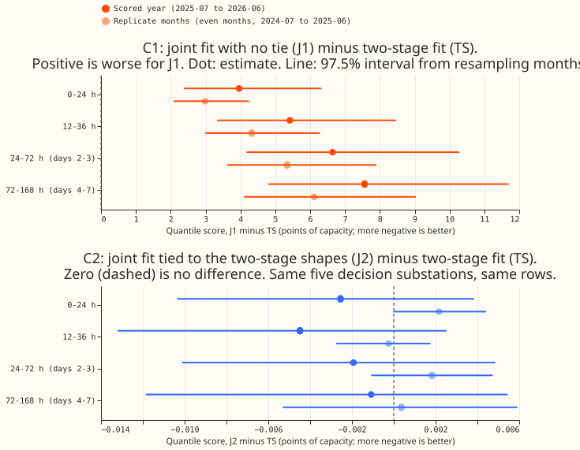
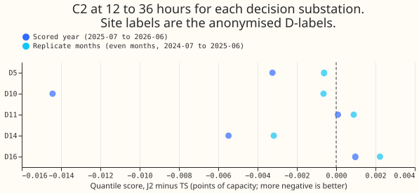
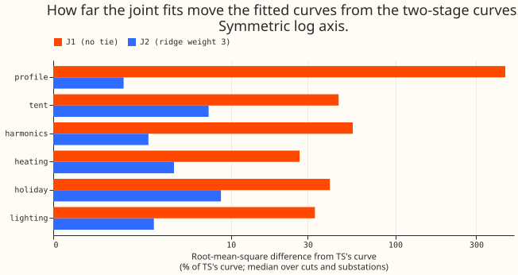

# Experiment 135: does fitting the demand model through the Kalman filter beat fitting it first and filtering after?

**Fitting the demand model through the Kalman filter did not improve the day-ahead forecast, and the
untied version made it much worse.**
With no tie to the two-stage fit (J1), the quantile score at leads 12 to 36 hours was 5.4 points
higher (worse) than the two-stage fit's, with a 97.5% interval of +3.3 to +8.5. With a ridge tie to
the two-stage coefficients (J2), the difference was -0.0045 points (-0.013 to +0.003), which cannot
be told from zero. The verdict is `not supported`. The two-stage design stays: fit the demand model,
then filter its residuals.

We asked whether the convex demand model (GAM-K, from [experiment
111](../00111-differentiable-physics-6-ens-forecast-engine-against-bg2/result.md)) forecasts the
next day better when its coefficients are chosen to minimise the error that remains after the Kalman
filter has corrected the forecast. The filter tracks a slowly moving level and a quickly decaying
transient of the model's error in each of 4 hour bands, with the noise settings that [experiment
133](../00133-differentiable-physics-vk-learned-noise-and-observation-variance-in-gam-k/result.md)
chose. In the two-stage design, the model is fitted first and the filter then runs on its residuals.
For fixed noise settings the filter is linear in the residuals, so the joint fit is an exact bounded
quadratic problem, solved on a graphics processing unit (GPU) with no gradient descent. The idea
follows [de Vilmarest and Goude (2022)](https://arxiv.org/abs/2110.00334), who run a state-space
correction on the residuals of a generalised additive model for electricity load. They correct the
residuals after fitting, and this experiment fits through the correction.

The experiment compared three arms on `fold_a_daily_gap_v1` at the five decision substations (D5,
D10, D11, D14, and D16, with D9 beside them):

- **TS:** the two-stage fit, as in experiment 111, with experiment 133's filter settings (its GRID
  arm).
- **J1:** the joint fit with no tie to TS.
- **J2:** the joint fit plus a ridge that pulls the coefficients towards TS's, with a weight chosen
  per substation from {0.1, 0.3, 1, 3} by the score on the tuning months (odd months of 2024-07 to
  2025-06). The choice was 3 at five substations (D5, D9, D10, D11, and D14) and 0.3 at D16.

## Results

- **J1 is worse at every lead and every substation.** C1 (J1 minus TS) at 12 to 36 hours is +5.419
  (97.5% interval +3.330 to +8.465) in the scored year (2025-07 to 2026-06), and 0 of 5 substations
  improve. In the replicate months (even months of 2024-07 to 2025-06) it is +4.323 (+2.988 to
  +6.281). The gap grows with lead, from +3.96 at 0 to 24 hours to +7.56 at days 4 to 7 (figure 1
  shows the four lead bands). The absolute quantile score at 12 to 36 hours is 7.907 for J1 against
  2.488 for TS. Over all leads (0.5 to 168 hours), J1 is 9.563 and TS is 2.783. D9, scored beside
  the decision substations, shows the same pattern (J1 6.009 against 2.151 at 12 to 36 hours).
- **J2 is indistinguishable from TS.** C2 (J2 minus TS) at 12 to 36 hours is -0.0045 (-0.0132 to
  +0.0025) in the scored year, with 3 of 5 substations improving, and -0.0002 (-0.0027 to +0.0018)
  in the replicate months, with 3 of 5. The upper bound of the scored-year interval rules out a loss
  of more than 0.003 points, and the lower bound rules out a gain of more than 0.013 points. Over
  all leads, C2 is -0.0015 (-0.0106 to +0.0048), within the non-inferiority bound of +0.02. D10
  contributes most of the scored-year gain (-0.0145), and leaving D10 out leaves a mean of about
  -0.002.
- **The tuning months prefer the strongest tie on the grid.** The mean tuning-month score is 2.7136
  for ridge weight 0.1, 2.7067 for 0.3, 2.7028 for 1, and 2.7020 for 3, against 2.7028 for TS (J1 is
  8.200). The score falls as the tie tightens and reaches TS's, so the data prefer the two-stage
  fit. The best weight lies at the edge of the grid at five of six substations.
- **J1's fitted curves move far from the two-stage curves, and J2's barely move.** The median
  root-mean-square difference from TS's curve, as a share of the root-mean-square spread of TS's
  curve, over the 27 monthly cuts and 5 substations, is 444% for J1's weekly profile, 46% for its
  tent, 56% for its harmonics, 27% for heating, 41% for the holiday term, and 33% for lighting. For
  J2 at weight 3 it is 2%, 7%, 3%, 4%, 9%, and 3%. Most of J1's weekly-profile difference is a
  constant offset (a median of 51 points raw against 10 points once the offset is removed), which is
  the freedom the filter's level absorbs.
- **Breakouts, at 12 to 36 hours in the scored year (descriptive).** C1 and C2 are:
    - Winter (November to March): +6.53 (+2.17 to +12.93) and -0.007 (-0.023 to +0.004).
    - Winter nights: +1.85 (+0.05 to +4.26) and -0.004 (-0.025 to +0.007).
    - Cold nights: +2.44 (+0.64 to +5.80) and -0.017 (-0.048 to +0.013).
    - Christmas and bank holidays: +4.32 (+3.88 to +5.15) and -0.061 (-0.209 to +0.023).
- **Tails.** The coverage of the 0.95 quantile is 0.942 for TS, 0.886 for J1, and 0.941 for J2, and
  on cold nights 0.864, 0.945, and 0.864. The coverage of the 0.01 quantile is 0.020, 0.046, and
  0.020, and of the 0.05 quantile is 0.064, 0.078, and 0.064. J2's tails match TS's to the third
  decimal, so the cold-night shortfall of the 0.95 quantile that experiments 125 and 133 found is
  unchanged.

## Checks

- **P1, reproduction (blocking): passed.** TS's scored-year mean forecasts equal experiment 111's
  stored GAM-K rows, and its mean and median forecasts equal experiment 133's GRID rows, with a
  maximum absolute difference of 0 at all 5 decision substations.
- **P2, the linear filter equals the filter: passed.** Unit tests in
  `packages/studies/tests/test_dp_joint_fit.py` match the corrected loss to `run_kalman` and
  `correction_at` to a relative 1e-9 in float64, with gaps in the readings and a binding variance
  floor, and match `fit_gam` to 1e-6 when the filter is switched off.
- **P3, the solved loss is the true loss: passed.** At all 5 substations, the loss of the filter run
  on the joint solution's residuals is lower than the loss at a perturbed set of coefficients and
  lower than the loss at TS's coefficients (at D10, 1,120,985 against 1,121,407 and 1,150,502). The
  fit does minimise the loss it was given, so J1's failure is a property of that loss and not of the
  solver.
- **P4, known answer: failed for J1, passed for J2.** On a simulated target built from TS's own
  curves plus a slow level, a decaying day anomaly, and white noise, the summed centred
  root-mean-square error of the recovered curves over the 5 substations was 36.6 points for J1, 11.2
  for TS, and 10.4 for J2. J1 loses even when the assumptions of the joint design hold. The weekly
  profile accounts for most of J1's error.
- **Absorption control: J1 failed in 4 of 15 substation-cut pairs, and J2 in none.** The fail rule
  needs a term to move by more than twice its own noise floor, and J1's noise floors are large, so
  the rule passes J1 where its movement hides inside the floor. J1's weekly-profile noise floor,
  from a cut moved back by 7 days, has a median of 19 points and a maximum of 95, against 1 point
  for J2 and TS. The J1 failures are D10 at the 2025-01, 2025-07, and 2026-01 cuts and D5 at the
  2026-01 cut. A term had a noise floor above 1 point (unidentified) in 14 of 15 pairs for J1 and 10
  of 15 for J2. The holiday term is unidentified for every arm, because few holidays fall in a
  window.
- **Predictions against results.** C1 was predicted at -0.05 to +0.02 points and came out at +5.4,
  so the prediction failed by a factor of more than 100 on the top of its range. C2 was predicted at
  -0.03 to +0.01 and came out at -0.0045, inside the range. J1's curves were predicted to differ
  from TS's by 5% to 15% of each term's spread, and they differ by 27% to 444%. J2's were predicted
  to differ by under 5%, and they differ by 2% to 9% (7% for the tent and 9% for the holiday term).
  The absorption prediction (J1 fails, J2 does not) held.
- **Error of the mean forecast beside each contrast (12 to 36 hours, scored year).** The mean
  absolute error is 4.374 for TS, 11.027 for J1, and 4.367 for J2. The C2 contrast on the mean
  forecast's error is -0.0073 (-0.0207 to +0.0032), the same sign as the quantile-score contrast, so
  the audit trigger for a disagreement did not fire. The median forecast minus the mean forecast is
  -0.156 for TS at D5 and -0.154 for J2, against -0.319 for J1, and is within 0.05 for TS and J2 at
  the other four substations.
- **Audit triggers.** Trigger 1 (a control fails) fired: P4 failed for J1. Trigger 2 (a result
  against its own prediction) fired for C1. The explanation, that the filter absorbs a shift of the
  slow terms so the loss leaves them to the penalty alone, is supported by the shape distance, the
  noise floors, and P4, and no variant of the loss was run to test it. Trigger 4 (one substation
  drives the contrast) did not change a verdict, because C2 stays inconclusive without D10 and C1
  stays above zero at every substation. No Opus audit was run, by agreement with the experiment
  manager, so both triggers are unresolved caveats.
- **Biases stated in advance.** The filter reads in-sample residuals from the training weather (ERA5
  and CAMS) when the joint fit is made, and out-of-sample residuals from the analysis proxy at
  forecast time. The noise settings were chosen on TS's own residual stream, which favours TS. J2 is
  a family of fits with the tie weight chosen on the tuning months. All three biases favour TS or
  leave J2 tied to it, so they cannot explain J1's loss and they limit what a null for J2 says about
  a retuned joint fit.
- **Retraining schedule and cost.** All arms refit the convex model monthly, as in experiment 111.
  The joint fits of all five weights (J1 and four J2) took 0.33 GPU hours in total, about 3.3
  minutes per substation for 27 cuts. The fits, tuning, forecasts, scoring, and controls together
  took about an hour and a half of wall-clock time.

## What the next experiment should answer

- **Whether learning the filter's noise settings together with the coefficients helps.** This
  experiment held the settings fixed at experiment 133's values, so a null for J2 does not rule out
  that joint learning helps. The experiment would need a differentiable filter loss that stays well
  posed, and J1's failure suggests tying the slow terms to a reference fit.
- **Whether a ridge weight above 3 changes J2.** The tuning months preferred the strongest tie at
  five of six substations, so a wider grid would show whether any gain survives before the tie
  reaches the two-stage fit.
