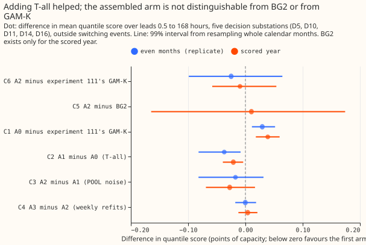
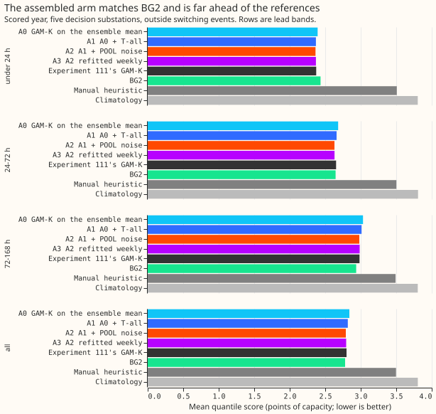
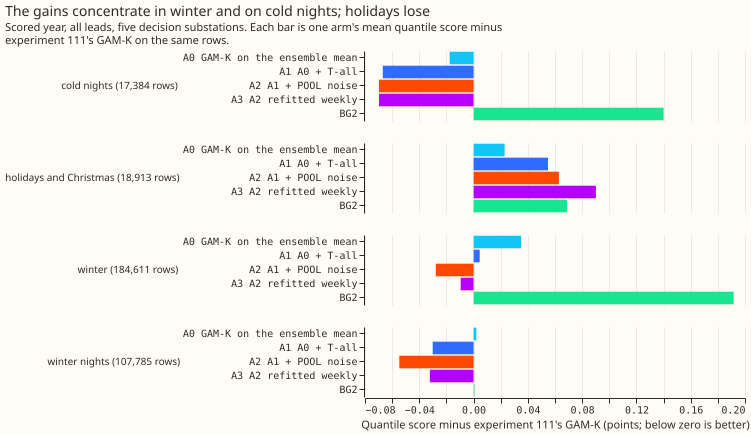

# Experiment 136: does GAM-K with everything that has helped, on the ensemble mean, match BG2?

**Putting every earlier gain into the convex demand model and driving it from the ensemble mean
gave a forecast that scores the same as BG2 and as experiment 111's GAM-K, and the experiment cannot
rank the
three.** The assembled arm scored 2.791 points against 2.780 for BG2 and 2.800 for experiment 111's
GAM-K, and the 99% intervals are 0.11 to 0.34 points wide. Using the ensemble mean instead of the 51
members made the quantile score 0.039 points worse (higher is worse). The heating split (T-all) and
one shared filter noise setting together lowered it by 0.048 points, which is not distinguishable
from the loss. The verdict is `inconclusive`. The experiment narrows the next step to the
spread: a single table of residual quantiles around the mean forecast is too narrow in the lower
tail, and a spread that restores the mixture's lower tail could turn the assembly into a gain.

We asked whether the convex demand model with the Kalman filter on recent errors (GAM-K,
[experiment 111](../00111-differentiable-physics-6-ens-forecast-engine-against-bg2/result.md)),
given the heating split by day type (T-all, [experiment
114](../00114-differentiable-physics-n3-n4-interactions-and-heating-threshold/result.md)) and one
filter noise setting shared by every substation (POOL, [experiment
133](../00133-differentiable-physics-vk-learned-noise-and-observation-variance-in-gam-k/result.md)),
forecasts demand at the five decision Primary substations 0.5 to 168 hours ahead as well as the
production recipe (BG2, [experiment
87](../00087-bg2-best-guess-assembled-with-drop-one-ablations/result.md)). The convex model was
driven by the ensemble mean of the ensemble of the European Centre for Medium-Range Weather
Forecasts (ECMWF ENS) instead of its 51 members. We added three changes one at a time (the ensemble
mean as input, T-all, and POOL) and scored each arm on the same half-hourly rows. All three were
already built and tested in earlier experiments.

## Results

- **Arms and schedule.** A0 is experiment 111's GAM-K on the ensemble mean. A1 is A0 plus T-all.
  A2 is A1 plus POOL. A3 is A2 refitted weekly instead of monthly. A0 to A2 refit monthly on a
  24-month window, as experiment 111's fits do. A3 tests weekly refits, because a monthly-refit arm
  would equal A2. The quantiles are the corrected mean plus a residual table fitted
  on the tuning months, with every spread factor at 1.
- **Rows.** `fold_a_daily_gap_v1`, 561,172 half-hourly rows in the scored year at the five decision
  substations, outside the hand-filtered switching events; BG2 exists only for the scored year.
  D9 is scored beside them and is not in any contrast.
- **Absolute skill, scored year, leads 0.5 to 168 hours (points of effective capacity).** A0 2.839,
  A1 2.818, A2 2.791, A3 2.795, experiment 111's GAM-K 2.800, BG2 2.780, manual heuristic 3.497,
  climatology 3.804. A2 is 20% below the manual heuristic and 27% below climatology.
- **By lead band (A2, BG2, experiment 111's GAM-K).** Under 24 hours: 2.363, 2.434, 2.373. From 24
  to 72 hours: 2.630, 2.646, 2.653. From 72 to 168 hours: 2.980, 2.936, 2.983. A2 scores better than
  BG2 below 24 hours and worse from 72 to 168 hours, as experiment 111's GAM-K did.
- **C1, A0 minus experiment 111's GAM-K.** +0.039 (99% interval +0.018 to +0.060), 0 of 5
  substations better, 2 of 12 months negative; replicate +0.029 (+0.011 to +0.052). The prediction
  was within 0.03, so the ensemble mean worsens the score by more than predicted.
- **C2, A1 minus A0 (T-all).** -0.021 (-0.039 to -0.004), 5 of 5 substations better, 10 of 12
  months negative; replicate -0.037 (-0.082 to -0.008). The prediction of -0.02 to -0.04 held.
- **C3, A2 minus A1 (POOL).** -0.027 (-0.069 to +0.017), 4 of 5 substations better; replicate
  -0.017 (-0.082 to +0.032). The prediction of -0.01 to -0.03 held in size, and the interval
  includes
  zero.
- **C4, A3 minus A2 (weekly refits).** +0.004 (-0.012 to +0.021); replicate 0.000 (-0.018 to
  +0.019). The prediction of within 0.02 held.
- **C5, A2 minus BG2.** +0.010 (-0.164 to +0.174), 3 of 5 substations better. The prediction of
  -0.03 to -0.12 missed, and the interval cannot exclude BG2 being better by 0.17.
- **C6, A2 minus experiment 111's GAM-K.** -0.009 (-0.058 to +0.054), 4 of 5 substations better;
  replicate -0.025 (-0.099 to +0.065). The prediction of -0.06 to -0.15 missed.
- **Verdict by the pre-registered rule.** C6's interval includes zero and C5's upper bound (+0.174)
  is above +0.05, so the hypothesis is `inconclusive`.
- **Breakouts, A2 minus experiment 111's GAM-K (scored year, all leads).** Winter -0.028, winter
  nights -0.055, cold nights -0.070, and holidays and Christmas +0.063 (18,913 rows, interval
  -0.058 to +0.094). The gain sits in winter and on cold nights, which are the hours NGED cares
  about, and the holiday rows lose.
- **Why the ensemble mean worsens the score by 0.039 (C1, tested after the result, post hoc).** A0's
  pinball loss
  is worse than experiment 111's GAM-K at the 0.01, 0.05, 0.10, and 0.25 quantiles (0.2252 against
  0.2082, 0.7471 against 0.7084, 1.1992 against 1.1487, 2.0333 against 1.9842) and equal from the
  0.40 quantile upward. A0's coverage at the 0.05 quantile is 6.3% against 5.8%, and at the 0.10
  quantile 11.4% against 10.1%. The mean forecast's error rose by only 0.007, so the loss is in the
  spread: the mixture of 51 members puts more mass in the lower tail than one residual table around
  the mean does (`e00136_levels.py`).

## Tail calibration (scored year, five decision substations)

| Arm | q01 cov | q05 cov | q95 cov | q99 cov | Pinball q95 | Pinball q99 | Cold-night q95 cov |
|---|---|---|---|---|---|---|---|
| A0 | 0.022 | 0.063 | 0.947 | 0.983 | 0.743 | 0.231 | 0.895 |
| A1 | 0.022 | 0.065 | 0.946 | 0.982 | 0.745 | 0.232 | 0.896 |
| A2 | 0.022 | 0.066 | 0.945 | 0.982 | 0.736 | 0.229 | 0.888 |
| Experiment 111's GAM-K | 0.018 | 0.058 | 0.948 | 0.983 | 0.730 | 0.227 | 0.874 |
| BG2 | 0.010 | 0.040 | 0.944 | 0.982 | 0.778 | 0.268 | 0.859 |

- **The 0.01 and 0.05 quantiles are too high in every ensemble-mean arm.** The observed shares
  below them are 2.2% and 6.3% to 6.6%, against 1.8% and 5.8% for experiment 111's GAM-K.
- **POOL hurts cold-night tails.** On cold nights (3 °C or below, night hours, all leads) the
  pinball
  loss at the 0.95 and 0.99 quantiles is 0.747 and 0.302 for A2 against 0.669 and 0.244 for A1.
- **The cold-night q95 coverage is 88% to 90% in the ensemble-mean arms**, above the 73% to 78%
  that [experiment
  125](../00125-differentiable-physics-n8-ens-members-through-gam-k-and-the-spread-around-them/result.md)
  found; the two experiments define the cold-night rows differently.
- **Curtailment cost against the manual heuristic was not computed**, because the repository has no
  node metric for these five substations yet.

## Checks

- **Median minus mean forecast, per site (A2, scored year, 12 to 36 hours):** 0.000 at every site,
  because the residual quantile table is built so that its median is zero. Experiment 111's GAM-K:
  -0.005, -0.021, +0.018, -0.009,
  -0.097 and -0.052 at D10, D11, D14, D16, D5, and D9.
- **Error of the mean forecast beside the score contrasts (mean absolute error, points):** C1
  +0.007, C2 -0.049, C3 -0.073, C4 -0.001, C5 -0.061, C6 -0.115. The mean forecast is better in
  every step except C1, which is slightly worse.
- **Audit triggers that fired, none triaged by an audit.** Trigger 2 (a result contradicts its
  prediction): C1 (+0.039) contradicts its
  prediction of within 0.03; the explanation above was tested and recorded. Trigger 3: C5's quantile
  score contrast is +0.010 while its mean-error contrast is -0.061; A2's mean forecast is better
  than BG2's and its spread is worse. Trigger 4: leaving D10 out turns C6 from -0.009 to +0.002,
  and leaving D16 out turns C5 from +0.010 to -0.033. Neither flip changes the verdict, because
  both C5 and C6 are `inconclusive` already, so we did not run the Opus audit; the manager can ask
  for one.
- **P1 control passed** in experiment 133 (its FIX arm reproduces experiment 111's GAM-K within 1e-4
  points).
- **P2 control passed.** T-all with a huge penalty matches experiment 111's stored fits to within
  2.6e-6 points, looser than the plan's 1e-6 because the ridge is divided between the pieces.
- **Prediction miss on cold-night coverage.** Predicted 73% to 85%, observed 88% to 90%.

## Caveats

- **Caveat on POOL.** POOL was chosen on experiment 111's fits, not on T-all's.
- **Caveat on the interval.** C5 and C6 have 99% intervals 0.11 to 0.34 points wide, so effects
  smaller than that cannot be resolved against BG2 or experiment 111's GAM-K. C1 to C4 have
  intervals 0.04 to 0.09 wide.
- **The filter uses no future weather.** Its residuals use an analysis proxy built from earlier ENS
  runs, and the proxy is available at forecast time.

## What to try next

- **Fit the spread around the ensemble mean to match the mixture's lower tail**, for example by
  tail-specific factors or a skewed residual table, then re-run A2 on the same rows.
- **Run the same assembly with the 51 members**, to see whether T-all and POOL add -0.05 on the
  mixture, which would put the assembly about 0.04 below experiment 111's GAM-K.
- **Check POOL's cold-night tails** before adopting it.

## Plan

**Question.** Does the convex model with the Kalman filter (GAM-K, [experiment
111](../00111-differentiable-physics-6-ens-forecast-engine-against-bg2/result.md)), given the pieces
that helped in later experiments and driven by the ensemble mean, forecast Primary demand at least
as
well as BG2 ([experiment 87](../00087-bg2-best-guess-assembled-with-drop-one-ablations/result.md)),
and better than experiment 111's GAM-K? No new modelling: every piece exists.

**Arms.** All arms share the rows, the weather calibration and solar shrink of experiment 111, and
the pinned capacity.

| Arm | Fits | Filter noise | Weather input | Spread |
|---|---|---|---|---|
| BG2 | as stored (experiment 87) | | | |
| K111 | as stored (experiment 111's GAM-K) | experiment 111's values | 51 members, mixture | as stored |
| A0 | experiment 111's monthly fits, 24-month window | experiment 111's values (FIX) | ensemble mean | refitted on the tuning months |
| A1 | A0 with T-all | FIX | ensemble mean | refitted |
| A2 | A1 | POOL (experiment 133) | ensemble mean | refitted |
| A3 | A2 refitted weekly | POOL | ensemble mean | refitted |

**Departure from the brief, and why.** The brief's A3 is "A2 with monthly refits", but experiment
111's fits are already monthly with a 24-month window, so A0 to A2 already refit monthly and the
brief's A3 would equal A2. A3 is therefore A2 with weekly refits, the production cadence, which
tests whether the monthly cadence the arms use changes the result.

**Ensemble mean as the input.** The forecast is one pass of the model through the calibrated
ensemble-mean temperature and irradiance, which replaces the 51 member passes of experiment 111. The
quantiles are the corrected mean plus the residual table fitted on the tuning months from the same
arm's own forecast (`e00133_ens.fit_spread_from_frame`), as K0-w does in [experiment
125](../00125-differentiable-physics-n8-ens-members-through-gam-k-and-the-spread-around-them/result.md).
The mean of a model with a hinge on temperature differs from the model at the mean temperature, so
C1 is not zero by construction.

**T-all.** [Experiment
114](../00114-differentiable-physics-n3-n4-interactions-and-heating-threshold/result.md)
fitted T-all at yearly cuts with its own design code. This experiment copies that design code and
fits
it at every monthly (and weekly) cut, and predicts on the ensemble-mean-driven cache.

**Filter.** The filter runs on the proxy-driven residual stream of each arm's own fits, with FIX for
A0 and A1 and POOL (the single shared cell of experiment 133) for A2 and A3. POOL was chosen on
experiment 111's fits, not on T-all fits; this is a caveat.

**Rows.** `fold_a_daily_gap_v1`, 09:00 UTC `power_fcst_init_time`, leads 0.5 to 168 hours, rows
outside hand-filtered switching events. The scored year is 2025-07 to 2026-06; the tuning months
are the odd months and the replicate months the even months of 2024-07 to 2025-06, as in experiment
133. D-labels only.

**Breakouts.** Lead bands (under 24, 24 to 72, 72 to 168 hours), winter, cold nights, holidays and
Christmas, and tail calibration at the 0.01, 0.05, 0.95, and 0.99 quantiles, with the q95 coverage
on cold nights. Absolute skill is reported for BG2, climatology, and manual_heuristic beside the
contrasts. The curtailment cost saving against the manual heuristic follows once a node metric
exists
for these substations; if not run, the write-up says so.

**Spread factors.** Every spread factor is fixed at 1, because [experiment
125](../00125-differentiable-physics-n8-ens-members-through-gam-k-and-the-spread-around-them/result.md)
found that factors tuned on alternate months scored worse out of period.

**Controls.** P1: the FIX arm of experiment 133 reproduced experiment 111's GAM-K within 1e-4
(passed
in experiment 133). P2: the T-all code, run with a difference penalty so large that the arm becomes
B0, must reproduce experiment 111's stored `gamk` forecasts at the same cut to within 1e-6 points;
this checks the copy of experiment 114's design code. P3: A0's forecast frames, scored on the
rows of experiment 111's stored GAM-K, differ from it only through the weather input, so C1 is read
against a within-method difference of 0 +/- 0.03.

**Five triggers.** Stored: private files only. Serving path: not touched. Degradation rule: not
touched. More than one design defensible: yes (mean input, spread refit), pre-registered above.
Callers
not nameable without searching: no, the scripts copy experiments 111, 114, and 133.

**Resources.** Central processing unit (CPU) only, at most 8 cores with one thread per worker, each
job under `systemd-run --user --scope -p MemoryMax=16G -p OOMPolicy=continue`.

**Advice followed.** From experiment 125, do not rely on member spread for tail skill. From
experiment 133, test one shared noise setting before any per-substation fit.
