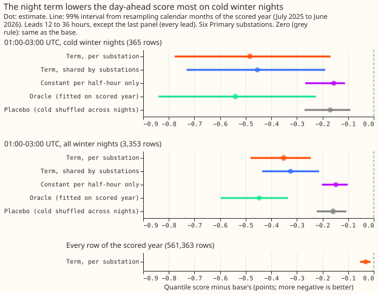
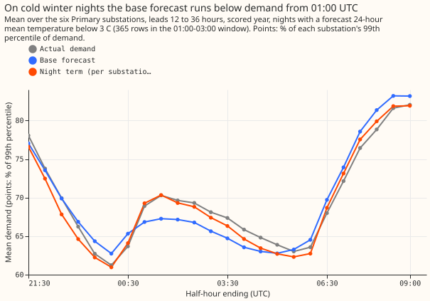
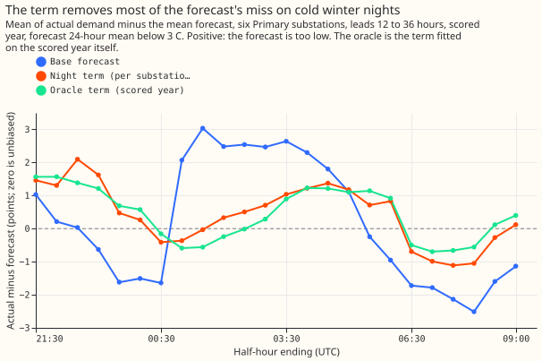

**Take-home message: the day-ahead forecast runs low on cold winter nights from 01:00 UTC, and a
correction learned from its own past errors removes that bias.** The experiment cannot say that the
bias grows with cold. On cold winter nights from 01:00 UTC the base forecast ran 2.5 points too low
on average (a point is 1% of a substation's 99th percentile of demand; "cold" means a forecast daily
mean below 3 °C). With the night correction (an additive term fitted on the forecast's own past
errors) it runs 0.2 points too low, and 93% of actual values fall below the 0.95 quantile, against
80% for the base forecast. The correction lowers the day-ahead quantile score (twice the mean
pinball loss) by 0.484 points on those rows (99% interval from resampling calendar months, -0.777 to
-0.169) and by 0.032 points over every row of the year (-0.054 to -0.012). A second analysis by a
fresh reviewer (the audit, below) showed that a plain winter night offset with no temperature does
as well, so the data show a winter night bias and not a cold-driven step. The verdict is
`inconclusive`: the shuffled-night placebo control failed, and the 365 headline rows are too few for
the rule committed in the plan (at least 3 months and 50 rows per substation).

We asked whether the step in Primary substation demand at the start of cheap night-rate electricity
(Economy 7), which experiment 123 found, can be added to the day-ahead forecast. The base is the
convex-optimisation demand model with a Kalman filter, driven by the mean of the European Centre for
Medium-Range Weather Forecasts (ECMWF) ensemble (ENS) weather forecast (experiment 133's
shared-noise arm). We fitted a ridge regression of the base's own past errors on the half-hour
(UTC), the forecast temperature, and the day of the week, refitted monthly on data before each
month, and added the fitted correction to every forecast quantile. We scored it on the six decision
substations over the year from July 2025, with winter 2025-26 as the only winter.

**Results** (every number is printed in `report.json`, produced by `e00137_report.py`):

- **Arms.** Base (no term); `t_site` (one fit per substation, ridge penalty 100, chosen on the odd
  tuning months); `t_pool` (one fit shared by the six substations); `oracle` (the term fitted on the
  scored year itself); `fixed123` and `fixed123b` (experiment 123's step inserted); `t_const` (post
  hoc: the per-half-hour constants only); `placebo` (temperature shuffled across nights).
- **Rows.** The scored year of `fold_a_daily_gap_v1`, forecasts issued at 09:00 UTC, leads 12 to 36
  hours, six substations, outside the hand-filtered switching events. Headline rows: the half-hours
  ending 01:00 to 03:00 UTC on winter nights whose forecast 24-hour mean temperature is below 3 °C
  (365 rows in 3 months by valid time; 35 rows at each of D5 and D16, 60 to 85 at the others).
- **C1 (term per substation minus base), headline rows:** -0.484 (-0.777 to -0.169); 5 of 6
  substations improve (D9 does not: +0.100); leaving each substation out gives -0.400 to -0.599. The
  pre-registered readability rule (3 months, 50 rows per substation) is not met, so by the rule the
  contrast is not assessable.
- **Wider row sets:** all winter nights in the 01:00 to 03:00 window (3,353 rows): -0.352 (-0.482 to
  -0.245), 6 of 6 substations. All winter-night half-hours at leads 12 to 36 hours (16,089 rows):
  -0.115 (-0.178 to -0.056). Cold winter nights, every night half-hour (1,752 rows, post hoc):
  -0.194 (-0.249 to -0.134).
- **C2 (term shared by substations minus base):** -0.454 (-0.731 to -0.190). **C5 (per-substation
  minus shared):** -0.030 (-0.094 to +0.089). Sharing one fit across substations loses nothing
  measurable.
- **C4 (non-inferiority, every row, every lead):** -0.032 (-0.054 to -0.012), 6 of 6 substations;
  the upper bound is below the +0.01 limit.
- **Oracle minus base:** -0.540 (-0.840 to -0.226). The term achieves 90% of the oracle's
  improvement.
- **C3 (experiment 123's step inserted, minus base), invalid arm:** +2.643 (+1.541 to +3.551); the
  summer-adjusted `fixed123b` (post hoc): +1.979 (+1.247 to +2.615). The audit found both arms
  specified wrongly (finding 4 below), so these numbers say nothing about experiment 123's step.
- **Placebo minus base:** -0.170 (-0.271 to -0.091). The constants-only arm `t_const` gives -0.156
  (-0.268 to -0.112): about a third of the term's gain needs no temperature at all.
- **Absolute scores (points), headline rows:** base 2.190, `t_site` 1.706, `t_pool` 1.736, oracle
  1.650, placebo 2.020, `t_const` 2.034. Every row of the year: base 2.706, `t_site` 2.675.
- **Tail calibration, headline rows (coverage / pinball):** q95 coverage 0.800 (base), 0.932
  (`t_site`), pinball 0.613 against 0.444; q99 coverage 0.959 against 0.995, pinball 0.132 against
  0.113; q05 coverage 0.041 against 0.047; q01 coverage 0.033 against 0.038, pinball 0.217 against
  0.270. The term lifts the whole distribution, so the upper tail improves and the 0.01 quantile
  gets slightly worse. Every row of the year: q95 coverage 0.948 against 0.951.
- **Mean forecast error, headline rows (actual minus mean forecast):** 2.519 (base), 0.230
  (`t_site`). The mean absolute error falls from 3.748 to 2.864 (-24%).
- **Curtailment-cost metric:** not run. The metric needs a forecast for a connection point and its
  generators, which this experiment does not forecast; the shift matters most for the upper tail,
  where q95 and q99 coverage improve.

**Predictions against outcome.** C1 was predicted at -0.5 to -2.0 points and came out at -0.484,
just short of the range. The term recovered 90% of the oracle's gain (predicted at least 50%; the
oracle's interval lies wholly below zero). The mean forecast's signed error shrank by 91% (predicted
at least a third); the mean absolute error shrank by 24%, short of a third. The all-row score (C4)
changed by -0.032 (predicted -0.03 to +0.01).

**Controls.**

- **Leakage:** passed. Adding 100 points to `actual` from the monthly fit dates of 2025-11-01,
  2026-01-01, and 2026-02-01 on, and rerunning the whole monthly fit, changed no corrected quantile
  of that cut's month (maximum change 0.0).
- **Injected step (an 8-point step plus 0.5 points per degree below 15.5 °C, which is 14.25 points
  at 3 °C):** passed. The fitted step minus the clean fit's was within 3.7% of the truth at every
  substation at every winter cut from November 2025 to March 2026 (`t_pool`: within 0.6%).
- **Reproduction:** passed. The base's score over five substations (the five that experiment 133
  scored) at 12 to 36 hours is 2.4622 against experiment 133's 2.462.
- **Shuffled-night placebo:** failed. It gained 0.170 points where the band was +/-0.1. The placebo
  keeps each half-hour's constant, which carries a third of the gain (`t_const`). The verdict is
  capped at `inconclusive` by the plan.

**Checks.**

- **Median minus mean forecast, per substation** (base and term alike, since the term shifts both):
  D5 -0.125, D9 -0.019, D10 -0.045, D11 -0.035, D14 +0.013, D16 +0.000 points.
- **Mean-forecast error beside each contrast:** the mean absolute error changes in the same
  direction as the quantile score (C1 headline -0.884, C4 -0.059), so the audit trigger for a
  mean-forecast error that moves against the quantile score did not fire.
- **Leave-one-substation-out:** no flip of sign (-0.400 to -0.599 on the headline rows), so trigger
  4 did not fire.
- **Triggers fired:** the failed-control trigger (the placebo) and the trigger for a control that
  moves the score by more than its paired interval's half-width. The audit is in the next section.

**Audit.** A fresh Opus agent re-derived the contrasts from the stored predictions with its own code
(report in the private briefs folder, `e137_audit_report.md`). Findings and triage:

- **Finding 1, accepted:** a post hoc arm that swaps `cold` for a November-to-March indicator scores
  -0.432 on the headline rows; the temperature term minus that arm is -0.052 (-0.123 to +0.022), and
  -0.000 (-0.018 to +0.015) on cold winter nights, all night half-hours. On all winter window rows
  the temperature term is worse than the offset by +0.094 (+0.016 to +0.143). The take-home message,
  headline, and advice say this. A shuffle of `cold` within each calendar month keeps most of the
  gain (-0.25 to -0.39 over 12 seeds).
- **Finding 2, accepted:** the planned placebo shuffles across the whole history, so it carries no
  season and falls back to the per-half-hour constants (`t_const` -0.156). Its failure is the
  constants working, not leakage. The plan's cap at `inconclusive` still applies.
- **Finding 3, accepted:** the headline rows fall in 3 months by valid time (2025-11, 2026-01,
  2026-02; `report.json` counts 4 by origin month), and D5 and D16 hold 35 rows against the 50
  required, so C1 is not assessable under the rule. The readable cold-night subset (1,752 rows)
  gives -0.194; the same seasonal explanation applies.
- **Finding 4, accepted:** `fixed123` and `fixed123b` omit experiment 123's actual summer rise,
  correct the forecast's rise and not its level, use each substation's own fit where the plan says
  the pooled step, and insert the step in summer. Both arms shifted the forecast by 4.4 to 17.6
  points where 2.4 to 4.4 were needed. Both arms are marked invalid above and were not rerun.
- **Finding 5, accepted:** the leakage control compared fits on filtered rows, which cannot fail. It
  now corrupts `actual` from three cuts on, reruns the whole monthly fit, and compares the corrected
  quantiles of each cut's month. The audit's own end-to-end test passed as well.
- **Findings 6, 7, and 9, no fault found:** the temperature window, the ridge and noise choices, the
  quantile shift (no crossings), and the 2.4622 reproduction check out. Tail coverage on cold
  nights, every half-hour: q95 0.913 (base) and 0.937 (term); q01 0.031 and 0.022.
- **Finding 8, accepted:** the code's window is the half-hours ending 01:00 to 03:00 (five rows);
  the plan's text said 01:30 to 03:00, and the plan section below now says 01:00 to 03:00.

**Caveats and what to try next.**

- The scored year holds one winter, and the term trained on one earlier winter (2024-25) at the
  start of it. A second winter would settle the verdict.
- The term moves the whole night, including the 22:00 to 23:00 half-hours, where the mean error on
  cold nights goes from about zero to about +2 points (figure 3). A term confined to the half-hours
  after 00:30 would test whether that raises the score.
- The temperature feature is a 24-hour ENS-mean temperature from 09:00 UTC on the evening date, so a
  "cold night" here is not experiment 123's daily mean below 3 °C.
- Next: test a seasonal night offset, or a fix to the base forecast's winter night level, and retest
  when winter 2026-27 exists, with a within-month placebo for any temperature term.

## Plan, as committed before any code ran

The text below is the plan as committed in the first commit of this branch, with the amendments of
the plan review applied before any code ran.

### Question

Experiment 123 found that demand at 13 of 14 Primary substations steps up around 01:00 UTC on
winter nights, by about 10 points at a daily mean of 3 C, and that the day-ahead forecast of
experiment 114 runs below actual demand from about 01:00 on cold nights. An operator sees that step
and the forecast's miss. This experiment asks whether an explicit night term, learned from the base
forecast's own past errors, closes the miss.

### Design

- **Base.** Experiment 133's `pool` arm: the convex GAM with a Kalman filter (GAM-K) on the ENS
  ensemble mean, with one shared noise setting. Its prediction frames are read from experiment
  133's private folder (tuning months 2024-07 to 2025-06, odd and even, and the scored year).
  No file of the best-guess assembly is edited.
- **The term.** For a half-hour at UTC clock time `h` in the night set (21:00 to 08:30 UTC, 24
  half-hours) on the night of evening date `D`, the correction to every quantile is
  `a[h] + b[h] * cold + c[h] * weekend`, where `cold = max(0, 15.5 - T)`, `T` is the ENS-mean
  temperature averaged over the 24 hours from 09:00 UTC on `D` to 09:00 UTC on the next day, which
  a 09:00 UTC run always covers in full for the night it forecasts, and
  `weekend` flags Saturday and Sunday evenings. Coefficients are a ridge regression of the base
  forecast's error (actual minus the mean forecast) on those 72 columns, fitted per substation
  (`T_SITE`) or shared across the six substations (`T_POOL`), on all rows whose run origin and
  valid time are both
  before the first of the month being forecast (an expanding window, refitted monthly, starting
  from 2024-07). The ridge penalty is chosen on the odd tuning months from a fixed grid. The
  spread around the shifted median is unchanged.
- **The clock is UTC.** Experiment 123 found the step follows UTC on British Summer Time nights
  (a post hoc finding at 13 of 14 substations). The term therefore uses UTC and does not test
  that choice.
- **Two reference arms.** `FIXED123` inserts experiment 123's estimated step (the pooled
  `fit_headline` step at the forecast temperature, with its estimated ramp) minus the step the
  base already forecasts on the same night. `ORACLE` is `T_SITE` fitted on the scored year's own
  rows, so it bounds what any term of this form could gain.
- **Weather at forecast time.** `T` is the ENS-mean forecast available at the origin. No ERA5
  value enters any score. Experiment 123's winters are used only by `FIXED123`, and end before the
  scored year.
- **Resampling.** Month resampling for C1 draws only the calendar months that hold C1 rows; the
  contrast is readable only if at least 3 months and 50 rows per substation hold them, and is
  otherwise reported as not assessable. With one winter the expected verdict is `inconclusive`,
  and the write-up says so rather than relaxing the rule.
- **Limits stated now.** The expanding window holds one training winter (2024-25) for the first
  scored winter months and grows through winter 2025-26. The scored year holds one winter, so the
  cold-night rows are few and the month-resampled interval will be wide.

### Rows and subsets

- Rows: `fold_a_daily_gap_v1`, 09:00 UTC init, six decision series, scored year (the runs
  stored by experiment 133).
- **E7 window rows**: valid time 01:00 to 03:00 UTC (the half-hours ending 01:00 to 03:00, five rows).
- **Cold nights**: `T` below 3 °C (the same `T` as the term's regressor; a 24-hour mean shifted 9
  hours from the calendar day, so it is not experiment 123's daily mean).
- **Winter**: November to March.
- Headline subset: E7 window rows, cold winter nights, leads 12 to 36 hours. Beside it: all
  winter nights, all E7 window rows, all rows, and a figure of the step against the forecast on the
  coldest nights.

### Controls (run before any scoring)

- **Injected step.** Add a synthetic step of known size to the `actual` of every night in the
  stored frames (a ramp from 0 at 00:30 to 8 points at 01:30 UTC, held to 08:30, plus 0.5 points
  per degree of `cold`), refit `T_SITE` and `T_POOL` with the same code, and read the fitted
  correction at 3 °C. Pass: the fitted step at 01:30 to 03:00 UTC is within 25% of the truth
  (8 + 0.5 * 12.5 = 14.25 points) at 5 of 6 substations, from the first scored winter month on.
- **Shuffled-night placebo.** Permute `cold` across the nights of each substation and refit.
  Pass: the C1 contrast on the permuted term is within +/-0.1 points of zero.
- **Leakage.** Corrupt `actual` (add 100 points) at every valid time on or after each monthly cut
  in a copy of the frames and refit. Pass: the coefficients of every monthly fit are identical to
  the uncorrupted fit, and the corrections applied to the month are unchanged.
- **Reproduction.** The stored base rows reproduce experiment 133's `pool` score at 12 to 36 hours
  to within 1e-4 points.
- **Stop rule.** If the injected-step control fails at 3 or more substations, stop, record the
  verdict `failed`, and write what was found. No scored contrast is read after a failed control.

### Compute

CPU only. The ridge fits are small: a run is expected to take minutes on 4 cores, well inside the
16 GB memory cap. Predictions are written under `data/ml-experiments/00137-*/predictions/` with
`q01` to `q99`, `actual`, `lead_hours`, and `time_series_id`, so `studies.tail_calibration` can
score them.

### Prior work followed

- Experiment 123's estimated step, timing, and cold slope (read first, not re-estimated).
- Experiment 133's stored frames, scoring and month-resampled intervals, copied by pattern.
- `advice` from experiment 123: judge on cold winter nights from 01:00; try the UTC clock.
  Departure: the term is fitted on the forecast's errors, not on the observed night mean, so that
  the part of the step the base already models is not added twice.
