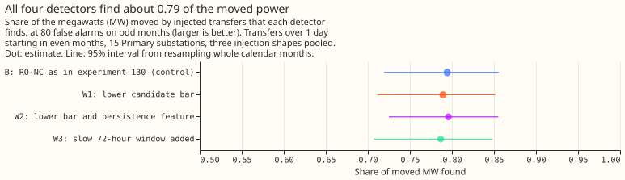
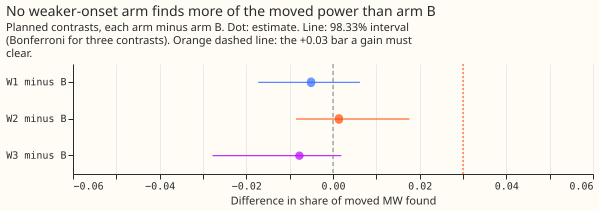
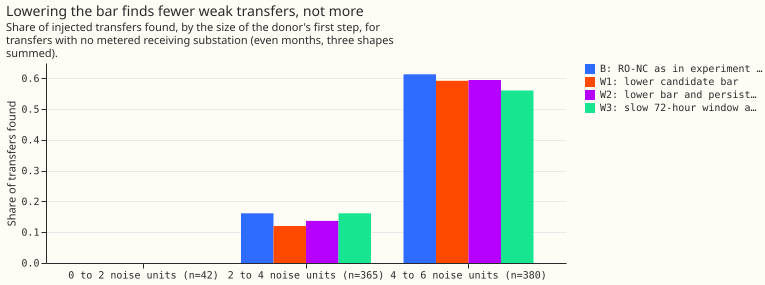
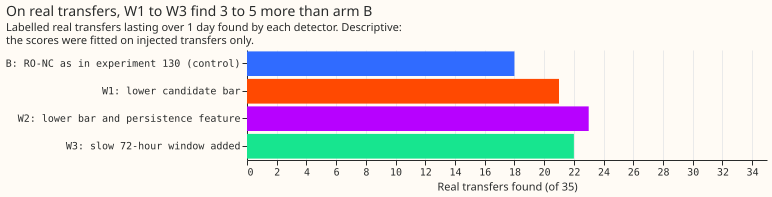

# Experiment 138: does a detector for weaker, slower onsets find more of the moved load?

**Making the load-transfer detector fire on weaker and slower starts did not find more of the moved
power on injected transfers.** A load transfer is a switching operation that moves part of one
Primary substation's demand onto neighbouring substations for hours or days. We added synthetic
transfers to real power history, and counted the share of the moved megawatts (MW) on which a
detector raised an alarm. The detector, the refit-offset neighbour-count detector (RO-NC), flags a
step in one Primary substation's forecast errors, helped by an opposite step at its neighbours. A
noise unit is the usual size of that step in odd-numbered months. The forecast is the convex demand
model of [experiment 130](../00130-ro-nc-detector-on-the-gam-k-residual/result.md), with its
coefficients held fixed. Three changes aimed at weak first steps (2 to 4 noise units) were a lower
threshold for what counts as a candidate, a persistence feature, and a 72-hour window. Each found
0.79 of the moved MW, the same share as the unchanged detector (arm B), at the same budget of 80
false alarms, counted on odd-numbered months. The verdict is `refuted`, because no change had an
interval reaching +0.02. Most of the weak first steps that stay missed are at a donor substation
whose load moves to a receiving substation with no power meter, and none of the three changes
separates them from noise. On the 35 real transfers lasting over 1 day, the three changes find 21 to
23 and arm B finds 18. The injected transfers show no such gain.

## Arms and rows

- **B (control):** RO-NC on the frozen convex residual, candidates at 2.5 noise units or more on the
  24-hour step, logistic score on the step, the largest opposite-sign neighbour step, and topology
  counts. It reproduces experiment 130 exactly: 7,745 rows of detector outcomes per transfer and
  shape, none differ, and recall is 0.794.
- **W1:** candidates from 1.5 noise units, same score features.
- **W2:** candidates from 1.5 noise units, plus the step still present 1 to 2 days after the
  candidate (a 24-hour mean after a one-day gap, minus the day before).
- **W3:** B's candidates plus peaks of a 72-hour step at 3.0 noise units or more, and the 72-hour
  step as a score feature.
- **Rows:** experiment 82's fresh headline-band draw, 602 transfers per shape in even months, shapes
  S2 to S4 pooled, 15 series. Each arm fits its own logistic score on odd-month injections and sets
  its threshold at 80 unexplained odd-month alarms. Interval: whole calendar months resampled 20,000
  times.
- **Lab shortcuts:** the residual uses ERA5 weather that arrives about 5 days late, the end of each
  alarm is chosen with hindsight, and the moved MW is the injected amount.

## Results

- **Recall (95% interval):** B 0.794 (0.719 to 0.856), W1 0.789 (0.711 to 0.852), W2 0.796 (0.725 to
  0.855), W3 0.787 (0.707 to 0.848).
- **Planned contrasts (98.33% interval):** W1 minus B -0.005 (-0.017 to +0.006), W2 minus B +0.001
  (-0.009 to +0.018), W3 minus B -0.008 (-0.028 to +0.002). The best lower end is under zero, and
  every upper end is under +0.02.
- **Alarm counts:** every arm has exactly 80 unexplained odd-month alarms by construction, and 65 to
  68 on even months, so weak candidates show up as lost recall, not extra alarms. In the unmetered 4
  to 6 noise-unit band W1 finds 225 of 380, W2 226, W3 213, against 233 for B.
- **Weak steps stay missed:** for transfers with no metered receiver and a donor step of 2 to 4
  noise units, B finds 59 of 365, W1 44, W2 50, and W3 59.
- **Long transfers (15.6 to 60 days):** each weaker-onset arm minus B is +0.005 (+0.000 to +0.026,
  95% interval).
- **Real transfers over 1 day (descriptive):** B 18 of 35, W1 21, W2 23, W3 22. The scores were
  fitted on injected transfers only, and the real set is too small to rank the three arms.

## Checks

- **Control:** arm B reproduces experiment 130 row for row.
- **Forecast checks:** no forecast is scored here, so the median-minus-mean and mean-forecast checks
  do not apply.
- **Audit triggers:** none of the seven conditions in the `ml-experiment` skill fires. The result
  contradicts the prediction (+0.02 to +0.06), and the by-step table is the tested explanation:
  added weak candidates replace stronger ones at the fixed 80-alarm budget. The nested arm W2 does
  not beat W1 by more than its interval. The real-transfer lead is descriptive, and no later design
  depends on it.

## Caveats

- **Injected transfers are rectangular steps,** so a persistence or slow-window feature has little
  to add there. Real transfers are less regular, which may explain why the real count rises while
  the injected recall does not. This is a guess that the experiment did not test.
- **The real-transfer count is 35 transfers at one threshold,** and arms W1 to W3 were never tuned
  on them.

## What to try next

- Check the real-transfer lead on a larger labelled set before porting W2.
- Look for a signal other than the residual step for weak transfers with no metered receiver.

Code: `ml-experiments/00138-weaker-onset-detector-on-the-ro-nc-convex-residual/`; every number above
is printed by `e00138_contrasts.py`.
