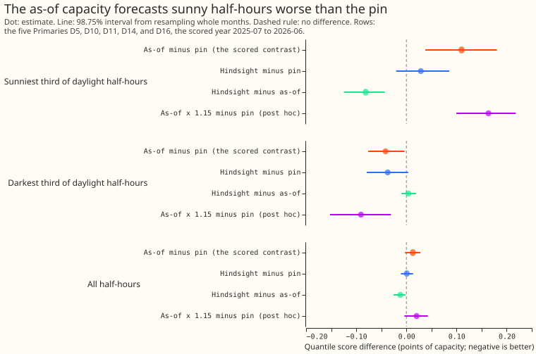
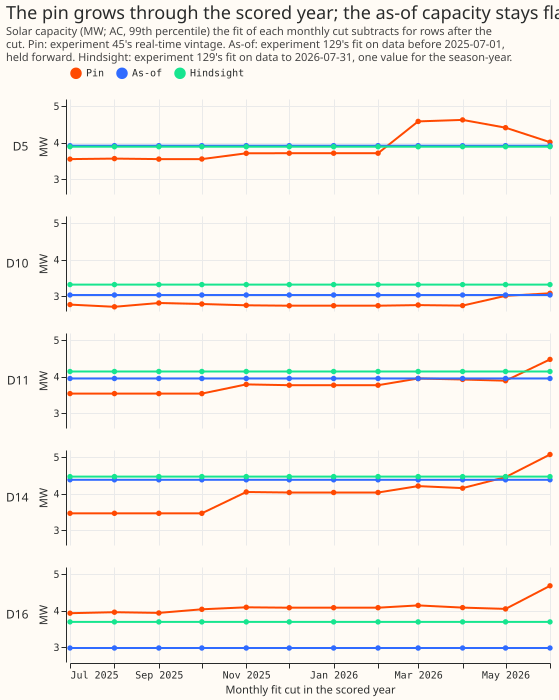
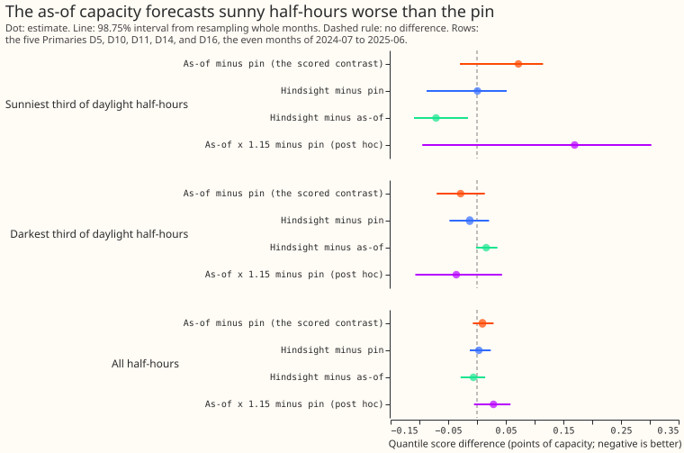
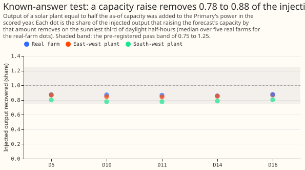

# Experiment 139: does an as-of solar capacity in GAM-K lower the forecast error on sunny half-hours?

**Take-home message: replacing the pinned solar capacity with a capacity read from each substation's
own power did not help, and made sunny half-hours worse by 0.11 points of capacity.** The as-of arm
was better on the darkest third (-0.042 points), but the sunniest-third loss decides the verdict. A
more accurate capacity (the hindsight arm, which sees the future) only matched the pin. The accuracy
of the solar capacity is therefore not what limits the solar part of the forecast. This experiment
does not locate the remaining sunny-day error. The verdict is `refuted` under the pre-registered
rule: the interval of the as-of arm minus the pin on the sunniest third lies wholly above zero. The
replicate months agree in sign but their interval includes zero, so the scored year carries the
verdict.

In this page, the **pin** is experiment 45's capacity held fixed, the **as-of** capacity is read from
data before each 1 July, the **hindsight** capacity is fitted on all data (a ceiling), and the
**sunniest third** is the third of daylight half-hours with the highest unit solar shape at each
Primary. The quantile score is twice the mean pinball loss over 11 quantiles, in points of effective
capacity. GAM is a generalised additive model, CAMS is the Copernicus Atmosphere Monitoring Service
(the irradiance source for the solar shape), and ENS is the ensemble forecast of the European Centre
for Medium-Range Weather Forecasts (ECMWF).

We asked whether the solar capacity subtracted by the convex demand model with a Kalman filter
(GAM-K, [experiment 111](../00111-differentiable-physics-6-ens-forecast-engine-against-bg2/result.md))
should come from [experiment 129](../00129-differentiable-physics-pv-capacity-known-answer-test/result.md)'s
capacity read from the substation's own power, fitted only on data before each 1 July, instead of
[experiment
45](../00045-pvdis-4-weekly-capacity-asymmetric-l1/result.md)'s pinned capacity. The pin and the as-of capacity both feed the same
convex demand model, driven by the mean of the European Centre's weather ensemble as in [experiment 136][e136].
Only the capacity changed. The known-answer test passed and the forecast got worse. Experiment 111's design also fixed the
injection: the test adds a synthetic plant to the scored half-hours only, so no fit or filter sees it.

## Arms and rows

- **Pin (control):** experiment 45's `frozen` vintage, passed through the adaptor. It reproduces
  experiment 111's fits (largest coefficient difference 0.0 at all six Primaries) and experiment 136's
  `a0` forecasts at D5 exactly.
- **As-of (scored arm):** experiment 129's arm 2, fitted on rows before the latest 1 July origin
  (2023, 2024, or 2025) and held for the following season-year, divided by a recovery divisor
  rebuilt from known-answer fits cut at the same origin. The rebuilt estimates for 2025-07-01 agree
  with experiment 129's published ones within 0.05 MW (leakage check). The origin is 1 July and not
  the 1 September of the design note, because the convex demand model's season-years run July to June.
- **Hindsight (ceiling, never a result):** experiment 129's published estimates, fitted on data to
  2026-07-31. **No PV (floor):** capacity zero.
- **Post hoc, not pre-registered:** as-of x 1.15 (one over the known-answer recovery of 0.87) and
  as-of in the convex demand model's own units (the raw capacity, before the divisor).
- **Rows:** `fold_a_daily_gap_v1`, 09:00 UTC `power_fcst_init_time`, leads 0.5 to 168 hours, outside
  the hand-filtered switching events. D5, D10, D11, D14, and D16 are pooled. D9 has no experiment 129
  table, so it has the pin and no-PV arms only. Monthly refits on a 24-month window, filter noise as
  experiment 111, 4 to 8 seconds per Primary for a whole year of fits and forecasts.
- **Slices:** the thirds are per Primary, over daylight half-hours (CAMS-driven unit solar shape above
  0.01), by that shape. Night half-hours are in no third.

## Headline numbers

Quantile score in points of effective capacity, five Primaries, scored year (2025-07 to 2026-06).
Intervals are 98.75% intervals from the month-block bootstrap with 20,000 resamples.

| Arm | All | Sunniest third | Darkest daylight third |
|---|---|---|---|
| Pin | 2.840 | 4.452 | 3.000 |
| As-of | 2.852 | 4.562 | 2.959 |
| Hindsight | 2.840 | 4.481 | 2.963 |
| No PV | 3.389 | 5.502 | 3.983 |
| As-of x 1.15 (post hoc) | 2.860 | 4.615 | 2.910 |
| As-of, model units (post hoc) | 2.874 | 4.569 | 3.050 |

- **C1, as-of minus pin:** all half-hours +0.013 (-0.003 to 0.028); sunniest third **+0.110
  (0.038 to 0.181)**; darkest third -0.042 (-0.076 to -0.003). The error of the mean forecast agrees:
  sunniest third +0.221 (0.114 to 0.359).
- **C2, hindsight minus pin:** sunniest third +0.029 (-0.020 to 0.085); all half-hours +0.001
  (-0.011 to 0.013). The ceiling gives no gain over the pin.
- **C3, hindsight minus as-of:** sunniest third -0.081 (-0.125 to -0.043). The hindsight arm also
  holds one value per season-year, so the gap comes from the information date: the hindsight arm
  sees the following year's power, and the as-of arm does not. The comparison is therefore not a
  pure test of staleness.
- **No PV minus pin:** all half-hours +0.549 (0.407 to 0.727); sunniest third +1.051 (0.467 to 1.650).
  At D9, +0.275 (0.062 to 0.460). An explicit solar term is worth about 0.55 points over all half-hours
  (1.05 on the sunniest third). The choice of capacity moves the sunniest-third score by 0.03 to
  0.16 points in the arms above.
- **Post hoc arms:** as-of x 1.15 minus pin on the sunniest third +0.163 (0.100 to 0.218); as-of in
  model units minus pin +0.117 (-0.024 to 0.255). Scaling worsens the as-of arm on sunny half-hours; the model-units arm
  is level with it. The post hoc scale of 1.15 came from the scored-year known-answer recovery, so
  its scored-year contrast is not out of sample.
- **Replicate months (even months of 2024-07 to 2025-06, origin 2024-07-01):** the sign is the same.
  As-of minus pin on the sunniest third +0.072 (-0.030 to 0.115) and on the darkest third -0.028
  (-0.070 to 0.014). Absolute scores: pin 2.765, as-of 2.774, hindsight 2.768, no PV 3.265. The stop
  rule (as-of worse than the pin on the sunniest third after the replicate, interval wholly above
  zero) did not fire, because the interval includes zero.
- **By Primary:** leaving out any one Primary leaves the sunniest-third sign positive (+0.060 without
  D16 to +0.153 without D14); the interval includes zero when D10 or D16 is left out.

## Known-answer test

- **Passed at five of five Primaries for all three plant classes** (real farm, east-west, south-west):
  raising the capacity by half the as-of capacity removed 0.86 to 0.88 (real farm), 0.84 to 0.87
  (east-west), and 0.78 to 0.80 (south-west) of the injected output on the sunniest third.
  The real-farm figures are medians over five real farms. The pre-registered band was 0.75 to
  1.25.
- **The injection enters the scored rows only,** so no fit or filter sees it. The test checks the
  shape match between the ensemble-driven forecast and each plant, not whether a fit absorbs a
  change.
- **The calibrated-fake-ensemble gate of experiment 111 was not rerun.** This experiment uses the
  stored calibration and ensemble of experiment 111 and 136.

## Tail calibration and checks

Nominal levels are 0.01, 0.05, 0.95, and 0.99. Both arms leave too many actuals in the tails: 0.021 of
actuals fall below the 0.01 quantile, and 0.054 rise above the 0.95 quantile. Pinball columns are in points of effective capacity.

| Arm | Below q01 | Below q05 | Below q95 | Below q99 | Pinball q01 | q05 | q95 | q99 |
|---|---|---|---|---|---|---|---|---|
| Pin | 0.0216 | 0.0632 | 0.9465 | 0.9828 | 0.225 | 0.747 | 0.743 | 0.231 |
| As-of | 0.0208 | 0.0629 | 0.9463 | 0.9824 | 0.226 | 0.757 | 0.741 | 0.233 |

- **Audit triggers:** two of the experiment-audit triggers fired. The result contradicts the
  pre-registered prediction of a 0.03 to 0.10 gain, and the session tested two explanations: the
  information date (the hindsight arm, which closes 0.081 of the 0.110 gap) and units or damping (the
  two post hoc arms, which do not). Downstream work (the full-history arm, the calibration
  experiments, the partly pooled GAM, and the card rebuild) waits for this headline. No Opus audit
  was run; Sonnet reviews of the code and the write-up were.
- **Predictions missed:** three pre-registered predictions failed. The as-of gain had the wrong sign.
  The hindsight arm beat the as-of arm by 0.081 and not under 0.03 points. The no-PV loss on the
  sunniest third was 1.05 and not 0.2 to 0.6 points.
- **Benchmarks:** climatology and `manual_heuristic` were not rescored here. Their absolute skill at
  these Primaries is in experiment 111's results, on the same rows.
- **Median minus mean forecast:** 0.0 at every Primary and arm, because the spread table is centred
  by construction, so it checks nothing here.
- **Curtailment cost saving against the manual heuristic:** not computed. No node-plus-generators
  metric exists for these five Primaries.
- **Weather and availability:** the ensemble mean is available at forecast time. The as-of capacity
  uses data before each 1 July origin only, and `e00139_asof_table.py` rebuilds the divisor per
  origin.

## Caveats

- **The scored arm holds one capacity for a year,** so C1 includes the staleness of the as-of
  capacity. A live service could refit monthly. The hindsight arm (also one value per season-year)
  bounds what accuracy alone gives, and it equals the pin.
- **The loss is concentrated at D16 and D10.** As-of minus pin on the sunniest third, per Primary:
  D16 +0.313 (0.138 to 0.490), D10 +0.222 (0.163 to 0.303), D11 +0.034 (-0.001 to 0.071), D5 +0.040
  (-0.183 to 0.344), and D14 -0.060 (-0.131 to 0.008). Staleness fits D16, where the pin (3.9 to
  4.7 MW) sits above the as-of capacity (2.98 MW). At D5 and D14 the as-of arm is level with or
  better than the pin, so the pooled loss leans on two Primaries. The post hoc arms rule out a simple
  unit or damping fix but do not identify the cause.
- **Tertile edges** come from the pin frame over the scored period, including D9.
- **The origin is 1 July,** so the 2025 estimate used for the scored year covers the 2025 season-year
  from the 2025-07-01 cut.
- **Replicate months cover six months only,** so the replicate intervals are wide.
- **The adaptor lives in this folder** (`e00139_adaptor.py`). Moving it into `packages/studies`
  would be a module change that needs the maintainer's review.

## What to try next

- **Keep the pin.** The capacity is not the limiting input; the next solar experiment should target
  the sunny-day forecast of the ensemble mean (per-member solar, or the cloud damping of the
  irradiance calibration) or the fixed solar shape.
- **If a capacity source is still wanted,** test one refitted monthly and compared with the pin
  weekly path, since a flat annual value loses to the hindsight value.

[e136]: https://github.com/openclimatefix/nged-substation-forecast/pull/1437
