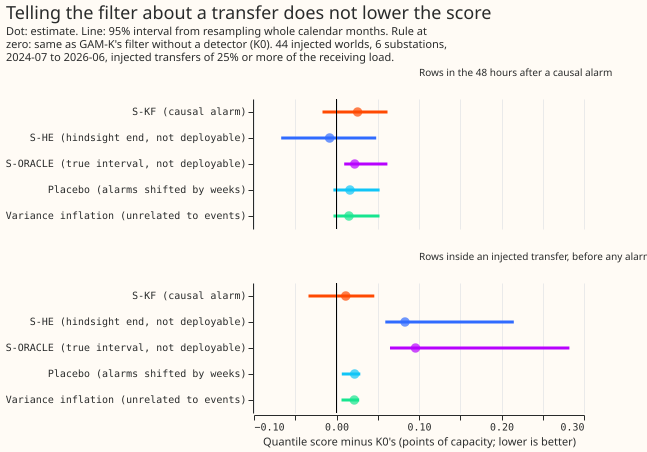

**Take-home message.** Telling GAM-K's Kalman filter that a load transfer has begun did not lower
the forecast's error. Even the arm given the true start and end of each injected transfer scored
slightly worse than the filter alone. The reason is that the fitted filter already follows a step in
its residual within about a day, so there is no slow adaptation for the detector to speed up. The
detector's remaining value is therefore at the end of a transfer (the step reverses and the filter's
level carries the old step forward), which this experiment's arms did not address.

## What we asked, and the answer

We asked whether the refit-offset neighbour-count detector (RO-NC, the detector of
[experiment 130](../00130-ro-nc-detector-on-the-gam-k-residual/result.md)) lowers the forecast's
error when its output is fed into GAM-K's Kalman filter. We injected the headline-band transfers of
experiment 147's draw (25% or more of the receiving load, lasting over a day) into the real
residuals, in 44 injected worlds that touch six Primary substations. We ran the detector with the
causal end rule of
[experiment 147](../00147-causal-live-end-rule-for-ro-nc/result.md), and gave the filter a second
"switched" regime whose level variance is a multiple of the fitted one. The filter did not improve:
every setting scored worse than the filter alone on the tuning months, so the stop rule ended the
experiment before the real year was scored. The method follows
[Kalman filtering of GAM residuals](../00111-differentiable-physics-6-ens-forecast-engine-against-bg2/result.md)
(experiment 111) and a two-model mixture filter in the style of the interacting multiple model
filter.

## Arms, rows, and numbers

- **Arms.** K0 (GAM-K's filter, no detector). S-KF (the two-regime filter; prior 0.5 of the switched
  regime while a causal alarm is active, level variance 4 times the fitted one, chosen on the tuning
  months from prior {0.5, 0.9} and multiplier {4, 16, 64, 256}). S-HE (the same filter with the
  hindsight end, not deployable). S-ORACLE (prior from the true transfer interval, not deployable).
  Placebo (the causal prior shifted by a random whole number of weeks). Variance inflation (the
  placebo prior with no likelihood update). All share K0's spread, so each contrast is a difference
  in location only.
- **Rows.** `fold_a_daily_gap_v1` runs at the five decision substations and D9 (labels as in
  [experiment 134](../00134-differentiable-physics-same-weekday-error-profile-on-gam-k/result.md)),
  replicate months (even months 2024-07 to 2025-06) and the scored year (2025-07 to 2026-06), leads
  0.5 to 168 h, rows outside the hand-filtered switching events. The rows scored are those inside an
  injected transfer (and 72 h after) or within 48 hours after a causal alarm is known: 592,087 rows
  in the alarm window and 440,353 inside a transfer before any alarm. Intervals resample the 16
  calendar months of target time.
- **C1 (S-KF minus K0, 48 hours after a causal alarm):** +0.026 points (-0.017 to +0.062); K0's
  own score on these rows is 4.35 points (3.15 to 5.55). Mean-forecast absolute error: +0.022
  (-0.038 to +0.069). The point estimate is positive and the interval includes zero.
- **S-ORACLE minus K0:** +0.022 (+0.009 to +0.062) in the alarm window and +0.096 (+0.065 to +0.282)
  inside a transfer. **S-HE minus K0:** -0.008 (-0.067 to +0.048) in the alarm window and +0.083
  (+0.059 to +0.215) inside a transfer.
- **Controls.** Placebo +0.016 (-0.004 to +0.052) and variance inflation +0.015 (-0.004 to +0.052) in
  the alarm window: S-KF is no worse than either, and no better.
- **Why nothing moves.** GAM-K's fitted level variance `q` is 0.7 to 9.5 points squared per day, and
  its observation noise 0.2 to 0.8 points, at the four substations whose settings were printed
  (D10, D11, D14, D16). The filter's level follows a step within about a day. A synthetic 8-point
  step with illustrative settings (`q` 0.5, noise 2.0 points) reaches 7.9 points after 12 hours
  without any regime.
- **Tail calibration** (alarm-window rows, K0 and S-KF alike): q95 coverage 92.2% against a nominal
  95%, q05 coverage 84.5% against 95% above q05. On winter nights (a proxy for cold nights: UTC
  00:00 to 06:00, November to March, 62,564 rows) q95 coverage is 91.1% for K0 and 91.2% for S-KF.
  No q01 or q99 results were computed.
- **By site, S-KF minus K0 in the alarm window:** D16 +0.123, D5 +0.059, D14 +0.017, D9 +0.004,
  D11 -0.004, D10 -0.046. By period: scored year +0.054, replicate months -0.018. Dropping any one
  site leaves the S-KF estimate between +0.006 and +0.040, never below zero.

## Checks

- **Median minus mean forecast per site** (K0 and S-KF identical): D10 -0.08, D11 -0.04, D14 +0.003,
  D16 +0.03, D5 -0.21, D9 -0.03 points. No large shift.
- **The mean-forecast error beside each quantile-score contrast** is in the bullets above; it points
  the same way as the quantile score for every arm.
- **Triggers fired: 1 and 5.** The known-answer arm (S-ORACLE) does not show the gain it should, and
  an arm given more information than the arm that contains it (S-ORACLE against K0) is worse. The
  audit by a fresh Opus agent that the `ml-experiment` skill requires has not run: the brief allows
  one Opus review only with the maintainer's approval. The experiment is not merged until that is
  decided. The synthetic step and the fitted `q` above are the explanation tested so far.

## Departures from the plan

- **S-KF's prior is binary** (0.5 while an alarm is active, 0 otherwise), not a logistic function of
  the detector's score. **S-F (plain features) was not built**, and **the real year was not scored**
  (C3 and C5 have no number), because the stop rule fired on the tuning months. The placebo and
  variance-inflation controls were run on the injected worlds only.
- **The causal alarm is known from 96 half-hours (48 hours) after the step starts**, a conservative
  stand-in for the statistic's 24-hour window plus the 24-hour peak test. The planned unit test
  (truncating the residual stream and checking the score is unchanged) was **not written**, so the
  claim that the alarm time is causal rests on this lag and on the end rule's own `known_from`.
  A leak would favour the detector, which makes the negative result stronger, not weaker.
- **Intervals are 95%, not the planned family-wise level**, because only one contrast carries a
  verdict. The injected worlds use the ERA5-driven residuals of experiment 130 (cleaner than live
  residuals), the fast-path injection, and K0's spread, which was not refitted per arm.
- **"Within 48 hours of an alarm" means target valid time** from the stamp at which the alarm is
  known. The detector and the moved megawatts are those of experiment 147's headline draw.

## What the next experiment should answer

The filter does not need help finding the start of a transfer. The open question is the return: when
a transfer ends, GAM-K's level still holds the old step for about a day. An experiment can test a
forecast that uses the detector's causal end call (R2, experiment 147) to drop the level shift at
the predicted end, on the same injected worlds, with the oracle end as its ceiling.

## Plan (written before any fit)

**Question.** How much does the switching detector help when its output is fed into the forecast
itself? Earlier results measured the ceiling only: a perfect detector lowers the best guess's score
by 0.42% ([experiment 44](../00044-sw2-2-switching-share-of-best-guess-score/result.md)), and true
moved megawatts close 83% of the gap that the refit-offset neighbour-count detector (RO-NC) closes
16% of ([experiment 88](../00088-sw2-21-nra-forecast-recovers-normal-arrangement-during-and-after-injected-switches/result.md)).
RO-NC is the detector of [experiment 130](../00130-ro-nc-detector-on-the-gam-k-residual/result.md).
Lab conditions are allowed (maintainer, 2026-10-18); every shortcut is named in the write-up.

**Base forecast.** GAM-K member forecasts and the K0 filter as experiment 134 stores them (monthly
refits from experiment 111). The best-guess assembly of experiment 136 is not merged; if it is
ready before the real-year scoring, the same arms are re-run on it, labelled post hoc.

**Arms.**

- **K0** — GAM-K's filter with no detector input (control).
- **S-KF** — the filter becomes a two-regime mixture per hour band. Regime N ("normal running
  arrangement") uses the fitted level variance `q`; regime S ("switched") uses `q` times a
  multiplier chosen on the tuning months. The prior probability of S per half-hour is a logistic
  function of the causal RO-NC score, and the filter's likelihood updates it. The correction is
  the posterior-weighted mean of the two regimes' corrections.
- **S-F** — K0 plus a regression of the residual on two causal features: event age (hours since the
  causal onset, capped at 7 days) and signed step size. Fitted on the tuning months.
- **S-HE** — S-KF with the detector's hindsight end (the interval end from experiment 130's end
  rule). **NOT DEPLOYABLE.** It is the ceiling for the causal arms.
- **S-ORACLE** — S-KF whose prior is 1 inside the true transfer interval and 0 outside, from the
  injected truth (and from the logged events in the real year). **NOT DEPLOYABLE.** Upper bound.
- **Causal onset-only signal** is the deployable input. The harness takes the signal as a table of
  `(series, half-hour, score, signed step)`, so the causal live end rule of experiment 140 can be
  swapped in later without changing the arms.

**Causal score.** RO-NC's step statistic compares the mean of the residual after a stamp with the
mean before it, so a score stamped at the onset has seen up to 24 hours of the future. The
deployable score is therefore re-indexed: the score at stamp `s` uses only residuals ending no
later than `s` minus 3.5 hours (the telemetry delay), the alarm is stamped when the "after" window
is full and not at the onset, and the peak, partner, and veto tests use the same cut. A unit test
truncates the residual stream at `s` minus 3.5 hours and requires the score at `s` to be unchanged.
Only S-HE and S-ORACLE may read onset-stamped scores.

**New filter core (a deliverable).** Experiment 134's filter is single-regime, so S-KF needs a
two-regime core in this folder: a per-stamp prior input, a level-variance multiplier for regime S,
a posterior update from the two regimes' likelihoods, and moment-matched mixing of state and
covariance. Gate: S-KF with the prior fixed at 0 reproduces K0 to numerical tolerance. The
regime-S multiplier grid is 4, 16, 64, and 256 times `q`, chosen on the tuning months.

**Known answer first (injected world).** Draw transfers of known size and timing in the real
residual stream using experiment 130's injection harness (headline band: moved load 25% or more of
the receiving load, lasting over 1 day; other bands descriptively), with injection seeds disjoint
from the tuning months. The frozen GAM-K forecast is not refitted, so adding the moved megawatts to
the stream (experiment 130's fast path) is valid for the filters. Scoring uses actuals plus the
signed moved megawatts at the donor and each receiver, never the original actuals, normalised by
the same effective capacity as the score. The spread is shared across arms (K0's), so every
contrast is a location-only difference. The `scorable` mask is recomputed on the injected world:
injected rows stay in, and logged events overlapping an injection window are dropped. Two gates:
an injected event of size zero reproduces K0 exactly, and check (a): S-KF's posterior probability of
S passes 0.5 within 24 hours of the causal alarm for at least 60% of detected headline-band events.

**Controls.**

- **Placebo.** S-KF with the causal score shifted by a random whole number of weeks within each
  series, which keeps the alarm rate, durations, and hour-of-day structure. Predicted gain: about
  zero.
- **Variance-inflation control.** K0 with regime S's multiplier applied at the same fraction of
  stamps but unrelated to events (the placebo prior, with no likelihood update), to separate
  knowing when from simply adapting faster.
- **False alarms.** Report the alarm rate per series per year, the detection-delay distribution,
  and alarms on Economy 7 winter mornings and evenings.
- **S-F** is fitted on the injected tuning world (disjoint seeds), because the real tuning months
  hold few events; the number of events is stated.

**Real year.** The same arms on the real scored year. The real year can support only "no harm"
(C3) and a descriptive gain near events (C5), because experiment 44 bounds the whole-year gain at
about 0.42%. Logged events are used only descriptively. The expected whole-year change is
computed from the injected-world gain and experiment 44's event frequency and compared with C3's
interval width before the verdict.

**Rows and scoring.** `fold_a_daily_gap_v1`; the five decision substations of experiment 134 plus
D9 beside them; leads 0.5 to 168 h with D+1 (15.5 to 39 h) beside, and the gain by lead band;
winter (November to March) and cold nights (daily mean under about 3 C) separately; tail
calibration, with q95 and q99 coverage and pinball loss on cold nights reported separately (q95
coverage was 73% to 78% in experiment 125); intervals resample whole calendar months; absolute
scores for K0, climatology, the manual heuristic, and (when ready) the best guess shown beside every
contrast. "Within 48 hours of an onset" means the target valid time. A pooled figure weights the six
sites equally. Labels for the sites follow experiment 134; no metered-generator series is used.

**Contrasts (family-wise level 5%, Bonferroni across C1, C2, C3, and C5).**

- C1: S-KF minus K0, injected world, target rows within 48 hours of a causal alarm on a
  headline-band transfer.
- C2: S-F minus K0, same rows.
- C3: S-KF minus K0, real scored year, all rows outside logged events (non-inferiority).
- C4: share of the K0-to-S-ORACLE gap closed by S-KF, injected world (descriptive).
- C5: S-KF minus K0, real scored year, rows within 48 hours of a causal alarm or of a logged event.
- Placebo minus K0 and variance-inflation control minus K0 are descriptive, and S-KF must beat both
  on C1 for `supported`.

**Decision rule.** The threshold is set by the cost of porting: a two-regime filter plus a detector
pipeline step is a new component. Before the verdict, the plan fixes the minimum detectable effect
as the half-width of C3's month-resampled interval.

- `supported`: C1's interval is wholly below zero, S-KF beats the placebo and the variance-inflation
  control on C1, C3's upper end is at most +0.005 points, and the q95 and q99 coverage on cold
  nights is within 2 points of K0's.
- `not supported`: C1's interval includes zero or lies above it, or S-KF fails to beat the placebo.
- `inconclusive`: otherwise, including a C3 interval wider than +0.005 points.

C1 is an easy test by construction (large injected steps). A `supported` verdict therefore means
the mechanism works in the lab, and the write-up says plainly that the real-year benefit is
bounded by experiment 44 and judged by C3 and C5.

**Stop rule.** If check (a) fails, or C1's point estimate is above zero on the tuning months, stop
before scoring the real year, record `not supported` or `inconclusive`, and write up what the
failure rules out. Compute cap: 6 cores at one thread each, 16 GB per job.

**Compute.** CPU only (the corrections are small filters on cached forecasts).
`systemd-run --user --scope -p MemoryMax=16G -p OOMPolicy=continue`, 6 workers,
`OMP_NUM_THREADS=1`.

**Lab shortcuts, named.** ERA5-driven residuals in the detector (as in experiment 130), which are
cleaner than live ENS-driven residuals and so inflate C1; hindsight end in S-HE; true megawatts in
S-ORACLE; fast-path injection.

**Data processing.** Reads `cleaned_power_time_series` with the `substation_zero` flags treated as
kept, as experiment 132 did.

## Reviews planned

A Sonnet review of the plan is triaged above (leakage of the score, the new filter core, scoring
of injected actuals, the vacuous verdict rule, and the missing controls were accepted). Sonnet then
reviews the code for leakage (the detector score at a half-hour may use
residuals ending no later than that half-hour minus the 3.5-hour telemetry delay), then the
write-up. One Opus review only with the maintainer's approval.
