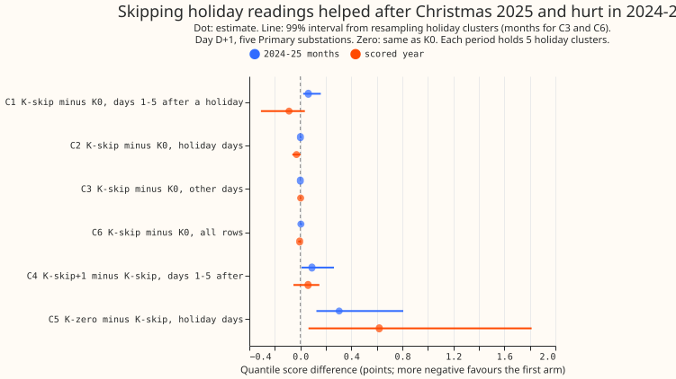
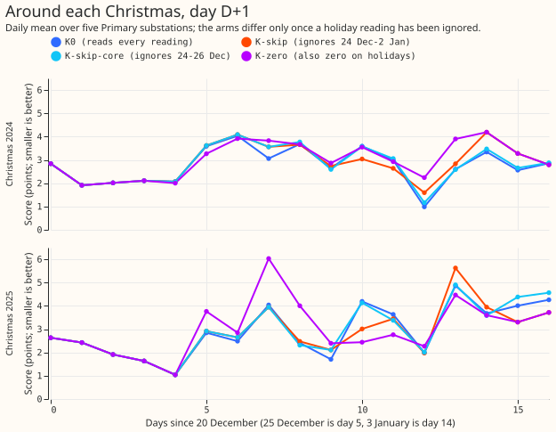
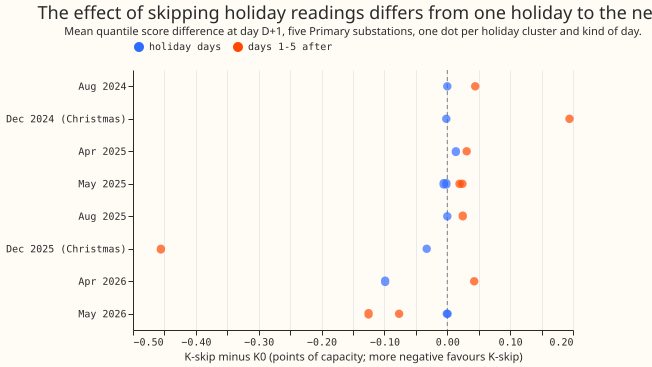

**Take-home: leaving holiday readings out of the filter's update did not reliably help, so these two
Christmases give no reason to change the filter.** The filter corrects the day-ahead demand forecast
using the forecast's recent errors. A holiday cluster is a bank holiday or a run of holidays close
together, such as 24 December to 2 January. After Christmas 2025 the quantile score (lower is
better; 1 point is 1% of a substation's capacity) improved by 0.456 points when the filter ignored
holiday readings, and after Christmas 2024 it worsened by 0.194. Over the 5 holiday clusters of the
scored year (2 July 2025 to 29 June 2026) the score fell by 0.089 points on the 5 days after each
cluster (99% interval from resampling clusters -0.309 to +0.036). Over the 5 clusters of July 2024
to June 2025 it rose by 0.063 (+0.022 to +0.160). In 10 of 12 clusters, the filter's error on the
holiday days had the same sign as on the following days, so the holiday readings are not usually
contamination. Zeroing the correction on holiday days is harmful (+0.62 points there). Experiment
118 did that and ignored the readings together. The verdict is `not supported`.

## What was asked, and the answer in plain terms

**The question was whether Christmas Day and other holidays teach the filter a wrong level that
spoils the days after the holidays.** The filter is the Kalman filter on the recent errors of the
physics-based demand model driven by ensemble weather forecasts (GAM-K; its unchanged form is arm
K0, see "Background and credit" below). We changed only which readings the filter learns from and
left the demand model, the filter settings, and the spread alone. K-skip ignores every reading on a
bank holiday and on 24 December to 2 January. K-skip-core ignores bank holidays (including 1
January) and 24 to 26 December only. K-skip+1 also ignores the day after a holiday. K-zero ignores
holiday readings and sets the correction to zero on holiday days. Scores are quantile scores in
points of effective capacity (1 point is 1% of a substation's capacity; lower is better) at day D+1
(leads 15.5 to 39 hours from the 09:00 UTC forecast time) over five Primary substations (stations
stepping power down from 33 kV to 11 kV), outside the hand-filtered switching events (periods when
demand was moved to or from another substation, marked by hand). An arm is one variant of the
filter. Leakage days are the 5 days after the last day of a holiday cluster.

**Answer.** On the 25 leakage days of the scored year (5 days after each of 5 holiday clusters),
K-skip scored 0.089 points better than K0, but the interval includes zero and the sign reverses in
2024-25. K-skip does no harm elsewhere (+0.002 on the 324 days that are neither holiday nor leakage
days; -0.005 over all 66,844 rows, interval -0.017 to +0.005). The decision rule needed an interval
wholly below zero for the leakage days, so the verdict is `not supported`.

## Figures

## Results

- **Arms and rows.** K0, K-skip, K-skip-core, K-skip+1, K-zero; all share K0's filter settings and
  spread. K0 reproduces experiment 115's frame exactly (largest quantile difference 0 points at 6
  substations; [`frames.txt`](frames.txt)). No demand model was refitted and nothing was tuned.
  "2024-25" pools the tuning and replicate months of July 2024 to June 2025 (each alone holds 1 to 3
  holiday clusters, so the pooling is post hoc); the scored year has 292 runs, 66,844 D+1 rows. Day
  categories hold 5 holiday dates (bank holidays outside Christmas), 10 Christmas-window dates, 25
  leakage dates, and 324 other dates in the scored year.
- **Absolute D+1 scores.** Scored year: K0 2.524, K-skip 2.519, K-skip-core 2.525, K-skip+1 2.522,
  K-zero 2.541. 2024-25: K0 2.425, K-skip 2.429, K-skip-core 2.429, K-skip+1 2.437, K-zero 2.442.
- **The two periods disagree on the days after a holiday (C1, K-skip minus K0).** Scored -0.0887
  (-0.3090 to +0.0355, 5 clusters, 3 of 5 substations better); 2024-25 +0.0626 (+0.0222 to +0.1604,
  5 clusters, 1 of 5); replicate months alone +0.0376 (2 bank-holiday clusters; the days after
  Christmas 2024 fall in the tuning months, so the replicate sign check did not test Christmas).
  Leaving out one substation never changes the scored sign (-0.044 to -0.117).
- **K-skip did no harm on holiday days (C2, margin +0.10).** Scored -0.0301 (-0.0625 to +0.0003);
  2024-25 +0.0004 (-0.0041 to +0.0103). Passed.
- **K-skip did no harm on other days (C3, margin +0.01).** Scored +0.0022 (-0.0009 to +0.0080);
  2024-25 -0.0001 (-0.0011 to +0.0005). Passed.
- **The net effect over all rows is within the interval around zero (C6).** Scored -0.0049 (-0.0166
  to +0.0050); 2024-25 +0.0044 (-0.0016 to +0.0142).
- **Skipping the day after a holiday as well did not help (C4).** Scored +0.0607 (-0.0537 to
  +0.1486); 2024-25 +0.0911 (+0.0090 to +0.2635). Skipping the day after a holiday does not help.
- **Zeroing the correction on holiday days hurt (C5).** Scored +0.6190 (+0.0637 to +1.8134); 2024-25
  +0.3045 (+0.1258 to +0.8079). K-zero's bank-holiday days cost +0.847 against K0 in the scored
  year.
- **Christmas.** K-skip minus K0 on the Christmas window: 2025 -0.033, 2024 -0.002; on the 5 days
  after: 2025 -0.456 (2 of the 3 substations with rows on those days better), 2024 +0.194 (1 of 5).
  On 27 to 30 December, K-skip-core minus K0: 2025 -0.082, 2024 +0.132; K-skip-core minus K-skip:
  +0.240 in 2025 and +0.127 in 2024, so ignoring Christmas Day alone is not what helped in 2025, and
  ignoring 27 December to 2 January as well helped. Each Christmas is one cluster, so no interval is
  meaningful.
- **Other holidays (scored year).** Easter 2026 -0.099 on the holiday days and +0.043 after; Late
  Summer 2025 +0.025 after; early and late May 2026 -0.077 and -0.125 after. In 2024-25 every
  cluster's days after were worse with K-skip (+0.019 to +0.194).
- **Winter (scored year, K-skip minus K0).** November to March -0.0099 (-0.0258 to -0.0000); winter
  evenings 16:00 to 20:00 -0.0233 (-0.0754 to -0.0000); cold-snap nights -0.0696 (-0.2011 to
  -0.0000; 19 dates). The upper ends round to zero because 4 to 5 month blocks resample poorly. In
  2024-25 the same breakdowns were +0.006, +0.005, and +0.029.
- **Cold-snap nights, q95 coverage (scored year, 895 rows; nominal 0.95).** K0 0.840, K-skip 0.869,
  K-skip-core 0.828, K-skip+1 0.878, K-zero 0.850; 2024-25 K0 0.888, K-skip 0.892. All arms
  under-cover on cold nights.
- **Tails, D+1, scored year (coverage gap in points, pinball loss).** K0: q01 +1.31 (0.1912), q05
  +1.75 (0.6362), q95 -1.57 (0.6613), q99 -1.21 (0.2090). K-skip: +1.28 (0.1909), +1.73 (0.6355),
  -1.51 (0.6600), -1.23 (0.2086). K-zero is worse at q95 (-2.08) and q99 (-1.61).
- **Lead bands.** K-skip minus K0 on days after a holiday is negative at every lead band in the
  scored year (-0.025 to -0.100), all with intervals that include zero.
- **Predictions.** P1 failed (its scored-year size held, -0.089, but the replicate and 2024-25 signs
  are positive); P2 failed (-0.082 and +0.132, not at most -0.10 in both); P3 held (-0.030, +0.000);
  P4 held (upper +0.008, +0.0005); P5 failed (+0.061 and +0.091, outside 0.03); P6 held (+0.619,
  +0.305).

## A step added to one day is carried forward by K0 and by no skip arm

**The known-answer gate passed before any scored fit.** A +3-point step added to every reading of
one day was carried by K0 into the following days (share of the step at days 1 to 5 after 1 January
2025: 0.06, 0.23, 0.17, 0.12, 0.08, the median of 5 substations; 5 May and 26 May 2025 give 0.08,
0.23, 0.17, 0.12, 0.08), and carried by K-skip, K-skip+1, and K-zero not at all (largest absolute
share 0, 6 substations). On the control day, 15 January 2025, K-skip matched K0 to within 0.002. A
step on 3 January 2025 was carried by K-skip (at least 0.10 on the second day) and not by K-skip+1.
Each holiday day with readings had 48 readings skipped, and K-skip equalled K0 exactly before the
first skipped reading. Most of these conditions are true by construction of the mask; the
informative result is that K0 carries a step at all. The calendar assigns each half-hour to its
local start date, which `studies.dp_calendar` documents.

## Whether holiday readings usually carry the same level error as the days after

**The holiday readings' residual usually has the same sign as the residual on the days after, so
carrying it forward is usually not wrong.** The filter's residual (observed minus the fitted
forecast) averaged +0.7 points on Christmas 2024's holiday days and +5.6 on the 5 days after, and
+4.3 and +7.7 in 2025. The sign differs in 2 of the 12 clusters (early May 2024 and Late Summer
2025). The magnitudes differ (+0.73 against +5.59 in 2024), and the 12 clusters include two from May
2024 outside every scored period. The result makes "holidays teach a wrong level" unlikely as the
general case in these 12 clusters. The residual does not explain why ignoring 27 December to 2
January helped in 2025, because both Christmases have the same sign and opposite effects. That
remains unexplained, with one Christmas for each sign.

## Checks

- **Median forecast minus mean forecast per site (scored year, D+1, points).** K0 and K-skip: D10
  +0.003, D11 -0.022, D14 +0.014, D16 -0.014, D5 -0.097. The arms share K0's spread, so the values
  are the same to 3 places.
- **Error of the median and of the mean forecast beside each contrast (scored year, D+1).** C1
  -0.141 and -0.142 (quantile score -0.089); C2 -0.040 and -0.037; C3 +0.004 and +0.004; C6 -0.007
  and -0.007. All point the same way as the quantile score.
- **Triggers.** Trigger 2 (a result contradicts its own prediction) applies to P1, P2, and P5; the
  explanation tested above is recorded and does not settle P2. Triggers 1, 3, 4, 5, 6, and 7 did not
  fire: the gate passed; the quantile score and the errors agree; leaving out one substation never
  flips C1's scored sign; no nested arm beats the arm that contains it; no sister experiment on
  these rows; no later experiment that we found depends on this result. No audit was run, and no
  Opus review, as the brief asked.

## Caveats

- **Two Christmases and about 5 holiday clusters per period.** Intervals from resampling 5 clusters
  are wide and unstable, and the Christmas contrasts are single clusters.
- **The spread is K0's.** It slightly favours K0 on days where K-skip's residuals differ.
- **The substations' holiday days are not independent**; the per-substation counts (3 of 5) reflect
  the same weather.
- **The early winters of experiment 122 were not added**: that experiment stored quantile
  predictions only, not residual streams.
- **Gate thresholds were set before the gate was run, and the plan was amended once after its review
  (K-skip-core, cluster bootstrap, extra gate checks), before any score was read.**

## What to try next

- **Keep K0 for this Christmas.** The filter's holiday behaviour is not shown to be a defect.
- **If a holiday term is revisited, test it over more than two Christmases**, for example by running
  GAM-K's filter on past weather for 2019 to 2024, which needs residual streams that no stored
  experiment holds.
- **Test ignoring only 27 December to 2 January's readings** (not 24 to 26 December) as a
  Christmas-specific rule, since K-skip-core and K-skip separate there.

Every number above is printed by `ml-experiments/00143-*/e00143_report.py` and `e00143_gate.py`; the
report's output is [`report.txt`](report.txt).

## Plan, committed before any fit

**The plan below was committed before any fit and amended once, after its review and before any
score was read: K-skip-core, the cluster bootstrap, C6 in the decision rule, and extra gate checks
were added.** Section headings are one level lower than in the plan's commit.

### Background and credit

**GAM-K is the physics-based demand model (a generalised additive model) with the Kalman filter on
its recent errors, as built in [experiment
111](../00111-differentiable-physics-6-ens-forecast-engine-against-bg2/result.md),** following the
Kalman-on-additive-model idea of [de Vilmarest and Goude
(2022)](https://doi.org/10.48550/arXiv.2110.00334). This experiment reuses experiment 111's stored
fits, calibrations, and filter settings; experiment 115's cached ensemble member forecasts, K0
spread, and scoring rows; and the scoring and breakdown code of [experiment
134](../00134-differentiable-physics-same-weekday-error-profile-on-gam-k/result.md). [Experiment
118](../00118-differentiable-physics-kfe-kalman-filter-on-the-gam-effects-on-ens/result.md) tried
two holiday actions at once in a different filter (KEZ-DT): it dropped holiday readings from the
update and zeroed the correction on holiday targets, and it scored +1.24 points worse on 17 holiday
days (+0.62 to +1.83). Halving the correction (KEZ-DTs) was +0.09 on those days. Of the two actions,
only the second is shown to hurt in these experiments. We found no GAM-K breakdown of Christmas in
the earlier experiments. Experiment 134 found that the holiday rule on the recent-error profile
raised the score by 0.004 points (an interval including zero), and that its Christmas-window
contrast was +0.07; the holiday rule's own effect in those windows was not printed.

### Arms

All four arms are K0's member forecasts plus a correction, with K0's filter hyperparameters, spread
tables, and spread factors (experiment 115's stored values), so the arms differ only in the
correction.

- **K0 (control).** GAM-K's filter reads every reading, as in experiment 111.
- **K-skip.** A reading on a holiday day is treated as missing for the update only. A holiday target
  still gets the carried level and transient.
- **K-skip-core.** K-skip, but only bank holidays and 24 to 26 December are skipped. K-skip also
  skips 27 December to 2 January, so its 27 to 30 December targets differ from K0 for two reasons
  (Christmas Day not learned, and four more days not learned). K-skip-core separates them: on 27 to
  30 December it ignores Christmas Day but reads the readings of the 27th onwards.
- **K-skip+1.** K-skip, and also the first non-holiday day after each holiday day is skipped, to
  test slow recovery.
- **K-zero (reference only).** K-skip's filter, and the level and transient are set to zero on
  holiday targets. This is experiment 118's drop-and-zero idea on GAM-K.

**The holiday set is fixed here before any fit:** every England and Wales bank holiday in the
`holidays` package's list for England (including the substitute days it marks as observed), and
every day from 24 December to 2 January. Days are Europe/London dates; a reading belongs to the date
of its half-hour's start.

**Day categories (disjoint, by the target's local date).** *Christmas window* (24 December to 2
January); *bank holiday* (a bank holiday outside that window); *after Christmas* and *after bank
holiday* (days 1 to 5 after the last day of a holiday cluster, where a cluster joins holiday days at
most 3 days apart, so Good Friday and Easter Monday are one cluster); *other* (everything else).
"Leakage days" are the two "after" categories. A day that follows two clusters takes the later
cluster's label, and 1 and 2 January belong to the Christmas window even where New Year's Day is
also a bank holiday. 27 to 30 December lie inside the Christmas window and are also scored on their
own, as K-skip-core against K-skip and against K0. After Christmas the leakage days are 3 to 7
January, by which time K-skip has ignored 10 days of readings; a null C1 there could therefore be a
stale level rather than no contamination, and the K-skip-core contrast on 27 to 30 December is the
cleaner test of Christmas Day's contamination.

### Settings

**No setting is fitted.** The filter hyperparameters, spread tables, and spread factors are those of
K0 as experiment 111 and 115 tuned them. The odd months of 2024-07 to 2025-06 (tuning months) are
therefore a first read, with the known-answer gate run on them; the even months (replicate months)
and the scored year (2025-07-02 to 2026-06-29) are read after the predictions are fixed. Christmas
2024 lies in the replicate months and Christmas 2025 in the scored year. The past-weather winters of
[experiment 122](../00122-differentiable-physics-three-winter-backtest-gam-k/result.md) cannot be
added cheaply: that experiment stored quantile predictions only, not residual streams, so rerunning
the filter on earlier Christmases would need new past-weather fits and is left to a later
experiment.

### Planned contrasts

All at day D+1, quantile score in points of effective capacity, K-arm minus K0 unless stated
(negative favours the first-named arm), pooled over the five decision substations, with 99%
intervals from a day-block bootstrap (below).

- **C1 (decides).** K-skip minus K0 on the leakage days.
- **C2 (non-inferiority).** K-skip minus K0 on holiday days (Christmas window and bank holidays).
- **C3 (non-inferiority).** K-skip minus K0 on the other days.
- **C4.** K-skip+1 minus K-skip on the leakage days.
- **C5 (reference).** K-zero minus K-skip on holiday days.
- **C6 (non-inferiority).** K-skip minus K0 over all D+1 rows (month-block bootstrap,
  `studies.bootstrap`).
- **C7.** K-skip-core minus K0 on 27 to 30 December, and K-skip-core minus K-skip on the same days.

**Required breakdowns for C1 to C3** (K-skip against K0, and K-skip+1 against K0): winter (November
to March); winter evening 16:00 to 20:00; cold nights (days with a daily mean under 3 C, local 22:00
to 06:00), with q95 coverage; each holiday cluster separately, with a figure per Christmas (20
December to 5 January, daily mean D+1 score per arm); 27 to 30 December; every lead band beside D+1.
Tail calibration (coverage and pinball loss at q01, q05, q95, q99) is reported for each arm.

**Cluster bootstrap.** Days of one holiday cluster share filter state, so they are not independent.
A block is one holiday cluster with its holiday days and its 5 following days, over all decision
substations. Clusters are resampled with replacement within the period, 5,000 resamples, a fixed
seed, percentile interval; for C3 and C6 the blocks are calendar months. The write-up states how
many clusters and dates each period holds, and a conclusion resting on few clusters says so.
Christmas occurs once a year, so the Christmas findings rest on two Christmases (2024 and 2025) and
are not generalised.

### Predictions

- **P1.** C1 is between -0.05 and -0.30 in the scored year, and negative in the replicate months.
- **P2.** On 27 to 30 December, K-skip-core minus K0 is at most -0.10 in each of the two Christmases
  (point estimates; two Christmases give no interval worth a rule). Where the largest gain sits is
  read from this contrast, not from C1.
- **P3.** C2 is between -0.05 and +0.10.
- **P4.** C3 is within ±0.01, and its upper interval end is at most +0.01.
- **P5.** C4 is within ±0.03 (skipping the day after a holiday adds nothing measurable).
- **P6.** C5 is above +0.30 (zeroing the correction on holiday targets hurts), the direction of
  experiment 118.

### Decision rule

**The verdict follows C1, C2, and C3 in the scored year, and the replicate months must agree in the
sign of C1.** Skipping holiday readings costs nothing in production, because it is a mask on the
update, so the threshold for a gain is zero.

- **supported:** C1's interval lies wholly below zero; C2's upper end is at most +0.10 (about 4% of
  the score; holiday days are about 5% of the year); C3's upper end is at most +0.01; and C1 is
  negative in the replicate months; and C6's upper end is at most 0.00 (the net annual effect does
  not lose).
- **partly supported:** C1's interval lies wholly below zero but C2 or C3 fails its margin.
- **not supported:** C1's interval includes zero or lies above it.
- A failed known-answer gate caps the verdict at `inconclusive`.

### Known-answer gate (before any scored fit)

**On real tuning-month residuals, add +3 points to every reading of one holiday day, run each arm's
filter on the changed stream, and measure how much of the step reaches the correction on the
following days.** The holiday days injected are 1 January 2025, 5 May 2025, and 26 May 2025 (all in
tuning months); the control day is Wednesday 15 January 2025 (not a holiday, not adjacent to one).
The change in the correction (changed stream minus real stream) is averaged over D+1 rows whose
target is 1 to 5 days after the injected day, as a share of 3 points.

- **Pass conditions.** On each holiday day, K0 carries a share of at least 0.10 into the second day
  after the injected day (the first day whose forecast sees the whole injected day), and K-skip and
  K-skip+1 carry 0.00 (to 1e-9). On the control day, K-skip's share is within 0.02 of K0's, so that
  skipping holidays does not damage the filter elsewhere. K-zero's change on the holiday targets
  themselves is exactly zero.
- **Further checks, all run before any scored fit.** Every holiday day with readings has 46 to 50
  readings skipped; K-skip equals K0 exactly on every row whose cutoff precedes the first skipped
  reading; a step injected on 3 January is carried by K-skip (share at least 0.10 on the second day)
  and not by K-skip+1. Most of these checks are true by construction of the mask. The gate's
  informative parts are that K0 carries a step (the bar is 0.10) and that the masks hit the dates
  intended (the local date of the half-hour's start, as `studies.dp_calendar` defines it).
- **K0 reproduces experiment 115.** The K0 frame's q01, q05, q50, q95, and q99 match experiment
  115's stored K0 frame to 1e-3 points at every site.
- A failed condition is reported and capped as stated in the decision rule.

### Known limits

The spread tables and factors are K0's, tuned for K0's residuals, so they slightly favour K0 on
leakage days where K-skip's residuals are smaller. The effect is conservative for K-skip.

### Compute and process

CPU only, at most 4 cores. Each filter run over a site's grid takes about 1 second, and a frame
build for four arms and six substations takes a few minutes. Every script runs under `systemd-run
--user --scope -p MemoryMax=16G -p OOMPolicy=continue`. Reviews: one Sonnet plan review, one Sonnet
code review, one Sonnet numbers review, and one Sonnet prose review. No Opus review unless the ML
manager asks.
