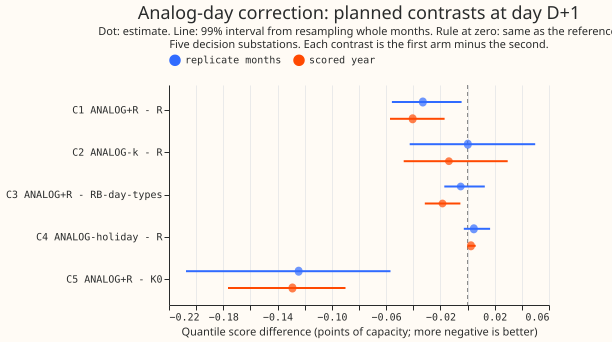
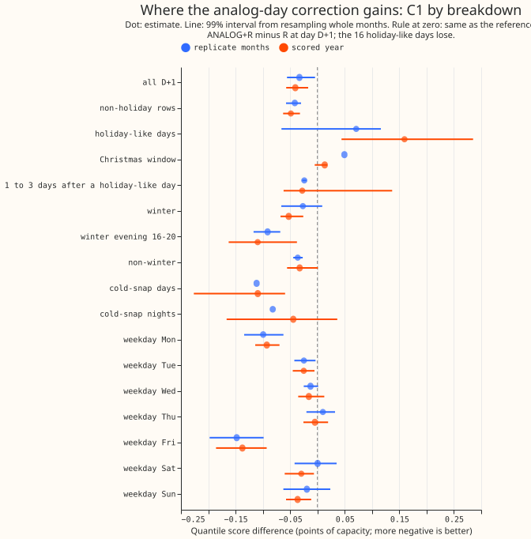
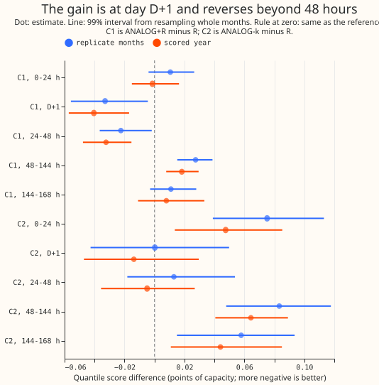
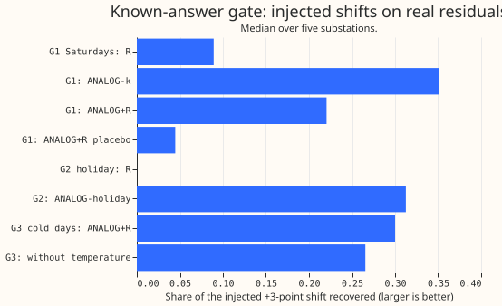

**Take-home: averaging the errors of the 20 most similar past days gave a small, real gain over
recipe R at day D+1 (0.041 points, about 1.7% of 2.44), and the part of the idea that was about
weather and holidays did not help.** Recipe R is the baseline correction: it subtracts 0.75 times
the mean of the last 14 days' errors by half-hour from the forecast of GAM-K, the physics-based
demand model with a Kalman filter on ECMWF ensemble weather. One point is 1% of a substation's
capacity, and lower scores are better. The gain comes from using many same-day-type days over a
13-week season window, including last year's days. Ranking days by forecast temperature added
nothing. Using the same holiday of the year before made holidays worse. The verdict is `small gain`:
the 99% interval is wholly below zero, and its upper end (-0.017) is above the pre-registered -0.02
bar.

## What was asked, and the answer in plain terms

**The question was whether the day-ahead correction should average the errors of the past days that
look most like the day being forecast, instead of the most recent days.** The forecast is the
electricity demand of five Primary substations (the stations that step power down from 33 kV to 11
kV) for the day after the 09:00 UTC forecast origin. [Experiment
115](../00115-differentiable-physics-w1-diurnal-shape-state-on-ens/result.md) found recipe R, and
[experiment 134](../00134-differentiable-physics-same-weekday-error-profile-on-gam-k/result.md)
found that a weekday term added only 0.011 points. This experiment looked for the most similar past
days instead: same day type (Monday, Tuesday to Thursday, Friday, Saturday, Sunday), within a season
window of the same date, and closest in forecast daily mean temperature, with the same holiday for
holidays. It is a nearest-neighbour ("analog") correction as in [Delle Monache et al.
(2013)](https://doi.org/10.1175/MWR-D-12-00281.1), applied to forecast errors.

**Answer.** The best arm, ANALOG+R, scored 2.395 points at day D+1 in the scored year (2 July 2025
to 29 June 2026, 292 runs) against 2.436 for R. Rows inside the hand-filtered switching events are
left out. The settings were chosen on the odd months of July 2024 to June 2025; the even months are
the replicate months.

## Figures

## Results

- **Arms and settings.** K0 (GAM-K); R (recipe R, kappa 0.75); ANALOG-k (kappa 0.75, k 20 days, 8
  weeks); ANALOG+R (kappa 1.0, k 20, 13 weeks, lambda 0.5, the weight of the analog profile against
  R's profile); ANALOG-holiday (R, with the analog profile at weight 0.5 on holiday-like days only;
  fixed settings); ANALOG+R-notemp (no temperature ranking; k 20, 8 weeks); ANALOG+R-recent (post
  hoc: ANALOG+R without days older than 300 days). Settings are fleet-wide, chosen by the tuning
  rows' mean absolute error of the median at D+1; **k reached its largest value on the grid (20) for
  all three tuned arms**. Tuning rows' error: K0 4.299, R 4.131, ANALOG+R 4.053. No demand model was
  refitted, so no retraining schedule applies and the contrasts do not depend on one.
- **Rows.** 66,844 D+1 rows in the scored year and 41,126 in the replicate months at the five
  decision substations (D5, D10, D11, D14, D16), D9 beside them.
- **Absolute scores, scored year, D+1 (all leads).** K0 2.524 (2.812), R 2.436 (2.744), RB 2.424
  (2.750), RB-day-types 2.414 (2.756), ANALOG-k 2.422 (2.793), ANALOG+R 2.395 (2.750),
  ANALOG-holiday 2.438 (2.746), ANALOG+R-notemp 2.400 (2.757), ANALOG+R-recent 2.411 (2.760). D9
  beside them: R 2.123, ANALOG+R 2.107.
- **C1 ANALOG+R minus R (decides the verdict, 99%).** Scored year -0.0405 (-0.0572 to -0.0169), 4 of
  5 substations; replicate months -0.0330 (-0.0558 to -0.0045), 4 of 5. Winter (November to March)
  -0.0526 (-0.0676 to -0.0259); leaving out any one substation keeps the estimate between -0.027 and
  -0.052 with the interval below zero. Over all leads +0.0067 (-0.0048 to +0.0187); at 48 to 144
  hours +0.0182 (+0.0079 to +0.0295).
- **C2 ANALOG-k minus R.** -0.0138 (-0.0471 to +0.0295), 2 of 5; replicate +0.0002. **C3 ANALOG+R
  minus RB-day-types.** -0.0185 (-0.0315 to -0.0052), 5 of 5; replicate -0.0051 (-0.0171 to
  +0.0127). **C5 ANALOG+R minus K0.** -0.1291 (-0.1765 to -0.0899), 5 of 5.
- **Where C1 gains (scored year, D+1).** Monday -0.0928 and Friday -0.1375 (both 5 of 5), Saturday
  -0.0296, Sunday -0.0363, Tuesday -0.0251, Wednesday and Thursday within noise. Winter evening
  16:00 to 20:00 -0.1095 (-0.1625 to -0.0375), 4 of 5. Cold-snap days (forecast daily mean under 3
  degrees C, 80 site-days) -0.1092 (-0.2264 to -0.0593), 5 of 5, but against RB-day-types -0.0738
  (-0.3648 to +0.0501). Non-winter -0.0325 (-0.0557 to +0.0009).
- **Temperature.** ANALOG+R-notemp minus ANALOG+R is +0.0046 (-0.0012 to +0.0110) in the scored year
  and +0.0029 in the replicate months: ranking by temperature adds nothing measurable. On cold days
  the chosen analogs differ from the target by 3.0 degrees C on average (site D10), against 1.3 on
  other days, because few cold days exist.
- **Last year's days.** In the scored year the mean pool of candidates at D10 is 80, of which 51 are
  from the previous year; in the tuning and replicate months it is 34, of which 8 are.
  ANALOG+R-recent minus ANALOG+R is +0.0162 (+0.0107 to +0.0224) in the scored year and +0.0016 in
  the replicate months, which have no previous year to use. About 40% of the gain over R therefore
  comes from last year's days (recent-only minus R: -0.0243, -0.0375 to -0.0072). The tuned settings
  were chosen on a pool with little previous-year history, so they may under-use it.
- **Holidays.** C4 (ANALOG-holiday minus R) on holiday-like days is +0.0713 (+0.0192 to +0.1424), 1
  of 5 substations better; Christmas window +0.0053; Easter +0.1161 (one set of 720 rows). ANALOG+R
  minus R on holiday-like days is +0.1595 (+0.0441 to +0.2851). All 16 holiday-like targets of the
  scored year (D10) used their own holiday's earlier occurrence (identity path); none needed the
  fallback. One earlier occurrence is a worse correction than R's 14-day profile. Non-holiday rows
  carry the whole gain (-0.0486, 5 of 5). The days 1 to 3 after a holiday-like day gain -0.0279
  (-0.0620 to +0.1369) against R, and -0.0672 (5 of 5) against RB-day-types. About 13 holiday-like
  days fall on scored runs, so the intervals are coarse.
- **Tails (scored year, D+1; coverage gap in points, pinball).** ANALOG+R: q01 +1.27 (0.1843), q05
  +1.65 (0.5910), q95 -0.94 (0.6570), q99 -1.16 (0.2130); R: +1.39 (0.1875), +1.76 (0.6138), -1.01
  (0.6573), -1.16 (0.2124). On cold-snap nights (900 rows) the share of readings at or below q95 is
  0.839 for K0, 0.888 for R, and 0.891 for ANALOG+R; below q99 it is 0.953, 0.976, and 0.978.
- **Not computed.** The curtailment-cost metric was not scored, because the experiment changes only
  the day-ahead mean correction and the tail pinball losses above barely move.
- **Predictions.** Held: P4 (temperature adds 0.00 to +0.02: +0.005), P7 (the gain reverses beyond
  48 hours), P8 (tuned k at least 5), and P6's first half (the gain is largest on winter evenings).
  Failed: P1 (C1 was -0.041, below the predicted -0.005 to -0.03), P2 (the pure analog arm was not
  worse than R), P3 (ANALOG+R beat RB-day-types by 0.0185, not within 0.01), P5 (the holiday arm was
  worse than R, not better), and P6's second half (the non-winter estimate was -0.033, not within
  0.005 of zero).

## Gate

**The known-answer gates G0, G1, and G2 passed, and they ran on the tuning months before any
replicate or scored forecast was read.** The shares match the expected values in the plan to three
digits.

- **G0, no lookahead.** Injecting +3 points on the target day and on the origin's own day changed no
  arm's profile at all (largest change 0.0).
- **G1, Saturday evenings.** Share of the +3-point shift recovered, median of five substations: R
  0.089, ANALOG-k 0.352, ANALOG+R 0.220 (twice R is 0.178), the placebo (the day type of 3 days
  later) 0.045 for ANALOG+R and 0.000 for ANALOG-k. G1b at k 3 and 4 weeks: 0.556 with temperature
  ranking and 0.590 without.
- **G2, a recurring holiday.** The Spring Bank Holiday of 26 May 2025 recovered 0.3125 of a shift
  injected on 27 May 2024 for ANALOG-holiday (the plan's expected value) and 0.000 for R.
- **G3, a recurring weather state (informative, did not cap the verdict).** On cold days ANALOG+R
  recovered 0.300 and ANALOG+R-notemp 0.265. The difference, 0.035, is below the 0.05 the plan asked
  for. Together with the null result for temperature above, **the temperature part of the hypothesis
  is untested in the gate and unsupported in the scores**, so it is `inconclusive` rather than
  refuted.

## Checks

- **Median forecast minus mean forecast per site (scored year, D+1, points).** ANALOG+R: D10 +0.011,
  D11 -0.018, D14 +0.007, D16 -0.021, D5 -0.060. R: +0.009, -0.019, +0.002, -0.015, -0.037. K0 at D5
  is -0.097.
- **Error of the median and of the mean forecast beside each contrast (scored year, D+1).** C1:
  -0.0675 and -0.0689. C3: -0.0320 and -0.0323. C5: -0.2447 and -0.2482. The quantile score and both
  errors point the same way.
- **Triggers.** Three fired and none led to an audit, by the manager's decision (quota). Trigger 1:
  G3, a known-answer gate that failed, reported as informative above. Trigger 2: the C1 gain is
  larger than predicted; the recent-only ablation tests an explanation (last year's days carry about
  40% of it). Trigger 5: R, which the holiday arm contains, beats it on holiday-like days (+0.0713);
  the cause is the one-sample holiday profile. Trigger 3 did not fire. Trigger 4 did not fire:
  leaving out one substation never flips C1. Trigger 6 did not fire: experiment 134's C1 interval is
  0.026 wide and this one is 0.040 wide. Trigger 7 did not fire: no later experiment depends on this
  result yet.

## Caveats

- Five substations and one independent winter; about 13 holiday-like days in the scored year.
- k stopped at the largest grid value, so a larger k may do better. The tuning screen used the
  median's absolute error, 135 settings per arm against one fixed setting of R, and the replicate
  months (-0.033) guard against that optimism.
- The tuned settings come from a pool with little history from the previous year; the scored year's
  pool is larger.
- The shift applies at every lead as R does; the gain reverses beyond 48 hours, so a serving version
  would apply it at day D+1 only.
- ANALOG+R-recent is post hoc and was not re-tuned.

## What to try next

- **Test a day-type profile with k 20 or more and a 13-week season window, applied at day D+1
  only,** with lambda tuned on the quantile score. The gain over RB-day-types (0.0185) says the
  larger pool and last year's days matter more than the choice of similarity.
- **Leave holiday-like days on R's 14-day profile** and test a pooled holiday profile (several
  holidays of one kind together) instead of one earlier occurrence.

Every number above is printed by `ml-experiments/00145-*/e00145_report.py`; its output is
[`report.txt`](report.txt).

## Plan, committed before any fit

**This experiment asked whether the day-ahead forecast's recent-error correction should average the
errors of the most similar past days instead of the most recent days.** The forecast is the
electricity demand of five Primary substations (the stations that step power down from 33 kV to 11
kV) for the day after the 09:00 UTC forecast origin, from the physics-based demand model with a
Kalman filter on ECMWF ensemble weather (GAM-K, arm K0;
[experiment 111](../00111-differentiable-physics-6-ens-forecast-engine-against-bg2/result.md)).
Recipe R subtracts 0.75 times the mean of the last 14 days' errors by half-hour
([experiment 115](../00115-differentiable-physics-w1-diurnal-shape-state-on-ens/result.md)). A
weekday term gave only 0.011 points more
([experiment 134](../00134-differentiable-physics-same-weekday-error-profile-on-gam-k/result.md)).
This experiment picks, from all the past days of the same day type within a season window, the
ones whose forecast temperature was closest to the target day's, and averages their errors. It is
a nearest-neighbour ("analog") correction of the kind forecasters use for load on holidays and
extreme weather, as in the analog ensemble of [Delle Monache et al.
(2013)](https://doi.org/10.1175/MWR-D-12-00281.1), applied to the error of a forecast and not to
the weather. A clean negative result is a fine outcome. Experiment 143 (in progress) tests a
different holiday
idea (keeping holiday readings out of the Kalman filter's update); the two do not overlap in
mechanism.

## Read before planning

- **Earlier advice followed.** Experiment 134's advice is to use day types and not seven weekdays,
  and to apply the term at D+1 only. This plan uses day types, and applies the analog shift at every
  lead as recipe R does, so the lead bands show whether the loss beyond 48 hours that experiment 134
  found also appears here.
- **Experiment 115's KW-pl52 arm** (the diurnal shape from 52 weeks earlier) scored -0.034 against
  K0, against -0.075 for the current shape (KW), so last year's shape gains about half as much as
  the
  current one. That means demand errors have a seasonal repeat but the pattern drifts within a year.
  The season window of this plan therefore starts narrow (2 to 13 weeks either side), and the
  most-recent days stay in the pool, so the arm can use last year's days where they match and the
  recent days elsewhere.
- **Residual history.** GAM-K's D+1 errors exist for runs from 2024-04-02, so the first scored
  target has about 15 months of history and the last has about 27 months. **The same-holiday-
  last-year arm can show** whether one earlier occurrence of a holiday, at one substation, predicts
  the next one: all 16 holiday-like days of the scored year (the Late Summer Bank Holiday, 24 to 31
  December, New Year's Day, the Easter weekend, Easter Monday, May Day, and the Spring Bank Holiday)
  have an earlier occurrence in the history, and the scoring script prints that check. **The arm
  cannot show** anything about the tuning or replicate months: of their holiday-like days only the
  two May 2025 bank holidays have an earlier occurrence, so Christmas 2024 and Easter 2025 use the
  fallback to any earlier holiday-like day. The holiday arm's setting is therefore fixed before any
  fit and not tuned, and one earlier occurrence is one noisy sample. The holiday result rests on 16
  days at each of 5 substations.
- **What the tuning rows cannot exercise.** A tuning target has at most 15 months of history, so
  its pool holds recent same-class days and almost no days of the previous year; the scored year's
  pool also holds last year's days. The tuned k and N are therefore tuned on a recency-dominated
  pool, and the write-up reports the number of candidates and of previous-year candidates by period.
  The plan does not predict the tuned N.
- **Warm-up runs.** The history before 2024-07 comes from warm-up runs, whose Kalman errors may not
  have converged; the write-up prints the usable-block count and the mean absolute error by month.
- **Past weather at lag times.** The similarity uses the ENS ensemble-mean temperature that each
  past day's forecast run saw for that day, so it exists at forecast time. The target day's forecast
  temperature is from the run being corrected. No ERA5 enters.
- **No data-processing entry is expected.** Read `docs/ml-experiments/data-processing.md`; the plan
  adds no new processing step.

## Arms

- **K0.** GAM-K as stored (control; linked from experiment 115).
- **R.** Recipe R as experiment 115 stored it (linked): K0 minus 0.75 times the mean of the last 14
  UTC days' D+1 errors by local half-hour, each day's mean removed, no holiday rule. Call its 14-day
  profile A.
- **ANALOG-k.** K0 minus kappa times the mean error of the k most similar past days (below); where
  no
  analog set exists the arm falls back to A. A pure analog correction.
- **ANALOG+R.** K0 plus the shift -kappa x (A + lambda x (the analog profile minus A)). Lambda 0 is
  R, so R is nested. Lambda is the weight of the analog profile in the correction.
- **ANALOG-holiday.** R on every non-holiday-like day; on a holiday-like target day, K0 minus 0.75
  times A plus 0.5 times (the same-holiday profile minus A). The weights are fixed, because the
  tuning months hold too few repeated holidays to tune them.
- **ANALOG+R-notemp (exploratory ablation).** As ANALOG+R, with the k most recent days of the same
  class inside the season window replacing the k closest in temperature, so the contrast with
  ANALOG+R isolates the weather similarity.
- **References from earlier experiments (read only).** Experiment 134's RB and RB-day-types.

**What is similar.** A source day S is a candidate for target day T (both UTC days of the D+1
block; the target's run has origin on T-1) when all of the following hold.

- S is at most T-2, so its block came from the run of day S-1 and S ended before the origin, as in
  experiment 134.
- S has a usable error block (at least 40 of 48 half-hours with a reading) and a forecast
  temperature.
- **Class.** For a non-holiday T, S is a non-holiday-like day of T's day type (Monday, Tuesday to
  Thursday, Friday, Saturday, Sunday). For a holiday-like T (an English bank holiday, Easter
  Saturday or Sunday, 24 December, or 27 to 31 December), S has T's holiday identity: a bank
  holiday's
  name (Good Friday, Easter Monday, Christmas Day, ...), `Easter Saturday`, `Easter Sunday`, or the
  month and day for 24 and 27 to 31 December. If T has no earlier occurrence, S is any holiday-like
  day, and if fewer than 2
  of those exist the arm falls back to A.
- **Season.** For a non-holiday T, S lies within N weeks either side of T's day of year (circular).
  A holiday T uses no season window, since its class is already narrow.
- **Nearest.** The k candidates with the smallest absolute difference between S's forecast daily
  mean
  temperature (the ENS ensemble-mean temperature, mean of the 48 half-hours of the D+1 block, from
  the run of S-1) and T's. Ties go to the more recent day. A non-holiday T needs at least 3
  candidates, otherwise the arm falls back to A.

**No lookahead.** Every input to a correction at origin O is an error block of a day that ended
before O, or a forecast temperature from a run that started before O.

### Settings and how they are chosen

- **Grids.** kappa from 0.5, 0.75, 1.0, 1.25; k from 3, 5, 8, 12, 20; N from 4, 8, 13 weeks (kappa
  1.25
  and k 20 were added after a first screen on the tuning rows put the tuned kappa and k at the old
  grid edge; no replicate or scored row had been read); lambda from 0.25,
  0.5, 0.75 (ANALOG+R and its ablation; ANALOG-k is lambda 1).
- **Rule.** Fleet-wide settings, one set for all five decision substations, chosen by the lowest
  pooled mean absolute error of the corrected median at D+1 on the tuning rows (the odd months of
  2024-07 to 2025-06), as in experiment 134. Each arm's spread is then refitted on the tuning rows
  and one factor per lead band is chosen, as for every arm of experiment 115.
- **R's kappa is tuned on the same rows too.** The tuning screen prints R's mean absolute error at
  kappa 0.5, 0.75, 1.0, and 1.25, so a reader can see whether R at 0.75 was a handicap.
- **Lead scope.** Every arm applies its shift at every lead, as R does, so that R is nested;
  experiment 134 found such a shift loses beyond 48 hours, and the lead bands show it here too. The
  verdict metric is D+1 either way.
- **Tuning uses the median's absolute error, not the quantile score,** for the speed of a screen of
  about 150 settings; the contrasts are on the quantile score.

### Known-answer gate (reported before any score)

**On real tuning-month residuals, inject a repeated pattern, run every arm's full profile code on
the changed readings, and measure the share of the pattern each correction recovers.** Each
injection goes through the same reading filter, class rule, and fallback as the real scoring, so
the gate can fail for a real reason.

- **G1, a recurring day type.** +3 points on Saturdays 17:00 to 21:00 local for 8 Saturdays (2
  November to 21 December 2024), read at the third to eighth Saturday, as in experiment 134. Pass
  at the reference setting (kappa 0.75, k 8, N 8, lambda 1 for ANALOG-k and 0.5 for ANALOG+R): each
  analog arm recovers at least 0.15 of the shift and at least twice what R recovers, and the
  placebo (the class is the day type of the date 3 days after the target; same settings) recovers
  at most what R recovers plus 0.05.
- **G2, a recurring holiday.** +3 points on the evening (17:00 to 21:00 local) of the Spring Bank
  Holiday of 27 May 2024, read at the Spring Bank Holiday of 26 May 2025 (a tuning row). Pass:
  ANALOG-holiday recovers at least 0.15 of the shift (expected 0.75 x 0.5 x 0.83, about 0.31), and R
  recovers
  none, since the earlier occurrence is a year before R's 14 days.
- **G3, a recurring weather state (informative).** +3 points on 17:00 to 21:00 local on every day of
  November 2024 to January 2025 whose forecast daily mean temperature is below 5 degrees C, read at
  the injected days from the sixth on. ANALOG+R should recover at least 0.05 more than
  ANALOG+R-notemp. This gate is reported and does not cap the verdict.
- **G1b, the temperature ranking.** The G1 injection at k 3 and N 4, where the pool of Saturdays
  holds more than 3 candidates, read at the same Saturdays; ANALOG-k with temperature and without
  are reported side by side (informative).
- **G0, no lookahead.** +3 points on the readings of the target day T and of T-1, the origin's own
  day, at the injected Saturday runs: every arm's profile at T must be unchanged to the last digit.
  Failing G0 invalidates the experiment.
- **Expected values, so that a bug is distinguishable from a pass.** Removing each day's mean costs
  a factor of 5/6 (8 injected half-hours of 48 raise the block mean by 0.5). At the G1 reference
  the pool of Saturday n holds the 8 Saturdays T-7 to T-56, so k 8 takes all of them, n-1 injected,
  and the mean share is 0.5625: ANALOG-k about 0.75 x 0.5625 x 0.83 = 0.35, R about 0.089,
  ANALOG+R about 0.22 (the margin over twice R, 0.178, is 0.04), and the placebo about 0.
- A failure of G1 or G2 caps every verdict at `inconclusive`. The gate runs before any replicate or
  scored forecast is read.

### Predictions

- **P1.** ANALOG+R minus R at D+1 in the scored year: -0.005 to -0.03 points.
- **P2.** ANALOG-k minus R: 0.00 to +0.05 (a pure mean of at most 12 days is noisier than the 14-day
  mean).
- **P3.** ANALOG+R minus RB-day-types is within 0.01 (day types carry most of the same information).
- **P4.** ANALOG+R-notemp minus ANALOG+R is 0.00 to +0.02 (temperature similarity adds little at
  D+1,
  because GAM-K already models temperature).
- **P5.** On holiday-like days ANALOG-holiday minus R is -0.05 to -0.3 at D+1, with an interval that
  includes zero, so the predicted outcome is "cannot tell"; in the Christmas window the sign is the
  same.
- **P6.** The gain is largest in winter evenings (16:00 to 20:00 from November to March), and the
  non-winter estimate lies within 0.005 of zero.
- **P7.** Beyond 48 hours the analog arms lose against R, as experiment 134's profile did.
- **P8.** The tuned k is 5 or more.
- **Expected verdict.** P1's range straddles the 0.02 bar, so `small gain` or `not supported` is the
  expected verdict, and `supported` would be a surprise.

### Contrasts and decision rule

- **C1** ANALOG+R minus R (decides the verdict), **C2** ANALOG-k minus R, **C3** ANALOG+R minus
  RB-day-types, **C4** ANALOG-holiday minus R on holiday-like days, **C5** ANALOG+R minus K0.
  **Diagnostics:** ANALOG+R-notemp minus ANALOG+R, ANALOG-holiday minus R on all rows.
- **Supported** if C1's scored-year 99% interval has its upper end at most -0.02; the replicate
  months have the same sign and an estimate at least half the scored estimate; at least 3 of 5
  substations improve in both periods; the winter C1 estimate is at most 0 with its upper end under
  +0.02; and the gate passes. **Small gain** if the scored interval lies wholly below zero but its
  upper end is above -0.02. **Not supported** if the interval includes zero. **Refuted** if the
  interval lies wholly above zero. A gate failure caps every verdict at `inconclusive`.
- **Holiday verdict, separately, descriptive.** Only about 13 holiday-like days fall on scored runs,
  8 of them in December, so a month-block interval is very coarse. C4 is reported with its interval,
  the count of scored holiday-like days, the split between the identity path and the fallback path
  (and how often the fallback fires), and the number of substations that improve. The arm is a
  `candidate` for holidays only when C4's estimate is negative at 4 of 5 substations, both inside
  and outside the Christmas window, and its 95% interval lies wholly below zero. The replicate
  months hold no holiday with an earlier occurrence, so they check the fallback path only.
- **Threshold, with the reason.** 0.02 points (about 1% of the score), because the change adds a
  history lookup keyed on day type, holiday identity, and forecast temperature to the serving path,
  and because experiment 134's day-type arm gained 0.022 over R without such a lookup.
- **Intervals.** 99% intervals for the five planned contrasts and 95% for the rest, month blocks
  resampled, paired across arms (`studies.bootstrap.bootstrap_difference_at_level`).

### Breakdowns and checks

Winter (November to March) and the winter evening peak (16:00 to 20:00); cold nights (daily mean
under about 3 degrees C, 22:00 to 06:00) with q95 coverage; holidays and the days after them;
Christmas window (15 December to 7 January); the days 1 to 3 after a holiday-like day (ordinary
class members, reported as their own row); row and day counts for every cell; the mean absolute
temperature gap between each cold day and its chosen analogs (match quality); Easter; each weekday;
non-winter; per substation (5 of
5 counts); leave-one-substation-out; tails (coverage and pinball loss at q01, q05, q95, q99); lead
bands; and the "Checks" list the `ml-experiment` skill requires. The days after a holiday are the
rows whose local date lies 1 to 3 days after a holiday-like day.

### Compute and schedule

CPU only, at most 4 cores and 16 GB under `systemd-run --user --scope -p MemoryMax=16G -p
OOMPolicy=continue`, with `OMP_NUM_THREADS=1 MKL_NUM_THREADS=1 OPENBLAS_NUM_THREADS=1`. Each arm is
a correction on stored member forecasts, so a fit takes seconds and the settings screen takes
minutes. No demand model is refitted: experiment 111's monthly refits are reused, so the schedule is
fixed and the contrasts do not depend on a retraining cadence.
