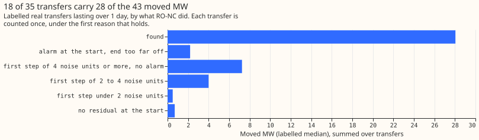
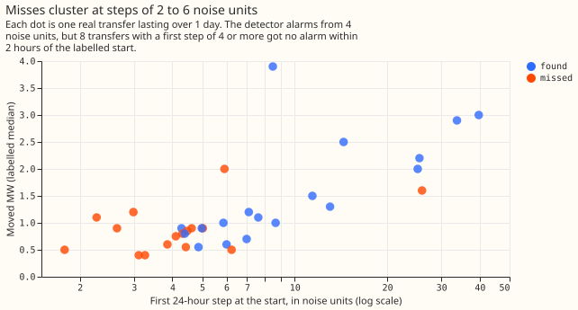

# Experiment 146: which of the 35 real transfers does RO-NC find, and why does it miss the rest?

**The detector finds 18 of the 35 real load transfers lasting over 1 day, and those 18 carry about
two thirds of the power moved.** A load transfer is a switching operation that moves part of one
Primary substation's demand onto neighbouring substations. The refit-offset neighbour-count detector
(RO-NC) looks for such moves as sudden steps in the forecast errors (the residual) of a demand
model, helped by an opposite step at neighbouring substations. We ran RO-NC unchanged, on the
residual of the convex demand model of [experiment
130](../00130-ro-nc-detector-on-the-gam-k-residual/result.md) with its coefficients held fixed. We
then recorded, for each of the 35 real transfers lasting over 1 day that experiment 41 labelled from
the switching log, whether and when RO-NC raised an alarm. RO-NC found 18 (0.51; 95% Wilson interval
0.36 to 0.67). Those 18 carry 28.1 of the 42.7 labelled moved megawatts (MW), a share of 0.657 (95%
interval 0.466 to 0.806). The injected transfers of experiment 130, which are synthetic transfers
added to real power history, gave 0.794. Every found alarm starts within 0.5 hours of the labelled
start. Of the 17 misses, 8 have a first step of 4 noise units or more but no alarm within 2 hours of
the labelled start. A noise unit is the usual size of the detector's 24-hour step in odd-numbered
months, when no transfer is injected. The page is descriptive. Its written prediction was half
right, so the verdict is `partly supported`.

## Results

- **Found:** 18 of 35 (0.51; 0.36 to 0.67). MW-weighted recall 0.657 (0.466 to 0.806), by resampling
  transfers 20,000 times. All 35 have a labelled moved MW, 42.7 MW in total. The injected-transfer
  recall of experiment 130 is 0.794.
- **Reasons for the 17 misses (count, moved MW):** first step of 4 noise units or more with no alarm
  at the start, 8 (7.2 MW); first step of 2 to 4 noise units, 5 (4.0 MW); alarm at the start with an
  end too far off, 2 (2.2 MW); first step under 2 noise units, 1 (0.5 MW); no residual at the start,
  1 (0.7 MW). The first step is the largest 24-hour step within 2 hours of the labelled start.
- **Timing:** the alarm of each found transfer is within 0.5 hours of the labelled start (median
  0.00, range -0.50 to +0.50 hours; a negative value means the alarm came first).
- **End error of found transfers:** median 0.50 hours, largest 11.50 hours, and at most 0.5 hours
  for 13 of the 18. The two alarms with a wrong end are 6.5 and 28.0 hours off.
- **Metering:** 15 of 31 transfers with a metered receiving substation are found, and 3 of 4 without
  one. The prediction that missing a metered receiver explains the misses is not borne out.
- **Prediction:** the recall by MW was predicted at 0.45 to 0.65 and is 0.657, just above. The
  prediction that more than half of the misses have a first step under 4 noise units or an
  unreadable start was wrong: 7 of the 17 misses have such a start.
- **The 8 misses with a first step of 4 noise units or more:** they are 8 of the 26 transfers with
  such a step, and their steps (4.1 to 6.2) sit just above the alarm threshold. 5 have no alarm of
  any size within 48 hours of the start, and 3 have an alarm 3.5, 28.0, and 30.0 hours away. The
  experiment did not test why. One possibility is that the alarm score ranked them below the
  threshold, which was set at 80 false alarms on odd-numbered months.

## Checks

- **Same detector as before:** the table reads the stored alarms of arm B in experiment 138, which
  reproduce experiment 130 row for row, and it counts 18 found as experiment 130 did.
- **Forecast checks:** no forecast is scored, so the checks on the median and mean forecast do not
  apply.
- **Audit triggers:** none of the seven conditions that the `ml-experiment` skill lists for an audit
  holds, because the page has no control, no nested arm, and no planned contrast.

## Caveats

- **Thirty-five transfers,** so the intervals are wide. The convex model was trained with the real
  transfers masked, as in experiment 130.
- **Each miss has exactly one reason,** assigned in this order: no residual at the start, alarm at
  the start with the wrong end, first step under 2 noise units, 2 to 4, then 4 or more. A transfer
  with several causes shows only the first cause that applies.

## What to try next

Find out why the 8 first steps of 4 noise units or more got no alarm, for example by listing the
alarm score of the best candidate near each, before building more detectors for weak onsets.

Code: `ml-experiments/00146-ro-nc-arm-b-on-the-35-real-transfers-over-1-day/`; every number above
except the injected-transfer recall of 0.794 and the reproduction of experiment 130 is printed by
`e00146_rescore.py`.
