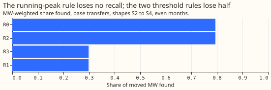
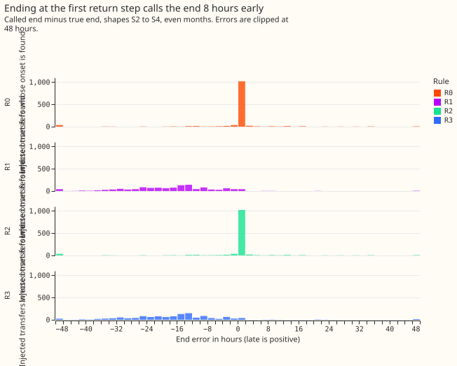
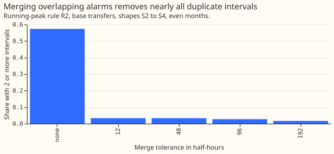

# Experiment 147: can the end of a load-shift interval be called without looking ahead?

**A live service can call the end of a switching interval with no lookahead, and shows no measurable
loss in MW-weighted share found against the offline rule, by waiting until the step statistic falls
to 0.8 of its running peak.** The offline end rule of [experiment
130](../00130-ro-nc-detector-on-the-gam-k-residual/result.md), used by the refit-offset
neighbour-count detector (RO-NC), needs up to 48 hours of data after the first return step, so the
rule cannot be applied live. We tested three rules that use only data available when the end is
called. The running-peak rule R2 gives the same MW-weighted share found as the offline rule: -0.000
(99% interval -0.001 to +0.000) on 1,806 injected transfers pooled over shapes S2 to S4 (602 per
shape), with a false-end share of 0.050 and a median call lag of 29.0 hours after the true end. The
two rules that end the interval as soon as the return step crosses the threshold, R1 (first return
step) and R3 (step held for 6 hours), lose 0.496 of the share found, because they end the transfer a
median 8 hours too early and so miss the transfer. Merging overlapping alarms on one Primary
substation cuts the share of transfers reported as 2 or more intervals from 0.574 to 0.033 and
lowers the share found by 0.006. The verdict is `supported`.

## Arms

- **R0 (reference):** the offline end rule of experiment 130. The earliest honest call time is the
  first return step plus 96 half-hours (48 hours), because the largest step within the next 24
  hours is only known then.
- **R1, first return step:** the end is the first stamp whose opposite step reaches the offline
  threshold (half the onset step, at least 1.5 noise units), called 24 hours later.
- **R2, running peak:** after the first return step, the end is the stamp of the largest opposite
  step so far. It is called once the step falls below 0.8 of that peak, or 24 hours after the first
  return step if the step has not fallen.
- **R3, hold:** the end is the first stamp from which the opposite step stays above the threshold
  for 12 half-hours (6 hours), called when the 12th stamp's step can be computed.
- **Merging:** an alarm on a Primary substation is dropped when an earlier alarm on the same Primary
  substation fired within the tolerance (12, 48, 96, or 192 half-hours: M12, M48, M96, M192), or
  when its step is opposite to a kept interval that is still open or whose end was called less than
  24 hours before. Both tests use only alarms and calls made before the dropped alarm. M12 and M48
  are pre-registered. M96 and M192 are post hoc.

**A noise unit is the usual size of the detector's 24-hour step in odd-numbered months, when no
transfer is injected.** The detector is arm B of [experiment
138](../00138-weaker-onset-detector-on-the-ro-nc-convex-residual/result.md), which is the arm of
experiment 130, scored without refitting on experiment 138's fresh draw of injected transfers.

## Results

- **Share found (95% interval), base transfers, shapes S2 to S4, even months:** R0 0.794 (0.719 to
  0.857); R2 0.794 (0.719 to 0.856); R1 0.298 (0.248 to 0.334); R3 0.298 (0.246 to 0.336).
- **Planned contrasts (99% interval), minus R0:** R2 -0.000 (-0.001 to +0.000); R1 -0.496 (-0.606 to
  -0.406); R3 -0.496 (-0.608 to -0.406). R2 is `supported`. R1 and R3 are `not supported`.
- **False and late ends, among transfers whose onset is found (1,269):** false end 0.050 (R2), 0.613
  (R1), 0.604 (R3), 0.049 (R0). Late end 0.026 for R0 and R2, 0.009 for R1, and 0.020 for R3.
- **Lag, hours from the true end to the call (median, 90th percentile):** R1 19.5 and 24.0; R3 24.5
  and 29.0; R2 29.0 and 32.5; R0 38.5 and 45.5 at its earliest honest call time. R2 is called 9.5
  hours sooner than R0 at the median.
- **End error, hours (median; 10th to 90th percentile):** R0 0.00 (-1.00 to +0.00); R2 0.00 (-1.00
  to +0.00); R1 -8.50 (-16.50 to -1.50); R3 -8.00 (-16.50 to -1.50). A negative value means the call
  named an end before the true end.
- **Merging, applied to R2 (95% interval for the share found):** the share of transfers with 2 or
  more intervals falls from 0.574 (no merge) to 0.033 (M12 and M48), 0.027 (M96), and 0.017 (M192).
  The share found changes by -0.006 (-0.017 to +0.000) for M12 and M48, -0.007 (-0.018 to -0.001)
  for M96, and -0.019 (-0.042 to -0.002) for M192. M12, M48, and M96 are `supported`. M192 is `not
  supported`, because its lower interval end is below -0.02.
- **Precision of intervals:** across all injected batches, the share of intervals that match an
  injected transfer rises from 0.050 (no merge, 137,283 intervals) to 0.063 (R2 with M12 or M48,
  104,091 intervals).
- **Real transfers over 1 day (35, descriptive):** R0 and R2 find 18 of 35, as in [experiment
  146](../00146-ro-nc-arm-b-on-the-35-real-transfers-over-1-day/result.md). R1 finds 7 and R3
  finds 6, with 13 and 14 false ends. With merging, the number of transfers with 2 or more
  intervals falls from 17 to 1.
- **Predictions:** R1's predicted loss of 0.02 to 0.08 was wrong (R1 lost 0.496). R3 was predicted
  to halve R1's false ends and lose 0.01 to 0.04, but the false-end share of R3 is 0.604 against
  0.613. R2 was predicted to give the offline ends on at least 0.9 of transfers with a median lag of
  48 hours, and R2 gives the same share found with a median lag of 29.0 hours. Merging was predicted
  to lower the share of transfers with 2 or more intervals from about 0.2 to under 0.1. The no-merge
  share was 0.574, not 0.2, and the merged share is 0.017 to 0.033.

## End-time accuracy check (descriptive)

- **Partner reversal:** for transfers whose onset is found and whose donor has a partner
  (receiving) series, 773 of the 1,269 under R2, the partner's step reverses within 3 hours of the
  stated end, with a size between 0.5 and 2 times its onset step, for 0.915 of them. The share is
  0.935 of 750 where R2's end is within the tolerance of the true end, and 0.261 of 23 where it is
  outside, so the check separates good ends from bad ends.
- **R1 and R3:** 0.918 and 0.920 of the transfers with a partner pass the same check, although their
  ends are a median of 8 hours early. The check does not flag an early end, because the partner's
  step ramps early too.
- **Real transfers:** 8 of the 9 transfers with a partner series reverse at R0's and R2's end, 7 at
  R1's, and 6 at R3's.
- **Causal and hindsight tables:** the interval tables for every series are written in the layout of
  `xl_intervals.parquet` with a `causal_live` flag and the stamp from which each end is known.

## Checks

- **Same detector as before:** arm B's score and threshold are read from experiment 138 unchanged,
  and R0 reproduces experiment 130's 0.794.
- **Forecast checks:** no forecast is scored, so the checks on the median and mean forecast do not
  apply.
- **Audit triggers:** trigger 2 (a prediction contradicted) fires for R1 and R3. The contradiction
  has a tested explanation: the 24-hour step statistic ramps before the true end, so a threshold on
  it calls the end early, and the end-error medians of about -8 hours show this directly. None of
  the other six conditions holds, and no audit was run.
- **Merge tolerances:** M12 equals M48 because the detector's alarms are local peaks within 48
  stamps, so two alarms on one series cannot be less than 48 stamps apart. M12 is therefore not an
  independent setting.

## Caveats

- **The onset alarm is itself late.** The statistic at the onset needs the next 24 hours, so an
  onset alarm is callable only about 48 hours after its stamp. This experiment did not study that
  lag, and "lag" above counts only the time from the true end to the end call.
- **Best-interval selection uses the truth.** When several intervals match an injected transfer,
  the scored one is the closest to the truth, which favours all rules alike.
- **M96 and M192 are post hoc,** so their confidence intervals are not corrected for the planned
  contrasts.
- **Series 12 is blank by design, and series 14 never alarmed,** so neither appears in the interval
  tables.
- **Long transfers (up to 14 days) were scored descriptively:** no rule differs from R0 by more
  than 0.01 in share found (largest: -0.010 for R1 and R2 with M12, M48, or M96; R3 is +0.009,
  0.000 to +0.021).

## What to try next

**The next experiment should study the delay of the onset alarm itself.** A live service learns of
a start about 48 hours after the start. A further experiment can test the running-peak rule on the
next detector arm that replaces RO-NC.

Code: `ml-experiments/00147-causal-live-end-rule-for-ro-nc/`; every number above is printed by
`e00147_contrasts.py` (saved at
`data/ml-experiments/00147-causal-live-end-rule-for-ro-nc/printed_report.txt`).
