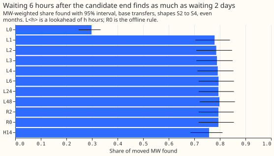
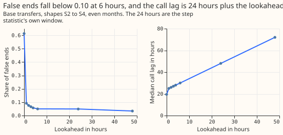
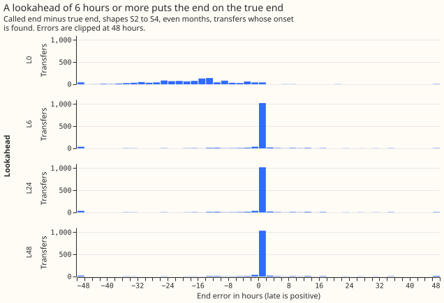

# Experiment 148: how long must a live service wait to fix the end of a load-shift interval?

**On injected transfers, a live service needs only 6 hours of data after the candidate end to fix
the end of a switching interval of the refit-offset neighbour-count detector (RO-NC), with no loss
of recall against the offline rule R0.** We scored the end rule at lookaheads of 0, 6, 24, and 48
hours on 1,806 injected transfers pooled over shapes S2 to S4. The offline rule R0 is the end rule
of experiments 61 and 130, and `L<h>` below is the lookahead rule with h hours. The share of moved MW
found is 0.795 at 6 hours, 0.794 at 24 hours, and 0.798 at 48 hours, against 0.794 for the offline
rule R0, and no lookahead of 6 hours or more loses recall. The call lag is the lookahead plus 24
hours, because the step statistic needs 24 hours of data after each stamp, so 6 hours calls the end
a median 30 hours after it happens and 48 hours calls it 72 hours after. A lookahead of 0 hours is
the same rule as experiment 147's R1 and loses 0.496 of the share found. The verdict is `supported`,
and the smallest pre-registered lookahead that is adequate is 6 hours.

## Results

- **Rule:** after the first return step, the candidate end is the largest opposite step so far. The
  end is fixed once none of the next L hours has a larger step, and called when the 24-hour step
  statistic of the last of those hours can be computed. Alarms are experiment 138's arm B, with no
  refitting, on experiment 147's fresh draw.
- **Planned contrasts, share found minus R0 (98.75% interval):** L0 -0.496 (-0.603 to -0.405); L6
  +0.000 (-0.001 to +0.002); L24 +0.000 (+0.000 to +0.000); L48 +0.004 (-0.002 to +0.011).
- **Adequate lookaheads:** 6, 24, and 48 hours (lower interval end above -0.02, false-end share and
  late-end share at most 0.10). 0 hours is not adequate. The recommended lookahead is 6 hours.
- **False ends and late ends among 1,269 transfers whose onset is found:** L0 0.613 and 0.009; L6
  0.050 and 0.024; L24 0.049 and 0.026; L48 0.034 and 0.033; R0 0.049 and 0.026; R2 0.050 and 0.026.
- **Call lag, hours from the true end (median, 90th percentile):** L0 19.5 and 24.0; L6 30.0 and
  30.0; L24 48.0 and 48.0; L48 72.0 and 72.0; R2 29.0 and 32.5; R0 38.5 and 45.5. The median and
  90th percentile of L6 to L48 equal the lookahead plus 24 hours, because the candidate end is the
  true end for at least 90% of transfers.
- **End error, hours (median; 10th to 90th percentile):** L6 0.00 (-1.00 to +0.00); L24 0.00 (-1.00
  to +0.00); L48 0.00 (-0.50 to +0.10); L0 -8.50 (-16.50 to -1.50).
- **Reference rows:** R2 (experiment 147's running peak) is -0.000 (-0.001 to +0.000) against R0.
  The hindsight rule H14 (largest opposite step in 14 days, known at 14 days) is -0.037 (-0.059 to
  -0.021) with a median lag of 304 hours, so waiting longer than needed loses recall.
- **Post hoc shorter lookaheads (95% intervals, no correction):** L1 -0.015 (-0.030 to -0.001),
  false ends 0.091, lag 25.0 hours; L2 -0.009 (-0.017 to -0.000), 0.076, 26.0; L3 -0.006 (-0.015 to
  +0.000), 0.066, 27.0; L4 -0.003 (-0.009 to +0.002), 0.058, 28.0. The intervals are uncorrected and
  L3 already touches zero, so this evidence does not justify choosing 4 hours over the
  pre-registered 6 hours; it shows that 6 hours is not a sharp edge.
- **Merging overlapping alarms within 24 hours (M48),** applied to each rule: the share of transfers
  with 2 or more intervals falls from 0.574 to 0.028 for L24, 0.034 for L6, and 0.025 for L48. The
  share found falls by 0.006 (-0.014 to -0.001) for L6, L24, L48, and R2, and by 0.049 for H14.
- **Real transfers over 1 day (35, descriptive):** L6, L24, and L48 find 18 of 35, as R0 and R2 do,
  with 2 false ends; the mean call lag is 28.4, 44.4, and 65.8 hours. L0 finds 7 of 35 with 13 false
  ends. With merging, L6 and L24 keep 18 found, L48 finds 17, and the transfers with 2 or more
  intervals fall from 17 to 1.
- **Long transfers (up to 14 days):** no lookahead differs from R0 in share found.
- **Predictions:** the call lags were predicted to be about 24, 30, 48, and 72 hours; L6, L24, and
  L48 matched, and L0 had a median of 19.5 hours, because its end is a median 8.5 hours early. L0
  reproduced R1 (0.298, false ends 0.613), as predicted. L6 was predicted to lose 0.10 to 0.40 with
  false ends of 0.2 to 0.5, and it lost 0.000 with 0.050. L24 and L48 matched (losses under 0.03 and
  0.01, false ends under 0.10 and 0.06). A plausible reason is that an injected transfer ends in a
  step, so a candidate that nothing beats within 6 hours is usually the true end (about 93% of
  onset-found transfers are within tolerance); this was not tested. Real transfers, whose return can
  ramp or arrive in stages, have 18 found of 35 at every lookahead from 1 hour up, so they do not
  support the 6-hour recommendation on their own.

## Checks

- **Same detector as before:** arm B's score and threshold are experiment 138's, R0 reproduces
  0.794, and L0 reproduces experiment 147's R1 (0.298).
- **Forecast checks:** no forecast is scored, so the checks on the median and mean forecast do not
  apply.
- **Audit triggers:** trigger 2 (a prediction contradicted) fires for L6, and for the L0 call lag.
  The contradiction goes in the safe direction, since the rule did better than predicted, and the
  verdict is unchanged whichever way the prediction had gone, so no Opus audit was run; a Sonnet
  reviewer read the code and the write-up instead. None of the other six conditions holds.
- **Interval table:** `run/intervals.parquet` under the private folder holds every setting in the
  layout of `xl_intervals.parquet`, with `known_from`, `setting`, `rule`, `lookahead_hours`, and
  `merged`. Series 12 is blank by design and series 14 never alarmed, so neither has an interval.

## Caveats

- **The onset alarm is itself late** (callable about 48 hours after the start, as [experiment
  147](../00147-causal-live-end-rule-for-ro-nc/result.md) found), so the
  total delay from a start to a fixed end is longer than the lag above.
- **Injected transfers have clean ends.** The 18 of 35 real transfers found are the same at every
  lookahead from 6 hours, so real transfers do not tell the lookaheads apart.
- **L1 to L4 are post hoc,** so their intervals are not corrected for the four planned contrasts.
- **The alarm-to-transfer matching uses the truth:** when several intervals match an injected
  transfer, the scored one is the closest to the true end, which favours every rule alike.

## What to try next

**The next experiment should shorten the onset alarm's delay,** because the 24-hour step window sets
the floor under both the onset and the end calls. A shorter window trades noise for speed.

Code: `ml-experiments/00148-switching-end-rule-lookahead-ro-nc/`; every number above is printed by
`e00148_contrasts.py` (saved at
`data/ml-experiments/00148-switching-end-rule-lookahead-ro-nc/printed_report.txt`).
