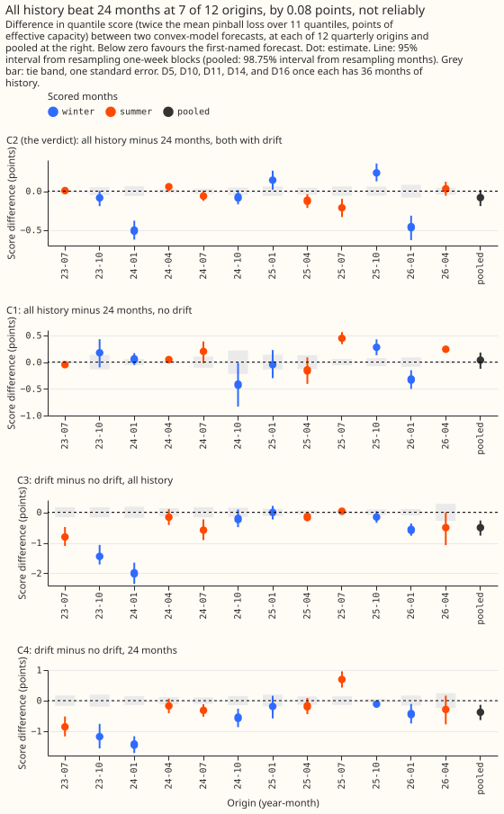
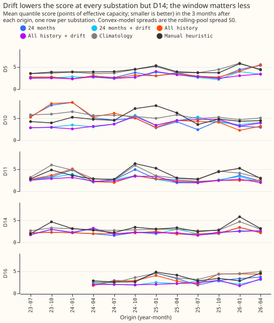
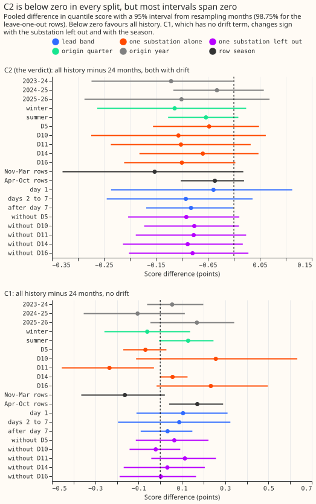
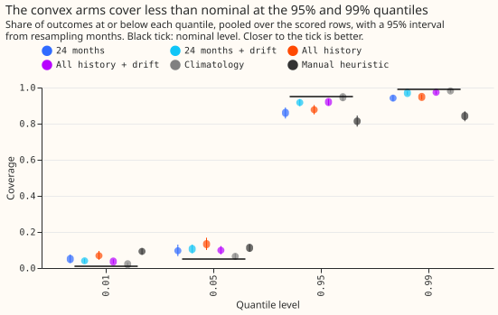

---

**Training the convex demand model on every year back to 2019, instead of the last 24 months, lowered
its forecast error by only about 3% (0.08 points of substation capacity), and the difference could
be chance. The verdict is `inconclusive`.** The demand model is a convex fit of substation power
from weather and calendar terms, and its quantile score (defined below) is the error measure. The
drift term, a term that lets the forecast level move slowly over the years, lowered the score by
0.38 points on 24 months and by 0.50 points on all history, about 5 to 6 times as much as the
window did. The interval for the window's effect (98.75%, from resampling months) runs from -0.19 to
+0.01. We scored five Primary substations at 12 quarterly refits, on past weather and not on weather
forecasts. This experiment did not test whether explicit heating, switching, or pooled terms would
make longer history help.

We asked whether, with the solar term fixed, a longer training window helps the convex model of
`studies.dp_gam`. The solar term is a pinned capacity times a unit solar shape in every arm. We
refitted the model every quarter at 12 cut dates, called origins, from 1 July 2023 to 1 April 2026,
and scored each fit on the 3 months after its origin. The two windows are the last 24 months and
every year from the substation's first usable date (September 2019 to February 2021), each with and
without the drift term D1. Training and scoring use past weather only (ERA5 temperature and CAMS
irradiance), so every score is a ceiling for a forecast made on weather forecasts. "Score" means the
quantile score: twice the mean pinball loss over 11 quantiles, in percentage points of each
substation's effective capacity, where lower is better. Contrasts are treatment minus reference. C1 is all history minus 24 months with no drift term, C2
(the verdict) is the same with the drift term in both, C3 is drift minus no drift on all history, and
C4 is drift minus no drift on 24 months.

**Figure 1 shows C2 at 7 of 12 origins below zero and at 4 above, and C1 with no stable sign.** The
largest C2 differences are at the January 2024 and January 2026 origins (-0.51 and -0.46). The four
origins above zero are July 2023, April 2024, January 2025, and October 2025.

**Figure 2 shows the drift term lowering the score at four of the five substations and the two
windows trading places from origin to origin.** Pooled scores run from 2.760 to 3.262 for the four
arms. Climatology scores 4.010 and the manual heuristic 3.945.

**Figure 3 shows C2's estimate below zero in every split, with most intervals spanning zero.** C1
changes sign by substation, by season, and when D10 is left out.

**Figure 4 shows the drift arms covering about 92% at the 95% quantile and 97% at the 99% quantile,
where the arms without drift cover 86% to 88% and 94% to 95%.** Climatology comes closest to the
nominal 95% (94.6%).

## Results

- **Arms:** the convex model of `studies.dp_gam` at experiment 104's tuned penalties (ridge 0.1,
  drift step 3,000) with experiment 45's pinned solar capacity: A24 (24 months, no drift), A24+D1,
  Aall (every year, no drift), and Aall+D1. The spread is experiment 107's baseline spread S0,
  fitted on each arm's own residuals over the 12 months before each origin.
- **Rows:** experiment 107's `dp_mw_v1` rows outside the hand-filtered switching events, at the
  substation-origin pairs with at least 36 whole months of usable history before the origin: D5,
  D10, D11, and D14 at all 12 origins and D16 from April 2024 (57 of 60 pairs), 241,983
  half-hours. Quarterly refits, as experiment 107; weekly refits might change the contrasts.
- **Absolute scores** (95% intervals from resampling months; mean error is actual minus mean
  forecast, in points):

| Arm | Score | Mean error |
|---|---|---|
| Aall+D1 | 2.760 [2.625, 2.906] | -0.064 |
| A24+D1 | 2.843 [2.694, 2.996] | -0.205 |
| A24 | 3.224 [2.998, 3.463] | +0.899 |
| Aall | 3.262 [3.090, 3.467] | -0.218 |
| Manual heuristic | 3.945 [3.680, 4.216] | +0.810 |
| Climatology | 4.010 [3.816, 4.213] | -1.201 |

- **C2 (the verdict), all history minus 24 months, both with drift:** -0.083 [-0.192, +0.014]
  (98.75% interval from resampling months), 7 origins below zero, 4 above, 1 tied. The mean absolute error of the mean forecast
  contrast is -0.120 [-0.300, +0.047]. Winter-quarter origins give -0.114 [-0.263, +0.024]
  and summer-quarter origins -0.054 [-0.127, +0.009]. Leaving out each substation in turn gives
  -0.076 to -0.091, all below zero.
- **C1, all history minus 24 months, no drift:** +0.038 [-0.125, +0.178], 4 below, 6 above, 2 tied.
  Leaving out D10 gives -0.021. Rows from November to March give -0.163 [-0.365, +0.021] and rows
  from April to October +0.171 [+0.041, +0.290].
- **C3, drift minus no drift on all history:** -0.502 [-0.765, -0.270], 10 origins below zero, none
  above. Experiment 107 found -0.451 for the same contrast on its own rows, which include D16 at
  all 12 origins; the sign and size agree.
- **C4, drift minus no drift on 24 months:** -0.381 [-0.638, -0.136], 11 below, 1 above. The drift
  term raised D14's score on both windows (+0.085 on all history, +0.202 on 24 months) and lowered
  the other four substations' by 0.23 to 1.22 (all history).
- **Tail calibration** (percentage of outcomes at or below the quantile; nominal 1, 5, 95, and 99;
  pinball loss in brackets):

| Arm | q01 | q05 | q95 | q99 |
|---|---|---|---|---|
| A24 | 5.0 (0.303) | 9.6 (0.845) | 86.0 (0.911) | 94.1 (0.309) |
| A24+D1 | 4.0 (0.217) | 10.6 (0.724) | 91.7 (0.777) | 97.0 (0.238) |
| Aall | 6.8 (0.352) | 13.2 (0.933) | 87.7 (0.880) | 94.8 (0.290) |
| Aall+D1 | 3.6 (0.214) | 9.8 (0.711) | 92.0 (0.737) | 97.4 (0.221) |
| Climatology | 2.1 (0.228) | 6.5 (0.873) | 94.6 (0.994) | 98.1 (0.270) |
| Manual heuristic | 9.2 (0.426) | 11.2 (0.906) | 81.5 (1.225) | 84.2 (0.749) |

- **Curtailment cost:** not computed. These are demand substations, and the node metric scores
  generators.

## Pre-registered predictions and what happened

- **C2 pooled between -0.30 and -0.05:** held (-0.083).
- **C2 below zero at 8 or more of 12 origins:** failed (7).
- **C2 larger in winter-quarter origins than summer:** held (-0.114 against -0.054).
- **C1 sign varies by origin:** held (4 below, 6 above).
- **C3 between -0.2 and -0.5:** failed by 0.002 (-0.502). **C4 smaller than C3:** held (-0.381).
- **C2 moves under 0.15 when one substation is left out:** held (at most 0.008).
- **Verdict:** the interval spans zero, so `inconclusive` by the pre-registered rule.

## Checks

- **Median forecast minus mean forecast, per site:** exactly 0.000 for every arm, because the
  centred spread has a zero median, so this check cannot expose a shifted forecast. The mean error
  in the absolute-score table does: A24 misses low by +0.899 and Aall+D1 is nearly unbiased
  (-0.064).
- **Mean absolute error of the mean forecast beside each score contrast:** C1 +0.019 [-0.227, +0.240], C2 -0.120
  [-0.300, +0.047], C3 -0.720 [-1.083, -0.386], C4 -0.581 [-0.966, -0.210]. Each of the four contrasts has the same sign as its score contrast.
- **Blocking checks, all passed** (the reproduction is in `report.txt`; the other two are enforced in
  the scripts, which raise on a violation): Aall and Aall+D1 reproduce experiment 107's G-all
  and G-all+D1 means exactly over 350,428 rows each (maximum absolute difference 0.0), every fit's
  non-negativity violation is below 2e-15, every spread-pool row has a valid time at or before its
  origin, and the pairs scored per origin are 4 sites for the first 3 origins and 5 after.
- **Audit triggers.** Triggers 2, 4, and 5 fired. Triggers 1, 3, 6, and 7 did not: the reproduction
  controls match exactly (1), every mean-absolute-error contrast has the sign of its score contrast
  (3), C3's interval is 1.1 times as wide as experiment 107's matching contrast (6), and no other
  experiment cites this one (7). **No audit has run: the `ml-experiment` skill requires an Opus audit
  for a fired trigger, and the experiment's brief allows Sonnet only, so merging needs the
  maintainer's decision to waive the audit or to lift the limit.** The verdict is `inconclusive`,
  and an audit could only turn it into a finding if it found a method fault.
    1. **Trigger 2 (contradicts its prediction):** C2 was below zero at 7 origins, not 8 or more, and
       C3 missed its predicted range by 0.002. The origins above zero are July 2023, April 2024,
       January 2025, and October 2025. The explanation tested post hoc is the history rule's weakness
       below: the early origins hold little extra history.
    2. **Trigger 4 (leaving one site out flips a sign):** C1 flips to -0.021 without D10. C1 is not
       the verdict contrast, and C1 already had no stable sign.
    3. **Trigger 5 (a nested arm wins):** the 24-month arm scores 0.038 better than all history
       without drift, although the all-history window contains the 24 months. The difference is
       inside its interval. The seasonal split of C1 (post hoc) is the explanation tested.

## Caveats

- **Past weather** (ERA5 and CAMS) at forecast time is a ceiling, as in experiment 107.
- **Five Primaries** are scored, with D16 entering at April 2024, so the first three origins hold
  four substations.
- **The 36-month rule does not guarantee 12 extra months of training data.** The rule counts calendar
  months from each substation's first usable date, but training skips the COVID-lockdown window and
  the switching masks. At the July 2023 origin the all-history window holds only 1.7 extra months
  at D5, 3.7 at D10, and 6.2 at D11, and none at D14, so C2 compares two identical fits there. Extra
  history reaches 12 months from the April 2024 origin for D10, D11, D14, and D16, and from July
  2024 for D5. **Post hoc, over the 8 origins from July 2024 on, C2 is -0.066 [-0.201, +0.052]
  and C1 is +0.031 [-0.186, +0.228] (98.75%)**, so the conclusion does not change.
- **Quarterly refits and one drift step** (3,000, tuned on 2024-07 to 2025-06) are used. Experiment
  85 found quarterly refits score worse than weekly refits, so the contrast could change with the
  schedule.
- **The pinned solar capacity** of experiment 45 uses a hindsight growth prior at the four burn-in
  cuts, and the July 2023 cut uses a vintage dated 37 days after it. The burn-in residuals form the
  spread pools of the first four scored origins. Both arms of every contrast get the same capacity,
  so the leak is not differential. The as-of capacity of experiment 139 is not used.
- **D10's two unlabelled jump windows stay in training, spread pools, and scoring**, as in the base
  variant of experiment 107. Without D10, C2 is -0.076 [-0.173, +0.010].
- **The 36-month rule is a choice** made before the fits; it leaves out D16's first three origins.

## What to try next

- **Rerun C2 with weekly refits and ensemble weather forecasts** only if a use needs full history,
  because the pooled improvement is 3% and the interval spans zero.
- **Test whether explicit heating, switching, or pooled terms make long history lower the score.** The
  window alone did not, at these five substations.
