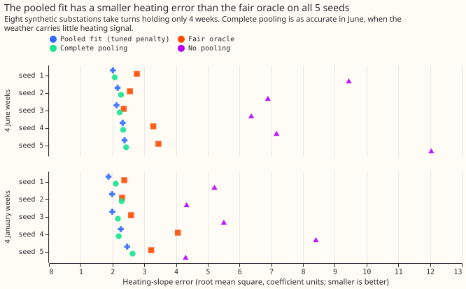
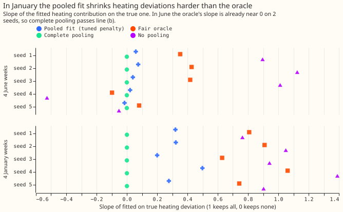
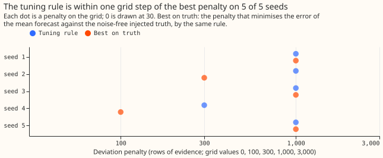

# Differentiable physics, N0: rerunning experiment 109's known-answer gate with a fair oracle and five seeds

**We tested a forecasting method on made-up data whose right answer we know, and the test did not
settle whether the method shrinks each substation's own coefficients towards the fleet's
correctly.** The method is a convex demand model of [experiment
109](../00109-differentiable-physics-n0-partially-pooled-convex-model/result.md) that gives each
substation the fleet's shared coefficients plus a penalised deviation of its own ("partial
pooling"). We built 8 synthetic substations from real calendar and weather data with injected
coefficients, fitted the method to a substation that held only 4 weeks of data, and compared the fit
with a reference estimator (the "oracle") that is told the fleet mean, the true spreads, and the
noise variance. We repeated this on 5 random draws of the injected coefficients ("seeds"). A control
that keeps no deviation at all (complete pooling) passed the shrinkage line on 2 of 5 seeds when the
4 weeks were in June, because a substation's heating signal is weak then, so the line could not tell
a good fit from a bad one. The verdict by the pre-registered rule is `inconclusive`.

**Other results were mixed.** Capacity from 4 weeks was within 25% of the truth at 8 of 8
substations on every seed. The tuning rule chose a penalty within one grid step of the best on 5 of
5 seeds. The pooled fit's heating-slope error was smaller than the oracle's on 5 of 5 seeds. The
line that checks full-history coefficients passed on 2 of 5 seeds, and the fleet-mean line on 4 of
5. A gate that scored the heating-slope error against the injected truth on winter weeks would
settle the shrinkage question; a post hoc rerun on 4 January weeks showed that the controls then
fail.

**Experiment 109's gate was unfair in two ways, and this rerun removes both.** The oracle was given
each substation's true capacity, which the pooled fit had to estimate from the same 4 weeks, and the
tuning rule was checked on one seed per definition. Here the oracle estimates every coefficient,
capacity included, and the gate runs 5 seeds under one definition fixed in advance. The gate code is
copied from
[`e00109_gate.py`](https://github.com/openclimatefix/nged-substation-forecast/blob/main/ml-experiments/00109-differentiable-physics-n0-partially-pooled-convex-model/e00109_gate.py).

## Results

Every number below is printed in [`report.txt`](report.txt).

| Line (pre-registered) | Seeds passed | Detail |
|---|---|---|
| (a) fleet mean | 4 of 5 | Seed 1 missed by 0.02 points (profile 0.518 against 0.5). |
| (b) shrinkage against the fair oracle | 2 of 5 | Passes on seeds 4 and 5, where the oracle's slope is near 0. |
| controls for (b) both fail | 3 of 5 | Complete pooling passed on seeds 4 and 5; no pooling never passed. |
| (c) full history keeps its own coefficients | 2 of 5 | Slopes 0.82 to 0.94 against the 0.85 bar. |
| (d) tuning within one grid step | 5 of 5 | Exactly the best penalty on 3 of 5 seeds. |
| (e) capacity from a short window | 5 of 5 | 8 of 8 within 25% at 4 weeks and at 3 months on every seed. |

- **Verdict rule as pre-registered.** The gate is not passed: line (b) passed on 2 of 5 seeds, line
  (c) on 2, and the controls failed line (b) on 3, each below the 4 needed. The tuning rule is
  stable. Complete pooling passed line (b) on 2 seeds, so the rule's `inconclusive` clause, checked
  first, applies. - **The oracle is the worse heating estimator in June and in January (post hoc).**
  The oracle's heating error was 2.35 to 3.45 against 2.01 to 2.38 for the pooled fit in June, and
  2.30 to 4.06 against 1.87 to 2.46 in January. One untested explanation: the oracle treats the
  noise as independent, while the noise keeps multi-day persistence, so the oracle trusts 4 weeks of
  evidence too much. Another is that capacity and heating are hard to separate over 4 weeks. This
  experiment does not isolate either. - **Line (b) fails by design in June.** The slope half asks
  the pooled fit to match the oracle's slope. The oracle's slope was 0.35, 0.43, 0.42, -0.10, and
  0.08 on the 5 seeds, so a fit that keeps nothing (slope 0) is within 0.15 of the oracle on seeds 4
  and 5. - **Capacity is estimated well.** The fair oracle's fitted capacity was 0.90 to 1.20 of the
  truth (report section "Fair oracle capacity ratios"). - **Tuning.** The rule picked 1,000 rows on
  4 seeds and 300 on seed 4. The best penalty on the noise-free truth was 1,000, 300, 1,000, 100,
  and 1,000.

## Post hoc: line (b) with 4 January weeks

**This rerun is labelled post hoc and changes no pre-registered verdict.** The rerun holds the 4
weeks before 2025-02-01 on the same 5 fleets, with the penalty tuned on June (not retuned for
January).

- **The controls failed on 5 of 5 seeds**, so with winter weeks line (b) can detect both no pooling
  (error 4.3 to 8.4) and complete pooling (error 2.1 to 2.6). - **The pooled fit failed line (b) on
  5 of 5 seeds, on the slope half only.** Its slope was 0.20 to 0.50 against the oracle's 0.63 to
  1.06, while its error (1.87 to 2.46) was below the oracle's (2.30 to 4.06). The pooled fit shrinks
  harder than the oracle and is more accurate, consistent with the oracle's independent-noise
  assumption being wrong, which this experiment does not test.

## Checks

- **Median forecast minus mean forecast, per site.** This check does not apply, because the gate
  scores coefficients and noise-free truth, not forecast spreads.
- **Error of the mean forecast beside each contrast.** The tuning check scores the mean forecast
  against the noise-free truth (line (d)); the quantile-score rule gave the same penalty as the
  truth-based rule on 3 of 5 seeds. Tuning on the median's absolute error instead picked 1,000, 300,
  300, 300, and 1,000, which agrees with the quantile-score rule on 3 of 5 seeds.
- **Audit triggers that fired.** Trigger 1 (a known-answer test fails), trigger 2 (the result
  contradicts the prediction that line (b) passes on 4 or 5 seeds; explained above), and trigger 7
  (the pooled experiments listed in the theme's plan depend on this gate). Triggers 3 to 6 do not
  apply, because the gate has no per-site forecast contrast. One Sonnet reviewer re-derived
  every number from the stored runs and read the prose; no Opus audit ran.

## Pre-registered lines

- **Synthetic fleet.** As in experiment 109: 8 synthetic substations on the real calendar and
  weather of the MW Primaries, a known fleet mean and known deviations, noise taken as whole weeks
  of residuals from a different substation. Each of seeds 20261101 to 20261105 builds a new fleet. -
  **(a) Fleet mean.** The fitted heating slopes (summed over the four smoothing windows) are within
  10% of the true fleet mean in every hour band, and the centred profile is within 0.5 points root
  mean square. Line (a) is the same as in experiment 109. - **(b) Shrinkage on 4 June weeks, against
  the fair oracle.** The fair oracle is the posterior mean of the Gaussian model with the realised
  fleet mean, the true spread of each family, and the true noise variance, and a flat prior on the
  capacity. It estimates every coefficient jointly from the held-out substation's 4 weeks. Line (b)
  passes when both hold: the slope of the pooled fit's deviation on the true deviation, measured on
  the heating contribution to the prediction, is within 0.15 of the oracle's slope, and the heating
  root mean square error across the eight substations is at most 1.2 times the oracle's. -
  **Controls for (b).** The same line, with the pooled fit's penalty set to 0 rows (no pooling) and
  to 1,000,000 rows (complete pooling). Both must fail line (b); if either passes, the line cannot
  detect a bad fit. - **(c) Full history keeps its own coefficients.** With 2 years of rows the
  slope of the fitted deviation on the true deviation is at least 0.85. Line (c) is the same as in
  experiment 109. - **(d) Tuning rule picks the best penalty within one grid step.** The rule is
  experiment 109's (the penalty minimising the mean of the 4-week and 3-month score ratios against
  no pooling, subject to the all-rows score within 0.02 points). The best penalty is found by
  applying the same rule to the root mean square error of the mean forecast against the noise-free
  injected truth, on the same rows. Line (d) passes when the rule's penalty is within one step of
  the best on `common.LAMBDA_GRID` (nine values from 0 to 1,000,000). Experiment 109's line (d),
  which multiplied every spread by 10 or by 0.1, is dropped, and the two extra fleets that it needed
  are not built. - **(e) Capacity from a short window.** As in experiment 109, the 4-week and
  3-month pooled fits recover the held-out substation's capacity within 25% at 6 or more of 8
  substations. - **Reported, not blocking:** the fair oracle's capacity ratio.

## Predictions against outcome

- **Predicted: line (b) passes on 4 or 5 of 5 seeds.** Line (b) passed on 2. The prediction assumed
  the oracle's capacity advantage was the only fault; the oracle's independent-noise assumption was
  a second one. - **Predicted: the tuning rule within one grid step on 3 or 4 of 5 seeds.** The
  tuning rule was within one step on 5 of 5.

## Caveats

- **The pooled fit is given the true capacity of the seven full-history substations**, because the
  synthetic vintages equal the truth (inherited from experiment 109). Lines (a), (c), and the tuning
  feasibility rule run with capacity known; lines (b) and (e) estimate the held-out substation's
  capacity.
- **The oracle's prior mean is the mean of all 8 true coefficient vectors**, including the held-out
  substation's own, which slightly flatters the oracle and biases against passing line (b).
- **The 5 fleets share the real calendar, weather, and noise weeks**, and differ only in the
  injected coefficients, so they are not independent replicates of the noise.
- **Schedule.** One refit per fit at the 2025-07-01 cut (2025-02-01 for the post hoc rerun), so the
  contrasts do not depend on a retraining schedule.
- **Torch.** `e00150_tune.py` imports torch inside its worker function and is on the `ty` torch
  override list.

## What to try next

**Replace line (b) by the error of the pooled fit against the injected truth, held on 4 winter
weeks, with the complete- and no-pooling errors as controls.** The pooled fit's heating error (1.87
to 2.46) beat complete pooling (2.1 to 2.6) on 4 of 5 seeds and no pooling (4.3 to 8.4) on 5 of 5 in
January, which such a line would test directly.
