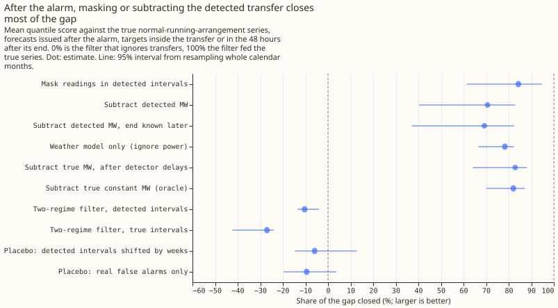
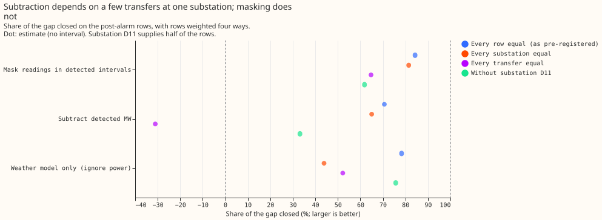
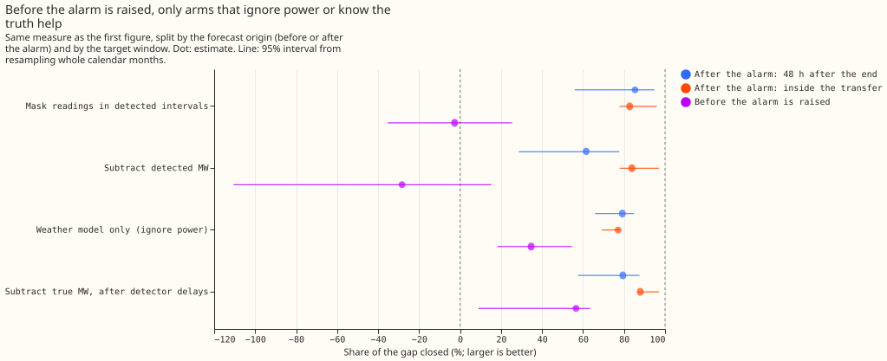
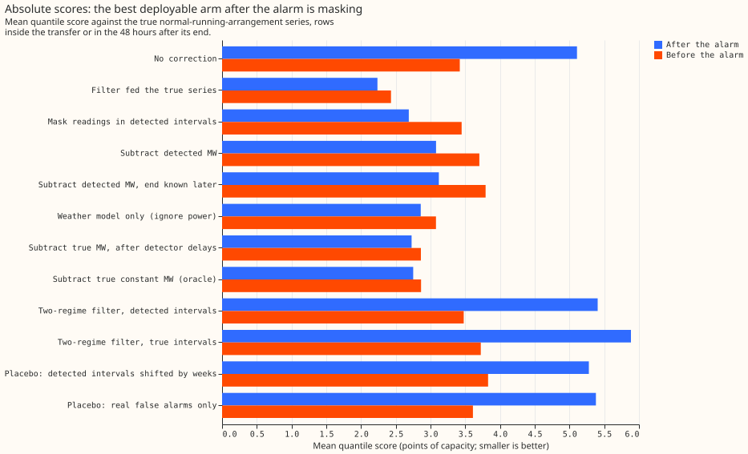
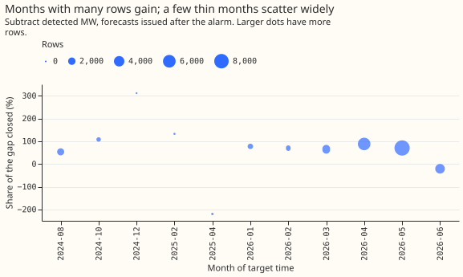

**Take-home message.** Once the refit-offset neighbour-count detector (RO-NC) has raised its alarm
that a load transfer is under way, taking the transfer out of the forecast's recent power closes most
of the gap in forecast error between a filter that ignores transfers and a filter fed the true
normal running arrangement (NRA) series. Ignoring recent power altogether closes nearly as much, and
masking the readings closes more than subtracting the detected megawatts (MW). Counting the
transfers the detector missed and the first 2 days before its alarm, the forecasts that use detected
transfers gain little (subtracting: nothing; masking: 21% of the gap), and on real days with no logged
transfer they make the forecast worse.

**We tested the correction on simulated load transfers added to recorded power, so the true NRA
series is known.** We asked whether a forecast of the power a substation would draw with no load
transfer (the NRA) improves when the forecast's recent-power input is corrected for the transfers
that RO-NC finds. The simulation uses the 44 worlds of experiment 141 (a world is one simulated copy
of the recorded power series), six substations, and 475 pairs of a transfer and a Primary substation.
The true NRA series is the recorded power without the simulated transfers. We scored every forecast
against that true series, which experiment 141 did not: it scored against the observed power, which
rewards a filter for following a transfer. The filter is the Kalman filter of GAM-K (the
weather-driven demand forecast of earlier experiments). The detector's intervals come from
[experiment 147](../00147-causal-live-end-rule-for-ro-nc/result.md) and
[experiment 148](../00148-switching-end-rule-lookahead-ro-nc/result.md). The share of the gap closed
is the measure used in
[experiment 88](../00088-sw2-21-nra-forecast-recovers-normal-arrangement-during-and-after-injected-switches/result.md),
where the detector closed 16% of the gap.

**By the pre-registered rule the verdict is `partly supported`, and the headline is fragile.** The
pre-registered arm (SUB-DET) closed 71% of the gap on forecasts issued after the alarm, with a 99%
interval of 25% to 85%. The pre-registered rule calls the result `supported` only if the lower end
is at least 40%; here it is 25%. Two further checks change the reading: with each transfer weighted
equally the share is -31%, and without substation D11 it is 33%. The detector-driven arms also do
worse than no correction before the alarm, and on real rows outside logged transfers.

Figure 1 draws 95% intervals; the verdict uses the 99% interval of 25% to 85%.

- **Arms.** All arms are GAM-K's member forecasts plus a correction from a Kalman filter run on a
  stream (the power series the filter reads), with experiment 141's spread. The gap is K0's score
  minus CLEAN's. K0 (no correction) reads the stream with the transfers in it. CLEAN reads
  the stream without them (the ceiling, 100%). SUB-DET subtracts the detected MW (the stored step of
  the detector, a constant per interval) over every interval known at the forecast origin. MASK
  treats the readings inside known intervals as missing. GAM-only ignores recent power. SUB-DET-LAG96
  knows the end 96 half-hours after it (the 90th percentile of the 6-hour rule's lag) instead of 60.
  SUB-TRUE-LAG subtracts the true shaped MW, and SUB-TRUE-CONST a constant at the event's mean MW
  (an oracle, because the mean uses the whole transfer). S-KF and S-ORACLE are experiment 141's
  two-regime filter fed detected and true intervals. SUB-PLACEBO shifts the detected intervals by
  whole weeks. SUB-FALSE subtracts only the detected intervals that match one of the 148 unexplained
  real alarms that match no logged transfer.
- **Intervals.** The injected worlds store the offline-end intervals (`R0_M48`), so those are used,
  with the onset known 96 half-hours after the step and the end known at the later of the stored
  `known_from` and 60 half-hours after the end. Experiment 148's 6-hour rule has the same onset and
  the same end for most intervals (median difference 0 stamps). The stored `known_from` of the
  `R0_M48` intervals is a median of 76 half-hours after the end (10th percentile 48, 90th
  percentile 94).
- **Rows.** 214,992 forecast rows (six substations, 44 worlds, leads 0.5 to 168 h, the replicate
  months and the scored year) with a target inside a transfer or in the 48 hours after its true end.
  The rows are the same for every arm. The C1 rows are the 24,716 whose forecast origin is after the
  alarm is known (11 calendar months); 188,817 rows have the origin between the onset and the alarm,
  and the detector found 36.4% of the 475 transfer-and-substation pairs (45% of the larger ones; the
  475 pairs come from 145 distinct transfers).
  The median ratio of the detected step to the true mean MW is 1.03.
- **Headline, C1 (the share of the gap SUB-DET closes after the alarm).** SUB-DET closes 71% (99%
  interval 25% to 85%) of the K0-to-CLEAN gap of 2.872 points of capacity (95% interval 1.490 to
  3.481). Inside the transfer it closes 84% (78% to 97%) and in the 48 hours after the end 62% (29%
  to 78%). On the absolute error of the median forecast it closes 69% (43% to 82%).
- **Other arms on the C1 rows (95%).** MASK 84% (61% to 95%). GAM-only 78% (67% to 82%).
  SUB-DET-LAG96 69% (37% to 82%). SUB-TRUE-LAG 83% (64% to 88%) and SUB-TRUE-CONST 82% (70% to 87%).
  S-KF -10% (-13% to -4%) and S-ORACLE -27% (-42% to -24%): the two-regime filters follow the
  transfer, as predicted. SUB-PLACEBO -6% (-15% to 13%) and SUB-FALSE -9% (-20% to 4%).
- **Robustness of SUB-DET.** With each of the 145 distinct transfers weighted equally: -31% (-107%
  to 17%). With each substation weighted equally: 65%. Without D11, which supplies 12,203 of the
  24,716 rows and 61% of the gap: 33% (-66% to 73%). By substation: D10 55%, D11 94%, D14 105%, D16
  -23%, D5 81%, D9 77%. By duration of the transfer: 1 to 3 days -72% (-625% to 17%), 3 to 7 days
  69% (41% to 88%), over 7 days 89% (85% to 99%). MASK with each transfer weighted equally is 65%
  (37% to 82%), and without D11 62% (-8% to 93%). Shares by the shape of the injected profile are
  not available, because the shape is not stored in experiment 141's worlds.
- **Before the alarm and on all rows.** On the 188,817 rows whose origin is after the onset and
  before the alarm: SUB-DET -28% (-111% to 15%), MASK -3% (-35% to 25%), GAM-only 35% (18% to 55%),
  SUB-TRUE-LAG 57% (9% to 63%). On all 213,533 rows after the onset, including the missed
  transfers: SUB-DET -1% (-51% to 35%), MASK 21% (-3% to 47%), GAM-only 47% (35% to 62%),
  SUB-TRUE-LAG 64% (32% to 69%). SUB-DET differs from K0 on 86% of the rows before the alarm,
  because real-stream alarms (false or true) are subtracted too.
- **Absolute scores (mean quantile score, points of capacity), after the alarm.** K0 5.108, CLEAN
  2.236, MASK 2.687, SUB-TRUE-LAG 2.728, SUB-TRUE-CONST 2.751, GAM-only 2.859, SUB-DET 3.079,
  SUB-DET-LAG96 3.120, S-KF 5.406, S-ORACLE 5.885. Before the alarm: K0 3.422, CLEAN 2.431,
  GAM-only 3.078, MASK 3.448, SUB-DET 3.702.
- **Real stream, descriptive.** Part A: 9 combinations of a logged real transfer and a substation
  have forecasts issued inside the transfer with targets in the week after its logged end (the
  observed power is then the NRA). Row-weighted mean quantile score: K0 9.843, SUB-DET 4.992, MASK
  5.018, GAM-only 4.713. Part B, no harm: on 877,540 real rows outside logged transfers, K0 scores
  2.712, SUB-DET 2.929 (+0.217, 95% interval +0.114 to +0.328), MASK 2.929 (+0.217, +0.082 to
  +0.376), GAM-only 3.001 (+0.289, +0.202 to +0.380); positive is worse.
- **Tail calibration after the alarm (share of actuals at or below the quantile; the pinball loss).**
  K0: q01 0.040 (0.401), q05 0.068 (1.130), q95 0.650 (1.962), q99 0.788 (0.999). MASK: 0.037
  (0.306), 0.088 (0.777), 0.971 (0.625), 0.994 (0.163). SUB-DET: 0.054 (0.396), 0.129 (0.943), 0.970
  (0.709), 0.991 (0.201). GAM-only: 0.002 (0.174), 0.014 (0.653), 0.839 (0.761), 0.931 (0.251).
  CLEAN: 0.009 (0.150), 0.043 (0.533), 0.974 (0.579), 0.996 (0.153). The spread is experiment 141's
  K0 spread for every arm, so the tail contrasts are contrasts in location.

## Checks

- **Median minus mean forecast** is -0.030 points of capacity over all rows and identical for every
  arm, because the spread is shared. By substation: D5 -0.329, D10 -0.091, D9 -0.107, D11 -0.038,
  D16 +0.031, D14 +0.106.
- **Mean-forecast contrasts** point the same way as the quantile score. The error of the median
  forecast gives SUB-DET 69%, MASK 83%, and GAM-only 74%.
- **Triggers.** Three fired: SUB-DET above its predicted band, a sign flip under per-transfer
  weighting, and dependence on D11. SUB-DET (71%) is above its predicted 30% to 60%. Weighting by
  transfer flips SUB-DET's sign, and leaving out D11 lowers the share to 33%, but the verdict stays
  `partly supported` when D11 is left out. Re-deriving the headline from the stored scores
  reproduces 71%. Three D11 transfers hold 45% of the gap.
- **Overlapping windows.** SUB-TRUE-CONST is labelled an oracle. At one substation the 48-hour window
  after a transfer overlaps the next transfer in 271 of 906 consecutive pairs, and a row takes the
  latest transfer that has begun; the overlap is not corrected.

## Caveats

- **C1 conditions on detection.** The detector missed 64% of the transfers; the share on all
  rows after the onset is the figure that includes them.
- **Intervals come from the offline end rule with a 30-hour call lag**, not from rerunning the
  6-hour rule on each world.
- **The scored months are few.** The C1 rows fall in 11 calendar months, with 29 to 8,791 rows each,
  so the month-block intervals are wide.
- **Real transfers inside the stream are not removed from CLEAN.** Subtracting a real-stream
  alarm that is a true transfer is scored against observed power, which still contains it.
- **Retraining schedule.** The experiment refits nothing: it reuses experiment 141's cached
  GAM-K forecasts.

## What the next experiment should answer

Whether a forecast that masks the readings inside a suspected transfer, and uses a detector that
alarms within hours instead of about 2 days, beats the weather model alone on all rows, including
the rows before the alarm and the normal rows where the weather model alone scores 0.289 points worse.

## Changes made after the first run

The decision rule, the prediction, and the arms of the plan were committed before any run. The first
run gave a SUB-DET share of 71% (99% interval 25% to 85%) on the post-alarm rows, which this page
still reports as C1. The reviews that followed changed the experiment, and each change is post hoc:

- **Added arms** (the ML experiment manager's request): GAM-only, MASK, SUB-DET-LAG96, and SUB-FALSE
  (a placebo of real alarms). The week-shifted placebo stays.
- **Added strata and robustness** (the audit): shares by transfer duration, with each transfer
  weighted equally, by substation, and without D11.
- **Corrections** (the code review): SUB-TRUE-LAG used the true end before it was known; it now
  holds the amount it had when the interval became known until the end is known, which lowered its
  share from 94% to 83%.
- **Real-stream check redesigned** (the manager's request): the first design added the labelled MW
  to observed power, which is circular with the detector's step.
- **Not applied:** shares by the shape of the injected profile, because the shape is not stored in
  experiment 141's worlds.
