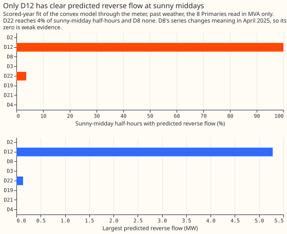
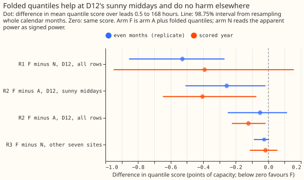

# Experiment 152: does modelling the fold help the forecast at the Primaries metered in MVA?

**At Stickney (D12), the one MVA-only Primary with clear reverse flow, folding the forecast
quantiles at zero lowered the score on sunny middays, did no harm at the other seven Primaries, and
did not clear the pre-registered bar for the whole year.** Against the same meter fit with symmetric
quantiles, arm F scored 0.40 points better on D12's sunny middays (98.75% interval -0.65 to -0.07;
replicate year -0.26, -0.51 to -0.02), which passes R2. Against reading the apparent power as signed
power (arm N), arm F scored 0.39 points better over all of D12's rows in the scored year, but the
interval (-0.95 to +0.16) includes zero, so R1 failed there. In the replicate year the gain was 0.53
points (-0.86 to -0.27). Pooled over the other seven Primaries, F minus N was -0.02 (-0.11 to +0.06),
so R3 passed. The known-answer test on five Primaries with a hidden solar farm passed on the sign of
the flow at the larger injection (balanced accuracy 0.81 to 0.87) and failed at the smaller one
(0.51 to 0.81) and on the upper-tail coverage (11.5% of readings above q95 at the larger
injection). The verdict is `inconclusive`: all of R1 and R2 rests on one substation, and the sign of its
flow could be checked only indirectly.

In this page, arm N reads the apparent power as signed power. Arm A fits the demand model through
the meter and uses symmetric quantiles. Arm F is arm A with quantiles folded at zero. R1 to R3 are
the pre-registered contrasts in the front matter, and the Terms paragraph below defines the other
abbreviations.

## Step 0: only D12 has clear reverse flow

**Only D12 has predicted reverse flow on most sunny middays, so all of R1 and R2 rests on one substation.**
The table uses experiment 110's fit through the meter (past weather, the scored year; the replicate
year agrees within 0.2 MW and 3 percentage points). Sunny middays are April to September
half-hours starting 10:00 to 13:30 UTC with CAMS irradiance at least 70% of the Haurwitz clear-sky
value, outside switching masks. "Sure" is the share of those half-hours with a fitted
reverse-flow probability above 0.9 under a normal residual.

| Site | NGED reverse flow? | PV capacity (MW) | Sunny-midday half-hours with reverse flow | Sure (probability above 0.9) | Largest reverse flow (MW) | Lowest reading (MVA) |
|---|---|---|---|---|---|---|
| D12 | Maybe | 5.9 | 100% | 100% | 5.3 | 0.87 |
| D22 | Maybe | 1.6 | 3.7% (replicate 0.7%) | 0% | 0.14 | 0.21 |
| D8 | Yes | 4.6 | 0% | 0% | 0 | 0.14 |
| D2 | No | 6.9 | 0% | 0% | 0 | 5.4 |
| D3 | No | 3.5 | 0% | 0% | 0 | 4.9 |
| D4 | No | 1.3 | 0% | 0% | 0 | 4.9 |
| D19 | No | 1.6 | 0% | 0% | 0 | 0.92 |
| D21 | No | 1.4 | 0% | 0% | 0 | 1.6 |

- **D8's zero is weak evidence.** NGED's monitoring file marks D8 "Yes", but the series changes
  meaning in April 2025, so the fit rests on little data and is scored from 2025-04-01 only.
- **D22's sign is unsure.** The fit puts the flow near zero (mean reverse-flow probability 0.09), so
  its sign cannot be called.
- **The sign at D12 can be checked only indirectly.** D12 has no MW meter, so signed MW does not
  exist. The bulk-supply-point closure (F1) put a coefficient of 1.02 on D12's signed flow, where an
  exact closure gives 1, but the variance of the closure error fell by only 0.7% (interval including
  zero), so the check neither contradicts nor firmly supports the sign. No reactive-power series
  exists for these Primaries.

## Headline result

**Terms.** The eight MVA-only Primaries are D2 (Warth Lane Skegness), D3 (Sleaford Road Boston),
D4 (Ingoldmells), D8 (Marsh Lane), D12 (Stickney), D19 (Chapel St Leonards), D21 (Alford), and D22
(Langrick). GAM-K is the convex additive demand model with a Kalman filter of experiments 111 and
136, driven by the mean of the 51 members of the European Centre for Medium-Range Weather
Forecasts ensemble (ENS) forecast. BG2 is the production-style best guess of experiment 87. CAMS is
the Copernicus Atmosphere Monitoring Service irradiance. Effective capacity is the series'
reference power (4.68 MW at D12), the unit of every "point". Arm N reads |S| as signed power; arm A
fits through the meter (experiment 110's L0) with the filter correcting |S|; arm F fits through the
meter, filters the signed flow, and folds its quantiles. A bulk supply point (BSP) is the
substation above a group of Primaries.

**Eight of the 16 trial Primaries report only the magnitude of apparent power (MVA), and the reading
rises again once embedded solar pushes the net flow below zero, because it is the absolute value of the flow.** This experiment asks whether
a forecast that models that bounce explicitly beats one that treats the reading as signed power.
[Experiment 110](../00110-differentiable-physics-5-embedded-generation-and-capacity/result.md)
already fitted the bounce for day-ahead forecasts on past weather and found it helps at Stickney
(D12) alone. This experiment tests the same idea on the ensemble-driven forecast, to seven days
ahead, with a filter and quantiles that also know about the fold.

## Results

- **Rows.** The scored year is 292 daily ensemble runs from 2025-07-01, leads 0.5 to 168 hours,
  outside the hand-filtered switching events: 97,046 half-hourly rows at D12 and 679,066 over the
  other seven sites (D8 from 2025-04-01, and only in the scored year because its replicate months
  precede its first usable fit). The replicate year is the even months of 2024-07 to 2025-06. The
  tuning months, odd months of the same span, fit the spread and the folded-quantile pools. D8 has
  no tuning months of its own, so it borrows the other six sites' tuning forecasts for its spread.
- **R1, F minus N at D12, all rows.** Scored year -0.39 points (98.75% interval -0.95 to +0.16);
  replicate -0.53 (-0.86 to -0.27). The point estimate is below the bar of -0.30 in both years, but
  the scored-year interval includes zero, so R1 fails as pre-registered.
- **R2, F minus A at D12, sunny middays.** Scored year -0.40 (-0.65 to -0.07; 3,692 rows, 6 months);
  replicate -0.26 (-0.51 to -0.02; 2,799 rows). R2 passes in both years. On all rows the same
  contrast is -0.12 (-0.22 to -0.02) and -0.05 (-0.25 to +0.11).
- **R3, F minus N pooled over D2, D3, D4, D8, D19, D21, D22.** Scored year -0.017 (-0.113 to
  +0.056); replicate -0.025 (-0.089 to +0.005), without D8. Both are below the +0.03 bar. Dropping
  any one of D2, D3, D4, D19, D21, or D22 moves the scored-year estimate between -0.019 and -0.027.
- **R4, F minus BG2 at D12.** Not computed: experiment 87 stored BG2 only for the MW Primaries,
  and none exists for D12. The reference arms climatology and the manual heuristic are likewise not
  available for the MVA series.
- **A minus N at D12.** Fitting through the meter without folding the quantiles already helps in the replicate year (-0.48, -0.77 to -0.25) and not clearly in the scored year (-0.27, -0.88 to +0.33): absolute quantile score at D12 is 7.56 (N), 7.29 (A), and 7.17 (F) in the scored year, and 7.33,
  6.85, and 6.80 in the replicate year.
- **By site, F minus N, scored year.** D2 +0.011, D3 +0.015, D4 -0.009, D8 -0.189, D12 -0.391,
  D19 -0.009, D21 +0.017, D22 +0.042. Only D3 and D21 have an interval wholly above zero (D3
  +0.005 to +0.027; D21 +0.009 to +0.024), by under 0.03 points.

### Stage 1: the known-answer test

Five MW Primaries (D5, D10, D11, D14, D16) had a metered solar farm's output subtracted from the
signed power at 1.0 and 2.0 times the Primary's midday median absolute reading in the year before
the scored year. Each Primary receives a different metered farm. The series was then folded to |P| (zero reactive
power) or to `sqrt(P² + (0.2506 D)²)` (power factor 0.97, with the pre-injection reading as the
demand D, which is simpler than the plan's as-of-capacity demand estimate). The scored year only.

| Check | Rule | Result | Passed? |
|---|---|---|---|
| K1, sign balanced accuracy, level 2.0 | at least 0.80 at 4 of 5 sites | 0.81 to 0.87 at 5 of 5, both reactive-power settings | yes |
| K1, sign balanced accuracy, level 1.0 | at least 0.80 at 4 of 5 sites | with zero reactive power 0.70 to 0.81, at 1 of 5 sites; with power factor 0.97 0.51 to 0.79, at 0 of 5 sites | no |
| K2, F minus N, level 2.0 | at most -0.10, interval wholly below zero | -0.71 (-1.02 to -0.44) zero reactive power, -0.56 (-0.84 to -0.31) power factor 0.97 | yes |
| K2, F minus N, natural level | at most +0.03 | -0.016 (-0.041 to +0.010) | yes |
| K3, mean absolute error of the signed median on reverse-flow rows, level 2.0 | F at most 1.5 times S, N at least 2 times S | F 1.04 times S, N 2.99 times S | yes |
| K4, fitted-capacity rise over injected capacity, level 1.0 | 0.75 to 1.25 at 4 of 5 sites | 0.84, 0.79, 0.88, 0.87 at four sites, -0.05 at D5 | yes |
| K5, coverage on sunny middays, level 2.0 | within 3 points of 5% below q05 and above q95 | 2.5% below q05, 11.5% above q95 | no |

The signed ceiling S scored 5.4 to 6.8 points at level 2.0, against 2.2 to 4.0 at the natural
level, so the injected farm makes the signed series harder to forecast. Stop rule S1 (balanced accuracy under 0.80
at 3 or more sites at level 2.0) did not fire.

## Checks

- **Median minus mean, D12 (points, scored year, all rows and sunny middays).** F -0.23 and +1.81;
  A +0.01 and 0.00; N 0.00 and 0.00. Folding makes the median differ from the mean on sunny
  middays by 1.8 points, which is the mechanism of the gain.
- **Mean-forecast error beside the contrasts, D12.** F and A share one fit and filter, so their mean
  forecasts are identical (all rows -0.09, sunny middays -12.6 points). N's is +0.04 over all rows
  and -22.9 on sunny middays. Every quantile gain of F over A therefore comes from the quantiles.
  A's gain over N on sunny middays comes with a mean forecast error that is 10 points smaller.
- **Tail calibration at D12, scored year.** Share of readings below q01, q05, above q95, above q99,
  all rows: F 3.7%, 7.9%, 7.5%, 3.0%; A 3.5%, 8.8%, 6.5%, 2.1%; N 4.2%, 9.9%, 5.6%, 1.9%.
  On sunny middays: F 0.9%, 2.7%, 15.1%, 6.9%; A 0.6%, 1.9%, 15.8%, 7.3%; N 0.0%, 0.2%, 18.1%,
  7.6%. All three arms leave 15% to 18% of readings above q95 on sunny middays, because the forecast
  reading is too low there.
- **Audit triggers that fired.** R1 failed in the scored year while the replicate year passed, so
  R1's point estimate agrees across the two years, and the scored-year interval is too wide to exclude zero. The known-answer test failed K1 at
  level 1.0 and K5. One site decides R1 and R2. The pre-registered verdict is `inconclusive`, and
  no audit was run, because the brief allows no Opus review and none of the findings would change
  the verdict.
- **Predictions against outcomes.** F minus N at D12 was predicted at -0.5 to -1.0 and came out at
  -0.39 (scored) and -0.53 (replicate). F minus A on sunny middays was predicted at -0.05 to -0.25
  and came out at -0.40 and -0.26, larger than predicted. F minus N pooled over the other seven
  was predicted within +-0.02 and came out at -0.02 and -0.03. Coverage below q05 on D12's
  sunny-midday rows was predicted at 9 to 11% for N, 6 to 8% for A, and near 5% for F, and came out
  at 0.2%, 1.9%, and 2.7%. The sunny-midday forecast is too low in all arms, which leaves almost no
  readings below q05 and explains the miss for N and A.
- **Folding helps more in Stage 2 than the Stage 0 replay predicted.** The replay of folded
  quantiles on experiment 110's day-ahead predictions with past weather moved D12's sunny-midday
  score by +0.03 and +0.04 points. Stage 2 uses ensemble-driven forecasts at leads 0.5 to 168
  hours. One possible reason is the longer leads, but the experiment did not test the difference
  separately.
- **Not computed.** BG2, climatology, and manual heuristic at the MVA Primaries (no stored
  predictions), the curtailment-style cost (the folded series has no signed export), and a learned
  reactive-power arm.

## Deviations from the plan

- **The latent filter was dropped by stop rule S0**, so arm F is arm A plus folded quantiles.
- **Plain GAM-K with experiment 133's shared filter settings (POOL), not T-all.** The plan's engine
  copy omitted the heating split.
- **Arm S uses the fitted capacity** and the known-answer demand is the pre-injection reading.
- **D8 borrows the other six Primaries' tuning forecasts for its spread** because its tuning months
  precede its first usable fit.
- **Stage 1 uses the scored year only**, one farm per Primary, and the sign check's floor is 5% of
  the Primary's 99th-percentile reading.

## Decisions made at the start of the run

- **Run now.** Experiment 139 is not awaited: no as-of capacity can be built at an MVA Primary, so
  the capacity is fitted through the meter in every monthly refit.
- **Step 0 comes first.** Step 0 measures how much reverse flow each MVA-only Primary has, and its
  table heads the finished page.
- **Falsifier F3 is dropped.** Stickney has no MW meter, so its signed MW cannot exist. Only F1 and
  F2 remain, and the page says the sign at D12 can be checked only indirectly.
- **Marsh Lane (D8) is scored only from 2025-04-01,** the month its series changed meaning. Its
  replicate months before April 2025 are empty, so R3's replicate rests on six sites.

## Plan

**Stage 0 (CPU minutes).** F1: the bulk-supply-point (BSP) closure of experiment 124 for the BSP
above D12, run on summer-midday rows with D12's |S| in the sum and again with D12's fitted signed
flow, each with a free term for the BSP's unmetered solar. A clear gain in residual variance from
the signed version supports the sign, no gain fails it. The free solar term is partly collinear with
D12's reverse flow, so a pass is weak evidence and a clear fail is strong. F2: replay the filter on
experiment 110's stored D12 predictions, additive on |S| against the latent filter with gating, plus
folded quantiles, day-ahead. Neither falsifier needs new fits. No reactive-power series exists for
these Primaries (experiment 79: NGED cannot supply P and Q), so there is no reactive check. Time one
multi-start meter refit, confirm that the hand-filtered switching list covers the MVA Primaries, and
confirm D8's cut date from its monthly profile.

**Stop rules.** S0: if F2 moves D12's sunny-midday score by less than 0.05 points in either
direction, drop the latent filter and run only N, A, and folded quantiles (A plus folded quantiles
becomes arm F). If F1 contradicts the sign at D12, stop and report that the sign cannot be
established from the data we hold. S1: if arm F's balanced accuracy in the known-answer test is
under 0.80 at level 2.0 with Q = 0 at 3 or more of the 5 sites, stop. S2: after the replicate
months, if F minus N at D12 has an interval wholly above zero, stop and diagnose. S3: if D12's
fitted reverse-flow share jumps by more than 20 percentage points between consecutive monthly
refits, flag it, and stop if it happens in 3 or more refits. S4: if one multi-start meter refit
takes longer than 5 minutes on one core, cut stage 2 to D12, D22, and D8.

**Stage 1, the known-answer test.** Fold the five MW decision Primaries (D5, D10, D11, D14, D16),
where the signed truth is known, by injecting farm output (levels none, 1.0, 2.0 as in experiment
79) and taking |P| with Q = 0 or a power factor of 0.97; run arm F, arm N, and a signed ceiling arm
S (GAM-K on the unfolded signed series) through the same ENS GAM-K configuration, on the scored year
only, with the injected farms' output used in training and scored rows alike and never as a forecast
input. A power factor of 0.97 uses a demand estimate built from experiment 129's as-of capacity,
fitted before each cut. Pass thresholds, fixed now: K1, balanced accuracy of the forecast flow's
sign at least 0.80 at 4 of 5 sites at levels 1.0 and 2.0, under Q = 0 and under a power factor of
0.97, on rows with |P_true| of at least 5% of effective capacity (rows nearer zero have a sign with
no effect on the reading); K2, F minus N on the quantile score of the folded series, pooled over the
5 sites and leads 0.5 to 168 hours, at most -0.10 at level 2.0 with the interval wholly below zero,
and at most +0.03 at the natural level; K4, the fitted capacity rises by the injected farm's
capacity within a ratio of 0.75 to 1.25 at 4 of 5 sites at level 1.0; K5, coverage below q05 and
above q95 within 3 points of nominal on sunny-midday rows at level 2.0, pooled. K1, K2, K4, and K5
block. K3 blocks only a claim about the signed flow: on rows with P_true below zero at level 2.0,
pooled, F's mean absolute error of the signed median is at most 1.5 times S's while N's is at least
2 times S's.

**Stage 2, the real test.** Arms N, A, F on the 8 MVA-only Primaries, driven by the calibrated
ensemble mean over experiment 136's 292 daily runs, monthly refits on a 24-month window ending at
each cut (capacity is fitted through the meter on data before the cut only), all 11 quantiles. A and
F share the meter fits and differ in the filter and the quantiles. F's filter has the signed-flow
state, an observation row `H = (P_hat + l + z) / y_hat`, and skips the update where the flow's sign
is ambiguous. F's quantiles fold 200 samples of the signed flow. A two-branch update is added as arm
F2 only if F fails K1 near crossings. A learned-Q arm at D12 is exploratory. D8's fits start at
2025-04-01 and are flagged.

**Compute.** CPU only, at most 4 cores, every thread cap at 1, run under `systemd-run --user
--scope -p MemoryMax=16G -p OOMPolicy=continue`: about 10 to 20 core-hours.

## Stage 0 results (written before stage 1 ran)

**F1 does not contradict the sign at D12, and gives only weak support for it.** On 1,185
sunny-midday half-hours of 2024-07 to 2026-06, the BSP regression put a coefficient of 1.02 on D12's
signed flow (the coefficient of an exact closure is 1) and 0.00 on D12's unsigned reading. The
signed version lowered the residual standard deviation by 0.7% (6.97 to 6.92 MW), and the
month-block interval of the variance drop (-0.29 to 1.98 MW squared) includes zero. Under the rule
written above, "no gain fails it" would stop the experiment, but a clear contradiction would be
the signed version fitting worse, and it fits slightly better. The experiment goes on, and the page
reports the sign at D12 as unestablished.

**F2 triggers stop rule S0 in the scored year, so the latent filter is dropped.** Replaying the
filters on experiment 110's stored D12 predictions (day-ahead, past weather), the gated
signed-flow filter minus the additive filter was +0.02 points (95% interval -0.24 to +0.30) on
scored-year sunny-midday rows, under the 0.05-point threshold, and -0.37 (-0.91 to -0.03) in the
replicate year, so the sign differs between the years. On all rows it was worse in both years (+1.57 and +0.80
points). Folded quantiles on the additive filter's corrected reading moved the sunny-midday score
by +0.03 and +0.04 points. Following S0, arm F becomes arm A plus folded quantiles, and R2 compares
those two. The replay reproduced experiment 110's stored filtered mean. The replicate-year
residual pool came from the scored year and the scored-year pool from the replicate year; the
convention is for screening only.

## Size triggers

- **What gets stored:** private files under the experiment's data folder only.
- **Serving path:** not touched.
- **Degradation rule:** not touched.
- **More than one defensible design:** yes, for the latent filter; the cheapest is planned and the
  others are named fall-backs.
- **Callers whose names need a search:** none; the scripts copy experiments 110 and 136.

## Earlier advice followed

Experiment 39's advice to leave MVA Primaries out of signed capacity fits is followed by fitting
capacity only through the meter. Experiment 56's advice to test the near-zero half-hours on more
series is followed by the near-zero slice. Experiment 79's standing advice to ask NGED for signed
MW at Stickney is dropped, because Stickney has no MW meter.
