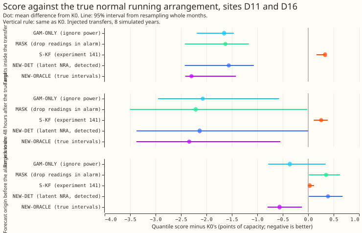

**Adding a separate state for a load transfer (demand switched from one substation to another) to
the Kalman filter that corrects the forecast from recent power readings did not forecast the normal
running arrangement (NRA) any better than two simpler filters.** The NRA is the power a substation
would have drawn had no transfer been switched in. One simpler filter ignores recent power
altogether (GAM-ONLY). The other drops the half-hourly readings recorded while the transfer
detector's alarm is open (MASK).

We added the recorded power of real transfers to the metered power of two Primary substations (D11
and D16), so that the NRA series is known. We then scored each filter's forecast against that series
with the quantile score (twice the mean pinball loss over 11 quantiles; smaller is better). The gap
is the quantile-score difference between the plain filter (K0) and the new filter given the true
transfer intervals (NEW-ORACLE). The new filter with detected intervals (NEW-DET) closed 78% of that
gap. GAM-ONLY closed 79% and MASK closed 81%.

**Verdict: partly supported.** The pre-registered rule needs a 99% lower bound of at least 40%,
and the lower bound is 5%, so the new filter's gain is not established. The real-alarm placebo
also failed, although the audit found that the placebo's pass rule cannot be met on real alarms.

## Question

Does a Kalman filter that carries the normal running arrangement (NRA) as a latent state, and routes
a detected load transfer into a separate offset state, give a better forecast of the NRA than the
filters we have? The maintainer wants the switching detector for two purposes: reading recent power
observations better, and producing an NRA forecast. Experiment 141 ([PR
1453](https://github.com/openclimatefix/nged-substation-forecast/pull/1453), not merged when this
page was written) scored observed power, which rewards following a transfer. Experiment
151 (not merged when this page was written) re-scores the existing
filters against the true NRA. This experiment changes the filter: none of the earlier designs in
this project ties the Kalman
state to a latent NRA. The edge-flow design of [experiment
116](../00116-differentiable-physics-nra-edge-flows-between-primaries/result.md) treats the NRA as
the frozen GAM, and 141's regime S is a variance switch on the same level state. The filter is a
standard linear-Gaussian state-space model with a switched process noise, in the family of [Harvey
(1989)](https://doi.org/10.1017/CBO9781107049994) intervention models. We re-implement it and do not
claim it as new.

## The filter

Per hour band, as in GAM-K, the filter reads the residual r of observed power minus the frozen GAM
forecast. State: the NRA level n (a random walk with GAM-K's fitted process noise, so it moves as
slowly as GAM-K's level), GAM-K's decaying anomaly z, and a transfer offset x. Observation:
r = n + z + x + noise. The offset x has zero mean. While an alarm interval is open its process
noise is a large multiple (four settings pre-registered, see below) of n's; after the interval's end
is called it decays to zero by a factor of 0.5 per reading and has no process noise. The NRA
forecast is n plus the decayed anomaly, with x not carried forward.

GAM-K's level and the NRA level are the same state: two random-walk levels observed only through
their sum cannot be told apart, so a separate fourth state would add nothing. This differs from
the brief's wording ("two extra states") on that point only.

Intervals come from the merged causal RO-NC alarm with experiment 147's R2 rule (the onset is
known 96 half-hours after the step, the end is known 60 half-hours after the true end, the
6-hour lookahead of
[experiment 148](../00148-switching-end-rule-lookahead-ro-nc/result.md)). When an alarm becomes
known at a forecast origin, the filter is re-run from the interval's onset with x switched on over
[onset, now], so the step is not left in n. The filter is re-run once per distinct set of known
intervals, as experiment 151 does for subtraction.

## Arms

- **K0:** GAM-K's filter on the stream, no correction.
- **S-KF:** experiment 141's two-regime filter, with 141's chosen prior and multiplier, fed the
  detected intervals.
- **NEW-DET:** the new filter fed the detected intervals.
- **NEW-ORACLE:** the new filter fed the true transfer intervals with no delay (the ceiling).
- **CLEAN:** GAM-K's filter on the stream without the injected transfers (reported beside, not the
  denominator of C1).
- **GAM-ONLY, MASK, NEW-DETNOCAP, NEW-DET96, NEW-TRUEEND:** see the design changes below.
- **Placebo:** see the design changes below (real alarms on the recorded power).

The ratio of x's process noise to n's is set on the tuning months (the odd months) from {10, 100,
1000, 10000}, scored by quantile score on NEW-DET's pre-registered post-alarm rows against the true
NRA, as 141 tuned its multiplier; the scored months are not used to choose it.

## Design changes made before any score was read

The changes below were agreed before any arm was scored. The first run was stopped and discarded.

- **Two denominators.** Every share is reported against NEW-ORACLE (the pre-registered C1) and
  against CLEAN, so the verdict is comparable with experiment 151's.
- **Two floors.** GAM-ONLY ignores power (the GAM-K member forecasts with no correction). MASK is
  K0 with the readings inside every known interval missing, re-run from the onset. If NEW-DET is
  about as good as MASK, masking is the far smaller production change.
- **End rule.** The detected arms use the detected end plus 60 half-hours (the 6-hour lookahead
  rule's median call lag). A sensitivity arm (NEW-DET96) uses 96 half-hours, the 90th percentile.
  NEW-TRUEEND keeps the detected alarm but ends the offset at the true end, so the post-end loss
  from a late end is visible. The offset decays by a factor of 0.5 per reading after its end
  (one reading per hour band per day), a time constant of 1.4 days, and it is not carried into the
  forecast.
- **Interval cap.** An interval still open 14 days after its onset has its offset folded into the
  NRA level, because a step with no return would otherwise hold the level frozen. NEW-DETNOCAP
  shows the effect of the cap.
- **Row sets are not pooled in a headline.** Scores are reported separately inside the transfer,
  in the 48 hours after the true end, and in the remaining rows (detection lag, after the detected
  end), and by transfer duration (1 to 3 days, 3 to 7 days, over 7 days). C1 stays the pooled
  post-alarm rows for the decision rule only.
- **Placebo uses real alarms.** The placebo is experiment 148's real causal alarms (6-hour
  lookahead) on the recorded power, with the new filter, MASK, and K0 scored against the recorded
  series outside the logged switching periods. Intervals shifted by whole weeks are not used.
- **No circular real check.** The labelled MW is the detector's own step, so observed power plus
  labelled MW is not used as the NRA. The real-transfer check is descriptive: forecasts issued
  inside logged transfers with targets after the logged end, scored against observed power.

## Rows and windows

Experiment 151's: rows of experiment 141's worlds whose origin is after the alarm, with targets
inside the transfer or in the 48 hours after its true end; the detection lag (onset to alarm) and
the 48 hours after the detected end are reported separately. The first test uses sites D11 and D16
(the two sites with the most injected transfers, 333 and 372 across 141's 44 worlds), the first
eight worlds. Widen to the six sites only if C1 passes.

## Pre-registered checks and risks

- **Ceiling identity:** with no alarm intervals the new filter equals K0 to 1e-9; checked in the
  run script.
- **Leakage:** a forecast at origin c uses only intervals known at c, and stream values up to c
  minus the 3.5-hour telemetry delay.
- **Oracle gap:** a gap whose own interval includes zero reports no share.
- **Past weather:** the residual stream is on the frozen GAM-K, which uses past weather at lag
  times only through experiment 130's stored panels; the lab shortcut (ERA5 in the residual model)
  is the same as experiments 141 and 151, and the new filter adds no weather input.
- **Sharing:** the scoring harness is a copy of experiment 151's scripts at the time of writing; its
  session is asked to commit them so they can be diffed.

## Results

- **C1 (pre-registered).** NEW-DET closes 78% of the K0-to-NEW-ORACLE gap (99% interval 5% to 107%;
  7,579 rows, 35 events, D11 and D16, 8 worlds). Against CLEAN (the filter on the stream without the
  injected transfer) it closes 69% (95% interval 41% to 96%). The prediction was 40% to 70%.
- **Mean quantile score on those rows** (percentage points of effective capacity; smaller is
  better): K0 4.72, GAM-ONLY 2.89, MASK 2.84, S-KF 5.02, NEW-DET 2.91, NEW-DET96 2.78, NEW-DETNOCAP
  2.88, NEW-TRUEEND 2.89, NEW-ORACLE 2.41, CLEAN 2.09.
- **Row sets, NEW-DET minus K0, not pooled.** Inside the transfer −1.56 (−2.42 to −1.07). In the 48
  hours after the true end −2.13 (−3.37 to +0.01). Before the alarm is known +0.39 (+0.01 to +0.68),
  MASK loses by a similar +0.35 on these rows. A likely cause is that the filter acts on alarms
  unrelated to the scored target; this was not tested.
- **Experiment 141's two-regime filter (S-KF) is worse than K0** by +0.30 (+0.13 to +0.36). Its
  level follows the transfer, as predicted.
- **Offset time constant.** The offset decays by a factor of 0.5 per reading after its end is
  called, one reading per hour band per day, a time constant of 1.4 days. A late end (60 half-hours)
  costs little: NEW-TRUEEND and NEW-DET differ by 0.02.
- **Interval cap.** The 14-day cap with re-absorption changes the score by 0.03 (NEW-DET 2.91
  against NEW-DETNOCAP 2.88). The cap has no visible effect.
- **Placebo on real alarms** (experiment 148's causal alarms on recorded power, 21,648 rows):
  NEW-DET minus K0 is +0.58 (−0.79 to +1.71), with a mean median-forecast shift of 4.07 points. MASK
  gives +0.41 (−1.22 to +1.66). The rule (95% interval within ±0.01) fails.

## Checks run after scoring

- **Median minus mean forecast error (NEW-DET, C1 rows).** D11: median −0.34, mean −0.29. D16:
  median +3.78, mean +3.76. The median and mean errors are almost equal at each site, so the
  forecast distribution is roughly symmetric.
- **Mean-forecast error beside the quantile score.** Mean absolute error of the mean forecast: K0
  7.59, NEW-DET 4.94, NEW-ORACLE 4.29. The mean forecast's error points the same way as the quantile
  score.
- **Tail calibration on the C1 rows** (coverage at the quantile, target in brackets): NEW-DET 0.058
  (0.01) at q01, 0.103 (0.05) at q05, 0.961 (0.95) at q95, 0.990 (0.99) at q99. K0: 0.001, 0.006,
  0.570, 0.731. NEW-DET's lower quantiles sit too high (5.8% of targets fall below its q01 forecast,
  against the 1% intended); K0's tails are far worse.
- **Triggers fired:** 1 (a control, the placebo, failed), 4 (leaving out D11 gives −119% and leaving
  out D16 gives 103%), and 5 (GAM-ONLY, a nested arm with less input, beats K0). A Sonnet audit ran
  ; the audit's findings are triaged below.

## Audit findings and triage

- **NEW-DET is effectively MASK.** NEW-DET minus MASK is +0.071 (−0.001 to +0.115), and NEW-DET
  never beats MASK by more than 0.05 in any event or duration stratum. At offset-noise ratio 10^12
  the filter reproduces the plain filter on a masked stream. We accept this finding; it is the main
  finding.
- **The oracle gap is mostly "stop reading the corrupted power".** K0's mean absolute median error
  grows from 5.3 to 9.9 points as the step ages. We accept this finding; the verdict is unchanged.
- **A few events dominate.** Two D11 events and one D16 event hold 94% of the summed gap. Weighting
  each event equally gives 63%, and each site equally 66% (D11 alone 103%, D16 alone −119%).
  Dropping the three largest events by gap gives −322%. We accept this finding; the pooled share is
  not robust.
- **The oracle is not a clean ceiling at D16.** Real alarms there overlap injected events, so
  masking arms lose against recorded power that holds real shifts. We accept this as a caveat.
- **The placebo rule is not a fair test.** The 12 real alarms with scored rows last 1 to 16 days.
  Ten of them show a mean level shift of 4 to 21 points, and none is a zero or a bank holiday, so K0
  follows the real level and any arm that acts is penalised. A usable placebo needs known false
  alarms (experiment 151's list of unexplained alarms is the candidate). We accept this finding; the
  plan's week-shifted placebo was replaced on the manager's request and is not run.
- **The tuned ratio is weak.** It was tuned on 401 rows from 4 events, all at D11, and 10000 is the
  edge of the grid. Ratio 10 scores a higher C1 share (84.5%) on the scored rows. We accept this
  finding; the verdict is unchanged.
- **Leakage and algebra.** No leakage found; the filter matches the plain filter to 1e-14 with no
  open interval. The end-call lag at 96 half-hours gives 84%. No change to the verdict.

## Caveats and what to try next

- Lab conditions: ERA5-based residuals and true injected megawatts, as in experiments 141 and 151.
- The real-transfer check the manager asked for (forecasts issued inside logged real transfers,
  scored after the logged end) was not run; the placebo on real alarms was meant to cover the
  no-harm part but cannot, so no-harm on real transfers is untested.
- Six-site widening was not run, because C1 did not pass.
- **What the next experiment should answer:** whether any transfer-aware filter beats MASK on
  transfers that mask handles badly, such as short transfers (1 to 3 days) and real level shifts
  that do not return, scored per event and against known false alarms.
