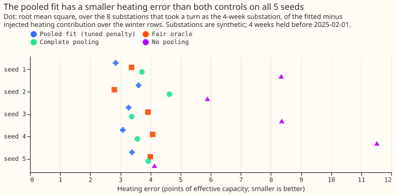
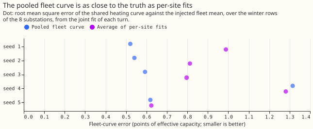
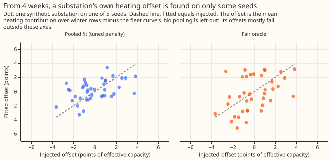

# Differentiable physics, N0 gate 2: the partly pooled convex model's heating error against the injected truth

**On made-up data with a known right answer, a partly pooled demand model found a new substation's
winter heating response from 4 weeks of data better than either extreme could, but no method found
the sign of that substation's own deviation from the fleet reliably.** The fleet's shared heating
curve was recovered as well as the average of separate per-substation fits recovers the curve. A
partly pooled model can therefore share the heating curve, and a substation with 4 weeks of history
should keep its own offset heavily shrunk towards the fleet's curve. The next experiment on partly
pooled shapes should not rely on offsets learned from 4 weeks. The verdict is `partly supported`:
three of the four pre-registered lines hold.

**We tested a forecasting method on 8 synthetic substations whose right answer we know.** The
method is the convex demand model of [experiment
109](../00109-differentiable-physics-n0-partially-pooled-convex-model/result.md), which gives each
substation the fleet's shared coefficients plus a penalised deviation of its own ("partial
pooling"; the model is convex, so its fit has one optimum). The synthetic substations use the real
calendar and weather of real substations, with injected heating coefficients: one curve shared by
the fleet plus a known offset for each substation. [Experiment
150](../00150-differentiable-physics-n0-gate-rerun-fair-oracle-five-seeds/result.md) could not tell
whether the method shrinks a substation's own coefficients correctly, because in 4 weeks of June
the heating signal is weak. Here each synthetic substation in turn keeps only the 4 weeks before
2025-02-01 (the other 7 keep 2 years), when heating dominates demand. The experiment repeats this
on 5 random draws of the injected coefficients ("seeds"). The fleet and the noise are experiment
150's.

**Terms used below.** The "heating error" is the root mean square, over the November to March rows
of the substation's 2 years of calendar and weather, of the fitted minus the injected heating
contribution to demand, in points of effective capacity (percentage points of the substation's
capacity). The "offset" is the substation's mean heating contribution minus the fleet curve's. The
"fair oracle" is a reference estimator told the fleet mean, the true spread of each coefficient
and the noise variance, which estimates every coefficient from the same 4 weeks. The two "controls"
are the same fit with no pooling (penalty 0 rows of evidence) and with complete pooling (penalty
1,000,000 rows). The "pooled fit" uses the penalty experiment 150 tuned on each seed (300 to 1,000
rows). The lines W1 to W3 are defined under "Pre-registered lines" below.

## Pre-registered lines

- **W1, the shared curve.** The fitted fleet curve's error against the injected fleet mean,
  averaged over the 8 turns, is at most 1.1 times the error of the average of the per-site fits
  (the penalty-0 fit of the same turn).
- **W2, close to the fair oracle.** The pooled fit's heating error is at most 1.1 times the fair
  oracle's.
- **W2b, better than both controls.** The pooled fit's heating error is below no pooling's and
  below complete pooling's.
- **W3, the offset's sign.** The pooled fit's offset has the injected sign at 6 or more of the 8
  substations, and the slope of the fitted offsets on the injected offsets, through the origin, is
  positive.
- **Decision.** A line holds when it passes on at least 4 of 5 seeds; the verdict rule is in the
  front matter.

## Results

Every number below is printed in [`report.txt`](report.txt). Errors are in points of effective
capacity.

| Line (pre-registered) | Seeds passed | Detail |
|---|---|---|
| W1, shared curve within 10% of per-site fits | 5 of 5 | Fleet-curve error 0.52 to 1.31, against 0.62 to 1.28 for the per-site average. |
| W2, pooled error within 10% of the fair oracle | 4 of 5 | Seed 2 missed: 3.61 against the oracle's 2.80. |
| W2b, pooled error below both controls | 5 of 5 | Complete pooling was closest, by 0.10 on seed 3. |
| W3, own offset has the injected sign | 2 of 5 | Signs right at 4, 6, 3, 6, and 4 of 8 substations. |

- **Heating error per arm and seed.** Pooled fit: 2.84, 3.61, 3.28, 3.08, and 3.39.
  complete pooling: 3.72, 4.63, 3.38, 3.57, and 3.93. no pooling: 8.34, 5.89, 8.36, 11.52, and 4.13.
  fair oracle: 3.37, 2.80, 3.91, 4.07, and 4.00.
- **Verdict rule as pre-registered.** W2b holds, and three of four lines hold, so `partly supported`.
- **The pooled fit's edge over complete pooling is small on some seeds.** The edge is 0.10 on seed
  3 and 0.48 to 1.02 on the others, so most of the gain over no pooling comes from sharing the
  curve, and little from the substation's own offset.
- **The oracle found the offset's sign more often, and still reached 6 of 8 on only 2 seeds
  (comparison added after the run).** The fair oracle got the sign right at 3, 8, 5, 7, and 5 of 8
  substations, the pooled fit at 4, 6, 3, 6, and 4, and no pooling at 4, 3, 4, 3, and 3. The oracle
  reached 6 or more on seeds 2 and 4, the same two seeds as the pooled fit. The pooled offsets'
  slope on the injected offsets was 0.50, 0.53, -0.06, 0.67, and 0.27, against the oracle's 0.35,
  1.00, 0.26, 1.47, and 0.66.
- **The coefficient-space error is lowest for the pooled fit on 4 of 5 seeds.** The pooled fit's
  1.87 to 2.46 beat the oracle's 2.30 to 4.06 on every seed and complete pooling's 2.10 to 2.63 on
  every seed except seed 4, where complete pooling's 2.20 is just below the pooled fit's 2.26.

## Predictions against outcome

- **Predicted: heating error below both controls on 4 or 5 of 5 seeds.** Observed 5 of 5.
- **Predicted: within 10% of the fair oracle on 5 of 5 seeds.** Observed 4 of 5; seed 2 is the miss.
- **Predicted: own-offset sign right at 6 or more of 8 on 3 or 4 of 5 seeds.** Observed 2 of 5. A prediction
  of 3 seeds was already a predicted failure of W3, which needs 4. The fair oracle also reached 6 of
  8 on only 2 seeds, which points to the information in 4 weeks, and the oracle's edge on some
  seeds has an explanation in its extra knowledge (see the caveats).

## Checks

- **Median forecast minus mean forecast, per site.** Not applicable: the gate scores coefficients
  and noise-free truth, not forecasts.
- **Error of the mean forecast beside each contrast.** Not applicable for the same reason; the
  contrasts here are errors against the injected truth.
- **Audit triggers that fired.** Trigger 1 (a known-answer line, W3, fails) and trigger 7 (a later
  experiment's design, the partly pooled GAM, depends on this gate). Trigger 2 (a result
  contradicts its prediction) fires only for W3's sign count. Triggers 3 to 6 do not apply. One
  Sonnet reviewer re-derived the numbers from the stored runs and read the code; no Opus audit ran,
  and the next experiment should treat the offset result as unreplicated beyond one January and 5
  seeds.

## Caveats

- **The fleets share the real calendar, weather and noise weeks**, and differ only in the injected
  coefficients, so the 5 seeds are not independent replicates of the noise. The held weeks are
  one January.
- **The oracle's offset is measured against the true fleet mean, and the pooled fit's against its
  fitted fleet mean.** The oracle's prior mean also includes the held-out substation's own truth
  (1 of 8). Both choices flatter the oracle and hurt the pooled fit on the offset's sign.
- **The penalty is experiment 150's, tuned on June and not retuned for January.**
- **The injection is into the synthetic series, not into the residuals of a fitted real
  substation.** Truth for every coefficient is therefore known, and the fleet's heating curve is
  the six real Primaries' fitted curve with injected spread.
- **The pooled fit is given the true capacity of the seven full-history substations** (inherited
  from experiments 109 and 150).
- **Schedule.** One refit per fit at the 2025-02-01 cut, so the contrasts do not depend on a
  retraining schedule.

## What to try next

**Plan the partly pooled GAM shapes experiment so that the shared curve is pooled and the
substation's offset comes from its full history, not from 4 weeks.** Use at least a winter's rows
for any substation whose own offset is scored, because the sign of the offset was not found from 4
weeks by any method tried. The partly pooled GAM itself is not planned or started here.
