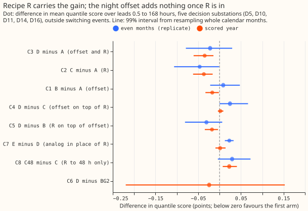
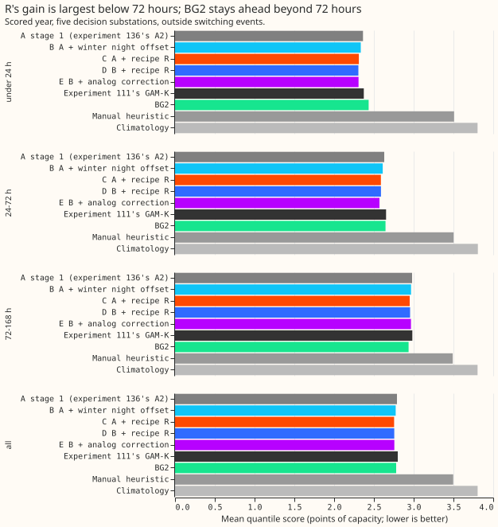
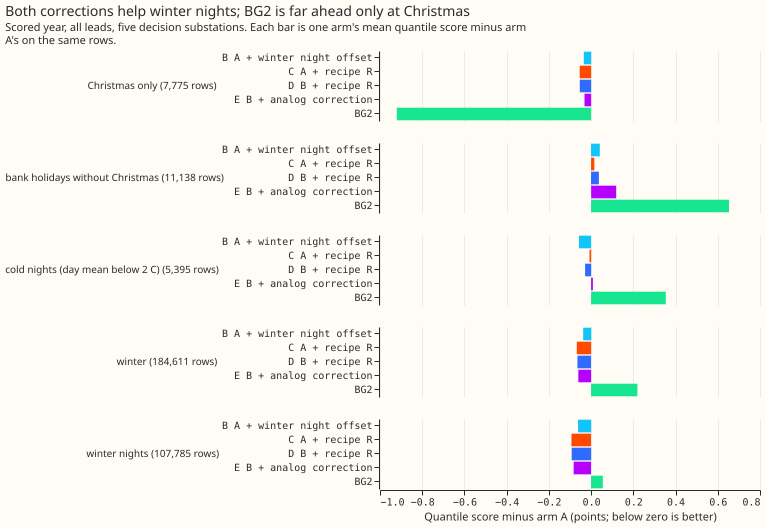
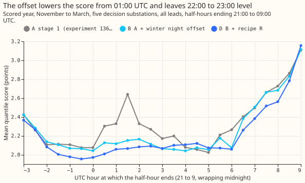

# Experiment 155: does GAM-K with a winter night offset and recipe R beat the stage 1 assembly?

**Subtracting recipe R's 14-day error profile from the stage 1 forecast lowers its score by about
0.04 points, and the winter night offset adds nothing once R is in.** The stage 1 assembly (arm A)
scored 2.791 points over leads 0.5 to 168 hours in the scored year. Adding R gave 2.754 (C2 -0.037,
99% interval -0.062 to -0.016), adding the offset alone gave 2.774 (C1 -0.017, -0.033 to -0.002),
and adding both gave 2.756 (C3 -0.035, -0.061 to -0.014; C4, both against R alone, +0.002). The best
arm is therefore R alone, which sits 0.026 points below BG2 (2.780) with an interval too wide to
rank the two. The verdict is `inconclusive` because the pre-registered placebo gained as much as the
real offset, and the rule caps the verdict there. Without the cap, C3's upper bound (-0.014) is
above the -0.02 threshold, so the verdict would be `partly supported`. The next experiments start
from arm C.

We asked whether two corrections that earlier experiments found, a winter night offset
([experiment 137](../00137-differentiable-physics-e7-economy-7-night-step-term-in-the-forecast/result.md)'s
audit) and recipe R ([experiment 115](../00115-differentiable-physics-w1-diurnal-shape-state-on-ens/result.md),
the 0.75-weighted mean error of the last 14 days by half-hour), improve the stage 1 forecast of
[experiment 136](../00136-dp-bg-stage1-assembly-on-the-ensemble-mean/result.md), the convex
demand model with a Kalman filter on recent errors driven by the ensemble-mean weather. We
added each correction to experiment 136's stored forecasts, alone and together, refitted each arm's
spread, and scored every arm on the same half-hourly rows at five Primary substations. Nothing is
newly modelled: the analog correction of [experiment
145](../00145-differentiable-physics-analog-day-error-correction-on-gam-k/result.md) is an extra
arm.

## Results

- **Arms and schedule.** A is experiment 136's A2 as stored. B adds the winter night offset. C adds
  R at every lead. D adds R to B (R on B's own past errors). C48 and D48 limit R to leads of 48 hours
  or less. E adds experiment 145's tuned analog correction to B. B0 is the offset without the winter
  indicator (ablation). The fits are experiment 136's monthly refits on a 24-month window, so every
  contrast is within that schedule.
- **Rows.** `fold_a_daily_gap_v1`, scored year 2025-07-02 to 2026-06-29, five decision substations
  (D5, D10, D11, D14, D16; D9 beside them), outside the hand-filtered switching events. The headline
  rows are those that every arm and BG2, climatology, and the manual heuristic share. The store
  holds 291 scored runs per substation, not the 292 the plan names. Five outage rows at D16 (actual
  0) leave the headline because BG2 has no actual there.
- **Absolute skill, all leads (points of effective capacity).** A 2.791, B 2.774, C 2.754, D 2.756,
  C48 2.777, D48 2.766, E 2.757, B0 2.788, experiment 111's GAM-K 2.800, BG2 2.780, manual
  heuristic 3.497, climatology 3.804. Day D+1: A 2.489, B 2.462, C 2.436, D 2.432, E 2.393, BG2
  2.535, GAM-K 2.521. Replicate months (even months of 2024-07 to 2025-06), all leads: A 2.710, B
  2.719, C 2.664, D 2.688, E 2.711.
- **C1, B minus A (offset).** -0.017 (-0.033 to -0.002), 5 of 5 substations, 11 of 12 months;
  replicate +0.009 (-0.022 to +0.048). Cold nights (daily mean below 2 °C, 5,395 rows) -0.058.
- **C2, C minus A (R).** -0.037 (-0.062 to -0.016), 5 of 5 substations, 12 of 12 months; D+1 -0.053
  (-0.087 to -0.022); replicate -0.047 (-0.106 to -0.001). Leaving out any one substation gives
  -0.029 to -0.042.
- **C3, D minus A.** -0.035 (-0.061 to -0.014); replicate -0.022 (-0.079 to +0.030). It lies 0.019
  from the sum of C1 and C2, inside the predicted 0.02.
- **C4, D minus C.** +0.002 (-0.004 to +0.009); replicate +0.024 (0.000 to +0.067). **C5, D minus
  B.** -0.018 (-0.034 to -0.004).
- **C6, D minus BG2.** -0.024 (-0.220 to +0.153), D+1 -0.103 (-0.306 to +0.093). **C13, A minus
  BG2** +0.010, as experiment 136 found. The intervals are 0.3 to 0.4 points wide, so no arm can be
  ranked against BG2.
- **C7, E minus D.** +0.001 (-0.010 to +0.014) over all leads, -0.039 (-0.056 to -0.010) at D+1;
  E scores 0.12 worse than D on bank holidays other than Christmas.
- **C8 and C9, limiting R to 48 hours.** C48 minus C +0.023 (+0.007 to +0.041); D48 minus D +0.010
  (-0.001 to +0.021). R helps beyond 48 hours as well.
- **Spread refit (post hoc).** Using arm A's spread table for the corrected means scores 0.003 to 0.004
  better than each arm's own refit (B 2.771, C 2.750, D 2.751), so refitting the spread on
  tuning months that start with little history costs a little.
- **Predictions against outcome.** C1 -0.017 against -0.02 to -0.04 (a little short; cold nights
  -0.058 against -0.10 to -0.30, a miss). C2 -0.037 inside -0.03 to -0.08; at D+1 -0.053 against
  -0.07 to -0.12 (a miss). C3 inside 0.02 of the sum. C48 and D48 worse by 0.023 and 0.010 (inside
  0.00 to 0.03). E minus D at D+1 -0.039 (inside), all leads +0.001 (inside). The best arm scored
  2.754 against 2.67 to 2.75, and minus BG2 -0.026 (just outside -0.03 to -0.11). The cold-night q95
  coverage rose by 1.1 points at most (predicted 2 to 6).
- **Verdict by the pre-registered rule.** The placebo control failed, so the verdict is capped at
  `inconclusive`. The winning arm is C: its all-lead score is the lowest, D (2.756) and E (2.757)
  are within 0.005 points, and C comes first in the tie order.

## Tail calibration and breakouts (scored year, five decision substations)

| Subset | Arm | q01 cov | q05 cov | q95 cov | q99 cov | Pinball q95 | Pinball q99 |
|---|---|---|---|---|---|---|---|
| All leads | A | 0.022 | 0.066 | 0.945 | 0.982 | 0.736 | 0.229 |
| All leads | C | 0.023 | 0.069 | 0.946 | 0.982 | 0.748 | 0.233 |
| All leads | D | 0.024 | 0.070 | 0.947 | 0.983 | 0.749 | 0.232 |
| Cold nights | A | 0.043 | 0.073 | 0.827 | 0.941 | 0.927 | 0.307 |
| Cold nights | B | 0.043 | 0.078 | 0.838 | 0.942 | 0.902 | 0.290 |
| Cold nights | C | 0.043 | 0.092 | 0.827 | 0.939 | 0.944 | 0.329 |
| Cold nights | D | 0.042 | 0.092 | 0.837 | 0.942 | 0.937 | 0.324 |
| Cold nights | BG2 | 0.020 | 0.035 | 0.756 | 0.861 | 1.390 | 0.809 |

- **Cold nights stay under-covered.** The q95 covers 82.7% to 84.3% of cold-night rows in every
  arm (BG2 75.6%), against 94.5% over all rows. R leaves the cold-night upper tail unchanged and
  worsens its q05 coverage (9.2% against 7.3%), and only the offset improves the pinball loss at
  q95 and q99 there.
- **Breakouts, quantile score minus arm A.** Winter nights: B -0.062, C -0.093, D -0.092. Winter:
  B -0.037, C -0.067, D -0.064. Christmas rows only (7,775 rows): B -0.035, C -0.054, D -0.054, BG2
  -0.921. Bank holidays without Christmas (11,138 rows): B +0.041, C +0.015, D +0.037, E +0.119,
  BG2 +0.653.
- **Christmas is one event.** The 7,775 Christmas rows come from 12 runs at 4 substations in one
  month. A over-forecasts on 29 to 31 December by 6.7 to 7.9 points, and BG2 does not. BG2 is worse
  than A on other bank holidays and on non-holiday December rows (audit, finding 3).
- **The offset on the 22:00 to 23:00 half-hours.** B's score on winter nights at half-hours ending
  22:00 and 22:30 UTC is 2.137 and 2.105, against 2.105 and 2.111 for A, so the offset does not
  repeat the loss at 22:00 that experiment 137's term had, except by 0.03 at 22:00.
- **Lead check.** The score of A falls from 0.5 to 3.5 hours to 3.5 to 9.5 hours by 0.476 points,
  because the bands cover different hours of the day. Against A, B's difference is +0.003 (+0.001
  to +0.005, passes the +0.02 bound) and the R arms' is -0.048 (-0.139 to +0.032, fails the bound
  by its upper end and shows no growth in the point estimate). The production cadence is not tested.
- **Curtailment cost against the manual heuristic was not computed**, because the repository has no
  node metric for these substations yet.

## Checks

- **Median minus mean forecast, per substation:** 0.000 for arms A, B, and D at all six
  substations, because the residual table is centred, so this check exposes nothing here.
- **Mean forecast's error beside each contrast (mean absolute error):** C1 -0.035, C2 -0.090, C3
  -0.087, C4 +0.003, C7 +0.009. Every contrast moves in the direction of its quantile score.
- **Leave-one-out:** removing any one substation leaves C1 at -0.015 to -0.019, C2 at -0.029 to
  -0.042, and C3 at -0.028 to -0.041, so trigger 4 did not fire.
- **Controls.** Reproduction: arm A rescored on experiment 136's rows gives 2.791 (passed). Spread
  refit with a zero shift reproduces A's quantiles to 1.5e-5 (passed). Leakage: corrupting `actual`
  by 100 points from each cut (offset) and from the origin's own day (R) changed no applied shift
  (maximum change 0.0, passed). Injected known answer: the winter-night step of 6 points is
  recovered as 5.60 points at every substation (93%), and R's shift on an injected daily shape of
  3 points is +2.06 (0.75 times the day-mean-corrected 2.75), inside 25% of +2.25 (passed).
  **Placebo: failed.** The offset with the winter indicator moved six months scored 2.774, the same
  as B (difference +0.00002), against a pass rule of at most half of C1.
- **Zero-shift runs.** R's shift is zero for 4 of 184 tuning runs and none of the replicate or
  scored runs at each substation.
- **Triggers fired.** Trigger 1 (the placebo) and trigger 2 (predictions missed on cold nights and
  at D+1). Trigger 5 did not fire, because C4's interval includes zero, although arm C scores 0.002
  below arm D. Triggers 3, 4, and 6 did not fire. The Opus audit is in the private briefs folder
  (`e155_audit_report.md`) and is triaged below.

## Audit and triage

- **Finding 1, placebo (accepted).** The placebo was degenerate: with per-slot constants, a May to
  September indicator spans nearly the same space as a November to March indicator. A scan of 55 month
  sets found that a five-month window gains about -0.017 only when it splits the year into winter and
  summer halves, and 40 random five-month sets gained -0.003 on average (none as much as the real
  flag). The gain therefore needs a seasonal split, and the real flag is the best one. The cap stays
  because the rule was pre-registered, and the scan is reported as a labelled post hoc control.
- **Finding 2, the two corrections overlap (accepted).** R fitted on B's errors removes about 58% of
  the offset at night, and R's day-mean removal moves the offset's level onto daytime half-hours, so
  D is worse than C by +0.005 (+0.002 to +0.008) in daytime. No order of the two beats C. The offset
  is dropped from the winning arm.
- **Finding 3, Christmas (accepted).** Rows and units match; the lead is real for one event. It is
  reported as one event, with no ranking.
- **Findings 4 and 5, no leakage and row-set details (accepted).** The row-set details are stated in
  the Results.

## Caveats

- **One scored year.** The offset is fitted on one earlier winter, and the replicate months show
  the offset's sign reversed (+0.009), so the offset's evidence is thin. The selection of arm C uses
  the scored year, and the replicate months agree on R (-0.047).
- **The intervals against BG2 are 0.3 to 0.4 points wide**, so the ranking of the corrected arms
  against BG2 is open.
- **Analog source days.** Arm E has fewer source days than experiment 145 had, because the stored
  forecasts omit the every-fifth-day stride runs and the runs before 2024-07.

## What to try next

- **Calibrate the tails of arm C on cold nights**, where the q95 covers 82.7% of rows.
- **Test the offset again at a second winter** with a placebo made of random month sets.

## Plan

**Question.** Experiment 136 assembled a GAM-K with the heating split (T-all), one shared filter
noise setting (POOL), the pinned solar capacity, and the ensemble mean as its weather input, and
could not rank it against BG2. Two later experiments found corrections that act on the finished
forecast: a winter night offset (the audit of
[experiment 137](../00137-differentiable-physics-e7-economy-7-night-step-term-in-the-forecast/result.md))
and the 14-day error profile of recipe R
([experiment 115](../00115-differentiable-physics-w1-diurnal-shape-state-on-ens/result.md)). This
experiment adds them to experiment 136's A2 one at a time and together, scores every arm on the same
rows, and picks the winning arm that the calibration experiments start from. No new modelling: every
piece exists, and the code is copied from experiments 136, 137, and 145.

**Arms.** All arms share the rows and the weather of experiment 136's A2, the pinned capacity of
[experiment 139](../00139-differentiable-physics-pv-as-of-capacity-in-gam-k/result.md) (which found
that replacing the pin does not help, so the pin is kept), and the filter noise of experiment 136.

| Arm | Built from | Added piece |
|---|---|---|
| A | Experiment 136's A2 forecasts as stored | none: GAM-K, T-all, POOL, pinned capacity, ensemble mean |
| B | A | winter night offset |
| C | A | recipe R at every lead |
| D | B | recipe R at every lead, fitted on B's own past errors |
| C48 | A | recipe R at leads of 48 hours or less (variant) |
| D48 | B | recipe R at leads of 48 hours or less (variant) |
| E | B | the analog correction of experiment 145 (ANALOG+R, tuned values) at every lead, in place of R |
| B0 | A | the offset's per-slot constants and weekend flag only, without the winter indicator (ablation, no verdict) |

**Reference arms.** BG2, experiment 111's GAM-K, `ref_climatology`, and `ref_manual_heuristic`, as
stored and read as experiment 136 reads them.

**The winter night offset (arm B).** For each of the 24 half-hours that end between 21:30 and 09:00
UTC, the offset is `a[h] + w[h] * winter + c[h] * weekend`, where `winter` is 1 when the evening's
date (the UTC date 21:30 before the half-hour ends, so post-midnight half-hours take the previous
date) falls from November to March, and 0 otherwise, and `weekend` flags Saturday and Sunday
evenings. The coefficients are a ridge regression of arm A's own past errors (actual minus mean
forecast) on those 72 columns. They are fitted per substation on all rows whose run origin and valid
time are both before the first day of the month being forecast (an expanding window, refitted
monthly, starting from 2024-07), as in experiment 137, with experiment 137's ridge penalty of 100.
The offset replaces experiment 137's temperature term because the audit of that experiment found a
winter indicator matched it and so the data show a winter night bias and not a step that grows with
cold. The offset shifts every quantile and the mean.

**Recipe R (arms C, D, C48, D48).** For a run with origin on UTC day `O`, the target day is `T = O +
1`. The profile is the mean over the source days `T - 15` to `T - 2` (at least 3 of them usable) of
each source day's D+1 error block, by local half-hour with the day's mean removed. A source day's
block is the error of the pre-R forecast of the run issued on the day before it, over its leads of
15.5 to 39 hours. The shift added to every row of the run is minus 0.75 times the profile at the
row's local half-hour. The code is `e00145_analog.py`'s recipe R, copied. In arm D the pre-R forecast
is B, so R is fitted on the errors that remain after the offset and the two corrections do not
count the same error twice. The 48-hour variants zero the shift on rows with a lead above 48 hours.

**The analog correction (arm E).** Experiment 145's ANALOG+R with its tuned values (20 source days of
the same day type within 13 weeks of the target's day of the year, weight 0.5 of the analog profile
against R's 14-day profile, kappa 1.0), added to B at every lead. The values are not retuned here.
The loss beyond 48 hours that experiment 145 found is why the variants exist, and arm E is read
at D+1 and at every lead.

**Spread.** Each arm's quantiles are its corrected mean plus a residual table (hour band by calendar
quarter by lead band) fitted on that arm's own corrected forecasts in the tuning months (the odd
months of 2024-07 to 2025-06), every spread factor 1, as experiment 136 and experiment 145 do.
Experiment 137 left the spread unchanged instead. The spread's width is therefore not a second thing
the arms differ in, and the comparison with the residual table of arm A's uncorrected forecast (a
post hoc sensitivity row for each of B, C, and D: the arm's corrected mean with arm A's residual
table) shows how much the refit matters, because the correction arms' tuning-year forecasts start
from an empty or thin history and may give wider tables than the scored year needs. Experiment 125
found factors tuned on alternate months scored worse out of period, so no factor is tuned. The
comparison spread (the pooled quantile model with factor 1.15 of the BG2 recipe) is the stored BG2
and is not recomputed.

**Rows and periods.** `fold_a_daily_gap_v1`, 09:00 UTC `power_fcst_init_time`, leads 0.5 to 168
hours, rows outside the hand-filtered switching events. The scored year is the 292 runs from
2025-07-02 to 2026-06-29. The tuning months are the odd months and the replicate months the even
months of 2024-07 to 2025-06, as in experiment 136. D-labels only. The error stream that R and the
offset read is the corrected forecasts of the stored tuning, replicate, and scored runs. The
every-fifth-day stride runs of the scored year are in no stored forecast, so R's 14-day profile has
about 11 source days there, and the minimum of 3 is met. A run with fewer than 3 usable source days
gets a shift of zero, and the count of such runs per arm and period is reported. The corrections
use every row with a reading, switching-masked rows included, because switching information is not
used in this pass; the scores and the spread tables exclude the masked rows. The ridge penalty of
100 and experiment 145's tuned values are reused without retuning.

**Weather and what exists at forecast time.** The weather is the calibrated ensemble mean of
experiment 136, and the filter uses an analysis proxy built from earlier runs. The offset uses the
calendar only, and R and the analog correction use errors of days that ended before the origin. Every
input exists at forecast time.

**Scoring.** The headline is the quantile score over leads 0.5 to 168 hours at the five decision
substations in the scored year. Beside it:

- lead bands (under 24 hours, 24 to 72 hours, 72 to 168 hours) and day D+1;
- **cold nights**: night and evening half-hours (the night and evening hour bands of experiment 136)
  of the winter days whose ERA5 daily mean 2 m temperature at the substation's grid box is below 2
  °C, at all leads; experiment 136's definition (an ERA5 half-hourly temperature of 3 °C or below)
  is reported as well so that the two experiments can be compared, and q95 coverage is the second
  headline for the cold-night rows because experiment 125 found it was 73% to 78%;
- **holiday and Christmas rows**: rows on a bank holiday or in the Christmas run days (the
  `holiday_period` of the calendar), with the Christmas rows reported alone;
- tail calibration at the 0.01, 0.05, 0.95, and 0.99 quantiles, overall, on cold nights, and by hour
  band (night, evening, morning, and day, as in experiment 136);
- the quantile score by UTC half-hour from 21:00 to 09:00 on winter nights, for A, B, and D, to show
  whether the offset worsens the 22:00 to 23:00 half-hours as experiment 137's term did;
- the quantile score by lead hour for leads up to 24 hours, and the score at leads of 0.5 to 3.5
  hours, 3.5 to 9.5 hours, and 9.5 to 24 hours, for each arm. The production service will refresh
  its forecast every 6 hours with an input that is 3.5 hours old, so a forecast used in production
  is up to 9.5 hours older than its origin. The check is whether an arm's error grows between those
  lead bands by more than arm A's, which would make the corrections fragile under that cadence. The
  production cadence itself is not tested here;
- absolute scores for every arm and for the reference arms, and the mean absolute error of the mean
  forecast beside every quantile-score contrast.

**Planned contrasts.** C1 B minus A (the offset), C2 C minus A (R), C3 D minus A (both: the
headline), C4 D minus C (the offset on top of R), C5 D minus B (R on top of the offset), C6 D
minus BG2, C7 E minus D (the analog correction in place of R), C8 C48 minus C (limiting R to 48
hours), C9 D48 minus D, C10 C48 minus A, C11 D48 minus A, and C12 E minus A. Each is read at the
99% level. The replicate months give the sign.

**Controls, run before any contrast is read.**

- **Reproduction.** Arm A, rescored from the stored forecasts of experiment 136 on the same common
  rows, scores 2.791 over leads 0.5 to 168 hours, within 0.001.
- **Leakage.** Add 100 points to `actual` at every valid time on or after each month's cut, in a copy
  of the frames, and rebuild every correction. Pass: no correction applied to the month changes (a
  maximum change of 0.0), for the offset and for R. For R the control also corrupts `actual` from the
  origin's own day and checks that the run's shift is unchanged, because the newest source day is
  `T - 2`.
- **Injected known answer.** In a control copy of the frames, add a winter-night step of known
  size (6 points on the half-hours from 01:00 to 08:30 UTC, November to March) and a daily shape
  error of known size (3 points on the half-hours ending 17:00 to 19:00 local time, every day) to
  the `actual` of every row, the scored year included, and rebuild the corrections. Pass: the
  fitted winter-night offset minus the clean fit's offset, averaged over the injected half-hours at
  the cuts of 2025-11 onward, is within 25% of 6 points at 5 of 6 substations, and R's shift on the
  injected half-hours minus the clean shift has a mean within 25% of +2.25 points (0.75 times the
  injected 3 points; error is actual minus forecast in this sentence, and the code's forecast
  minus actual sign is the opposite, so the shift is plus 0.75 times the mean actual minus forecast).
- **Placebo.** Shift the winter indicator by six months (so `winter` is 1 from May to September) and
  refit. Pass: the placebo's all-lead score change against A in the scored year is at most half of
  C1's, read only if C1's interval lies wholly below zero (otherwise the placebo is reported and not
  read). The offset's per-slot constants carry about a third of its gain (experiment 137's audit),
  so the placebo is not expected to be zero, and the ablation B0 shows how much the constants
  carry.

**Five triggers (size).** Stored: private files only. Serving path: not touched. Degradation rule:
not touched. More than one design defensible: yes, three, each pre-registered above. Callers not
nameable without searching: no, the scripts copy experiments 136, 137, and 145.

**Audit triggers to watch.** Trigger 2 (a result contradicts its prediction) and trigger 5 (a nested
arm beating the arm that contains it, which could be arm D against arm B and arm C) are the likely
ones. The write-up lists which fired and tells the manager if any did.

**Resources.** Central processing unit (CPU) only, at most 8 cores with one thread per worker, each
job under `systemd-run --user --scope -p MemoryMax=16G -p OOMPolicy=continue`. No GPU. The jobs read
stored forecasts, so a full run is expected to take minutes.

**Outputs.** Predictions for every arm in the `dp_preds` layout (`q01` to `q99`, `actual`,
`switching_mask`, 09:00 UTC origins, leads up to 168 hours) for D5, D9, D10, D11, D14, and D16, under
`data/ml-experiments/00155-dp-bg-stage2-assembly-night-offset-and-error-correction/work/dp_preds/`,
so that the substation cards can be rebuilt from the winning arm.

**Advice followed and departures.** From experiment 136: keep T-all; check POOL's cold-night tails
(the tail table reports them). From experiment 137: test a seasonal offset and judge on cold winter
nights and also on the 22:00 to 23:00 half-hours (the by-hour figure shows them). From experiment
145: apply the analog and weekday terms at D+1 only (the C48 and D48 variants test whether R itself
should be limited; the brief's recipe applies it at every lead) and leave holiday-like days on R's
14-day profile. From experiment 139: keep the pinned capacity. Provisional: the offset, because
experiment 137 failed its placebo and its readability rule; this experiment is a second winter of
evidence only in the sense that the scored year is the same year, so it adds no independent winter.
