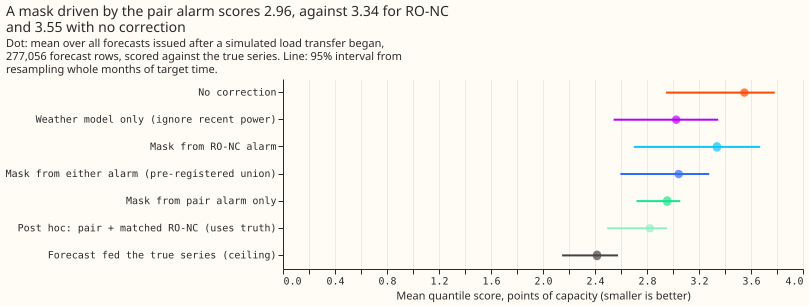
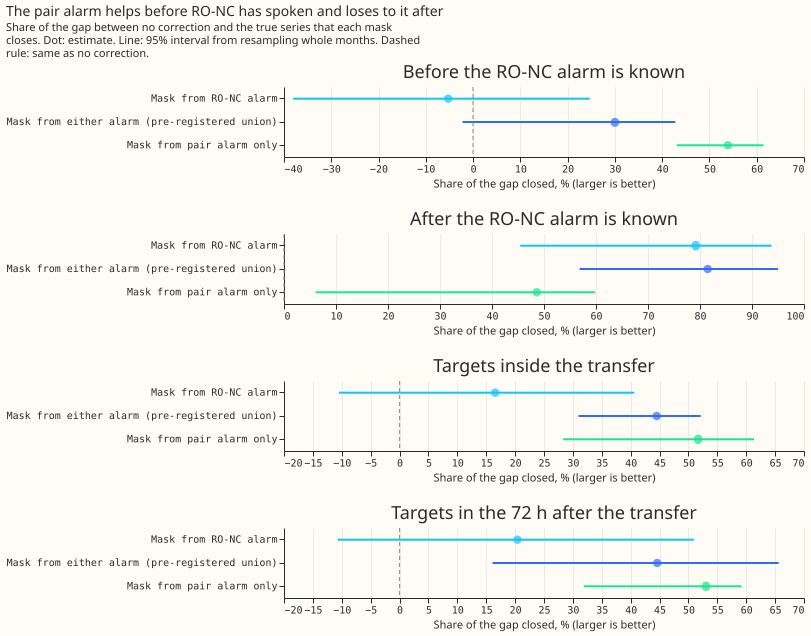
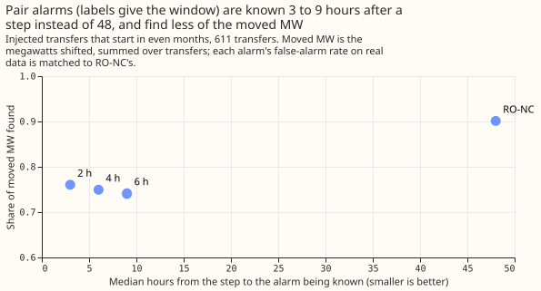

**Take-home message.** An alarm that fires when one metered substation steps by several noise units
and a connected metered substation steps the opposite way is known 3 to 9 hours after a load
transfer starts, instead of 48 hours for the refit-offset neighbour-count detector (RO-NC). On the
transfers the alarm finds, masking the readings from it closes 95% of the forecast-error gap to the
true series, against 40% for RO-NC's mask. The alarm finds few transfers: 38% of simulated ones
(RO-NC 69%) and 5 of 35 real ones (RO-NC 20). Pooled over all forecasts, the pre-registered gain
over RO-NC is small, and no mask beats a forecast that ignores recent power.

**We asked whether a much earlier alarm would make the mask forecast of
[experiment 151](../00151-nra-forecast-rescored-against-the-true-nra-series/result.md) work
before RO-NC has spoken.** A load transfer moves power from one substation to its neighbours, so the
two substations step in opposite directions at the same time, while weather and holidays move
neighbours the same way. We built an alarm on that pair of steps over windows of 2, 4, and 6 hours,
and set its threshold so that its real alarms that no logged switching explains in odd months number
at most 80, as RO-NC's do. We then added the simulated transfers of experiments 141 and 147 to
recorded power and scored two things: how soon each alarm is known, and the forecast error of a
mask driven by each alarm (readings from the alarm onset set missing until the end rule fires).
The forecast is the weather-driven GAM-K filter of earlier experiments, scored against the true
series without the simulated transfers.

**By the pre-registered rule the verdict is `partly supported`.** The speed test (C1) is supported.
The forecast test (C4) is not: the union of both alarms scores 0.119 points of capacity better than
RO-NC's mask, but the upper end of the 99% interval is -0.025, above the required -0.10. The
no-harm test on real rows (C5) is not supported either. The pair alarm alone adds nothing to what
RO-NC finds, because 224 of the 232 transfers it finds are also found by RO-NC.

- **Arms.** RO-NC (alarm known 96 half-hours after the step), the pair alarm NEW (known `W/2 + W`
  half-hours after the step, with a peak test of `W/2`), and UNION (an interval from either, merged
  within 24 hours). The mask arms are MASK-RONC, MASK-NEW, and MASK-UNION, beside no correction
  (K0), the forecast fed the true series (CLEAN), and the weather model alone (GAM-only). The end of
  every interval uses RO-NC's offline end rule, called as in
  [experiment 148](../00148-switching-end-rule-lookahead-ro-nc/result.md), so the onset alarm is the
  only difference. Weather in the filter's residual is ERA5, as in experiments 141 and 151 (a lab
  shortcut); no refit runs.
- **Tuning.** Matched thresholds k: 4.5 (2 h), 3.75 (4 h), and 3.5 (6 h), giving 68, 66, and 57 real
  unexplained alarms in odd months. The 4-hour window had the highest share of moved MW found on
  odd-month transfers (0.760, against 0.736 and 0.752) and is the headline.
- **Detection, even-month transfers (611, from the 44 worlds).** Median lag 6 hours against 48.
  Share of moved MW found 0.749 for the pair alarm, 0.901 for RO-NC, and 0.902 for the union; C2 is
  -0.152 (95% -0.226 to -0.097) and C3 is +0.001 (95% -0.022 to +0.031). Of the 1,160 simulated
  transfers, 43% have a metered receiver, which is 89% of the moved MW (coverage). The lag is fixed
  by construction, so its interval has zero width.
- **C4, all 277,056 forecast rows after a transfer began (12 months of target time).** Mean
  quantile score: K0 3.549, CLEAN 2.416, GAM-only 3.025, MASK-RONC 3.338, MASK-NEW 3.233,
  MASK-UNION 3.219. MASK-UNION minus MASK-RONC -0.119 (95% -0.215 to -0.052); MASK-NEW minus
  MASK-RONC -0.105 (95% -0.355 to +0.099); MASK-NEW minus GAM-only +0.209 (95% +0.069 to +0.281).
  Share of the K0-to-CLEAN gap closed: MASK-RONC 19%, MASK-NEW 28%, MASK-UNION 29%, GAM-only 46%.
- **Where the mask helps.** On the 29,582 rows of transfers the pair alarm finds, MASK-NEW closes
  95% of the gap (95% interval 91% to 97%), MASK-RONC 40%, and MASK-UNION 72%. After RO-NC's alarm
  is known, MASK-RONC closes 79% and MASK-NEW 28%. Before RO-NC's alarm, MASK-NEW closes 28%
  (16% to 58%) and MASK-RONC -5%.
- **Each transfer weighted equally (475 transfers).** MASK-UNION minus MASK-RONC -0.133 (95% -0.225
  to -0.043). Without D11, which supplies 48% of rows: -0.213 (95% -0.310 to -0.107). Leaving out
  any one of the six substations keeps the sign of the union contrast.
- **C5, real stream (874,369 rows outside logged transfers), minus no correction.** MASK-RONC +0.228
  (95% +0.086 to +0.403), MASK-UNION +0.140 (+0.033 to +0.265), MASK-NEW +0.064 (-0.002 to +0.135),
  GAM-only +0.297 (+0.216 to +0.387); positive is worse. Forecasts issued inside a logged real
  transfer, scored after its end (9 combinations): K0 9.843, MASK-RONC 5.018, MASK-UNION 4.496,
  MASK-NEW 5.824, GAM-only 4.713.
- **False alarms by series (odd and even months, unexplained, 4-hour window).** The pair alarm raises
  9 at D8 and 0 at D9. RO-NC raises 28 at D8 and 33 at D9. The 2-hour window raises 23 at D8 and 1 at
  D9.
- **Real transfers over a day (35).** The pair alarm finds 6, 5, and 7 at the 2, 4, and 6-hour
  windows (median lag 3.2, 6.5, and 9.5 hours); RO-NC finds 20.
- **Tail calibration after onset (share of actuals at or below the quantile; pinball loss).**
  K0: q01 0.024 (0.280), q05 0.049 (0.851), q95 0.814 (1.104), q99 0.906 (0.460). MASK-RONC: 0.029
  (0.329), 0.060 (0.880), 0.858 (0.949), 0.931 (0.365). MASK-UNION: 0.024 (0.293), 0.053 (0.824),
  0.868 (0.938), 0.936 (0.369). GAM-only: 0.002 (0.185), 0.012 (0.694), 0.822 (0.855), 0.921 (0.311).
  The spread is shared, so these are contrasts in location.
- **Post hoc arms (labelled; the pre-registered verdict is unchanged).** MASK-NEW at the 2-hour and
  6-hour windows: 3.212 and 3.256. MASK-NEW with the alarm series only (no partner): 3.333. The pair
  alarm plus only those RO-NC intervals that match an injected transfer (an oracle, because it uses
  the truth): 3.086, which is 0.215 below the union's 3.301 for the same construction without the
  filter, so RO-NC's unmatched alarms cost about 0.2 points.

## Checks

- **Median minus mean forecast** by substation: D10 -0.076, D11 -0.044, D14 +0.084, D16 +0.040,
  D5 -0.347, D9 -0.091 points of capacity, identical for every arm.
- **Mean-forecast contrast** has the same sign as the quantile score: MASK-UNION minus MASK-RONC
  -0.204 (95% -0.312 to -0.103) in the error of the mean forecast and -0.204 in the error of the
  median forecast.
- **Triggers.** Trigger 2 fired: the share of transfers with a metered partner (0.43 of transfers)
  is below the predicted 0.6 to 0.85, and the union found the same moved MW as RO-NC (+0.001)
  instead of +0.05 to +0.15 more. The explanation, tested: 224 of the 232 transfers the pair alarm
  finds are also found by RO-NC, so the pair alarm cannot add recall. The 0.89 coverage by moved MW
  is the figure that matters. Trigger 5 fired in the first run and not after the fix described
  below. A Sonnet agent (the brief for this session said no Opus) audited the first run and
  re-derived its headline numbers; it did not repeat after the fix, which changed the pair-alarm
  forecast scores, so the fixed numbers have one independent code review and no independent
  re-derivation.

## Caveats

- **Lab conditions.** Injected steps are exactly balanced between metered neighbours and the
  weather residual uses ERA5, so the 0.75 share of moved MW found is a ceiling. The 5 of 35 real
  transfers are the counterweight.
- **The mask arms lose to ignoring recent power.** GAM-only scores 3.025 on the same rows and is
  not part of the pre-registered contrasts; on real rows outside transfers it is worse than no
  correction (+0.297).
- **Few months.** The all-row contrasts rest on 12 calendar months, and the by-transfer contrasts on
  475 transfers from six substations.
- **The pair alarm's first threshold choice used real odd months only,** and the 4-hour window was
  chosen on odd-month injected transfers; the even-month recall favours the 2-hour window by 0.011.

## What the next experiment should answer

Whether a forecast that drops recent power while any alarm is active, and otherwise keeps it, beats
the weather model alone: the weather model alone scores 0.52 points better than no correction on
rows after a transfer began (3.025 against 3.549) but 0.30 points worse on real rows outside
transfers (3.000 against 2.703), so a switch between the two is the gain left to find.

## Changes made after the first run

The plan, decision rule, and arms were committed before any run. Two changes followed, both before
the numbers on this page:

- **Peak test (before any run).** The plan's first-crossing alarm was replaced by a peak test of
  `W/2`, because a first crossing dates the onset up to `W` early.
- **Causal partners (after the code review).** The first run kept a partner interval only when the
  partner's own next 24 hours kept half the step, which a live service cannot see. Partners now copy
  their alarm's interval. This changed MASK-NEW from 2.955 to 3.233 and MASK-UNION minus MASK-RONC
  from -0.294 to -0.119.
- **Post hoc arms.** The alarm-series-only, other-window, and match-filtered arms, and the leave-one-site-out
  and weather-model-only contrasts, were added after the audit and the review.
