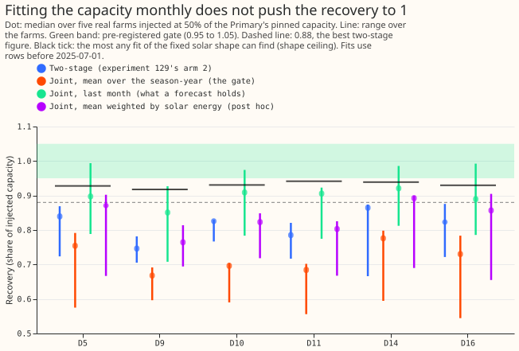
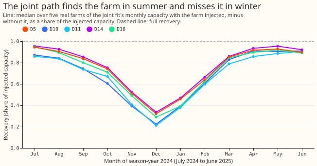

# Experiment 157: does fitting the solar capacity jointly with the demand terms recover an injected farm?

**Take-home message: letting the solar capacity change month by month does not find more of an
injected solar farm than a capacity that changes once a year, so the forecast stage is not worth
running.** We added the recorded output of five real solar farms, one at a time, to the power of six
Primary substations, and checked how much of each farm a fitting method found again. The two-stage
capacity of [experiment 129](../00129-differentiable-physics-pv-capacity-known-answer-test/result.md)
found 0.75 to 0.86 of it. The monthly capacity found 0.67 to 0.78 when averaged over the year, and 0
of the 5 decision Primaries reached the pre-registered 0.95 to 1.05. A fit of the fixed fleet solar
shape cannot find more than 0.92 to 0.94 of a real farm, so part of the gap to 1.0 is the farm's
shape and not the capacity (figure 1). The verdict is `not supported`.

**What the experiment did.** Net power is linear in solar capacity, so the capacity can be fitted
inside the demand model of `studies.dp_gam` instead of in a second stage. The joint arm gives the
capacity a non-negative level for each calendar month and penalises its change from month to month.
Both arms trained on the same rows before 2025-07-01. The Kalman filter is not involved, because
this stage fits capacity and never forecasts. The idea of a joint fit comes from the PV design
session; the convex model and the injection come from experiments
[110](../00110-differentiable-physics-5-embedded-generation-and-capacity/result.md) and
[129](../00129-differentiable-physics-pv-capacity-known-answer-test/result.md).

**Terms.** Recovery is the capacity fitted with a farm injected, minus the capacity fitted without
it, divided by the injected capacity. Each farm is injected at 50% of the Primary's pinned
capacity, as the farm's output divided by its own 99th percentile. D5, D10, D11, D14, and D16 are
the five decision Primaries, and D9 is shown beside them. A season-year runs from July to June and
is labelled by the year of the July, so season-year 2024 is July 2024 to June 2025. Capacity is
the 99th percentile of alternating-current output over daylight half-hours, in MW.

## Results

- **Verdict by the pre-registered rule: stop.** The joint fit's mean over season-year 2024 has a
  median recovery of 0.754 (D5), 0.696 (D10), 0.685 (D11), 0.776 (D14), 0.730 (D16), and 0.668
  (D9). None lies in 0.95 to 1.05, and none exceeds 0.88.
- **Two-stage benchmark, same rows:** 0.840 (D5), 0.825 (D10), 0.785 (D11), 0.865 (D14), 0.823
  (D16), 0.746 (D9). The two-stage arm beats the joint arm's year mean at all six Primaries.
- **The two-stage pin recovers none of an injection.** It does not refit, so its recovery is 0 by
  construction, and an injection appears whole in the forecast error.
- **Farm-to-farm spread.** The five farms' recoveries span 0.55 to 0.80 for the joint year mean and
  0.67 to 0.88 for the two-stage arm (the lines in figure 1).
- **Growth-penalty sensitivity (labelled, cannot change the verdict).** The year-mean median is
  0.65 to 0.75 at a penalty share of 0.01 and 0.71 to 0.83 at 1.0. A stiffer penalty moves the
  joint arm towards the two-stage arm and does not pass it.
- **Post hoc read-outs.** The joint fit's last month (June 2025, which is what a forecast would
  hold) recovers 0.85 to 0.92, with the farm maximum between 0.93 and 0.99. June is a month of
  strong sun, so the figure is not comparable with a year mean. Weighting the months by solar
  energy gives 0.76 to 0.89, close to the two-stage figures.
- **Shape ceiling.** The least-squares scale of a farm's output on the derated unit shape of
  `studies.dp_gam`, over the training rows of season-year 2024, is 0.92 to 0.94 as a median over
  farms (0.77 to 0.97 for single farms). It is the most any capacity fit of the fixed shape can find
  if the demand terms absorbed nothing, so the 0.95 gate was out of reach for most farms. The cause
  of the farm's shape differing from the fleet shape (tilt, azimuth, inverter clipping, or
  irradiance error) was not tested.
- **Winter months are barely identified.** The monthly recovery is 0.85 to 0.96 from April to
  August and 0.2 to 0.35 in December (figure 2). That the demand terms absorb the small winter
  signal is a likely cause and was not tested.

## Checks

- **Wiring check passed.** With no injection, the two-stage fit built from the month design's Gram
  matrix reproduces `fit_gam` at D10 to 1e-6 (46.062283 against 46.062283 points).
- **Median minus mean forecast, and the error of the mean forecast:** not applicable, because no
  forecast was run.
- **Triggers of "Audit before merge":** none fired. The one control, the wiring check, passed. The
  result agrees with the prediction (0.78 to 0.92, fewer than 4 of 5 in the gate). There is no
  quantile-score contrast, no leave-one-out flip, no nested arm, no sister interval, and no later
  experiment that depends on the sign.

## Caveats

- **One origin.** The fits use rows before 2025-07-01 and read season-year 2024 only.
- **Intervals are ranges over five farms, not confidence intervals.** The data are one real series
  per Primary, and a fit is nearly linear in its target, so the farms carry the variation.
- **Five farms of 50% injection.** Experiment 129 also tested synthetic plants and a cloud-driven
  load, and this experiment did not.
- **Compute.** CPU, one core, 25 seconds for the grid of six Primaries, five farms, two arms, and
  three growth penalties. Pre-registered penalty share: 0.1 of the mean Gram diagonal over the
  month columns that have rows.

## What to try next

- **A fixed-shape capacity cannot reach 1.0, so test a different shape first.** A fitted tilt and
  azimuth per Primary, or a fitted peak-to-capacity ratio, would raise the ceiling. A joint
  capacity fit is worth planning only once the ceiling is above the 0.95 gate.
- **No forecast arms are planned.** The decision rule stops the series here.

## Plan (written before any fit)

**Question.** [Experiment 129](../00129-differentiable-physics-pv-capacity-known-answer-test/result.md)
found a capacity per season-year from each Primary's own power and recovered an injected real
farm's output at 0.78 to 0.88. [Experiment 139](../00139-differentiable-physics-pv-as-of-capacity-in-gam-k/result.md)
found the as-of capacity no better than the pin, and the hindsight capacity equal to it. Net power
is linear in capacity, so the capacity can instead be fitted inside the GAM-K fit as a monthly path.
Does that recover the injection near 1.0? This experiment runs only the known-answer stage, as the
maintainer asked, because the expected forecast gain is under 0.05 points.

**Arms, all on the same rows.** Every arm trains on rows before the origin 2025-07-01 and has the
same demand terms, so that only the capacity differs.

| Arm | Capacity | Role |
|---|---|---|
| 1. Pin | Experiment 45's `frozen` vintage, held | Reference. It does not refit, so it recovers none of the injection |
| 2. Two-stage as-of | Experiment 129's arm 2: non-negative increments per season-year, ridge 0.1 on the cumulative capacity | Benchmark |
| 3. Joint | A non-negative level for each calendar month (the derated unit shape times the level), a penalty on the squared change of the level from month to month, and a near-zero ridge on the level | The arm under test |

**The joint fit's growth penalty is fixed in advance.** It is 0.1 times the mean diagonal of the
Gram matrix over the capacity columns, the share experiment 129's arm 4 used. Two values, 0.01 and
1.0, run as labelled sensitivity checks that cannot change the verdict. The shape parameters (tilt
35 degrees, south-facing, DC:AC 1.15, inverter clip at the AC capacity, 0.4% per kelvin
de-rating) stay as in `studies.dp_gam`. The Kalman filter acts on residuals only in the forecast
stage, so it is not involved here: this stage fits capacity and never forecasts.

**Injection.** Each of the five real farms of experiment 129 (labels A, B, C, D, F; anonymised) is
added to the Primary's power over all training rows at 50% of the Primary's pinned capacity, as a
farm's output divided by its 99th percentile. Rows where the farm's reading is missing or a
dropout are removed from both the injected and the matching base fit, so a difference of fits never
mixes two row sets. Recovery is read per Primary and farm, then summarised by the median over farms.
The base fit has no injection.

**Recovery read-out.** The raw recovery averages the fitted path over season-year 2024, the latest
complete season-year before the origin. The joint fit's last-month value, which is what a forecast
would hold, is reported beside it. The divisor that experiment 129 applied (the median recovery of
other farms) is not applied to the pre-registered gate, because the question is whether the joint
fit needs no divisor. The divided two-stage recovery is shown for context.

**Primaries and checks.** D5, D10, D11, D14, and D16 count for the decision. D9 is reported beside
them. The tables show every farm at every Primary, plus the unmodified base capacity of each arm
in MW, so that a reader can see the joint path's level against the two-stage steps. As a wiring
check, a fit with zero injection must reproduce arm 2's published capacity for the same cut to
three decimal places.

**Five triggers.** Stored: private files only. Serving path: not touched. Degradation rule: not
touched. More than one defensible design: no, because the maintainer fixed the arms and the stop
rule. Callers not nameable without searching: no.

**Compute.** CPU only, at most 4 cores, thread caps all 1, each job under `systemd-run --user
--scope -p MemoryMax=16G -p OOMPolicy=continue`. The first Primary is timed before the full grid.

**Reviews.** One Sonnet code review (leakage first: no row at or after the origin may train) and one
Sonnet prose review. No Opus review.

**Advice followed.** From experiment 129, count only season-years with at least 12,000 training
half-hours when reading a capacity, and use an as-of capacity and never a hindsight capacity in a
forecast test. Departs from none.
