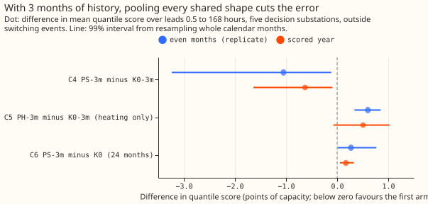
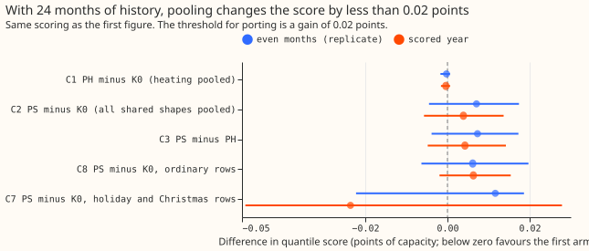
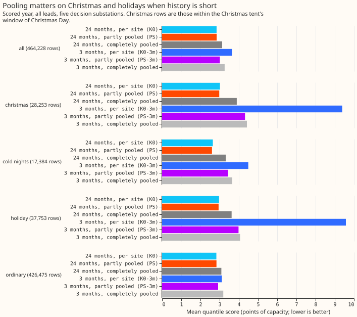
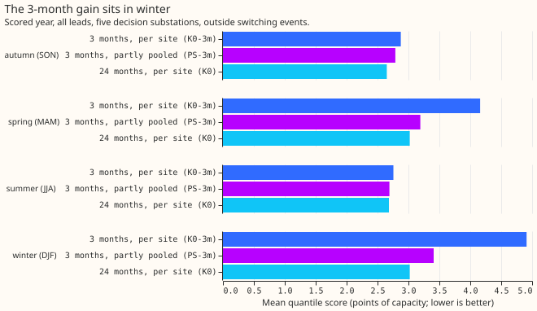

# Experiment 158: do partly pooled GAM shapes beat per-site GAM fits?

**In this test on six Primary substations, fitting a demand model's shared curves jointly across the
six let a substation with only 3 months of history forecast almost as well as one with 24 months,
but it did not help a substation that already had 24 months.** Scores are quantile scores, the mean
over 11 quantiles of twice the pinball loss, in points of capacity (1% of a substation's capacity),
and lower is better. A substation with 3 months of history scored 3.01 points with the shared curves
and 3.64 points fitted alone (difference -0.629, 99% interval -1.639 to -0.091), against 2.84 for a
substation fitted alone on 24 months. The gain held at all five decision substations (D5, D10, D11,
D14, and D16) and in all 12 months of the scored year (2025-07 to 2026-06), and it was largest in
winter and on Christmas rows. At 24 months, pooling changed the score by +0.004 points (-0.006 to
+0.014). Pooling at 24 months is safe, but it makes each substation's forecast depend on the other
five substations' data and on one joint monthly refit, for no measurable gain. The arm that pooled
only the heating curve scored worse than the per-site fit at 3 months, but the two arms also
differed in ridge, so this test cannot say whether the other shared curves carry the gain. The
verdict is `partly supported`.

**We asked** whether a demand forecast improves when each substation's heating curve, lighting
curve, daily profile, holiday effects, and Christmas shape are the fleet's average curve plus a
deviation of the substation's own that a penalty shrinks towards zero ("partial pooling"). The fleet
is the six Primary substations D5, D9, D10, D11, D14, and D16. The forecast is GAM-K (a generalised
additive model with a Kalman filter on recent errors) of [experiment
111](../00111-differentiable-physics-6-ens-forecast-engine-against-bg2/result.md), a convex demand
model driven by the ensemble-mean weather forecast as in [experiment
136](../00136-dp-bg-stage1-assembly-on-the-ensemble-mean/result.md). The partly pooled fit is the
convex model of [experiment
109](../00109-differentiable-physics-n0-partially-pooled-convex-model/result.md), which applies the
multilevel-model idea of [Gelman and Hill](https://doi.org/10.1017/CBO9780511790942) to the
coefficients. [Experiment
154](../00154-differentiable-physics-n0-gate-2-heating-error-against-truth/result.md) had found on
synthetic data that a shared heating curve is recovered better than separate fits recover it and
that a substation's own offset cannot be read from 4 weeks. We kept every level, capacity, and
offset per substation. We scored monthly refits over the scored year at the five decision
substations, with the even months of 2024-07 to 2025-06 as a replicate. A row is one substation's
forecast for one half-hour at one lead time. Holiday rows are bank holidays and the Christmas run,
and Christmas rows are those within a few days of Christmas Day.

## Results

Every number is in [`report.json`](report.json), which `e00158_report.py` writes. Scores are
quantile scores in points of capacity, lower is better.

- **Arms and settings.** K0 (no pooling), PH (heating curve pooled, penalty 300 rows of evidence),
  PS (all shared families pooled, 300 rows on the heating curve and 3000 on the others), and
  complete pooling (also called tied) as a reference, each for a target with 24 months and with 3
  months of history (the other five substations keep 24). A penalty of 300 rows against about 35,000
  training rows at 24 months, or 4,300 at 3 months, shrinks lightly. The penalty pair was chosen on
  the odd tuning months from three values per family, the same for both histories. Monthly refits,
  no weekly refits.
- **Absolute scores over the scored year and all lead times.** K0 2.839, PH 2.839, PS 2.843,
  complete pooling 3.133, K0-3m 3.638, PS-3m 3.009, PH-3m 4.145. References: experiment 136's A2
  (per-site T-all) 2.791, BG2 2.780, manual heuristic 3.497, climatology 3.804.
- **L1 (heating pooled gains at 24 months) fails: C1, PH minus K0, is -0.000 (-0.002 to +0.001).**
  The threshold was a gain below -0.02 points. C3, PS minus PH, is +0.004 (-0.005 to +0.014).
- **L2 (non-inferior at 24 months) holds: C2, PS minus K0, is +0.004 (-0.006 to +0.014) and C8
  (ordinary rows) is +0.006 (-0.002 to +0.015).** Both upper bounds are below +0.02. The replicate
  months agree (+0.007 and +0.006).
- **L3 (short-history gain) holds: C4, PS-3m minus K0-3m, is -0.629 (-1.639 to -0.091), at 5 of 5
  substations and 12 of 12 months.** The replicate months give -1.051 (-3.236 to -0.117). The gain
  is the same at every lead band (-0.61 to -0.66). Leaving each decision substation out in turn
  leaves it between -0.59 and -0.69.
- **C5, PH-3m minus K0-3m, is +0.507 (-0.073 to +1.024).** The scored-year interval includes zero.
  The replicate months give +0.601 (+0.339 to +0.852). The arms differ in ridge (see the caveats).
  Two post hoc heating-only arms with penalties of 3000 and 30000 rows scored 4.126 and 4.142 in the
  scored year, no better than PH-3m's 4.145, so a stronger heating penalty did not close the gap to
  K0-3m (3.638).
- **C6, PS-3m minus K0, is +0.169 (+0.053 to +0.327).** A 3-month substation with pooling is within
  0.17 points of a 24-month substation fitted alone, and still worse.
- **L4 (events) fails: C7, PS minus K0 on holiday and Christmas rows at 24 months, is -0.024 (-0.049
  to +0.028).** The sign is negative at 3 of the 4 decision substations with Christmas rows in the
  scored Christmas, and at 1 of 5 in the replicate Christmas. C9 (Christmas rows alone) is -0.032 in
  the scored year and +0.019 in the replicate months, each from one Christmas, so neither has a
  usable interval. On cold nights at 24 months PS scored 2.599 against K0's 2.645.
- **With a 3-month history, pooling helped most on holiday and Christmas rows.** Christmas rows
  scored 4.32 against 9.39 for the per-site fit, holiday rows 3.98 against 9.58, winter (December to
  February) 3.41 against 4.91, and cold nights 3.43 against 4.49 (scored year).
- **The 24-month arm tuned on its own (penalties of 300 and 300) scored 2.839,** the same as K0.
- **Tail calibration, scored year, all leads (coverage of q01, q05, q95, q99; pinball loss at q01
  and q99).** K0: 2.2%, 6.3%, 94.7%, 98.3%; 0.225 and 0.231. PS: 2.1%, 6.4%, 94.5%, 98.3%; 0.223 and
  0.229. K0-3m: 3.4%, 8.2%, 93.6%, 97.3%; 0.326 and 0.542. PS-3m: 2.6%, 7.1%, 94.4%, 98.1%; 0.245
  and 0.246.

## Predictions against outcome and checks

- **C1 to C3 and C8 predicted within about +/-0.03; observed within +0.006.** C7 predicted -0.2 to
  -1.5; observed -0.024. C4 predicted -3 to -12 and revised to -0.5 to +0.3 after the tuning months
  showed K0-3m scoring 3.05; observed -0.629, just outside the revised range. Complete pooling
  scored worse than PS at 24 months by 0.29, as predicted (0.05 to 0.30).
- **Controls.** The per-site fits at penalty 0 reproduce experiment 111's stored fits to within
  7.2e-11 over 162 fits (27 monthly cuts and 6 substations; [`reproduction.txt`](reproduction.txt)).
  K0's score (2.839) equals experiment 136's A0. The fit refuses any training row after the cut.
  Complete pooling scoring worse than PS passes the shrinkage check at 24 months and at 3 months.
  Experiment 154 is the known-answer gate and was not repeated here.
- **Median forecast minus mean forecast, per site.** 0.000 at every site for K0, PS, and PS-3m, at
  12 to 36 hours. This is zero by construction, because both forecasts are built from the same
  corrected mean.
- **Mean-forecast error beside each contrast.** The mean absolute error has the same sign as the
  quantile score for C1 to C9 (for example C2 +0.010, C4 -0.833, C7 -0.033).
- **Audit trigger 2 fired for C7 and C4, and the explanations were tested.** Two post hoc arms with
  a penalty of 30000 rows on the non-heating families scored worse than K0 at 24 months on Christmas
  rows (3.052 and 3.050 against 3.012 in the scored year, 3.603 and 3.586 against 3.376 in the
  replicate), so at 24 months the fleet's Christmas shape is worse than a substation's own two
  Christmases. K0-3m scored 3.64, not the 6 to 17 predicted, because the filter corrects most of a
  poorly fitted level.
- **Audit triggers 5 and 7.** Trigger 5 (a nested arm beating the arm containing it) does not apply,
  because PH-3m is not nested in K0-3m. Trigger 7 holds in principle, because a later onboarding
  design could rest on C4, and C4 is replicated in the even months. No Opus audit ran.

## Caveats

- **PH-3m and K0-3m differ in ridge.** K0-3m uses experiment 109's ridge of 10 on every coefficient,
  and the pooled arms use 0.1, because a ridge of 10 would also pull a pooled heating curve to zero.
  C5 therefore mixes pooling with ridge, and this test cannot say which shared curves carry the gain
  of PS-3m.
- **K0-3m's ridge was not tuned on these tuning months,** while PS-3m's penalty pair was. The sign
  of C4 holds in the replicate months, at all five decision substations, and in 12 of 12 months, but
  its size is not a like-for-like gain.
- **Six substations, 3 months, one scored year.** D9 is fitted alone before 2025-04 because its
  pinned capacity is a late vintage, and D18 is out of the fleet. D5 has no scored Christmas rows
  after the switching mask.
- **K0 is experiment 136's A0, not experiment 155's arm,** because experiment 155 has not run, and
  the pooled design shares B0's columns, not T-all's.
- **The switching terms of experiments 141 and 147 are not in the fit.** The detector's alarm
  arrives about 48 hours after a step.
- **The penalty pair was tuned on the odd months of one year,** and the plan was amended once after
  the first tuning scores were read (see "Plan"). The 3-month history is a window of 3 months, not a
  new substation's first 3 months.
- **No curtailment-cost metric was scored.** The question is the fit, not a headline model.

## What to try next

**A follow-up could give the heating curve and the calendar families separate penalties, pool
T-all's split columns, and test the pooled fit on a real substation that joins with 3 months of
history.** Separate penalties need a change to the reviewed module `studies.dp_gam_pooled`, in its
own pull request. Pooling did not improve Christmas rows at 24 months, and this experiment did not
test whether more years of history would.

## Plan

**Question.** Experiments 105, 109, and 112 pooled raw demand, so the shared shape had to absorb each
substation's solar output and switching. Solar capacity is now a pinned term, the filter of
GAM-K handles recent level shifts, and
[experiment 154](../00154-differentiable-physics-n0-gate-2-heating-error-against-truth/result.md)
showed, on synthetic fleets with a known answer, that sharing the heating curve across substations
recovers it better than fitting each substation alone, and that a substation's own heating offset
is not learnable from 4 weeks. This experiment asks whether the same sharing helps the real
forecast, at 24 months of history, at 3 months, and on holidays.

**Method.** The partly pooled convex fit of
[experiment 109](../00109-differentiable-physics-n0-partially-pooled-convex-model/result.md)
(`studies.dp_gam_pooled.fit_pooled`) gives each substation the fleet's coefficients plus a
ridge-penalised deviation of its own. The fit is GAM-K's design with a pinned capacity and no
drift. With a penalty of 0 the fit is the per-site fit, and the folder's reproduction control
checks that it matches experiment 111's stored fits to 1e-8. The forecast engine (ensemble mean
input, per-substation Kalman filter, residual table fitted on the tuning months) is copied from
[experiment 136](../00136-dp-bg-stage1-assembly-on-the-ensemble-mean/result.md), so the arms differ
only in their monthly fits. The partly pooled fit is the idea of
[Gelman and Hill](https://doi.org/10.1017/CBO9780511790942) (multilevel models) applied to the
coefficients of a generalised additive model.

**Fleet.** D5, D9, D10, D11, D14, and D16. D18 is left out because its capacity is a late vintage.
D9's pinned capacity is a late vintage (`growth_prior`) at the cuts before 2025-04, and the pooled
fit refuses such a capacity, so D9 is fitted alone in every arm at those cuts and joins the fleet
from 2025-04.

**Arms.** All arms refit monthly from 2024-04.

| Arm | Pooled families | History of the target |
|---|---|---|
| K0 | none (penalty 0) | 24 months |
| PH | heating curve | 24 months |
| PS | heating, lighting, daily profile, holiday periods, Christmas tent, harmonics | 24 months |
| tied | the families of PS, completely pooled (reference) | 24 months |
| K0-3m, PH-3m, PS-3m | as K0, PH, and PS | 3 months for the target, 24 for the other five |

The 3-month arms take each substation in turn as the target, so the other five keep 24 months.
Capacity, level (the band means of the profile), and the filter stay per substation in every arm.
`studies.dp_gam_pooled` pools the holiday periods and the Christmas tent with the other non-heating
families under one penalty, so PS cannot pool the heating curve and the profile at different
strengths from the calendar families. Splitting them would change the reviewed module and is left
for a follow-up if PS gains.

**The penalty (amended 2026-10-21, after the tuning-month scores of K0 and PH were read and before
any replicate-month or scored-year score).** The deviation penalty is in rows of evidence (a
substation with far more training rows keeps its own curve). The first plan tuned PH's heating
penalty over 100 to 10000 and each history separately. The tuning months showed that at 24 months
every penalty up to 10000 scored the same as K0 within 0.002 points (a substation has about 35,000
training rows, so a penalty of 10000 rows barely pools), and that the tie rule would then pick the
penalty that pools least, which makes C1 and C2 uninformative. The amended rule is one penalty pair
for both histories, as in experiment 109, because a joint fit in production serves a mature
substation and a new one with the same penalty. PS is tuned over the heating penalty `h` and the
penalty `o` of the other families, each in 300, 3000, and 30000 rows (nine pairs), on the odd tuning
months of 2024-07 to 2025-06. The chosen pair is the one with the lowest all-lead score at the
decision substations of the 3-month arm, among the pairs whose 24-month score is at most 0.02
points above K0's on the same months; a tie within 0.005 points goes to the smaller `h + o`. PH
takes the chosen `h` with `o` = 0. The 24-month arm tuned separately (the first plan) is reported as
a labelled variant. The tuned penalties are therefore the same for both histories.

**Prediction check after reading the tuning months.** K0-3m scored 3.05 points on the tuning months,
against a predicted 6 to 17, because the Kalman filter corrects most of a poorly fitted level
within days. The predicted size of C4 (-3 to -12 points) cannot hold. The written prediction above
is left as it was, and the revised expectation, written before any scored-year score is read, is
C4 between -0.5 and +0.3 points and C6 between +0.1 and +0.6 points. The decision rule is unchanged.

**Switching.** The switching terms of experiments 141 and 147 are not part of this fit. Experiment
141 found that feeding the detector's causal alarm to the filter did no better than a random
placebo, because the alarm arrives about 48 hours after the step, and experiment 147 found a
live end rule inconclusive. The fit therefore does not take the hand-filtered switching events as
ground truth, and the rows inside those events are excluded from scoring, as in every experiment on
`fold_a_daily_gap_v1`.

**Per-site baseline.** The brief names the best-guess GAM-K components of experiment 155 as the
per-site baseline. Experiment 155 has not run, so K0 is experiment 136's A0 (GAM-K on the ensemble
mean, pinned capacity, per-substation filter), and experiment 136's A2 (per-site T-all and shared
filter noise) is an absolute reference. The pooled design shares B0's columns, not T-all's split
columns, because `studies.dp_gam_pooled` pools B0's design. Pooling T-all is a follow-up.

**Rows and periods.** `fold_a_daily_gap_v1`, 09:00 UTC `power_fcst_init_time`, leads 0.5 to 168
hours. The tuning months are the odd months and the replicate months are the even months of 2024-07
to 2025-06, and the scored year is 2025-07-02 to 2026-06-29 (292 runs), as in experiment 136.
D-labels only. The replicate months hold the Christmas of 2024 and the scored year the Christmas of
2025. The weather is the calibrated ensemble mean of experiment 136 and the filter uses its
analysis proxy built from earlier runs, so every input exists at forecast time. Each monthly fit
trains on rows that end before its cut.

**Rows for events.** Holiday rows are those on a bank holiday or in the Christmas run
(`holiday_period >= 0`), and Christmas rows are those within the Christmas tent's window of
Christmas Day. Ordinary rows are all others.

**Planned contrasts.** C1 PH minus K0. C2 PS minus K0. C3 PS minus PH. C4 PS-3m minus K0-3m. C5
PH-3m minus K0-3m. C6 PS-3m minus K0. C7 PS minus K0 on holiday and Christmas rows. C8 PS minus K0
on ordinary rows. C9 PS minus K0 on Christmas rows alone (reported, no verdict). Each is read at the
99% level. The replicate months give the sign. Contrasts are also reported by lead band, by season,
and by substation, and tail calibration at the 0.01, 0.05, 0.95, and 0.99 quantiles is reported
overall and on cold nights.

**Controls.**

- **Reproduction.** K0's monthly fits match experiment 111's stored `gamk` fits to a maximum
  coefficient difference of 1e-8 at every cut and substation, and K0's scored-year score matches
  experiment 136's A0 within 0.001.
- **Leakage.** The fit asserts that no training row ends after the cut. The leave-one-out check
  re-fits PS with each substation held out of the fleet in turn, and the headline contrast keeps
  its sign.
- **Known answer.** [Experiment 154](../00154-differentiable-physics-n0-gate-2-heating-error-against-truth/result.md)
  is the known-answer gate of the same fit, on synthetic fleets. It is not repeated here.
- **Bookends.** K0 (no pooling) and tied (complete pooling) bracket PH and PS. A pooled arm that
  scores worse than tied at 24 months on all rows fails the check that shrinkage is working.

**Five triggers (size).** Stored: private files only. Serving path: not touched. Degradation rule:
not touched. More than one design defensible: yes, pre-registered above. Callers not nameable
without searching: no, the scripts copy experiment 136's and call one reviewed fit.

**Audit triggers to watch.** Trigger 1 (the bookend check), trigger 2 (a result against its
prediction, likely at full history), and trigger 5 (a nested arm beating the arm that contains it:
PS against PH).

**Resources.** CPU only, at most 8 cores with one thread per worker, each job under `systemd-run
--user --scope -p MemoryMax=16G -p OOMPolicy=continue`. No GPU. A joint fit across 27 monthly cuts
takes under a minute and one substation's forecast takes seconds.

**Advice followed and departures.** From experiment 154: share the heating curve, keep every offset
and level per substation, and do not claim a substation's own heating offset is learned from short
windows (the 3-month arms are scored on forecast skill, not on the offset). From experiment 150:
treat the penalty as tuned on the tuning months, not carried over. From experiment 149: no
drift term is used. Departure: K0 is experiment 136's A0 and not experiment 155's arm, because
experiment 155 has not run.
