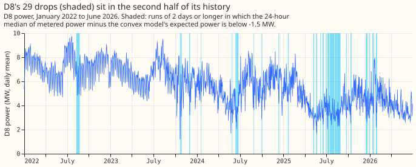
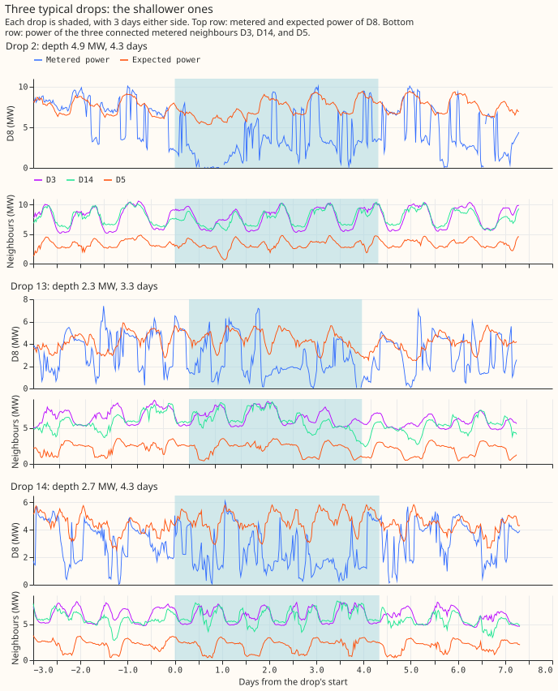
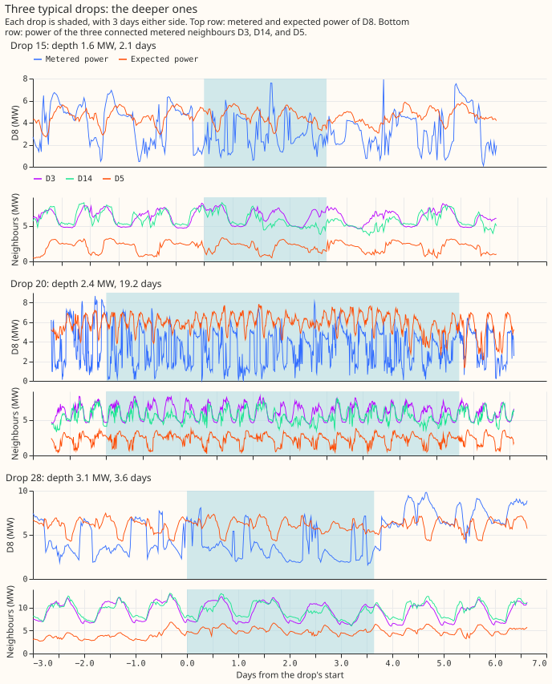
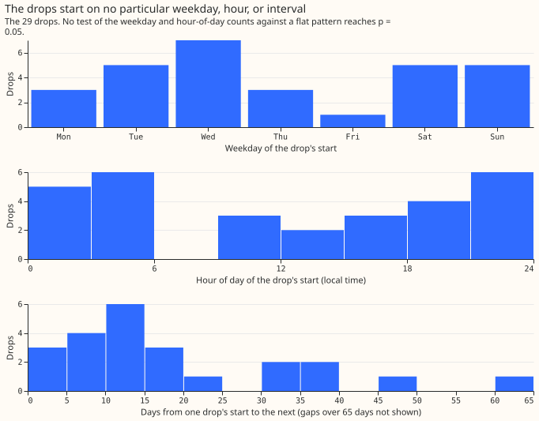
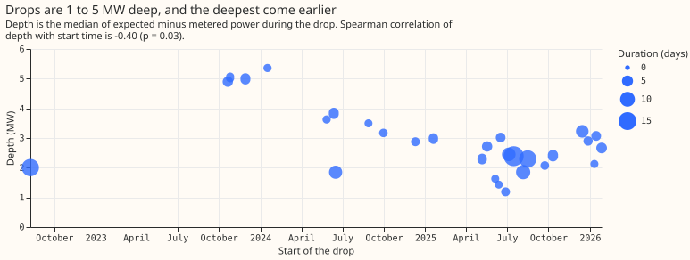
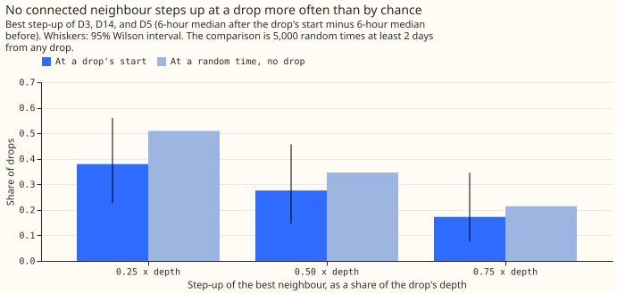
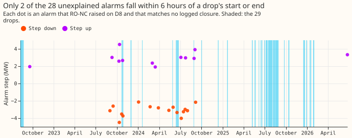

# Experiment 159: what are D8's multi-day drops, do they recur, and do they look like transfers?

**D8's multi-day drops are 29 episodes in which its power runs about 2.7 megawatts (MW) below what a
demand regression model expects, for 2 to 19 days. Its three connected neighbours step up with the
drops at a rate not clearly above their rate at times chosen at random.** D8 is a Primary
substation, and D3, D14, and D5 are its connected neighbours with metered power. An earlier analysis
found that the refit-offset neighbour-count detector (RO-NC), which flags a possible switching event
(an operator moving load between substations) when the regression model's errors shift together,
raised alarms on D8 that match no logged switching. That analysis also found that D8's power falls
for days at a time while the demand forecast does not follow. We listed every such drop in the
residual (metered power minus the power the regression model expects) of [experiment
130](../00130-ro-nc-detector-on-the-gam-k-residual/result.md). We then described when the drops
happen. Finally, we checked whether a neighbour steps up by a similar amount at the same time, which
would make a drop a load transfer (an operator moving some of D8's customers onto a neighbouring
substation).

A neighbour steps up by half the depth at 8 of the 29 drops (0.28; 95% Wilson interval 0.15 to
0.46), against 0.21 at random times of the same time of day. Among the explanations we did not test,
the drops could be a change in what D8's own customers draw, an outage, or a move of load to an
unmetered substation. The drops show no detectable weekday, hour of day, bank-holiday, or seasonal
pattern. Of the 29 drops, 23 have a logged closure of D8 within 24 hours, against 0.45 for random
windows of the same lengths. Switching may therefore be involved, although closures within 24 hours
are common (see Caveats). The alarms of RO-NC are mostly elsewhere: 10 of its 52 alarms on D8 fall
within 6 hours of a drop's start or end, which is about 10 times the 1.0 expected by chance but
leaves 42 of 52 away from the drops. We wrote predictions before looking at the data. Two held (the
count of drops and the lack of a detectable weekday or hour pattern), one narrowly missed (the
neighbour rate), and one failed (the alarms), so the verdict is `partly supported`. The page is
descriptive, and the substations are labelled D3, D5, D8, and D14.

## Results

- **Drops:** 29 runs of 2 days or longer in which the 24-hour median of the residual is below -1.5
  MW. Gaps under 12 hours are merged. The drops cover 148 of the 1,642 days of history (a share of
  0.090). Of the 29 drops, 28 start on or after 2023-07-01. By start year, 1 drop starts in 2022, 3
  in 2023, 7 in 2024, 15 in 2025, and 3 in 2026. The number of drops depends strongly on the
  threshold: -1.0 MW gives 48 drops, -2.0 MW gives 24, and -2.5 MW gives 15.
- **Depth and duration:** median depth 2.71 MW (range 1.19 to 5.36) and median duration 3.6 days
  (range 2.0 to 19.2). Inside drops the median metered power is 3.43 MW against an expected 6.20 MW.
  Of the half-hours inside drops, 0.435 are below 3 MW, against 0.158 of the half-hours outside
  drops after the first drop. The Spearman correlation of depth with start time is -0.40 (p =
  0.032). The correlation arises because the four drops from October 2023 to January 2024 are the
  deepest (4.9 to 5.4 MW).
- **What the power does inside a drop:** the metered power alternates between the expected level and
  0 to 3 MW within each day, as in drop 20, which lasts 19 days. A drop is a run in which the
  periods at 0 to 3 MW dominate, not a steady 3 MW shift.
- **Recurrence:** the 29 drops show no detectable weekday, hour, or interval pattern. Drop starts
  per weekday, Monday to Sunday, are 3, 5, 7, 3, 1, 5, and 5 (chi-squared p = 0.48). Drop starts per
  6-hour block of the day (00:00 to 06:00, 06:00 to 12:00, 12:00 to 18:00, and 18:00 to 24:00) are
  11, 3, 5, and 10 (p = 0.10). The spacing between starts has a median of 16.4 days (quartiles 10.3
  and 42.3). Of the 29 starts, 1 falls within 1 day of a bank holiday (0.03; 0.01 to 0.17), against
  a share of 0.069 of all days. Drop starts per calendar month, January to December, are 5, 0, 0, 0,
  3, 6, 2, 4, 2, 3, 1, and 3 (p = 0.12). The mean temperature during a drop is 0.55 degrees Celsius
  below the month's mean (95% interval -1.61 to +0.49).
- **Neighbour check:** the largest step-up in any one of D3, D14, and D5, in the 6 hours after a
  drop's start, is at least 0.25, 0.50, and 0.75 times the depth for 11 of the 29 drops (0.38; 0.23
  to 0.56), 8 (0.28; 0.15 to 0.46), and 5 (0.17; 0.08 to 0.35). At 5,000 randomly chosen times from
  July 2023, away from any drop and at the time of day of a drawn drop start, the rates are 0.34,
  0.21, and 0.12. Every interval of the drops contains the rate at random times, but the drops'
  rates are above it at all three thresholds. A neighbour steps down by at least half the depth at
  the end of 13 of the 29 drops (0.45; 0.28 to 0.62). That step-down is the one sign of a shared
  cause in these checks. No comparison with random times was run for the step-down.
- **Logged closures:** of the 29 drops, 23 (0.79; 0.62 to 0.90) have a logged closure of D8 within
  24 hours, against 0.449 for 2,000 random windows of the same lengths that start in July 2023 or
  later and overlap no drop. A closure is a switching outage in NGED's switching log. Of the 29
  drops, 14 (0.48; 0.31 to 0.66) still have a closure when one long-running switching job (reference
  21D5583, a closure between D8 and D14 that overlaps 12 of the 18 drops that start in 2025 or
  later) is set aside. Six drops have no closure in the log.
- **What the alarms did:** RO-NC raised 52 alarms on D8, of which 28 match no logged closure. Of
  those 28, 27 (0.96; 0.82 to 0.99) have a half-hour jump of at least 0.3 times the capacity (3.11
  MW) within 24 hours, against 0.644 of all half-hours, and 16 step down while 12 step up. Of the
  28, 5 (0.18; 0.08 to 0.36) fall inside a drop, 0 within 6 hours of a drop's start, and 2 within 6
  hours of its end. Of all 52 alarms, 10 fall within 6 hours of a drop's start or end, against 1.0
  expected by chance (0.018 of half-hours lie that close to an edge), and 4 of the 29 drops have an
  alarm within 6 hours of their start. The alarms track D8's within-day jumps more than chance and
  are mostly away from the drops, although the 10 near an edge are above chance. Within-day jumps
  occur in 2,642 of the 78,736 half-hours in the history. Of the 28 alarms, 26 fall between August
  2023 and September 2024, while 18 of the 29 drops start in 2025 or later.
- **Prediction:** the count (20 to 40 drops, nearly all after mid-2023) and the lack of a weekday or
  hour pattern held. The neighbour prediction (a step-up of half the depth at fewer than a quarter
  of the drops) narrowly missed, at 0.28, and the comparison with random times matters more. The
  alarm prediction (at least 20 of 28 within 6 hours) failed, at 2 of 28. The neighbour prediction
  said a step-up within 2 hours of the start, and the check uses 6-hour medians around the start, so
  the two are not the same test.

## Checks

- **Same inputs as before:** the 28 unexplained alarms, the 27 of 28 with a jump, and the 78 logged
  closures touching D8 reproduce the false-alarm analysis.
- **Forecast checks:** no forecast is scored, so the checks on the median and mean forecast, the
  tail coverage, and the curtailment cost do not apply.
- **Audit triggers:** one of the seven audit triggers in the `ml-experiment` skill fires, because
  the result contradicts the written prediction for the alarms (2 of 28 against at least 20). The
  page tests an explanation. 26 of the 28 alarms fall between August 2023 and September 2024, while
  18 of the 29 drops start in 2025 or later (figure 7), and 27 of the 28 alarms have a jump (0.644
  of all half-hours do). The other six triggers do not apply, because the page has no control, no
  nested arm, no planned contrast, and no earlier experiment on the same rows to compare an interval
  with.

## Caveats

- **The definition of a drop is ours.** The count changes from 15 to 48 as the threshold moves from
  -2.5 to -1.0 MW. A drop's start and end can be off by up to 12 hours, because of the 24-hour
  smoothing.
- **The residual is the lab residual.** The residual comes from the frozen convex regression model
  of experiment 130, as the false-alarm analysis stored it, with estimates of past weather from ERA5
  and the real transfers left out of training. A drop that the regression model partly follows is
  under-counted.
- **The neighbour check is crude.** The check compares 6-hour medians, so a transfer spread over a
  day would not show. The random-time comparison matches the time of day of the drop starts, which
  controls for the daily rise of the neighbours' demand. D5 has a median power of 2.96 MW, so D5 can
  absorb only part of a 5 MW drop.
- **A logged closure within 24 hours does not show that the closure caused a drop.** NGED's log
  holds 78 closures touching D8 in 4.5 years, and the random-window rate of 0.449 shows that a
  closure within 24 hours is common.
- **The random-time comparisons are limited.** The window and time-of-day matching use July 2023
  onwards only, with 29 drops, so an interval contains several rates. The calendar tests have little
  power at 29 drops, and the month test uses expected counts below 5.
- **Not done:** National Grid Electricity Distribution (NGED) has not confirmed any drop, and no
  cause was tested beyond the neighbours, the closures, and the calendar.

## What to try next

**Ask NGED which load D8 moves and which customers it serves.** Start with the six drops that have
no logged closure. The answer from NGED decides whether a drop should be left out of the regression
model's training data, or shown to NGED's operators as an event.

## Every drop

| Drop | Start | End | Depth (MW) | Duration (days) | Start weekday and hour | Largest neighbour step-up (MW) | Logged closures within 24 hours |
|---|---|---|---|---|---|---|---|
| 1 | 2022-08-09 | 2022-08-23 | 2.0 | 14.2 | Tue 16:00 | +2.2 (D5) | 1 |
| 2 | 2023-10-21 | 2023-10-25 | 4.9 | 4.3 | Sat 11:30 | +1.4 (D3) | 0 |
| 3 | 2023-10-26 | 2023-10-28 | 5.0 | 2.2 | Thu 18:30 | -0.1 (D5) | 0 |
| 4 | 2023-11-29 | 2023-12-02 | 5.0 | 3.9 | Wed 03:30 | +0.5 (D3) | 1 |
| 5 | 2024-01-17 | 2024-01-19 | 5.4 | 2.2 | Wed 17:00 | +1.6 (D14) | 0 |
| 6 | 2024-05-27 | 2024-05-30 | 3.6 | 2.2 | Mon 21:30 | +0.3 (D5) | 0 |
| 7 | 2024-06-12 | 2024-06-15 | 3.8 | 3.8 | Wed 03:00 | -0.2 (D5) | 1 |
| 8 | 2024-06-16 | 2024-06-24 | 1.8 | 7.8 | Sun 18:30 | +1.5 (D5) | 0 |
| 9 | 2024-08-28 | 2024-08-30 | 3.5 | 2.0 | Wed 01:00 | -0.9 (D5) | 2 |
| 10 | 2024-09-30 | 2024-10-02 | 3.2 | 2.5 | Mon 10:30 | +4.0 (D3) | 1 |
| 11 | 2024-12-10 | 2024-12-13 | 2.9 | 2.9 | Tue 22:30 | -1.4 (D5) | 4 |
| 12 | 2025-01-19 | 2025-01-23 | 3.0 | 3.3 | Sun 21:00 | -1.3 (D5) | 1 |
| 13 | 2025-05-07 | 2025-05-10 | 2.3 | 3.3 | Wed 05:00 | +1.3 (D3) | 2 |
| 14 | 2025-05-18 | 2025-05-23 | 2.7 | 4.3 | Sun 21:30 | -0.4 (D5) | 1 |
| 15 | 2025-06-05 | 2025-06-07 | 1.6 | 2.1 | Thu 12:30 | +0.2 (D3) | 1 |
| 16 | 2025-06-13 | 2025-06-15 | 1.4 | 2.0 | Fri 19:30 | +2.1 (D5) | 1 |
| 17 | 2025-06-17 | 2025-06-21 | 3.0 | 3.6 | Tue 12:00 | -0.2 (D3) | 1 |
| 18 | 2025-06-28 | 2025-07-01 | 1.2 | 2.9 | Sat 22:30 | +0.1 (D5) | 1 |
| 19 | 2025-07-05 | 2025-07-13 | 2.4 | 8.3 | Sat 16:30 | +1.4 (D5) | 1 |
| 20 | 2025-07-16 | 2025-08-04 | 2.4 | 19.2 | Wed 04:00 | +1.7 (D14) | 2 |
| 21 | 2025-08-06 | 2025-08-15 | 1.9 | 9.4 | Wed 05:00 | +0.7 (D3) | 3 |
| 22 | 2025-08-16 | 2025-08-30 | 2.3 | 14.2 | Sat 04:00 | +0.0 (D3) | 1 |
| 23 | 2025-09-23 | 2025-09-25 | 2.1 | 2.6 | Tue 01:00 | -0.6 (D5) | 1 |
| 24 | 2025-10-11 | 2025-10-16 | 2.4 | 4.2 | Sat 20:30 | -0.3 (D5) | 0 |
| 25 | 2025-12-15 | 2025-12-22 | 3.2 | 7.0 | Mon 10:00 | +2.8 (D3) | 1 |
| 26 | 2025-12-28 | 2025-12-31 | 2.9 | 3.2 | Sun 02:30 | -0.4 (D5) | 1 |
| 27 | 2026-01-11 | 2026-01-13 | 2.1 | 2.1 | Sun 22:00 | -1.4 (D5) | 1 |
| 28 | 2026-01-15 | 2026-01-18 | 3.1 | 3.6 | Thu 01:00 | -0.4 (D5) | 5 |
| 29 | 2026-01-27 | 2026-01-31 | 2.7 | 4.8 | Tue 00:30 | -0.7 (D5) | 1 |

Code: `ml-experiments/00159-switching-d8-multi-day-drops-recurrence-and-report/`; every number above
is printed by `e00159_drops.py` into `printed_report.txt` in that folder, and `e00159_charts.py`
draws the figures.
