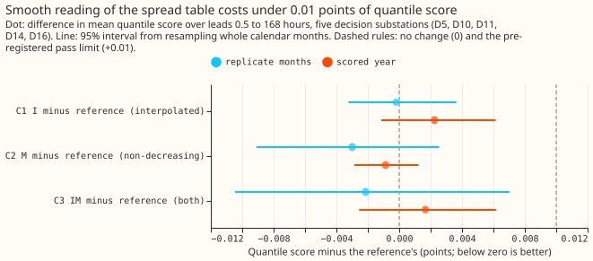
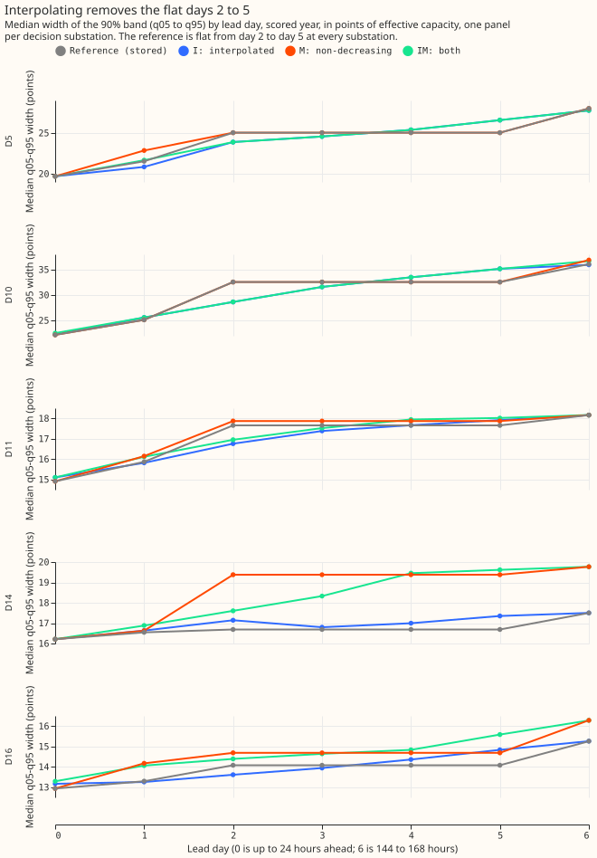
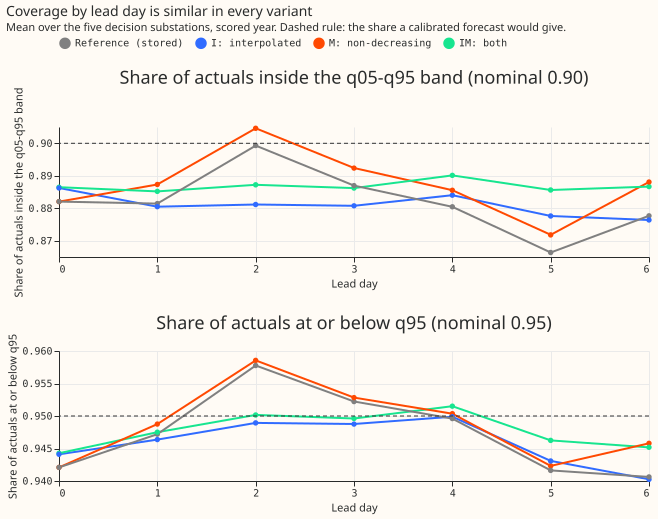
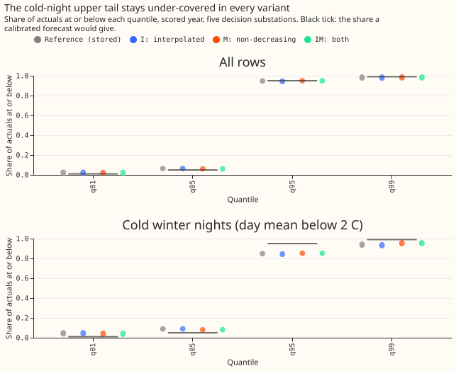

# Experiment 160: a smooth spread table removes the band-width staircase

**The 90% prediction interval of experiment 155's best forecast was equally wide on lead days 2 to
5, and reading its stored spread table by interpolation removes the equal days at a cost of 0.002
points of quantile score.** Lead day 0 is up to 24 hours ahead, so day 2 is 48 to 72 hours ahead. The
interval runs from the 5% quantile (q05) to the 95% quantile (q95). The forecast is arm D of
[experiment 155](../00155-dp-bg-stage2-assembly-night-offset-and-error-correction/result.md) with
the spread table of its arm A. Arm D is the stage 1 demand forecast of [experiment
136](../00136-dp-bg-stage1-assembly-on-the-ensemble-mean/result.md) plus two corrections: a night
offset in winter, and recipe R, which subtracts 0.75 times the mean error of the last 14 days by
half-hour of the day.

The spread table holds the quantile offsets from the mean forecast, for each hour band, calendar
quarter, and one of four lead bands (up to 24, 48, 144, and 168 hours). Each row reads the offsets
of its own lead band, so within one hour band and quarter every row between 48 and 144 hours has
the same width. Experiment 136 found the resulting steps.

We changed only how the stored table is read along the lead, never the mean forecast, and scored the
result at five Primary substations (D5, D10, D11, D14, D16) over leads 0.5 to 168 hours. The
quantile score is twice the mean pinball loss over 11 quantiles, in percentage points of effective
capacity (lower is better). The reference scores 2.7507. Arm I (interpolated) scores 2.7529 (+0.0022
against the reference, worse; 95% interval from resampling calendar months -0.0011 to +0.0061).
Arm IM (interpolated and non-decreasing) scores 2.7523 (+0.0017, -0.0026 to +0.0062). Arm M
(non-decreasing only) scores 2.7498 (-0.0009, -0.0029 to +0.0012) and leaves the equal days. The
replicate months give upper bounds of +0.0036 (I), +0.0025 (M), and +0.0070 (IM). The
pre-registered rule asks for an upper bound under +0.01 and no equal days, so arms I and IM pass and
arm M fails. Arm I wins, because arm IM is within 0.002 points of it and arm I comes first in the
pre-registered order.

## Results

- **Arms.** Reference: experiment 155's `d_spread_a` as stored. I: offsets interpolated linearly in
  lead between the band centres (12, 36, 96, and 156 hours), flat outside. M: upper offsets replaced
  by their running maximum over the four lead bands and lower offsets by their running minimum. IM:
  I applied to M's table. The table is recovered from the stored tuning rows (each cell holds one
  value) and nothing is fitted on the scored year. No weather model is run: every input is
  experiment 155's stored forecast, which already respects the forecast-time availability of its own
  weather.
- **Rows.** `fold_a_daily_gap_v1`: one row is one substation, forecast time, and valid time. The
  scored year is the 292 daily runs from 2025-07-02 to 2026-06-29 (D9 is scored beside the five
  decision substations and enters no contrast). Scored year (561,172 rows at the 6 substations,
  464,228 at the 5 decision substations in the common set with BG2, climatology, and the manual
  heuristic), outside the hand-filtered switching events. The replicate months (even months of
  2024-07 to 2025-06) give the second period. Schedule: experiment 155's monthly refits, so no
  contrast here depends on retraining cadence; the fix acts after the forecast.
- **Staircase measured on the reference.** The year-median q05 to q95 width is identical on lead
  days 2, 3, 4, and 5 at every decision substation (three equal pairs of adjacent days at each), for
  example 25.0 points at D5 and 14.1 at D16, with steps at 24, 48, and 144 hours. Arm I leaves no
  equal pair at any substation, arm IM leaves one at D11, and arm M leaves three at every
  substation. The replicate months give the same counts for arms I and M, and arm IM leaves one pair
  at each of D11, D14, and D16. The largest one-day step, as a share of the substation's median
  width, falls from 0.105 (median over substations) to 0.056 (I) and 0.063 (IM), and rises to 0.142
  for M.
- **Coverage by lead day (reference, mean over substations).** The share of actuals inside the 90%
  band is 0.88 over all leads (0.80 to 0.95 across substations and lead days), against 0.90 nominal.
  The q95 covers 0.948 of rows, and the q05 is crossed by 0.065 (nominal 0.05). The pooled q05 and
  q95 figures of I, M, and IM stay within 0.01 of the reference; per substation and lead day the
  inside-band share differs by up to 0.017 (M) and 0.031 (IM).
- **Quantile score, all leads (points; lower is better).** Reference 2.7507, I 2.7529, M 2.7498, IM
  2.7523, BG2 2.7804, manual heuristic 3.4968, climatology 3.8038. At 12 to 36 hours: reference
  2.4028, I 2.4047, M 2.3982, IM 2.4027, BG2 2.5178.
- **Score by lead band, I minus reference.** Under 24 hours +0.0024 (+0.0008 to +0.0043, worse),
  24 to 72 hours -0.0071 (-0.0123 to -0.0021, better), 72 to 168 hours +0.0069 (+0.0008 to +0.0141,
  worse). Interpolation narrows the early part of each stepped band and widens the late part, so it
  helps at 24 to 72 hours and hurts at the shortest and longest leads.
- **Substations.** I minus reference by substation: D10 +0.0088, D5 +0.0037, D16 +0.0008, D11
  -0.0001, D14 -0.0018. D10 is the only substation that loses by more than 0.004 (IM +0.0113 there,
  above the 0.01 limit, which the pre-registered rule applies to the pooled score only). Without
  D10, C1 is about +0.0007. Months: C1 is negative in 5 of 12, C2 in 7 of 12, and C3 in 6 of 12.
- **Tail calibration, scored year, all rows.** Coverage is the share of actuals at or below the
  quantile; loss is the pinball loss in points (lower is better).

| Arm | q01 cover | q01 loss | q05 cover | q05 loss | q95 cover | q95 loss | q99 cover | q99 loss |
|---|---|---|---|---|---|---|---|---|
| Reference | 0.022 | 0.214 | 0.065 | 0.711 | 0.948 | 0.748 | 0.982 | 0.231 |
| I | 0.022 | 0.216 | 0.065 | 0.713 | 0.947 | 0.746 | 0.981 | 0.232 |
| M | 0.020 | 0.212 | 0.061 | 0.711 | 0.949 | 0.748 | 0.984 | 0.227 |
| IM | 0.020 | 0.213 | 0.061 | 0.713 | 0.949 | 0.747 | 0.983 | 0.228 |
| BG2 | 0.010 | 0.220 | 0.040 | 0.643 | 0.944 | 0.778 | 0.982 | 0.268 |

Contrasts on the q99 loss: I +0.0014 (0.0000 to +0.0029), M -0.0039 (-0.0080 to -0.0007), IM
at -0.0030 (-0.0075 to +0.0007); on the q01 loss: M -0.0025 (-0.0045 to -0.0006).

- **Cold nights (winter nights, day mean temperature below 2 °C; 5,395 rows).** The q95 coverage is
  0.848 for the reference, 0.846 for I (-0.002, -0.005 to +0.001), and 0.852 for M and IM
  (+0.004, +0.001 to +0.011). The q99 coverage is 0.940 (reference), 0.933 (I), 0.954 (M), and 0.953
  (IM). The score on those rows moves by +0.021 for I (+0.002 to +0.053, worse), -0.028 for M
  (-0.068 to -0.001), and -0.015 for IM (-0.045 to -0.001). On all winter nights M is worse by
  +0.0035 (+0.0006 to +0.0074) and IM by +0.0079 (+0.0010 to +0.0166). BG2 covers 0.756 at the q95.
- **Width smoothness.** The mean absolute change in median width between adjacent lead days is
  within 0.15 points of the reference at every substation for I, and larger for IM at D14 and
  D16 (0.59 and 0.50 against 0.21 and 0.39) because the monotone table widens those substations'
  late days. Arm I has one falling step, at D14 (the reference has none).
- **Curtailment-cost proxy.** The node-only rule of `studies.node_curtailment` run on each
  substation's own demand, with the limit set at 0.9 times its maximum before the scored year, at
  GBP 2,000 per MWh over leads 12 to 36 hours. Avoidable cost against the perfect forecast, in GBP
  per MW of capacity per day over the 292 daily runs (42.7 MW in total): reference 106.3, I 105.9, M
  106.5, IM 106.2, BG2 150.8, manual heuristic 267.1. The reference saves 160.8 GBP per MW per day
  against the stored manual-heuristic forecast. The intervals are wide (the reference's avoidable
  cost is 0.11 to 3.3 million GBP in total for the 5 substations) and the variants differ from the
  reference by under 0.5 GBP per MW per day at the limit of 0.9, so the proxy cannot rank them. With
  the limit at 0.5 of the maximum the order of the four variants reverses (M lowest, I highest) and
  M differs from the reference by about 19 GBP per MW per day, so the order is not stable. A Primary
  substation has no published export limit here, and a demand series is treated as the flow that can
  breach, so the figures show the arithmetic and are not a curtailment forecast.
- **Caveats.** The staircase test uses lead-day medians pooled over a year and over the hour bands,
  so a staircase that survives inside one hour band by quarter cell would not show. The score and
  coverage hold over 5 substations and 12 months, so the intervals are wide; the contrast against
  the reference is better resolved than any absolute figure. The spread table is the stored one of
  arm A, whose lead bands are coarse, and a table fitted on finer lead bands would be a refit and is
  not tested here. Arm C (recipe R alone) was experiment 155's pre-registered winner; the fix acts
  on the spread, so the result is expected, but not shown, to carry over to arm C.
- **What follows from this result.** A smooth reading of the table is a free change
  (no fitted term and no stored state); a smoother spread does not move the cold-night upper tail
  (q95 coverage 0.85 in every variant), so the mean forecast on those nights is one place a later
  experiment could look. A
  refit of the spread on 12-hour lead bands and a test of M's table on tail scores are the two
  follow-ups.

## Checks

- **Median minus mean forecast, per site, at 12 to 36 hours.** Exactly 0.000 for every arm at every
  substation (the spread table has median zero and the variants share the reference's mean).
- **Mean-forecast error beside each quantile-score contrast.** The mean absolute error of the mean
  forecast is identical across arms (contrast 0.0000 for C1, C2, and C3), because the mean is
  unchanged. No contrast of the quantile score and of the mean error can point in different
  directions.
- **Reproduction control.** The reference rescored from experiment 155's stored forecasts scores
  2.7507, the same as experiment 155's `d_spread_a`. The plan's rule capped the verdict at
  `inconclusive` if the reference differed from the "printed arm D score" by more than 0.001. That
  wording was wrong, because arm D with its own refitted spread scores 2.756 and the reference is
  `d_spread_a`. The control applied is against `d_spread_a`, and it was met. The run script prints
  the reproduction gap of the recovered table (under 2e-5 points). In the plan, "days 3 to 6"
  counts from one and names the same days as "lead days 2 to 5" here.
- **Audit triggers.** None fired. The score changes (within ±0.005) and the equal-pair counts (at
  most 1 for I and IM) matched the predictions. The prediction that the cold-night q95 coverage
  stays near 83% missed in level: it was 0.846 to 0.852 (the 83% came from experiment 155's arms on
  a slightly different definition of cold nights). D10 loses 0.009 under I. The unweighted mean of
  the other four substations' differences is +0.0007, so C1's sign is unchanged without D10 (not
  recomputed from rows), and the verdict does not depend on it. No audit ran.
