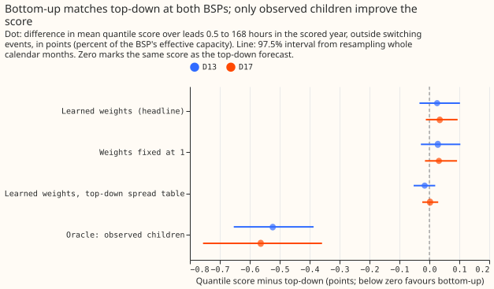
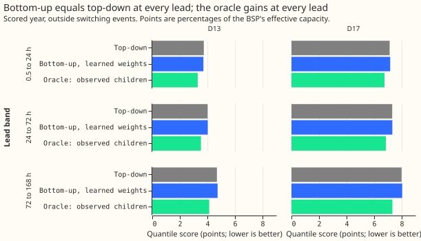
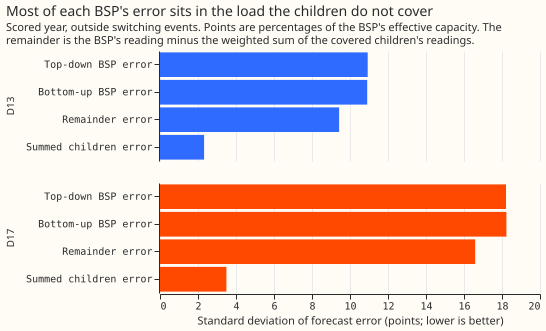

# Experiment 161: a bulk supply point is forecast no better from its children than on its own

**Take-home: building a bulk supply point (BSP) forecast from its children's forecasts did not
beat forecasting the BSP as a stand-alone series, at either BSP.** In the scored year, the
bottom-up arm scored 4.387 points at D13 against 4.361 for top-down (+0.026, 97.5% interval -0.033
to +0.102), and 7.706 at D17 against 7.672 (+0.035, -0.012 to +0.094). The bottom-up arm is 0.6%
and 0.5% worse, within the noise. The reason is the share of the BSP the sum can reach. Only 3
children per BSP report real power and have a long history, so they cover 42% (D13) and 56% (D17)
of the BSP's effective capacity, and most of the BSP's forecast error is in the load they do not
cover (figure 3). With the children's readings known exactly (the oracle), the score improves by
only 12% and 7%. The verdict is `inconclusive`, because both intervals include zero and the
oracle control missed its pre-registered threshold (the threshold was set too high; see
Checks).

This experiment compares two ways of forecasting a BSP, which sits above several Primary
substations in the electricity network. The top-down arm gives the BSP's own half-hourly reading to
the best-guess GAM-K chain ([experiment
155](../00155-dp-bg-stage2-assembly-night-offset-and-error-correction/result.md)'s arm D). The
bottom-up arm forecasts each covered child Primary with the same chain, weights the forecasts by
learned weights, and adds the chain's forecast of the remainder, the BSP's reading minus the
weighted children's readings. Quantile scores are in points: percentages of the BSP's effective
capacity, lower is better. Scored rows are the 291 daily runs of 2025-07-02 to 2026-06-29, leads 0.5
to 168 hours, outside switching events.

**Scope.** Two BSPs have child Primaries with usable data: D13 (seven children) and D17 (nine
children). Only the children that report real power and have a long history enter the sum (D9, D10,
and D11 under D13; D5, D14, and D16 under D17). The other children report apparent power (4 of 7 and
4 of 9), or have under 5 months of readings (D15 and D18), so they stay in the remainder. The test
is therefore a partial bottom-up. NGED will say in January 2027 which BSP each unmetered Primary
sits under, and no other BSP is in scope until then.

## Results

**Bottom-up scored the same as top-down, within the noise.** Figure 1 shows the three bottom-up
variants against zero, and the oracle far below it. The fixed-sum variant (every weight 1) scored
the same as the learned weights (C3: -0.003 at D13, +0.003 at D17, both intervals including zero).
Giving the bottom-up arm the top-down arm's spread table moved the score by -0.016 at D13 and
+0.002 at D17 (C5), so the two means tie. The positive sign of C1 comes from the spread table:
bottom-up
refits its table on the corrected errors, which narrows its band and under-covers the tails,
while top-down keeps the table fitted before the corrections.

**No lead band favoured bottom-up with confidence.** The prediction said the gain would be largest
below 24 hours (C4). At D13 the difference is -0.031 (-0.065 to +0.007) below 24 hours, +0.006
between 24 and 72 hours, and +0.050 (-0.015 to +0.140) beyond 72 hours, which has the predicted
order and includes zero in every band. At D17 it is +0.040, +0.010, and +0.046, with the wrong sign
in every band.

**Most of the BSP's error is in the remainder.** At D13 the remainder's error has a standard
deviation of 9.4 points and the weighted children's summed error 2.3 points; at D17 the figures are
16.6 and 3.5. The two parts add up to the bottom-up error (10.9 and 18.2), which is close to the
top-down
error, so correcting the children cannot remove the remainder's error. The two parts' errors
correlate positively (0.56 at D13, 0.39
at D17), so they add up to nearly the top-down error. Even the oracle, which removes the children's
error, only gets from 4.361 to 3.838 points at D13 and from 7.672 to 7.108 at D17.

| Arm (scored year) | D13 score | D17 score |
|---|---|---|
| Top-down | 4.361 | 7.672 |
| Bottom-up, learned weights | 4.387 | 7.706 |
| Bottom-up, weights fixed at 1 | 4.389 | 7.703 |
| Bottom-up, unbounded weights | 4.388 | 7.728 |
| Bottom-up, learned weights, top-down spread table | 4.345 | 7.674 |
| Oracle (observed children) | 3.838 | 7.108 |
| Manual heuristic | 5.466 | 8.424 |
| Climatology | 5.905 | 8.953 |

Rows are the shared rows: 96,324 at D13 and 82,137 at D17. Top-down on all of its own rows scores
4.355 (97,046 rows) at D13 and 7.751 at D17. The replicate months (even months of 2024-07 to
2025-06) agree: C1 is -0.014 (-0.067 to +0.031) at D13 and +0.036 (-0.010 to +0.084) at D17.

**The weights are not identified.** The bounded fit (0.8 to 1.2) puts all six weights on the upper
bound, 1.2. The unbounded fit gives D13 weights of 3.3, 4.3, and 1.4 (D9, D10, D11) and D17 weights
of 5.0, 0.2, and 1.1 (D5, D14, D16). Both fits use the winter window 2023-10 to 2024-03. The
children stand in for their unmetered siblings, so the weight on a child is not that child's
transformer ratio. The sum does not close: the in-sample residual has a standard deviation of 6.3 MW
(47% of the BSP's variance) at D13 and 8.8 MW (70%) at D17.

## Tail calibration and subset scores (scored year)

| BSP, arm | Coverage at 0.01 | 0.05 | 0.95 | 0.99 |
|---|---|---|---|---|
| D13 top-down | 0.018 | 0.067 | 0.921 | 0.969 |
| D13 bottom-up | 0.025 | 0.080 | 0.915 | 0.961 |
| D17 top-down | 0.020 | 0.077 | 0.906 | 0.964 |
| D17 bottom-up | 0.022 | 0.086 | 0.906 | 0.963 |

**Both arms are too narrow in the tails, and bottom-up is slightly more so.** The nominal values are
0.01, 0.05, 0.95, and 0.99. Bottom-up's pinball loss at the four tail quantiles is higher than
top-down's at both BSPs (C6: +0.012 to +0.042 at D13, +0.012 to +0.040 at D17), with every interval
including zero except the 0.05 quantile in the replicate months at D17. The top-down spread table
brings bottom-up's coverage back to top-down's (D13 0.017, 0.066, 0.921, 0.969).

## Checks

- **Median minus mean forecast, per BSP:** 0.000 for every arm at both BSPs, because the residual
  table is centred, so this check exposes nothing here.
- **Mean forecast's error beside each contrast (mean absolute error):** C1 -0.030 at D13 and +0.002
  at D17; C2 -0.026 and -0.003; C5 -0.030 and +0.002; C7 -0.975 and -1.037. At D13 the mean of the
  bottom-up forecast is slightly better than top-down's while its quantile score is slightly worse,
  so the spread table, not the mean, costs the score there (C5 confirms).
- **Controls.** Reproduction: the copied chain rescored at D10 reproduces experiments 136's and
  155's stored scores exactly (passed). Leakage: the weight window ends on 2024-03-31, before the
  first run, and the chain's `assert_no_lookahead` holds (passed). Weather frames built for the
  BSP cells match the stored frame of 2025-07-02 bit for bit (passed). The decomposition
  `BSP = remainder + weighted children` holds exactly in the observed readings (passed).
  **Oracle: failed.** The oracle gained 0.523 points at D13 and 0.563 at D17, against thresholds of
  0.918 and 2.140 (half of the covered capacity share times the top-down score). The
  threshold assumed the BSP's error falls in proportion to the covered load, and an exact sum does
  not imply that: it fixes which error the oracle has, not how large it is. The audit found the
  oracle's error equal to the remainder's error to within 1e-5 on every scored row, and the ratio of
  standard deviations in figure 3 predicts gains of 13.7% (D13) and 8.9% (D17) against the
  observed 12.0% and 7.3%. The failure therefore reflects the mis-specified threshold and not a
  plumbing fault. The cap does not bind, because both C1 intervals include zero and the decision
  rule gives `inconclusive` anyway. In the replicate months the D17 oracle gain is -0.361 (-0.652 to
  +0.070), which includes zero.
- **Triggers fired.** Trigger 1 (the oracle control failed). Trigger 2 (the prediction missed:
  C1 predicted -2% to -8% and found +0.6% and +0.5%; the oracle predicted -15% to -40% and found
  -12% and -7%; the explanation in the error decomposition is stated above and was tested by it).
  Trigger 3 (C1 and C2 point in different directions on the mean absolute error and the quantile
  score at D13; C5 explains it as spread). Triggers 4 to 7 did not fire: no site-level ablation
  applies to two BSPs, no nested arm beat its container, no sister experiment on BSPs exists for
  trigger 6, and no later experiment depends on the headline. The independent audit (Opus) is in the
  private briefs folder and is triaged below.

## Audit and triage

- **Finding 1, the spread table carries C1's sign (accepted).** Bottom-up's own table adds +0.042
  points at D13 and +0.033 at D17; with matched tables the means tie (C5). The text now says the
  means tie and no gain was found.
- **Finding 2, the oracle threshold (accepted).** The threshold was wrong before the run, and the
  plumbing is sound (see Checks). The cap does not bind.
- **Findings 3 and 4, wrong arm named and 291 runs (accepted).** Both are corrected.
- **Finding 5, when the weight bounds were set (accepted).** The bounds were added after the first
  unbounded fit, before any score was read, and bounding changes no score (C3).
- **Finding 6, the D17 oracle in the replicate months (accepted).** It is reported in Checks.

## Caveats

- **Two BSPs, three covered children each.** The sum reaches 42% and 56% of the BSP's capacity, so
  the result says little about a BSP whose children are all metered in real power.
- **The weights come from one winter** (2023-10 to 2024-03), and the unbounded weights are not
  stable. A fit on all year or a hierarchical estimate may behave differently.
- **Pinned against fitted capacity.** The covered children use the pinned PV capacity and the BSP
  and remainder fit theirs. The planned variant that fits the children's capacity (C8) was not run:
  with no bottom-up gain to split, the question did not arise.
- **The weight-refit variant (C9) was replaced by the unbounded-weights variant,** which tests the
  same question (does the weight estimate matter) with the weights that failed.
- **The curtailment metric was not scored,** because this experiment did not build the generator
inputs
  it needs for these BSPs.
- **Weather is past-weather ensemble means calibrated as in experiment 136,** the same as every
  arm uses, so the comparison is fair and the absolute scores are not production scores.

## What to try next

- **Forecast the apparent-power children's demand** (dark rows only, as experiment 124 does) and
  put them into the sum, so the covered share rises from about half toward all of the BSP.
- **Estimate the weights jointly with the remainder** on a full year, with a ridge or the 1.2 bound,
  so the weights stop standing in for unmetered siblings.
- **Wait for NGED's January 2027 answer on the hierarchy** before adding BSPs beyond D13 and D17.

## Plan

**Departures from this plan.** The scored year holds 291 runs, not 292, and the bounds were set
after the first unbounded fit and before any score was read. The weights are bounded (0.8 to 1.2),
because the first unbounded fit
was unstable, and the unbounded fit is the `free` variant, which replaces BU-w2 (C9). BU-fc (C8) was
not run. The oracle threshold and the prediction missed, as the Checks list says.

**Question.** Experiment 36 summed the Primaries' forecasts and fed the sum to a BSP's XGBoost
model, and the sum added nothing. Experiment 124 showed that a BSP reading does not close exactly
over the Primaries beneath it. The maintainer's hierarchy aims treat the topology as a soft hint and
not a hard sum. This experiment asks the question again with the best-guess GAM-K chain
([experiment 155](../00155-dp-bg-stage2-assembly-night-offset-and-error-correction/result.md)'s arm
D) on both sides: is the BSP forecast better when it is built from its children's forecasts plus a
learned remainder than when the BSP is forecast as a stand-alone series?

**Scope: two BSPs (seven and nine children), and the children that report real power.** NGED's
hierarchy file places 16 Primaries under two BSPs, D13 (seven children) and D17 (nine children).
Four of D13's children (D2, D4, D19, D21) and four of D17's (D3, D8, D12, D22) report apparent power
in megavolt-amperes, which hides the sign of the flow in daylight (see [the data-processing
page](../data-processing.md), "Use a Primary metered in MVA for demand only on dark rows"). No
observed net-power remainder can be formed from such a child, and arm D has no forecast for it. The
MVA children stay inside the remainder. The covered children are the Primaries that report real
power and have a long history and an arm D forecast: D9, D10, and D11 under D13 (23.3 of 55.3 MW of
effective capacity), and D5, D14, and D16 under D17 (26.5 of 47.6 MW). D15 and D18 under D17 (the
two transformers of one Primary substation) report real power but have under 5 months of readings
before the scored year, so they stay in D17's remainder too. The scope is therefore a partial
bottom-up, and the write-up says so in its first paragraph. A bottom-up arm that also forecasts the
MVA children (demand terms only, on dark rows, as experiment 124's joint fit does) is the obvious
follow-up and is not tested here.

**Arms.** All arms use arm D's recipe: the ensemble-mean weather, T-all, the shared filter noise
(POOL), monthly refits, the winter night offset, recipe R, and arm A's spread table.

| Arm | Forecast of the BSP |
|---|---|
| TD (top-down) | Arm D's chain on the BSP's reading as a stand-alone series |
| BU (bottom-up) | The sum over covered children of weight times the child's arm D mean, plus arm D's mean for the remainder series; quantiles from a spread table fitted on the sum's own tuning-month residuals |
| BU1 (fixed-sum) | The same, with every weight 1 (reference) |
| BU-oracle (diagnostic) | The same as BU, with the children's observed readings in place of their forecasts; no verdict |

**The remainder series.** For each BSP the remainder is `r(t) = BSP(t) - sum_i w_i * y_i(t)`, where
`y_i` is the covered child's observed reading in MW. The chain forecasts `r` as it forecasts any
series, with the BSP's location for the weather and calibration, a PV capacity fitted and not pinned
(no capacity vintage exists for a BSP, and the remainder holds the unmetered and the MVA children's
embedded solar), the same filter, and arm D's two corrections applied to the remainder's own errors.
The BU forecast of the BSP is `sum_i w_i * mean_i + mean_r`, because the decomposition is exact in
the observed readings. BU1 runs its own remainder chain on `BSP - sum_i y_i`.

**A confound the design names.** The covered children's arm D forecasts use the pinned PV capacity
of [experiment 139](../00139-differentiable-physics-pv-as-of-capacity-in-gam-k/result.md). No
capacity vintage exists for a BSP, so TD and the remainder fit the PV capacity. Part of any BU gain
may therefore come from the children's pinned capacity and not from the bottom-up structure. A
pinned capacity is information that bottom-up legitimately has and top-down lacks, so C1 stays the
headline. Variant BU-fc replaces the children's forecasts with arm D chains that fit the capacity
(C8, BU-fc minus BU), which splits the gain into the two parts. Arm D also corrects the children and
the remainder separately, so a shared error is corrected twice in BU; this is part of the design.

**Feasibility steps.** (1) Build a feature cache that adds D13 and D17 to experiment 103's 16
Primaries, from experiment 103's `panel.parquet`, with experiment 103's rows rule (present and
unflagged, outside the fixed lockdown window and the hand-filtered switching events), and add each
remainder series as a further site that copies the BSP's weather and replaces the reading. (2) Build
the ensemble weather arrays and the weather calibration for the two BSP locations; the remainders
reuse them. (3) Copy experiment 136's T-all fit and prediction with a fitted-capacity option,
because `predict_tall` asserts a pinned capacity. This is code inside this folder only. (4)
Experiment 155's stored forecasts hold the runs that experiment 155 scored, which are not the
every-fifth-day stride runs; the TD and remainder chains are built on the same runs so that recipe R
sees the same error stream, and every score uses the runs the arms share.

**The weights.** Non-negative least squares of the BSP's reading on the covered children's readings,
with no intercept, on the half-hours in 2023-10-01 to 2024-03-31 where the BSP and the children are
present, unflagged, and outside the hand-filtered switching events. The window ends on the day
before the first run (2024-04-01) and starts at the first usable day of the youngest child (D9,
2023-10-01 at D13). The weights are fixed for the whole experiment, so no weight uses a reading
after any cut. The weights are 15 to 27 months old in the scored year, and the remainder series
before 2024-04 is in-sample for the weights; no scored row is affected. Variant BU-w2 refits the
weights on data to 2025-06-30 and is scored on the scored year only. The window is winter only at
D13, so the weights say little about summer; the write-up shows the fitted weights beside experiment
124's multipliers.

**Spread.** Each arm's quantiles are its mean plus a residual table (hour band by calendar quarter
by lead band) fitted on that arm's own tuning-month forecasts (the odd months of 2024-07 to
2025-06), every factor 1, as experiments 136 and 155 do. TD uses arm D's own rule (arm A's table).
BU uses a table fitted on the sum's residuals. A variant gives BU TD's table (BU-spreadTD), which
isolates the mean.

**Rows and periods.** `fold_a_daily_gap_v1`, 09:00 UTC `power_fcst_init_time`, the 292 runs of the
scored year (2025-07-02 to 2026-06-29), leads 0.5 to 168 hours. A row is scored when the BSP and its
three covered children have a reading and sit outside the hand-filtered switching events, so every
arm is scored on the same rows. Tuning months and replicate months are experiment 136's. Series are
D-labels. No generator series enters.

**Weather and what exists at forecast time.** The weather is the calibrated ensemble mean of
experiment 136 for the BSP's grid cell, and the filter's analysis proxy is built from earlier runs.
The children's arm D forecasts are the stored forecasts of experiment 155, made at the same origin.
Every input exists at forecast time.

**Scoring.** Beside the headline: lead bands, the tail table (coverage and pinball loss at 0.01,
0.05, 0.95, and 0.99), the mean absolute error of the mean forecast beside every quantile-score
contrast, absolute scores for climatology and the manual heuristic, and the node curtailment metric
of `studies.node_curtailment` at the scaled limit (f = 0.9, with 0.75 and 0.5), if the BSP's
generators-beneath inputs it needs exist for these two BSPs. Where it cannot be scored, the write-up
says so.

**Planned contrasts.** C1 BU minus TD (headline, at D13 and at D17), with TD also reported on all of
its own rows beside the shared rows. C2 BU1 minus TD. C3 BU minus BU1 (do learned weights help). C4
C1 by lead band. C5 BU-spreadTD minus TD (the mean alone). C6 BU minus TD at the tail quantiles. C7
BU-oracle minus TD (diagnostic). C8 BU-fc minus BU. C9 BU-w2 minus BU. Each is read through
`studies.bootstrap`.

**Controls, run before any contrast is read.**

- **Reproduction.** Arm D rescored from experiment 155's stored forecasts at the covered children on
  the common rows matches experiment 155's stored per-site scores within 0.001. - **Oracle (positive
  control).** BU-oracle scores below TD at both BSPs by at least half the share of effective
  capacity that the covered children make up (42% at D13, 56% at D17) times TD's score. The
  decomposition is exact in observed readings, so a smaller gain means a plumbing fault in the
  remainder, the weights, or the join. Experiment 36's oracle gained 3.4 to 5.6 points. -
  **Leakage.** The weight window ends before the first run, and an assertion checks that no
  remainder fit trains on a reading after its cut (the chain's `assert_no_lookahead`). - **Closure
  check.** Print the in-sample residual of the weight fit in MW and its share of the BSP's variance,
  to compare with experiment 124's audit (1.2 to 1.8 MW at the BSP that closes, 11 points at the
  other).

**Five triggers (size).** Stored: private files only. Serving path: not touched. Degradation rule:
not touched. More than one design defensible: yes, three, each pre-registered above. Callers not
nameable without searching: no, the scripts copy experiments 111, 136, and 155.

**Audit triggers to watch.** Trigger 1 (a control fails: the oracle), trigger 2 (the result
contradicts experiment 36's null, or this plan's prediction), and trigger 6 (an interval more than
twice as wide as experiment 155's per-site intervals) are the likely ones. The write-up lists which
fired and tells the manager if any did.

**Resources.** CPU only, at most 6 cores with one thread per worker, each job under `systemd-run
--user --scope -p MemoryMax=16G -p OOMPolicy=continue`. No GPU. New work: the ensemble frames for
the two BSP locations for the 456 early runs (the scored year's frames already hold both), the
weather calibration, and six chains (TD, the BU remainder, and the fixed-sum remainder at each BSP).

**Outputs.** Predictions for every arm in the `dp_preds` layout under
`data/ml-experiments/00161-dp-bsp-top-down-against-bottom-up/work/dp_preds/`.

**Advice followed and departures.** From experiment 36: do not expect the children's median
forecasts to help an XGBoost BSP model, and do not read the oracle's gain as headroom; this
experiment uses a different model and reports the oracle only as a control. From experiment 124: the
BSP reading is not an exact sum, so the weights and the remainder are estimated. From experiment
155: use arm D (the instruction for this experiment), apply recipe R at every lead, and read the
tails.
