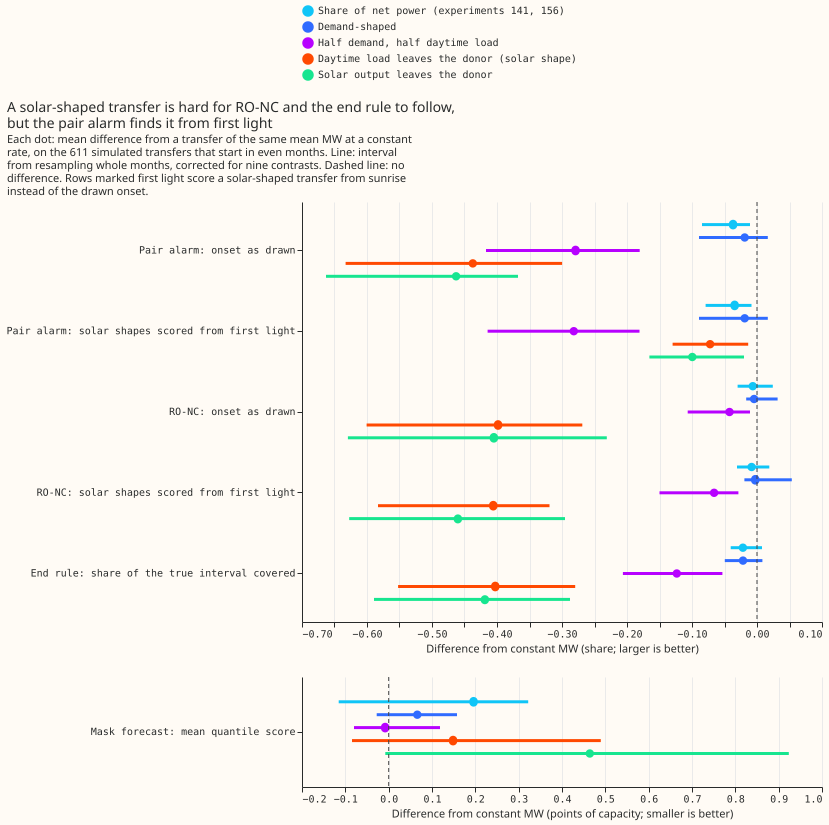
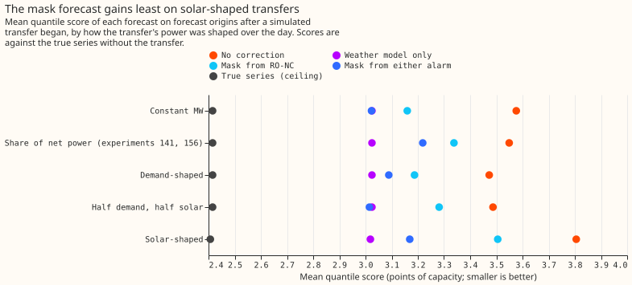
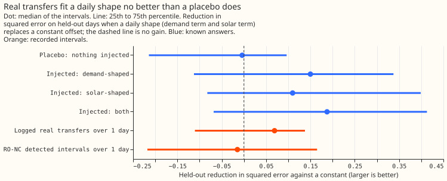
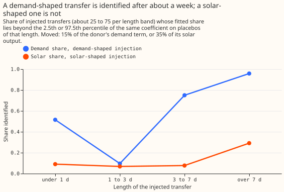
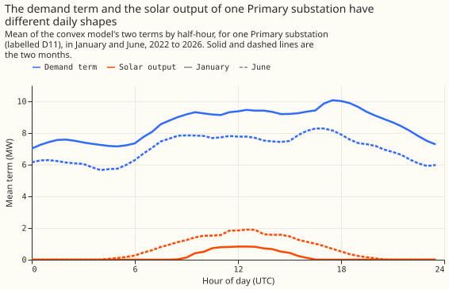

**Take-home message.** A load transfer is an operator moving demand from one substation to a
neighbour by switching. If a transfer followed the donor substation's solar shape, the refit-offset
neighbour-count detector (RO-NC) would find about half of the transfers instead of 91%, and the live
end rule would cover 22% of the true interval instead of 62%. The pair alarm of [experiment
156](../00156-switching-faster-onset-alarm-from-opposite-steps/result.md) loses much less once a step
may start at first light. The 25 logged real transfers cannot say whether they move solar output: a
daily shape fits them no better than it fits quiet stretches. Earlier RO-NC and end-rule results may
therefore be optimistic by 0.3 to 0.46 in recall. Transfers shaped like the donor's demand, or like
its net power (the shape the earlier experiments injected), are as easy to find as constant ones.

**We asked whether the power a transfer moves follows the donor's demand and solar shapes, and
whether injecting a constant number of megawatts flatters the detectors.** The idea comes from the
roadmap's [magnitude-only mixture model](../../roadmap/switching-events.md): a switch moves houses,
factories, and solar sites, not a constant. Part 1 split the convex model of
[experiment 130](../00130-ro-nc-detector-on-the-gam-k-residual/result.md) (a generalised additive
model, GAM) into its demand term and its solar term, and fitted each logged transfer's effect on the
donor's residual as a constant, as a daily shape, and as both, scoring on held-out days. Part 2
re-injected the 1,160 transfers of [experiment 141](../00141-switching-detector-fed-into-gam-k/result.md)
with five rules of the same mean megawatts at the donor (constant, demand-shaped, two solar shapes,
half demand and half daytime load), beside the original share-of-net-power rule, and re-ran the
detectors, the end rule, and the mask forecast of experiment 156. [Experiment
60](../00060-sw2-7-profile-weighted-step-detector/result.md) had already found that a detector
weighted by the donor's profile finds the same share of moved power on five shapes; the solar-only
shapes are new here.

**The verdict is `partly supported`, and the pre-registered rule did not cover this outcome.** The
rule gave `supported` when part 1 and part 2 both held and `not supported` when neither did. Part 2
held for RO-NC and the end rule, and part 1 did not (P1 and P2 failed). The verdict was set to
`partly supported` after the results, and the rule has a gap.

- **Arms.** Six injections with the same mean megawatts at the donor (0.865 to 0.872 MW across
  arms): constant (CONST, the reference), share of net power (SHARE, exactly the injection of
  experiments 141 and 156), demand-shaped (DEMAND), a daytime load that leaves the donor (SOLAR,
  proportional to the donor's solar output, subtracted from the donor), half demand and half daytime
  load (MIX), and solar output that leaves the donor, so the donor's net power rises at midday
  (PVOUT). Shaped arms divide the donor's term by its mean over the transfer. Detectors, thresholds,
  and scoring code are those of experiment 156 (4-hour pair-alarm window, k = 3.75); SHARE reproduces
  experiment 156's event table exactly and its mask scores to three decimals. Convex-model terms
  come from monthly refits, and solar plus demand equals experiment 130's stored forecast to 5e-15
  MW on six series. Series 12 has no terms; series 13 has terms from 2025-07 to 2026-06 only. 37
  DEMAND events and 57 SOLAR, MIX, and PVOUT events have a donor without terms, or no daylight, and
  use the donor's net-power shape instead.
- **Weather.** ERA5 at lag times, as in experiments 130 and 156, so every number is a lab ceiling:
  ERA5 arrives about 5 days late and is not available at forecast time.
- **Part 1, logged transfers over 1 day (35; 25 have a fitted series; 37 series fits; 13 logged
  donors).** P1, constant plus shape against constant on held-out days: median +0.067 (95% -0.033 to
  +0.126; 99.4% -0.110 to +0.160), not supported. Shape alone +0.069 (99.4% -0.111 to +0.138). The
  placebo median is +0.004 over all stretches; a placebo matched to the transfers' lengths has a
  median of +0.052, and 39% of such placebos reach +0.067. The demand share is beyond the placebo's
  2.5th percentile at 5 of 13 logged donors (0.38; exact 95% 0.14 to 0.68), the solar share beyond
  the 97.5th percentile at 0 of 13; neither is above one half (P2). Median fitted shares: 0.130
  demand and 0.140 solar. The 181 intervals RO-NC detected over a day (experiment 147): median
  +0.005; they are chosen because a step was found, so they are not evidence about transfers.
- **Receivers (12 receiver fits).** The donor's terms fit the receiver's opposite step better than
  its own terms in 8 of 12 (held-out reduction +0.091 against -0.004). That is the direction a
  transfer predicts, from 12 fits.
- **P3, injected known answers (182 per scenario, the same stretches in each).** The injected
  shares are recovered without bias (demand 0.158 for 0.15, solar 0.349 for 0.35), as the fit
  contains the injected shape, so the identification rates below are best cases. With the
  placebo-calibrated rule, the demand share is identified in 0.10 of transfers of 1 to 3 days, 0.75
  of 3 to 7 days, and 0.96 of over 7 days. The solar share is identified in 0.07, 0.08, and 0.29. The
  under-1-day band reads 0.52 for demand from 33 short stretches and is not trustworthy.
- **P4 to P7, even-month transfers (611), minus constant, 99.4% interval, onset as drawn.**
  Pair-alarm recall: SOLAR -0.437 (-0.633 to -0.300), PVOUT -0.463 (-0.663 to -0.368), MIX -0.279
  (-0.417 to -0.180), DEMAND -0.019 (-0.089 to +0.017), SHARE -0.037 (-0.085 to -0.011). RO-NC recall:
  SOLAR -0.398 (-0.601 to -0.269), PVOUT -0.405 (-0.629 to -0.231), MIX -0.042 (-0.107 to -0.011),
  DEMAND -0.004, SHARE -0.006. Absolute recall (pair alarm, RO-NC): CONST 0.786 and 0.907; SOLAR
  0.349 and 0.509; PVOUT 0.324 and 0.503. P6, the lag from step to alarm, is 6 hours for every arm,
  because the window fixes it. P7, share of the true interval the live end rule covers (missed
  transfers count 0): CONST 0.620, SOLAR 0.217, PVOUT 0.201, MIX 0.496; SOLAR minus CONST -0.403
  (-0.552 to -0.280).
- **Scored from first light (post hoc).** A solar-shaped step cannot start before sunrise, so a
  drawn onset at night is not a fair target for an alarm. Matching the donor's alarm from first
  light changes the pair alarm to SOLAR -0.072 (-0.130 to -0.013) and PVOUT -0.100 (-0.166 to
  -0.020), but RO-NC stays at SOLAR -0.406 and PVOUT -0.460. The end rule, scored on the covered
  share of the interval, loses about 0.40 under either scoring. Most of the pair alarm's loss in the
  as-drawn score is therefore a scoring effect, and the RO-NC and end-rule losses are real.
- **P8 and P9, mask forecast on all 277,056 rows after an onset (SOLAR 274,294 paired rows), minus
  constant.** MASK-UNION: SOLAR +0.149 points of capacity (99.4% -0.085 to +0.490), PVOUT +0.464
  (-0.008 to +0.923), DEMAND +0.066 (-0.028 to +0.158), MIX -0.008 (-0.080 to +0.118), SHARE +0.196
  (-0.115 to +0.322); none is supported at the corrected level. Scores of no correction, weather
  model only, mask from RO-NC, mask from either alarm, true series: CONST 3.576, 3.025, 3.160, 3.023,
  2.416; SHARE 3.549, 3.025, 3.338, 3.219, 2.416; DEMAND 3.473, 3.025, 3.187, 3.089, 2.416; MIX 3.487,
  3.025, 3.281, 3.015, 2.416; SOLAR 3.805, 3.019, 3.505, 3.169, 2.407; PVOUT 4.218, 3.019, 3.791,
  3.484, 2.407.
- **Why the forecast contrast is flat although recall falls.** The audit found that on rows the
  recall metric counts as missed, the mask still improves on no correction by 0.72 points on the
  SOLAR arm, because it masks a window that covers part of the transfer. The recall metric therefore
  understates what the mask achieves on solar-shaped transfers.

## Checks

- **Median minus mean forecast** by site, points of capacity: D10 -0.076, D11 -0.044, D14 +0.084,
  D16 +0.040, D5 -0.347, D9 -0.091, the same for every arm.
- **Mean-forecast contrast** has the quantile score's sign everywhere: SOLAR minus CONST +0.210
  (99.4% -0.102 to +0.661) in the error of the mean forecast and +0.149 in the quantile score.
- **Triggers fired.** A control failed: the 95% bootstrap intervals of the fitted shares flag 16%
  (demand) and 14% (solar) of placebos, so part 1 uses a placebo-calibrated rule. A headline
  interval is more than twice as wide as the same contrast's in experiment 156 (P8 for SOLAR is 0.58
  points wide, experiment 156's C4 was 0.22). A Sonnet code review found the bootstrap intervals too
  narrow, P2 chosen by the fit, a biased energy-share measure, contaminated placebos, and P7 dropping
  missed transfers; each was fixed before the numbers above. An Opus audit then found a wrong sign
  on the solar arm (fixed by relabelling it a daytime load and adding PVOUT), onset scoring, inherited
  weights, and the by-construction recovery in P3. The findings and their triage are in the audit
  report, kept in the private data store.

## Caveats

- **P1 and P2 rest on few transfers.** Twenty-five logged transfers, 13 with a logged donor, and
  placebos of 33 to 73 stretches per length band. A shape effect of the size the controls inject (15%
  of demand) would be found in about three quarters of transfers longer than 3 days; the real
  transfers show less, but few are that long.
- **Real transfers may move solar output in a way the donor's fitted solar term does not
  describe**, for example because the donor's solar capacity changed during a transfer.
- **The solar arms are extreme cases.** The realistic mix of houses and small solar sites is nearer
  the SHARE arm (RO-NC -0.006, pair alarm -0.037) than the SOLAR or PVOUT arms, which move no demand.
- **Missing terms.** Series 12 has no terms, which cuts the real transfers from 35 to 25, and the
  donor's net-power shape stands in for 37 to 57 injected events.
- **Mean-matching a solar shape raises its midday power** to several times the mean, so the solar
  arms also differ from the others in peak size.
- **Lab conditions** as in experiment 156: ERA5 residuals, balanced steps, hindsight end rule in the
  RO-NC intervals that the live end rule replaces only in P7. Recall weights are inherited from the
  constant arm's megawatts.

## What the next experiment should answer

Whether real transfers move solar output. The cheapest test uses the 35 logged transfers with
their metered receivers: fit the receiver's opposite step and the donor's step jointly, so that the
two together identify the solar share from a sum constrained to be zero. A second test replays
RO-NC and the end rule on the solar arms with a daylight-only step test, to see how much recall that
recovers.

## Changes to the pre-registered plan

- **Prior art (added after the plan).** Experiment 60 had already compared constant and profile
  injections for a profile-weighted detector.
- **Interval method (after the code review).** Bootstrap intervals over whole days flagged 14% to
  16% of placebo stretches, so the P2 and P3 tests use the placebo-calibrated rule, and the
  bootstrap intervals are reported beside them. The pre-registered statement that the solar share
  "is identified only for transfers of 3 days or more" rested on the bootstrap intervals.
- **P2 donors** are the logged donors, not the series with the largest fitted effect; P3's share
  of moved energy was dropped for a bias towards the demand term, and recovered shares are reported
  instead; P7 counts missed transfers as 0; controls and placebos avoid RO-NC's detected intervals
  and use the same stretches in each scenario.
- **P1's model** is constant plus shape (three parameters), as the prediction states.
- **After the audit:** the SOLAR arm is a daytime load leaving the donor, and the PVOUT arm was
  added for solar output leaving the donor; first-light scoring, the daylight-only sensitivity, and
  the receiver check are post hoc.
