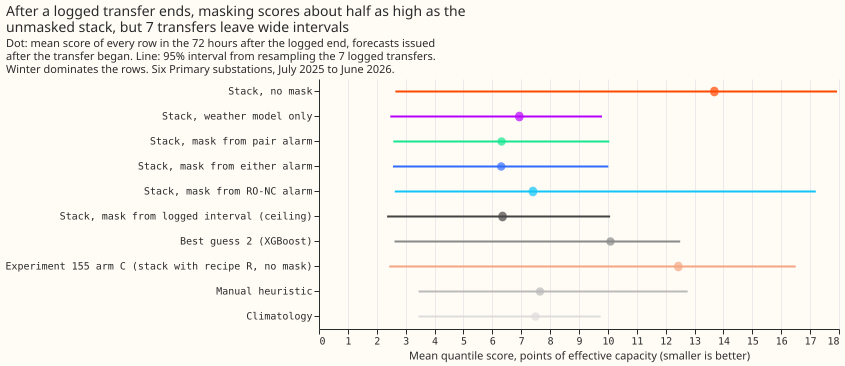
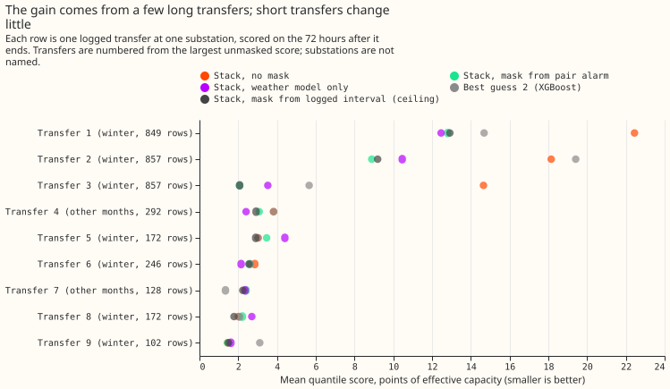
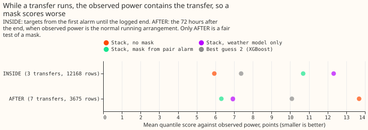
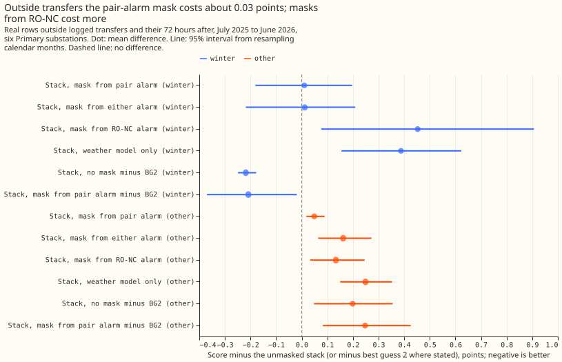

**After a real load transfer ends, a forecast that sets the transfer's readings missing, or that
ignores recent power, scores about half as high as best guess 2 and about half as high as the same
stack with no mask.** The effect rests on 7 logged transfers at six Primary substations in the
scored year. Three long winter transfers carry nearly all of it, the intervals are wide, and the
pair alarm found only some of the transfers. On ordinary days the masked stack and best guess 2 are
indistinguishable. The next experiment needs more logged transfers, or a forecast that drops recent
power whenever any alarm is active.

**We asked how two forecasts cope with real transfers of load between substations that the
network operator logged.** The stack is a weather-driven generalised additive model (GAM) with a
Kalman filter on its recent errors, and it sets the readings missing from the moment an alarm is
known. The alarm is the pair alarm of [experiment
156](../00156-switching-faster-onset-alarm-from-opposite-steps/result.md) (two metered substations
step in opposite directions within hours), with the end rule of [experiment
148](../00148-switching-end-rule-lookahead-ro-nc/result.md). Best guess 2 (BG2) is the XGBoost
forecast of [experiment 87](../00087-bg2-best-guess-assembled-with-drop-one-ablations/result.md),
which takes recent power as an input. Both were scored on the same rows, in points of a
substation's effective capacity (twice the mean pinball loss over 11 quantiles; smaller is better).

**By the pre-registered rule the verdict is `partly supported`.** C3 passes: the share of the gap
to the logged-interval mask that the pair-alarm mask closes is 100% on the pooled rows (at least
the 40% required). The no-harm test fails by a hair: the pair-alarm mask minus the unmasked stack
on ordinary rows is +0.033 points, and the upper end of its 95% interval, +0.105, is above the
required +0.10. The plan did not say whether the 40% applies to the point estimate or to the lower
interval end. The lower end, +0.117, is under 40%, so the pass rests on the point estimate. The
comparison with BG2 carried no threshold.

- **Arms.** STACK-K0 (the stack, no mask), STACK-NEW (mask from the pair alarm), STACK-UNION
  (mask from either the pair alarm or the refit-offset neighbour-count detector, RO-NC),
  STACK-RONC (mask from RO-NC alone), GAM-ONLY (no correction from recent power), ORACLE (the
  logged interval masked from its logged onset, its end known at once), BG2, experiment 155's arm
  C (the unmasked stack with recipe R, on the experiment 136 base), the manual heuristic, and
  climatology. The stack arms share experiment 115's K0 spread, so they differ in location only.
  Arm C is not masked, because the masked filter is the experiment 156 stack, which has no recipe R.
- **Rows.** The scored year (2025-07-02 to 2026-06-30), six decision Primaries (D5, D10, D11, D14,
  D16, D9), rows with a reading that the stack and BG2 share: 572,541. The no-harm rows are
  556,930 of them, outside the logged transfers and their 72 hours after and outside the
  hand-filtered switching events. The scored year holds 7 logged transfers that involve a decision
  Primary (13 transfer-substation pairs with rows after the logged end, counting the replicate
  months). Weather in the filter's residual is the analysis proxy, as in experiments 141 and 156;
  the member forecasts are experiment 111's ensemble.
- **Row sets, fixed before any score.** By target time, with the forecast origin at or after the
  logged onset: BEFORE (until either alarm is known), INSIDE (alarm to logged end), AFTER (72 hours
  after the logged end). Only AFTER is scored against a series free of the transfer. BEFORE has 11
  shared rows at 1 transfer, so it cannot be read; INSIDE has 3 transfers.
- **AFTER, absolute scores (7 transfers, 3,675 rows; winter 5 transfers, 3,255 rows).** STACK-K0
  13.69, GAM-ONLY 6.94, STACK-NEW 6.32, STACK-UNION 6.31, STACK-RONC 7.41, ORACLE 6.35, BG2 10.09,
  arm C 12.44, manual heuristic 7.65, climatology 7.49. Winter: K0 15.02, STACK-NEW 6.77, BG2
  11.00. Other months (2 transfers, 420 rows): K0 3.37, STACK-NEW 2.88, BG2 3.07, climatology 2.42.
- **C1 and C2, minus BG2 on AFTER (95%, resampling the 7 transfers).** STACK-NEW -3.77 (-6.01 to
  +0.02); STACK-UNION -3.79 (-6.01 to +0.00); STACK-K0 +3.59 (-0.08 to +5.70); GAM-ONLY -3.16
  (-4.76 to +0.10); arm C +2.35 (-0.28 to +4.53). Leaving out one substation: D5 out -1.85 (-3.07
  to +0.19), D14 out -4.57 (-6.76 to -0.15), the sign holds at every substation.
- **C3, share of the gap from STACK-K0 to ORACLE closed on AFTER (9 transfer-substation pairs).**
  STACK-NEW 100% (95% 12% to 101%), STACK-UNION 101% (17% to 102%), STACK-RONC 86% (-21% to
  126%), GAM-ONLY 92% (-5% to 112%), BG2 50% (21% to 84%), arm C 17% (15% to 78%). Per transfer
  (7 with a gap over 0.25 points): STACK-NEW median 89%, range -61% to 103%; STACK-UNION median 98%;
  STACK-RONC median 0%; BG2 median 72%. The two largest gaps (the winter transfers of December to
  January) carry the pooled shares.
- **Alarms.** Of the 7 transfer-substation pairs whose gap exceeds 0.25 points, the pair alarm
  found 5 and RO-NC found 4. An alarm that matches no logged transfer still masks, as in a live
  service.
- **INSIDE (3 transfers, 12,168 rows), against observed power that contains the transfer.**
  STACK-K0 5.94, BG2 7.38, STACK-NEW 10.69, GAM-ONLY 12.33. A forecast of the normal running
  arrangement is expected to miss the moved power, so this row set cannot rank the arms.
- **C4 and C5, no harm on 556,930 ordinary rows (95%, resampling calendar months).** Scores:
  STACK-K0 2.725, STACK-NEW 2.759, STACK-UNION 2.827, STACK-RONC 2.986, GAM-ONLY 3.030, BG2 2.693,
  arm C 2.666, manual heuristic 3.391, climatology 3.654. STACK-NEW minus STACK-K0 +0.033 (-0.043
  to +0.105); STACK-UNION +0.102 (-0.013 to +0.207); STACK-RONC +0.261 (+0.093 to +0.484); GAM-ONLY
  +0.304 (+0.192 to +0.431). STACK-NEW minus BG2 +0.066 (-0.109 to +0.245); STACK-K0 minus BG2
  +0.033 (-0.112 to +0.185). Winter: STACK-NEW minus BG2 -0.208 (-0.370 to -0.019); other months
  +0.248 (+0.083 to +0.426).
- **Tail calibration (share of readings at or below the quantile; pinball loss in points), ordinary
  rows.** STACK-NEW: q01 0.0145 (0.188), q05 0.052 (0.685), q95 0.956 (0.712), q99 0.988 (0.203).
  BG2: 0.0097 (0.208), 0.041 (0.617), 0.945 (0.739), 0.983 (0.249). After a transfer ends (7
  transfers), STACK-NEW covers 0.175, 0.231, 0.835, and 0.898 at the four quantiles, and BG2
  0.0035, 0.323, 0.745, and 0.842, so both forecasts are far too confident in the days after a
  transfer. The node-plus-generators curtailment metric does not apply: the six Primaries have no
  generators in the experiment.
- **Predictions against outcome.** The unmasked stack and BG2 were predicted to score 4 to 12 on
  AFTER; the stack scored 13.69 (above the range), BG2 10.09. The pair-alarm mask was predicted to
  close 20% to 60% of the gap and the union 40% to 75%; both closed about 100% pooled (89% and 98%
  per-transfer median), above the ranges. BG2 was predicted to close 0% to 50%: 50%. The predicted
  agreement of all arms before the alarm could not be tested (1 transfer). No harm on ordinary rows
  was predicted within 0.10: +0.033 for STACK-NEW.

## Checks

- **Median minus mean forecast** by substation, identical for every stack arm: D10 -0.064, D11
  -0.027, D14 +0.034, D16 +0.014, D5 -0.136, D9 -0.021 points of capacity.
- **Error of the median forecast beside the quantile contrast,** AFTER, shared rows: STACK-K0
  18.23, GAM-ONLY 10.73, STACK-NEW 9.64, STACK-UNION 9.62, BG2 15.47 points, the same order as the
  quantile score.
- **Triggers.** Trigger 2 fired: the pooled gap shares (about 100%) sit above the predicted ranges.
  The tested explanation is concentration: the three December-to-January pairs hold 31.1 of the
  39.3 points of gap, and the per-transfer median share is 89% with a range of -61% to 103%, so
  the pooled figure is not typical. Trigger 5 fired: GAM-ONLY or a mask beats ORACLE at 6 of 7
  pairs, so the logged interval is not a ceiling; the logged onset is later than the step in
  the telemetry at the first December transfer (pair alarm step 13 hours before the logged onset). Trigger
  4 did not fire: the sign of C1 holds when each substation is left out. Triggers 1, 3, 6, and 7
  did not fire. No Opus audit ran, because the session's brief limits Opus; one Sonnet code review
  ran, and its findings are triaged below.

## Caveats

- **Seven transfers.** The scored year holds 7 logged transfers at the decision Primaries, and
  BG2 exists only there; BG2 comparisons rest on those 7. The stack-only rows add 4 transfers from
  the replicate months and move no conclusion.
- **Lab conditions for the stack.** The filter's residual uses the analysis proxy, which a live
  service would have, but the alarm tables are experiment 156's, tuned on odd months of the real
  stream.
- **The logged interval is imperfect.** The share closed can exceed 100%, and ORACLE is not a
  floor.
- **Past weather.** The proxy is built from past weather available at the origin; no future
  weather enters the filter.

## What the next experiment should answer

The next question is whether a forecast that drops recent power while any alarm is active (the
weather-model-only arm switched on by an alarm), and otherwise uses it, beats both the stack and
BG2 across all rows. GAM-ONLY scored 6.94 after a transfer and 3.03 on ordinary days (K0 2.73), so
the alarm decides between the two. More logged transfers would also let the BG2 comparison rank the
forecasts.
